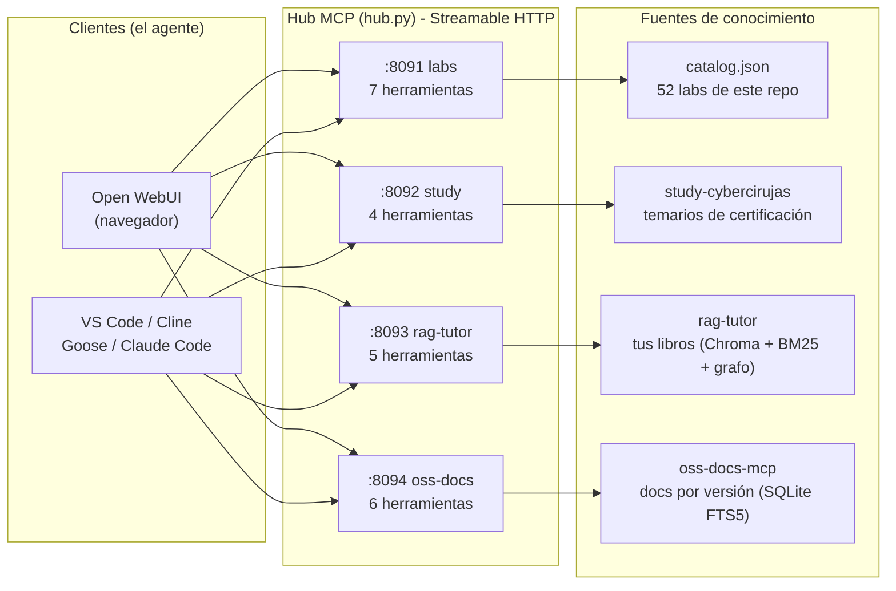
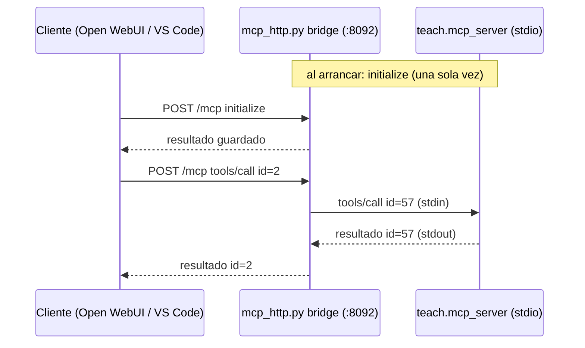

# Hub Multi-MCP: muchas fuentes, un solo agente

Hasta la Clase 7 el tutor tenía una sola fuente: los laboratorios de este repo. Esta guía suma tres más y las pone detrás del mismo agente, para que Open WebUI o VS Code puedan consultar **los laboratorios, los temarios de certificación, tus libros y la documentación oficial versionada** en una misma conversación.

Todo se maneja con un solo comando, [`hub/hub.py`](hub/hub.py), que solo usa la biblioteca estándar de Python.



## 1. Las cuatro fuentes

| id | Repo | Qué sabe | Herramientas | Puerto | ¿Se puede clonar? |
| :--- | :--- | :--- | :--- | :--- | :--- |
| `labs` | este repo | Los 52 laboratorios: ruta de aprendizaje, guía de cada lab, pistas socráticas | `get_student_roadmap`, `search_curriculum`, `get_lab_details`, `read_lab_guide`, `verify_student_readiness`, `get_progressive_hint`, `check_lab_environment` | 8091 | Sí |
| `study` | [study-cybercirujas](https://github.com/villadalmine/study-cybercirujas) | Temarios y teoría por objetivo de certificaciones (LPIC, CKA, CKAD, CKS, LF, NVIDIA) | `list_certs`, `get_syllabus`, `get_topic`, `search_topics` | 8092 | Sí |
| `rag-tutor` | [rag-tutor](https://github.com/villadalmine/rag-tutor) | Los libros y cursos que **vos** indexaste, con cita por sección | `listar_libros_y_secciones`, `buscar_fragmentos_secciones`, `leer_fragmentos` (versiones nuevas; con un modelo chico conviene `buscar_fragmentos_secciones` con `formato="completo"`, que trae el texto en una llamada), `consultar_grafo_kuzu`, `consultar_libros_manning`, `buscar_codigo_yaml` | 8093 | Sí, pero viene sin libros |
| `oss-docs` | [oss-docs-mcp](https://github.com/villadalmine/oss-docs-mcp) | Documentación oficial por versión de KServe, llm-d, vLLM, SGLang, agentgateway, Kubeflow, KEDA, Istio y otros | `list_projects`, `list_versions`, `search_docs`, `read_chunks`, `get_page_outline`, `whats_new` | 8094 | Sí; el índice se arma en tu máquina |

Dos consecuencias prácticas de la última columna:

- **rag-tutor** no distribuye libros. Cada persona indexa los suyos, o usa el del docente por la red (sección 6).
- **oss-docs** es público desde el 2026-11-14, pero su índice ocupa cerca de 1,2 GB de disco y tarda en armarse. Si la máquina no da, usá el del docente por la red (sección 6).

## 2. Requisitos

| Qué | Para qué | Obligatorio |
| :--- | :--- | :--- |
| Linux o WSL2, Python 3.10 o superior | correr `hub.py` y el MCP de labs | Sí |
| `git` | clonar los otros repos | Sí |
| [`uv`](https://docs.astral.sh/uv/) | crear los entornos Python de cada repo (trae el Python que haga falta) | Recomendado. Sin `uv` se usa `python3 -m venv` + `pip`, y ahí tu Python tiene que ser 3.12 o superior |
| `docker` o `podman` | el contenedor de Open WebUI | Solo para `hub.py webui` |
| Un modelo que sepa llamar herramientas | que el agente use los MCP | Solo para chatear: Ollama con `qwen2.5:7b` o mayor, o una API tipo OpenRouter |

Memoria: `labs`, `study` y `oss-docs` son livianos. `rag-tutor` carga un modelo de embeddings y ocupa cerca de 1 GB; Open WebUI ocupa otro tanto. Con 8 GB libres entra todo, sin contar el modelo de lenguaje.

## 3. Inicio rápido

Desde la raíz de este repo:

```bash
python3 ai/tutor/hub/hub.py doctor      # qué hay y qué falta
python3 ai/tutor/hub/hub.py setup       # clona repos, crea entornos, arma índices
python3 ai/tutor/hub/hub.py up          # levanta los MCP que estén listos
python3 ai/tutor/hub/hub.py corpus      # rag-tutor sin libros: indexa los labs de este repo como libro de ejemplo (1 a 2 min)
python3 ai/tutor/hub/hub.py verify      # prueba cada uno de punta a punta
python3 ai/tutor/hub/hub.py webui up    # Open WebUI con los MCP ya conectados
python3 ai/tutor/hub/hub.py webui agent # crea el modelo "Tutor del Hub"
```

Para bajar todo: `hub.py webui down` y `hub.py down`.

`hub.py corpus` le da libros a `rag-tutor` sin que tengas PDF propios: indexa las guías y el código de los laboratorios como un libro llamado `labs-practicos`. Si `rag-tutor` ya tiene un índice no lo toca (con `--force` lo suma).

`hub.py` nunca falla por un MCP que no podés tener: lo marca como omitido, te dice por qué y sigue con el resto. Con solo este repo clonado ya funciona `labs`.

## 4. Paso a paso

### 4.1 `doctor`: ver el estado

```text
Servidores MCP:
  labs       listo          :8091  /home/alumno/repos/labs
  study      NO LISTO       :8092  /home/alumno/repos/study-cybercirujas
             -> falta clonar el repo (hub.py setup)
  rag-tutor  NO LISTO       :8093  /home/alumno/repos/rag-tutor
             -> falta clonar el repo (hub.py setup)
  oss-docs   NO LISTO       :8094  /home/alumno/repos/oss-docs-mcp
             -> falta clonar el repo (hub.py setup)
```

Los repos se buscan como **hermanos** de este (la carpeta padre de `labs`). Para usar otra carpeta, definí `HUB_REPOS_DIR`.

### 4.2 `setup`: instalar lo que falta

Para cada servidor: clona el repo si no está, crea `.venv` dentro de ese repo e instala sus dependencias, y arma el índice si el servidor lo necesita. Si el repo ya existe **no lo toca** (ni `pull` ni cambios); si el entorno ya funciona, lo saltea.

```bash
python3 ai/tutor/hub/hub.py setup            # todos
python3 ai/tutor/hub/hub.py setup study      # solo uno
```

Lo que queda a mano:

- **rag-tutor: indexar libros.** Las dependencias pesan varios GB (PyTorch). Después copiá tus PDF, Markdown o subtítulos a `books/` y corré la ingesta dentro de ese repo:
  ```bash
  cd ../rag-tutor && .venv/bin/python src/ingest.py
  ```
  Hasta que no exista `chroma_db/`, el hub lo deja omitido.
- **oss-docs: armar el índice.** `setup` corre `oss-docs sync`, que baja la documentación desde los repos git de cada proyecto. La primera vez tarda varios minutos y necesita cerca de 1,2 GB libres en el disco donde está el repo (no en `/tmp`).

### 4.3 `up` y `verify`

```text
$ python3 ai/tutor/hub/hub.py up
  labs       OK  http://127.0.0.1:8091/mcp
  study      OK  http://127.0.0.1:8092/mcp
  rag-tutor  OK  http://127.0.0.1:8093/mcp
  oss-docs   OK  http://127.0.0.1:8094/mcp

$ python3 ai/tutor/hub/hub.py verify
  labs       OK   linux-labs-tutor | 7 herramientas | search_curriculum -> 5778 caracteres
  study      OK   teach-plat | 4 herramientas | list_certs -> 7377 caracteres
  rag-tutor  OK   Universal Technical RAG Tutor | 5 herramientas (6 desde que rag-tutor sumó leer_fragmentos) | listar_libros_y_secciones -> 22382 caracteres
  oss-docs   OK   oss-docs-mcp | 6 herramientas | list_projects -> 1222 caracteres
```

`verify` hace lo mismo que un cliente real: `initialize`, `tools/list` y una llamada a una herramienta de cada servidor. Si esto da OK, cualquier cliente MCP va a poder conectarse.

Otros comandos: `hub.py status`, `hub.py logs <id>`, `hub.py down [id]`. Los procesos quedan corriendo en segundo plano; los PID y los logs están en `ai/tutor/hub/.run/`.

## 5. Conectar los clientes

### 5.1 Open WebUI

```bash
python3 ai/tutor/hub/hub.py webui up
```

Levanta `ghcr.io/open-webui/open-webui` (versión fijada en [`hub/hub.json`](hub/hub.json)) en `http://127.0.0.1:3000` con los MCP **ya conectados**: no hay que cargar nada a mano en el panel. La lista sale de la variable `TOOL_SERVER_CONNECTIONS`, que `hub.py` genera desde el manifiesto.

Dos decisiones de diseño que conviene conocer:

- **Configuración como código** (`ENABLE_PERSISTENT_CONFIG=false`): lo que manda es lo que genera `hub.py`. Si cambiás conexiones desde el panel de administración, se pierden al reiniciar. Los usuarios, chats y modelos sí se guardan, en el volumen `labs-hub-webui-data`.
- **Sin login por defecto** (`WEBUI_AUTH=false`): pensado para tu propia máquina, y en ese modo Open WebUI solo escucha en `127.0.0.1`. Para abrirlo a otras personas hace falta `WEBUI_AUTH=true`.

**El modelo.** Open WebUI necesita un modelo de lenguaje que soporte llamadas a herramientas:

```bash
# Opción A: local con Ollama
ollama pull qwen2.5:7b

# Opción B: API compatible con OpenAI (en ai/tutor/hub/hub.env)
OPENAI_API_BASE_URL=https://openrouter.ai/api/v1
OPENAI_API_KEY=...
```

Después de cambiar `hub.env`, volvé a correr `hub.py webui up`.

**El agente.** Este comando crea el modelo **Tutor del Hub**: el modelo base, todos los MCP tildados, llamadas a herramientas en modo nativo y el prompt de [`hub/system_prompt_hub.md`](hub/system_prompt_hub.md), que le explica al modelo qué fuente usar para cada tipo de pregunta.

```bash
python3 ai/tutor/hub/hub.py webui agent                    # usa el primer modelo disponible
python3 ai/tutor/hub/hub.py webui agent --base qwen2.5:7b  # o elegís el modelo base
```

Abrí Open WebUI, elegí **Tutor del Hub** en el selector de modelos y preguntá. Si preferís no crear el modelo, en cualquier chat podés activar los MCP desde el botón de herramientas del cuadro de mensaje.

> [!IMPORTANT]
> Con modelos chicos (7B) las llamadas a herramientas tienen que estar en modo **nativo** (`function_calling: native`). `webui agent` ya lo deja así. Si armás el modelo a mano: Parámetros avanzados > Llamada a funciones > Nativa.

**Si ya tenés un Open WebUI andando**, no hace falta otro. Pedile al hub la lista de conexiones y cargala en la variable `TOOL_SERVER_CONNECTIONS` de tu instalación:

```bash
python3 ai/tutor/hub/hub.py config openwebui --compact --show-token
```

### 5.2 VS Code

```bash
mkdir -p .vscode
python3 ai/tutor/hub/hub.py config vscode > .vscode/mcp.json
```

VS Code detecta el archivo y ofrece iniciar los servidores; las herramientas aparecen en el modo agente del chat. Si el hub tiene token, el archivo **no lo contiene**: VS Code lo pide una vez y lo guarda en su almacén de secretos.

Como cliente HTTP, VS Code solo necesita la URL: sirve igual para tu hub local que para el del docente (`--host`).

### 5.3 Cline, Goose y Claude Code

```bash
python3 ai/tutor/hub/hub.py config cline         # pegar en cline_mcp_settings.json
python3 ai/tutor/hub/hub.py config goose         # pegar en ~/.config/goose/config.yaml
python3 ai/tutor/hub/hub.py config claude-code   # comandos 'claude mcp add' listos para correr
```

Con token, la salida muestra `<HUB_TOKEN>` en su lugar. Agregá `--show-token` para que escriba el valor real.

### 5.4 Cuándo conviene el MCP de labs por stdio

La herramienta `check_lab_environment` hace una radiografía de **la máquina donde corre el servidor** (discos, loop devices, memoria, servicios caídos). Por HTTP contra el hub del docente, esa máquina es la del docente, no la tuya. Por eso:

- en modo compartido el hub oculta esa herramienta;
- si querés que el tutor mire **tu** máquina mientras hacés un lab, conectá el MCP de labs por stdio como muestran [`mcp/cline_mcp_settings.json`](mcp/cline_mcp_settings.json) y [`mcp/goose_config.yaml`](mcp/goose_config.yaml). Las dos formas conviven.

## 6. Modo clase: el docente sirve, los alumnos se conectan

### 6.1 En la máquina del docente

```bash
cp ai/tutor/hub/hub.env.example ai/tutor/hub/hub.env
python3 ai/tutor/hub/hub.py token      # copiar el resultado a HUB_TOKEN
```

```ini
# ai/tutor/hub/hub.env
HUB_BIND=0.0.0.0
HUB_TOKEN=<el token generado>
HUB_PUBLIC_HOST=192.168.1.50          # la IP o el nombre con que los alumnos ven esta máquina
WEBUI_AUTH=true                       # si además querés compartir el Open WebUI
```

```bash
python3 ai/tutor/hub/hub.py up && python3 ai/tutor/hub/hub.py verify
```

Abrí en el firewall los puertos 8091 a 8094 (y el 3000 si compartís Open WebUI) solo hacia la red del aula. El hub se niega a escuchar en la red sin token.

### 6.2 En la máquina de cada alumno

**Opción A: solo el cliente.** No instala nada del hub. El docente genera la configuración y la comparte junto con el token:

```bash
python3 ai/tutor/hub/hub.py config vscode    # en la máquina del docente
```

El alumno guarda esa salida como `.vscode/mcp.json` y escribe el token cuando VS Code lo pide.

**Opción B: hub propio, mezclando local y remoto.** El alumno corre `labs` y `study` en su máquina y toma del docente lo que no puede tener:

```ini
# ai/tutor/hub/hub.env del alumno
HUB_URL_RAG_TUTOR=http://192.168.1.50:8093/mcp
HUB_TOKEN_RAG_TUTOR=<token del docente>
HUB_URL_OSS_DOCS=http://192.168.1.50:8094/mcp
HUB_TOKEN_OSS_DOCS=<token del docente>
```

```bash
python3 ai/tutor/hub/hub.py setup && python3 ai/tutor/hub/hub.py up
python3 ai/tutor/hub/hub.py verify     # prueba los locales y los remotos
python3 ai/tutor/hub/hub.py webui up   # su Open WebUI ve los cuatro
```

## 7. Cómo funciona por dentro (para explicarlo en clase)

MCP define dos transportes. **stdio**: el cliente lanza el servidor como proceso hijo y se hablan por entrada y salida estándar, sirve para un cliente en la misma máquina. **Streamable HTTP**: el servidor escucha en una URL y recibe cada mensaje JSON-RPC por `POST`, sirve para muchos clientes y por la red. Open WebUI solo habla el segundo.

De los cuatro servidores, `study` y `rag-tutor` solo hablan stdio. El hub resuelve eso con dos piezas de [`mcp/mcp_http.py`](mcp/mcp_http.py), unas 400 líneas sin dependencias:

1. **Servidor HTTP mínimo.** Recibe el `POST`, se lo pasa a una función `handle_message(dict) -> dict` y devuelve el JSON. `labs_mcp_server.py --transport http` usa esto directamente.
2. **Puente stdio a HTTP.** Lanza el servidor stdio como proceso hijo **una sola vez** y reparte sobre él los pedidos de todos los clientes. Contesta el `initialize` de cada cliente con el resultado que guardó, y reescribe los `id` de los mensajes para que dos clientes no se pisen. Así no hay que modificar los otros repos.



El protocolo se puede mostrar con `curl`, sin ningún cliente:

```bash
# 1. ¿Qué herramientas ofrece el servidor?
curl -s http://127.0.0.1:8091/mcp -H 'Content-Type: application/json' \
  -d '{"jsonrpc":"2.0","id":1,"method":"tools/list"}' | python3 -m json.tool | head -30

# 2. Llamar a una herramienta
curl -s http://127.0.0.1:8091/mcp -H 'Content-Type: application/json' \
  -d '{"jsonrpc":"2.0","id":2,"method":"tools/call","params":{"name":"search_curriculum","arguments":{"query":"zfs"}}}' \
  | python3 -c 'import json,sys; print(json.load(sys.stdin)["result"]["content"][0]["text"][:600])'

# 3. Lo mismo contra un servidor stdio que pasa por el puente
curl -s http://127.0.0.1:8092/mcp -H 'Content-Type: application/json' \
  -d '{"jsonrpc":"2.0","id":3,"method":"tools/call","params":{"name":"list_certs","arguments":{}}}' \
  | python3 -c 'import json,sys; print(json.load(sys.stdin)["result"]["content"][0]["text"][:600])'
```

Preguntas para la clase:

- ¿Por qué el puente mantiene un solo proceso hijo en vez de lanzar uno por cliente? (Pista: ¿cuánto tarda en arrancar `rag-tutor`?)
- Si dos clientes mandan un mensaje con `"id": 1` al mismo tiempo, ¿cómo sabe el puente a quién devolverle cada respuesta?
- ¿Qué diferencia hay entre que el modelo "sepa" algo y que lo busque con una herramienta? ¿Cuál de las dos respuestas podés auditar?

## 8. Guion de demo (15 minutos)

1. `hub.py doctor` y `hub.py up`: mostrar que son cuatro procesos y cuatro puertos.
2. Los tres `curl` de la sección 7: el protocolo a la vista.
3. `hub.py webui up`, abrir el navegador, elegir **Tutor del Hub**.
4. Una pregunta por fuente, mirando qué herramienta elige el modelo:

| Pregunta | Fuente esperada |
| :--- | :--- |
| "Quiero practicar RAID, ¿qué laboratorios hay y por cuál empiezo?" | `labs` |
| "¿Qué entra en el examen LPIC-1 sobre sistemas de archivos?" | `study` |
| "¿Qué dicen mis libros sobre el patrón sidecar? Citá el libro." | `rag-tutor` |
| "¿Cómo se configura el autoscaling con KEDA en KServe? Decime de qué versión es la doc." | `oss-docs` |

5. Una pregunta que cruza dos fuentes: "Estoy preparando el objetivo de LVM de LPIC-1, ¿con qué laboratorio del curso lo practico?" El agente tiene que consultar `study` y `labs`.
6. `hub.py config vscode`: el mismo hub, otro cliente.

## 9. Agregar otro MCP

Un servidor nuevo es un bloque más en [`hub/hub.json`](hub/hub.json). Ejemplo ilustrativo con un servidor stdio de otro repo (ajustá módulo, comando y herramienta según su README):

```json
{
  "id": "k8s-docs",
  "title": "k8s-docs",
  "description": "Documentación oficial de Kubernetes y manifiestos YAML canónicos.",
  "port": 8095,
  "mode": "bridge",
  "repo": {"dir": "k8s-docs-mcp", "url": "https://github.com/villadalmine/k8s-docs-mcp.git"},
  "venv": {"python": "3.12", "install": ["-e", "."]},
  "check": [".venv/bin/python", "-c", "import k8s_docs_mcp"],
  "cmd": [".venv/bin/k8s-docs-mcp"],
  "smoke": {"tool": "<una herramienta de solo lectura>", "arguments": {}}
}
```

| Campo | Significado |
| :--- | :--- |
| `mode` | `bridge`: servidor stdio envuelto por el puente. `native`: el servidor ya habla HTTP con `mcp_http.py` |
| `repo` | carpeta dentro de `HUB_REPOS_DIR` y URL para clonar (`null` si no es público) |
| `venv.install` | argumentos de `pip install` para crear el entorno |
| `check` | comando que devuelve 0 cuando el entorno está listo |
| `data` | archivo que tiene que existir, y opcionalmente cómo construirlo |
| `cmd` | cómo se lanza el servidor stdio, relativo al repo |
| `smoke` | herramienta de solo lectura que `verify` llama para probarlo |

La `description` importa: es lo que lee el modelo para decidir a qué servidor ir. Si agregás una fuente, sumala también a [`hub/system_prompt_hub.md`](hub/system_prompt_hub.md) y volvé a correr `webui up` y `webui agent`.

## 10. Seguridad y límites

- **Por defecto todo escucha en `127.0.0.1`.** En ese modo el servidor además rechaza pedidos cuya cabecera `Host` no sea local, para que una página web maliciosa no pueda llegar a tus MCP desde el navegador.
- **En red, token obligatorio.** El token viaja en `Authorization: Bearer`. Se pasa a los procesos por variable de entorno, no por línea de comandos, así que no aparece en `ps`.
- **Sin TLS.** El tráfico va en claro: usalo en la red del aula o detrás de una VPN, no lo publiques a internet. Para eso hace falta un proxy con HTTPS y autenticación delante.
- **Solo lectura.** Las herramientas de los cuatro servidores consultan contenido; ninguna modifica el sistema. `check_lab_environment` ejecuta comandos de diagnóstico de solo lectura y se oculta en modo compartido.
- **Lo que el transporte no hace:** solo herramientas (no recursos ni prompts de MCP), sin sesiones y sin streaming de progreso.
- **Derechos de autor.** `rag-tutor` devuelve fragmentos de los libros indexados. Compartirlo en el aula es compartir esos fragmentos: indexá solo material que puedas compartir.

## 11. Problemas comunes

| Síntoma | Causa y solución |
| :--- | :--- |
| `up` dice `OMITIDO` | Falta algo de ese servidor. El mensaje dice qué; `hub.py doctor` lo repite |
| `ERROR: el puerto 809x ya está en uso` | Otro proceso usa el puerto. Cambiá `port` en `hub.json` |
| `verify` da `FALLA HTTP 401` | Token incorrecto o faltante (`HUB_TOKEN`, o `HUB_TOKEN_<ID>` para un remoto) |
| `rag-tutor` tarda en quedar `OK` | Normal: carga el modelo de embeddings, entre 20 y 60 segundos |
| Open WebUI no muestra modelos | No hay Ollama ni API configurada. Ver sección 5.1 |
| El modelo no llama a las herramientas | Llamada a funciones en modo nativo, y un modelo que la soporte. Los de 3B suelen fallar |
| El modelo inventa `lab_id` o ids de chunks | Típico de modelos chicos. El prompt del hub lo mitiga; un modelo más grande lo resuelve |
| `webui up` no arranca con Docker Desktop en macOS o Windows | El contenedor usa la red del host, que ahí no funciona igual. Usá WSL2 o Linux |
| Cambié `hub.json` y Open WebUI no lo ve | Volvé a correr `hub.py webui up`: recrea el contenedor con la lista nueva |

## 12. Archivos

| Archivo | Qué es |
| :--- | :--- |
| [`hub/hub.py`](hub/hub.py) | El comando: `doctor`, `setup`, `up`, `down`, `status`, `logs`, `verify`, `config`, `token`, `webui` |
| [`hub/hub.json`](hub/hub.json) | Manifiesto de servidores: única fuente de verdad |
| [`hub/hub.env.example`](hub/hub.env.example) | Variables de configuración, comentadas |
| [`hub/system_prompt_hub.md`](hub/system_prompt_hub.md) | Prompt del modelo "Tutor del Hub" |
| [`hub/test_hub.py`](hub/test_hub.py) | Pruebas del transporte y del puente (las corre el CI) |
| [`mcp/mcp_http.py`](mcp/mcp_http.py) | Transporte Streamable HTTP y puente stdio a HTTP |
| [`mcp/labs_mcp_server.py`](mcp/labs_mcp_server.py) | MCP de labs, ahora con `--transport http` |
