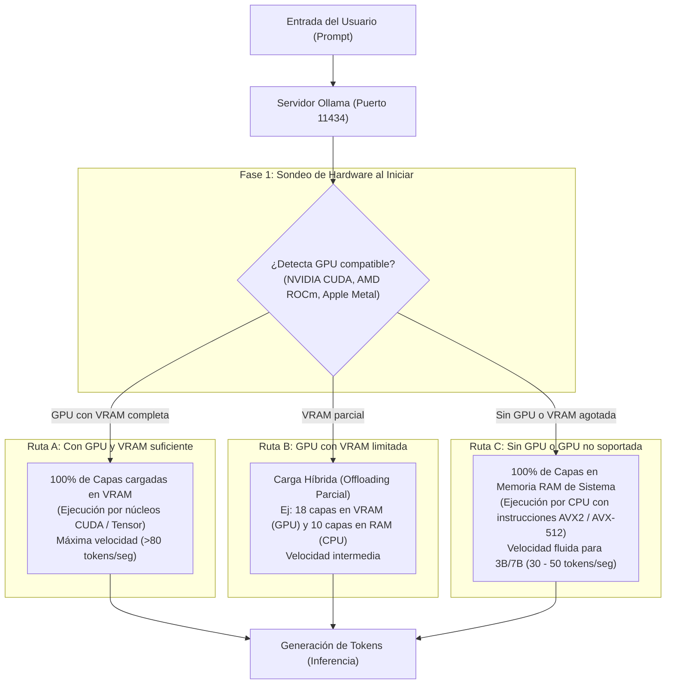

# ⚙️ Guía Maestra de Ollama: Instalación, Gestión de Hardware y Diagnóstico de CPU vs RAM / VRAM

Esta guía profundiza en el funcionamiento interno de [**Ollama**](GLOSARIO.md#ollama), cómo instalarlo en diferentes sistemas operativos, cómo decide automáticamente qué hardware utilizar (GPU con [VRAM](GLOSARIO.md#vram-video-ram) vs CPU con [memoria RAM](GLOSARIO.md#ram-de-sistema-y-ancho-de-banda-memory-bandwidth) de sistema) y cómo puedes supervisar o forzar este comportamiento.

> [!NOTE] Conceptos y Términos Técnicos
> Si deseas profundizar en la teoría detrás de la [inferencia](GLOSARIO.md#inferencia-inference), la [cuantización GGUF](GLOSARIO.md#cuantizacion-quantization-y-gguf) o el [KV Cache](GLOSARIO.md#kv-cache-key-value-cache), consulta el [**`GLOSARIO.md`**](GLOSARIO.md) con enlaces a la documentación y papers oficiales.

---

## 🗺️ Mapa Conceptual: El Motor de Ollama y la Distribución de Memoria



---

## 📥 1. Instalación de Ollama por Sistema Operativo

### A. Windows (Nativo)
1. **Descarga:** Ve a [ollama.com/download/windows](https://ollama.com/download/windows) y descarga `OllamaSetup.exe`.
2. **Instalación:** Ejecuta el instalador. Ollama se configurará automáticamente como un proceso de fondo y agregará su icono a la bandeja del sistema (System Tray).
3. **Instalación vía terminal (Winget):**
   ```powershell
   winget install Ollama.Ollama
   ```
4. **Verificación:** Abre PowerShell o CMD y escribe:
   ```powershell
   ollama --version
   ```

### B. Linux y WSL2 (Ubuntu / Debian / RHEL / Arch)
1. **Instalación en un solo comando:**
   ```bash
   curl -fsSL https://ollama.com/install.sh | sh
   ```
   *Este script detecta tu distribución, crea un usuario del sistema `ollama`, descarga los binarios de `llama.cpp` compilados para tu arquitectura y registra un servicio de `systemd`.*
2. **Control del servicio en Linux:**
   ```bash
   # Ver estado del servicio
   sudo systemctl status ollama

   # Reiniciar o detener el servicio
   sudo systemctl restart ollama
   sudo systemctl stop ollama
   ```
3. **Para usuarios de WSL2 (Windows Subsystem for Linux):**
   * Puedes instalarlo dentro de WSL2 con el comando `curl` anterior.
   * Si tienes GPU NVIDIA en Windows y los drivers oficiales instalados en el host, WSL2 tiene paso directo (*passthrough*) a CUDA y Ollama dentro de WSL2 detectará la GPU de inmediato.

### C. macOS (Apple Silicon y x86)
1. Descarga el paquete `.zip` desde [ollama.com/download/mac](https://ollama.com/download/mac) y arrastra `Ollama.app` a tu carpeta de Aplicaciones.
2. O vía Homebrew:
   ```bash
   brew install ollama
   ```
3. En Macs con chips M1/M2/M3/M4, Ollama utiliza la **Memoria Unificada** a través de **Metal**, logrando un rendimiento extremo sin necesidad de configurar nada.

---

## 🧠 2. ¿Cómo Sabe Ollama si Usar CPU + RAM o GPU + VRAM?

Ollama utiliza por debajo el motor **`llama.cpp`**, el cual implementa una arquitectura basada en **[Capas Transformer](GLOSARIO.md#capas-del-transformer-transformer-layers)** (*Transformer Layers*).

### El Proceso de Decisión Automático

Cuando ejecutas un comando como `ollama run llama3.2:3b`:

1. **Sondeo del Sistema:** Ollama examina las bibliotecas dinámicas del sistema:
   * Busca controladores NVIDIA con soporte **CUDA** (`libcuda.so` / `nvcuda.dll`).
   * Busca controladores AMD con soporte **ROCm**.
   * En macOS, inicializa el framework **Metal**.
2. **Cálculo de Espacio Disponible:**
   * Si encuentra una GPU, consulta cuánta memoria de video (**[VRAM](GLOSARIO.md#vram-video-ram)**) libre tiene disponible en ese instante.
   * Lee el archivo del modelo (formato **[GGUF](GLOSARIO.md#cuantizacion-quantization-y-gguf)**) y calcula cuántos megabytes pesa cada capa del modelo más el buffer de contexto (**[KV Cache](GLOSARIO.md#kv-cache-key-value-cache)**).
3. **Descarga de Capas (*[Layer Offloading](GLOSARIO.md#descarga-de-capas-layer-offloading)*):**
   * Un modelo como `llama3.2:3b` tiene **28 capas**.
   * Si tu GPU tiene al menos 3 GB de VRAM libres, Ollama asignará:
     $$\text{Capas en GPU} = 28 / 28 \quad (100\% \text{ en VRAM})$$
   * Si tienes una GPU integrada o con poca memoria (ej. solo 1.5 GB libres), Ollama repartirá:
     $$\text{Capas en GPU} = 14 \quad | \quad \text{Capas en CPU} = 14 \quad (\text{Modo Híbrido})$$
   * Si no tienes GPU dedicada o la memoria no alcanza:
     $$\text{Capas en GPU} = 0 \quad (100\% \text{ en [RAM de Sistema](GLOSARIO.md#ram-de-sistema-y-ancho-de-banda-memory-bandwidth)})$$

---

## 🔍 3. Cómo Comprobar en Tiempo Real Qué Hardware se Está Usando

No necesitas adivinar qué está haciendo tu máquina; existen dos formas precisas de comprobarlo:

### Método 1: El comando `ollama ps` (El más rápido)
Mientras el modelo está respondiendo o tras haber hecho una consulta, abre otra terminal y ejecuta:

```bash
ollama ps
```

**Ejemplo de Salida 1: Usando 100% GPU (VRAM)**
```text
NAME            ID              SIZE      PROCESSOR    UNTIL
llama3.2:3b     a849fc6642d3    2.0 GB    100% GPU     4 minutes from now
```

**Ejemplo de Salida 2: Usando 100% CPU (Memoria RAM)**
```text
NAME            ID              SIZE      PROCESSOR    UNTIL
llama3.2:3b     a849fc6642d3    2.0 GB    100% CPU     4 minutes from now
```

**Ejemplo de Salida 3: Modo Híbrido (CPU + GPU)**
```text
NAME            ID              SIZE      PROCESSOR             UNTIL
llama3.2:3b     a849fc6642d3    2.0 GB    48%/52% CPU/GPU       4 minutes from now
```

---

### Método 2: Inspeccionar los Logs del Servidor de Ollama

Los registros del servidor muestran el cálculo exacto de capas transferidas al inicializar el modelo.

* **En Linux (con systemd):**
  ```bash
  journalctl -u ollama -f -n 50
  ```
* **En Windows / Ejecución manual:**
  Si detienes el servicio y ejecutas en consola `ollama serve`, verás líneas como esta:
  ```text
  source=server.go:588 msg="offload to cuda" layers.requested=-1 layers.model=28 layers.offload=28
  source=server.go:610 msg="total VRAM available: 6144 MB, required: 2200 MB"
  ```
  Si ves `layers.offload=0`, significa que todas las operaciones matemáticas las está realizando tu procesador (**CPU**).

---

## 🎛️ 4. Cómo Forzar a Ollama a Usar CPU o Modificar el Hardware

A veces quieres reservar tu GPU para otras tareas (renderizado, juegos, edición) y deseas que Ollama corra exclusivamente en la memoria RAM y procesador.

### Opción A: Desactivar la GPU mediante Variables de Entorno

* **En Linux (temporal para la sesión):**
  ```bash
  # Deshabilita la visibilidad de dispositivos CUDA
  CUDA_VISIBLE_DEVICES="" ollama serve
  ```

* **En Linux (permanente en el servicio systemd):**
  1. Edita la configuración del servicio:
     ```bash
     sudo systemctl edit ollama.service
     ```
  2. Añade este bloque:
     ```ini
     [Service]
     Environment="CUDA_VISIBLE_DEVICES="
     ```
  3. Aplica los cambios:
     ```bash
     sudo systemctl daemon-reload
     sudo systemctl restart ollama
     ```

* **En Windows (PowerShell):**
  ```powershell
  $env:CUDA_VISIBLE_DEVICES=""
  ollama serve
  ```

### Opción B: Forzar CPU en un Modelo Personalizado (`Modelfile`)

Puedes crear una variante de cualquier modelo fijando el parámetro `num_gpu` en `0`:

1. Crea un archivo llamado `Modelfile_cpu`:
   ```dockerfile
   FROM llama3.2:3b
   # Forzar 0 capas en GPU (100% en CPU + RAM)
   PARAMETER num_gpu 0
   # Limitar hilos de CPU para no saturar tu maquina (ej. 4 hilos)
   PARAMETER num_thread 4
   ```
2. Compila el modelo local:
   ```bash
   ollama create llama-cpu -f Modelfile_cpu
   ```
3. Ejecútalo:
   ```bash
   ollama run llama-cpu
   ```

---

## ⚡ 5. Memoria RAM vs Memoria VRAM: ¿Por Qué Importa la Diferencia?

Para comprender por qué una GPU es más rápida que una CPU en inteligencia artificial, el secreto no es la fuerza bruta de cálculo, sino el **Ancho de Banda de la Memoria (Memory Bandwidth)**:

| Característica | Memoria RAM de Sistema (DDR4 / DDR5) | Memoria VRAM de Tarjeta Gráfica (GDDR6 / HBM) |
| :--- | :--- | :--- |
| **Ubicación** | Placa madre de tu computadora. | Integrada soldada junto al chip de la GPU. |
| **Capacidad Típica** | 8 GB, 16 GB, 32 GB, 64 GB. | 4 GB, 6 GB, 8 GB, 12 GB, 16 GB. |
| **Ancho de Banda** | **30 a 80 GB/s** | **300 a 1000+ GB/s** (10x a 20x más rápido). |
| **Ventaja Principal** | Muy barata, expandible y disponible en toda PC. | Transferencia de datos ultra veloz para matrices. |
| **Velocidad con Llama 3.2 (3B)** | **30 a 50 tokens/seg** (completamente fluido). | **80 a 140 tokens/seg** (instantáneo). |

### 💡 ¿Es suficiente una CPU con Memoria RAM para este curso?
**Sí, rotundamente.** 
A diferencia de los modelos gigantescos de 70 mil millones de parámetros (que en CPU son lentos), los modelos modernos optimizados para desarrollo como `llama3.2:3b` o `qwen2.5-coder:1.5b` solo pesan 2 GB y necesitan mover muy pocos datos por token. 

A **35 tokens por segundo en un procesador Intel i5 o AMD Ryzen**, el modelo escribe más rápido de lo que un ser humano puede leer en tiempo real, garantizando una experiencia de tutoría perfecta sin gastar en hardware costoso.
