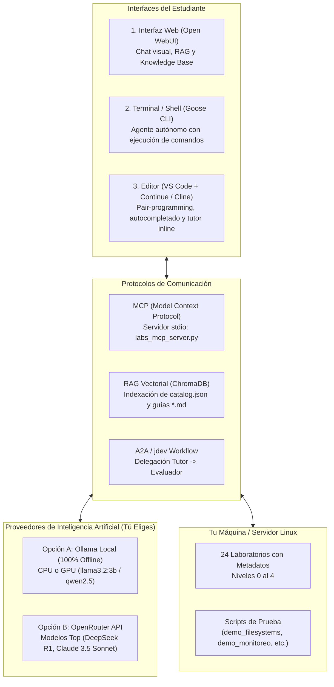
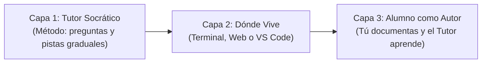

# Guía Maestra: Entorno de Aprendizaje con IA Local, Protocolos Modernos (MCP, A2A, jdev, RAG), Open WebUI, Goose CLI y VS Code

Esta guía paso a paso te enseña a armar un **entorno integral de estudio y tutoría asistido por Inteligencia Artificial** para dominar la administración de servidores Linux.

Aprenderás a conectar interfaces visuales (**[Open WebUI](GLOSARIO.md#open-webui)**), agentes autónomos de terminal (**Goose CLI**) y tu editor de código (**VS Code**) tanto con **modelos 100% locales en tu CPU/GPU ([Ollama](GLOSARIO.md#ollama))** como con **APIs en la nube (OpenRouter)**, utilizando los protocolos modernos de la industria:
* **[MCP (Model Context Protocol)](GLOSARIO.md#mcp-model-context-protocol):** Estándar abierto para que los modelos invoquen herramientas del catálogo de laboratorios y de la terminal.
* **[RAG (Retrieval-Augmented Generation)](GLOSARIO.md#rag-retrieval-augmented-generation):** Recuperación semántica de conceptos sobre el plan de estudios.
* **[A2A (Agent-to-Agent)](GLOSARIO.md#a2a-agent-to-agent) & jdev:** Patrones de interacción donde un agente tutor delega tareas a un agente evaluador o ejecutor de comandos.
* **Voz Local (Voice-to-Voice en CPU):** Módulo opcional para hablarle al tutor por micrófono y escuchar sus explicaciones en tiempo real sin GPU.

> [!NOTE] Glosario de Conceptos de IA
> Todos los términos técnicos y arquitecturas de hardware cuentan con definiciones y enlaces a su documentación oficial en el [**`GLOSARIO.md`**](GLOSARIO.md).

---

## 🏗️ Arquitectura General del Ecosistema



---

## 🎓 Filosofía Pedagógica: Las 3 Capas de Adopción de tu Tutor

Para sacar el máximo provecho de este entorno, es fundamental entender que tu Tutor de IA **no es un buscador comercial ni un chatbot que te regala la respuesta**: está diseñado bajo los principios de **soberanía tecnológica y aprendizaje profundo**.



### Capa 1: El Tutor Socrático vs. El Chatbot "Solucionador"
Un chatbot comercial común te entrega el comando completo para copiar y pegar. En la administración de sistemas Linux, **copiar y pegar sin entender destruye el aprendizaje**: no aprendés qué pasa en el kernel ni cómo diagnosticar cuando un servicio se cae en producción.

Tu Tutor (configurado con `system_prompt_tutor.md` y la herramienta MCP `get_progressive_hint`) opera bajo el **método socrático**:
1. **No regala el comando final:** Te guía mediante pistas graduadas:
   * **Nivel 1 (Concepto):** Te explica el mecanismo del kernel involucrado (ej: *"¿Quién es el responsable de leer el código de salida de un proceso hijo?"*).
   * **Nivel 2 (Búsqueda):** Te señala qué comando, llamada al sistema o ruta en `/proc` o `/sys` tenés que inspeccionar.
   * **Nivel 3 (Sintaxis análoga):** Te muestra un ejemplo de referencia análogo para que vos deduzcas tu solución.
2. **Inspección en vivo:** Mediante la herramienta MCP `check_lab_environment`, el tutor puede tomar una radiografía de solo lectura de tu máquina Linux (discos, loop devices, memoria, inodos, zombies) y decirte exactamente dónde estás parado sin que tengas que pegar 50 líneas de consola.
3. **Seguridad y Human-in-the-Loop (HITL):** En la terminal con Goose o en VS Code con Cline, el agente nunca ejecuta comandos destructivos de forma arbitraria; opera dentro de un [Harness](GLOSARIO.md#harness-entorno-de-ejecucion-evaluacion-y-sandbox) que exige confirmación explícita ([Human-in-the-Loop](GLOSARIO.md#human-in-the-loop-hitl)) antes de escribir o modificar el sistema de archivos.

### Capa 2: Dónde Vive tu Tutor (Elige tu Interfaz según tu Tarea)
El mismo motor de tutoría (`labs_mcp_server.py` + `catalog.json` + RAG) se adapta al lugar donde estés trabajando:

| Interfaz | Cuándo Usarla | Cliente Configurado |
| :--- | :--- | :--- |
| **Terminal / Shell** | Cuando estás ejecutando scripts (`demo_*.sh`), rompiendo discos o compilando código C. | **Goose CLI** (`goose_config.yaml`) |
| **Web Interactiva** | Para estudiar teoría profunda, hacer preguntas conceptuales cruzadas o consultar certificaciones. | **Open WebUI / AnythingLLM** (`openwebui_tools.py`) |
| **Editor de Código** | Para programar scripts en Bash/C, crear manifiestos de Terraform o documentar tus propios labs. | **VS Code + Continue / Cline** (`cline_mcp_settings.json`) |

### Capa 3: El Alumno como Autor (Soberanía Técnica y RAG Incremental)
El mayor salto de aprendizaje ocurre cuando vos mismo documentás lo aprendido:
1. Al terminar un laboratorio o resolver un problema en tu servidor, creás un archivo Markdown en `linux/administrator/` (ej: `mi_experiencia_btrfs.md`).
2. Ejecutás `python linux/administrator/manage_catalog.py sync` y `python ai/tutor/mcp/prepare_rag_corpus.py`.
3. Al instante, **tu propio Tutor incorpora tus notas y código a su base de conocimiento**, permitiéndote preguntarle sobre tus propios laboratorios.

---

## ⚙️ Paso 1: Configurar el Proveedor de Modelos (Ollama Local vs OpenRouter)

Puedes elegir entre correr los modelos 100% en tu máquina o conectarte a la API unificada de OpenRouter:

### Opción A: 100% Local con Ollama (CPU o GPU, Sin Costo, Privado)
1. Instala Ollama:
   * **Windows:** Descarga e instala desde [ollama.com](https://ollama.com) o ejecuta `winget install Ollama.Ollama`.
   * **Linux / WSL2:** `curl -fsSL https://ollama.com/install.sh | sh`
   * **macOS:** Descarga el instalador o ejecuta `brew install ollama`.

> [!TIP] Gestión de Hardware y CPU vs GPU
> Para entender a fondo cómo Ollama decide si usar tu tarjeta gráfica (**VRAM**) o tu procesador (**RAM de sistema**), cómo auditarlo con `ollama ps` o cómo forzar 100% CPU, consulta la guía especializada: [**`GUIA_OLLAMA_HARDWARE.md`**](GUIA_OLLAMA_HARDWARE.md).

2. Descarga los modelos optimizados:
   ```bash
   # Modelo de lenguaje para el tutor (2.0 GB - corre a 35 tokens/seg en CPU)
   ollama pull llama3.2:3b

   # Modelo de embeddings para RAG (274 MB)
   ollama pull nomic-embed-text

   # (Opcional) Si quieres autocompletado de código rápido en VS Code:
   ollama pull qwen2.5-coder:1.5b
   ```

### Opción B: Conexión Cloud con OpenRouter (Modelos de Razonamiento como DeepSeek R1 o Claude 3.5)
Si prefieres usar modelos más grandes sin consumir CPU ni RAM local:
1. Crea una cuenta en [openrouter.ai](https://openrouter.ai).
2. Genera una API Key en **Keys** -> **Create Key**.
3. Guarda tu variable de entorno:
   ```bash
   # En Linux / WSL:
   export OPENROUTER_API_KEY="sk-or-v1-tu-clave..."
   
   # En Windows PowerShell:
   $env:OPENROUTER_API_KEY="sk-or-v1-tu-clave..."
   ```
> [!NOTE]
> OpenRouter ofrece acceso a modelos como `deepseek/deepseek-r1`, `meta-llama/llama-3.3-70b-instruct` o `anthropic/claude-3.5-sonnet` pagando fracciones de centavo por consulta o usando modelos con cuota gratuita.

---

## 🌐 Paso 2: Interfaz Visual y RAG con Open WebUI

Open WebUI te ofrece una experiencia similar a ChatGPT en tu navegador, integrada con RAG local y herramientas personalizadas. Puedes iniciarlo con Docker o de forma nativa con Python:

### Opción 1: Iniciar Open WebUI con Docker (Recomendado)
```bash
docker run -d -p 3000:8080 \
  --add-host=host.docker.internal:host-gateway \
  -v open-webui:/app/backend/data \
  --name open-webui --restart always \
  ghcr.io/open-webui/open-webui:main
```
Abre en tu navegador: `http://localhost:3000`.

### Opción 2: Iniciar Open WebUI con Python (Sin Docker)
Si no tienes Docker instalado o prefieres no usar contenedores:
```bash
# Se recomienda crear un entorno virtual con Python 3.11 o 3.12
python -m venv venv_openwebui

# En Linux/macOS:
source venv_openwebui/bin/activate
# En Windows PowerShell:
.\venv_openwebui\Scripts\Activate.ps1

# Instalar Open WebUI
pip install open-webui

# Iniciar el servidor
open-webui serve
```
Abre en tu navegador: `http://localhost:8080`.
*(Al correr en tu propio sistema operativo, Open WebUI se conecta automáticamente a Ollama en `http://127.0.0.1:11434` sin necesidad de configurar hostnames especiales).*

### 2. Conectar Open WebUI a tu Backend
* **Si usas Ollama Local (con Docker):** Viene configurado por defecto apuntando a `http://host.docker.internal:11434`.
* **Si usas Ollama Local (con Python):** Se conecta directamente a `http://127.0.0.1:11434`.
* **Si usas OpenRouter:** En **Admin Settings** -> **Connections** -> **OpenAI API**:
  * URL: `https://openrouter.ai/api/v1`
  * Key: Tu `OPENROUTER_API_KEY`.
  * Presiona el botón de recargar modelos y aparecerán todos los modelos de OpenRouter.

### 3. Cargar la Base de Conocimiento (RAG)
1. Ve a **Workspace** -> **Knowledge** -> **+**.
2. Crea una colección llamada `Laboratorios Linux`.
3. Arrastra el archivo [`linux/administrator/catalog.json`](file:///C:/Users/rino/Documents/GitHub/labs/linux/administrator/catalog.json) y las carpetas de guías Markdown.
4. El motor creará los embeddings con `nomic-embed-text` en segundos.

### 4. Instalar las Herramientas del Tutor en Open WebUI
1. Ve a **Workspace** -> **Tools** -> **+ (Add Tool)**.
2. Abre el archivo [`ai/tutor/mcp/openwebui_tools.py`](file:///C:/Users/rino/Documents/GitHub/labs/ai/tutor/mcp/openwebui_tools.py), copia todo su contenido y pégalo en el editor de Open WebUI.
3. Guarda la herramienta. Ahora el modelo en Open WebUI puede invocar `get_student_roadmap` y `search_curriculum` de forma nativa.

---

## 💻 Paso 3: Agente Autónomo de Terminal con Goose CLI (Block)

[Goose](https://github.com/block/goose) es un agente autónomo de código abierto creado por Block para la terminal. Es ideal para estudiantes de Linux porque **puede ejecutar comandos bash reales, diagnosticar errores en vivo, reparar servicios caídos y consultar el servidor MCP de este repositorio**.

### 1. Instalar Goose CLI
* **En Linux / WSL2:**
  ```bash
  curl -fsSL https://github.com/block/goose/releases/download/stable/download_cli.sh | bash
  ```
* **En Windows:** Descarga el binario o instálalo vía `pipx install goose-ai` o `cargo install goose-cli`.

### 2. Configurar Goose con el Servidor MCP de Laboratorios
Copia la plantilla [`ai/tutor/mcp/goose_config.yaml`](file:///C:/Users/rino/Documents/GitHub/labs/ai/tutor/mcp/goose_config.yaml) a tu carpeta de configuración de Goose:

```bash
mkdir -p ~/.config/goose
cp ai/tutor/mcp/goose_config.yaml ~/.config/goose/config.yaml
```

Contenido clave de la configuración:
```yaml
# ~/.config/goose/config.yaml
provider: ollama        # o 'openrouter'
model: llama3.2:3b      # o 'deepseek/deepseek-r1'

extensions:
  linux_labs_tutor:
    name: linux_labs_tutor
    cmd: python
    args:
      - "ai/tutor/mcp/labs_mcp_server.py"
    type: stdio
    enabled: true
  developer:
    enabled: true       # Permite a Goose ejecutar comandos shell seguros
```

### 3. Iniciar una Sesión de Tutoría en Terminal con Goose
Ejecuta en la raíz del repositorio:

```bash
goose session
```

**Ejemplo de interacción real en la terminal:**
> **Tú:** *"Hola Goose, soy alumno, estoy en WSL2 con Ubuntu 24.04 y quiero empezar a practicar almacenamiento. ¿Qué laboratorio me recomiendas?"*

> **Goose:**
> 1. Invoca automáticamente la herramienta MCP `get_student_roadmap(environment='WSL2')`.
> 2. Te responde que el siguiente laboratorio es `lab-3.1-anatomia-filesystems`.
> 3. Lee la guía con `read_lab_guide(lab_id='lab-3.1-anatomia-filesystems')`.
> 4. Te ofrece ejecutar `demo_filesystems.sh` paso a paso o simular un rescate de superbloque con `e2fsck -b 32768`.

---

## 📝 Paso 4: Integración en VS Code (Continue.dev y Cline)

Para que puedas leer las guías, inspeccionar los scripts de demostración o editar código de Terraform teniendo al tutor al lado en el editor:

### Opción 1: Continue.dev (Extensión de VS Code)
1. Instala la extensión **Continue** (`continue.continue`) desde el Marketplace de VS Code.
2. Copia el archivo [`ai/tutor/mcp/continue_config.json`](file:///C:/Users/rino/Documents/GitHub/labs/ai/tutor/mcp/continue_config.json) a `~/.continue/config.json`.
3. Ya tendrás:
   * **Chat con el Tutor:** Presiona `Ctrl + L` para preguntarle dudas sobre cualquier archivo que tengas abierto.
   * **Comando `@tutor`:** Selecciona un fragmento de script Bash o Makefile y escribe `/tutor` para que te explique qué hace cada línea del kernel.
   * **Autocompletado Tab:** Sugerencias automáticas en scripts `.sh` corriendo en tu CPU con `qwen2.5-coder:1.5b`.

### Opción 2: Cline / Roo Code (Agente Autónomo en VS Code)
1. Instala la extensión **Cline** (`saoudrizwan.claude-dev`).
2. Abre la pestaña de MCP en Cline y añade el servidor configurado en [`ai/tutor/mcp/cline_mcp_settings.json`](file:///C:/Users/rino/Documents/GitHub/labs/ai/tutor/mcp/cline_mcp_settings.json).
3. Cline reconocerá inmediatamente las 5 herramientas del catálogo (`get_student_roadmap`, `get_lab_details`, etc.).

---

## 🤝 Paso 5: Protocolos Modernos (MCP, A2A y jdev)

### 1. Model Context Protocol (MCP)
En este repositorio creamos [`ai/tutor/mcp/labs_mcp_server.py`](file:///C:/Users/rino/Documents/GitHub/labs/ai/tutor/mcp/labs_mcp_server.py).
Cualquier cliente compatible con MCP (Claude Desktop, Goose, Cursor, Cline, Continue) puede conectarse ejecutando:
`python ai/tutor/mcp/labs_mcp_server.py`.
El servidor expone herramientas estandarizadas:
* `get_student_roadmap`: Resuelve el grafo curricular evitando bloqueos.
* `get_lab_details`: Retorna metadatos, tags y herramientas requeridas.
* `search_curriculum`: Búsqueda instantánea en el catálogo.
* `verify_student_readiness`: Comprueba si el estudiante tiene permisos antes de fallar.
* `read_lab_guide`: Inyecta la guía Markdown bajo demanda sin saturar la ventana de contexto.

### 2. Flujo de Trabajo estilo jdev / A2A (Agent-to-Agent)
El protocolo A2A permite que múltiples agentes especializados colaboren:
* **Agente 1: El Tutor Pedagógico (Orquestador):** Evalúa al estudiante, lee el plan de estudios, presenta los conceptos teóricos y diseña los ejercicios prácticos.
* **Agente 2: El Ejecutor de Terminal (Worker / Shell Agent):** Ejecuta de forma controlada comandos como `lsblk`, `tune2fs -l /dev/loop20` o `docker compose up` en la máquina del alumno.
* **Agente 3: El Evaluador Forense (Grader):** Analiza la salida de los comandos (o el código de retorno) y valida si el estudiante resolvió el problema (por ejemplo, si recuperó el superbloque o liberó inodos).

---

## 🎙️ Paso 6 (Bonus): Tutor con Voz Local (Voice-to-Voice en CPU / GPU)

Si deseas poder **hablarle al tutor por micrófono** mientras estás en la terminal y que el tutor **te responda con voz humana natural**:

### ¿Cómo funciona en Open WebUI sin GPU?
Open WebUI incluye soporte nativo para **Speech-to-Text (STT)** y **Text-to-Speech (TTS)**:

1. **Opción 1: Web Speech API (Gratis, 0 Consumo de CPU, Instantáneo):**
   * En Open WebUI, ve a **Settings** -> **Audio**.
   * En **Speech-to-Text Engine**, selecciona `Web API` (usa el reconocimiento de voz nativo de tu navegador Chrome / Edge).
   * En **Text-to-Speech Engine**, selecciona `Web API`.
   * ¡Listo! Aparecerá un ícono de micrófono junto a la caja de chat. Habla en español y el navegador transcribirá tu voz, y el tutor te responderá hablándote.

2. **Opción 2: Modelos Locales Avanzados (Kokoro-82M & Whisper):**
   * **Whisper (STT Local):** Puedes levantar Whisper en CPU para transcribir audio offline con alta precisión.
   * **Kokoro-82M (TTS Local de Última Generación):** Es un modelo ultra-liviano de solo 82 millones de parámetros que corre en CPU en tiempo real produciendo una voz con calidad de estudio.
   * En Open WebUI, puedes activar Kokoro en **Audio Settings** seleccionando el backend de OpenAI TTS compatible con un contenedor local de Kokoro FastAPI.

---

## 🌐 Paso 7: Super-Cerebro: Integración con study.cybercirujas (MCP y RAG Oficial)

Para enriquecer al tutor con la **teoría conceptual de 28 certificaciones internacionales** (LPIC-1, Linux Essentials, LPIC-3, CKA, CKAD, MCPA, etc.) preservando la soberanía y privacidad en tu propia máquina:

1. **Clona localmente [study.cybercirujas](https://github.com/villadalmine/study-cybercirujas):**
   ```bash
   cd ..
   git clone https://github.com/villadalmine/study-cybercirujas.git
   cd study-cybercirujas && make setup && make mcp-setup
   ```
2. **Servidor MCP Dual:** Conecta ambos servidores (`linux_labs_tutor` + `study_cybercirujas`) en Goose CLI o Cline. Tu agente podrá consultar la teoría de examen y prescribir los laboratorios prácticos en loop devices.
3. **RAG Unificado:** Ejecuta `python ai/tutor/mcp/prepare_rag_corpus.py` para exportar tanto los 24 labs prácticos como la teoría oficial en una carpeta lista para arrastrar a **Knowledge** en Open WebUI.

> 📖 Consulta la guía completa y detallada en: [**`INTEGRACION_STUDY_CYBERCIRUJAS.md`**](INTEGRACION_STUDY_CYBERCIRUJAS.md).

---

## 📋 Resumen de Archivos en `ai/tutor/`

| Archivo | Propósito |
| :--- | :--- |
| [`README.md`](README.md) | Portal principal de bienvenida y arquitectura general para el estudiante. |
| [`GUIA_PASO_A_PASO.md`](GUIA_PASO_A_PASO.md) | Este tutorial completo de instalación, backends (Ollama/OpenRouter) y clientes. |
| [`INTEGRACION_STUDY_CYBERCIRUJAS.md`](INTEGRACION_STUDY_CYBERCIRUJAS.md) | **Guía de integración con study.cybercirujas** (MCP dual, RAG con `prepare_rag_corpus.py` y API REST). |
| [`system_prompt_tutor.md`](system_prompt_tutor.md) | Instrucciones maestras del Tutor para Open WebUI, Goose, Cline o Continue. |
| [`mcp/labs_mcp_server.py`](mcp/labs_mcp_server.py) | Servidor MCP nativo stdio con 5 herramientas curriculares de labs prácticos. |
| [`mcp/prepare_rag_corpus.py`](mcp/prepare_rag_corpus.py) | Script utilitario para preparar y exportar el corpus unificado para Open WebUI. |
| [`mcp/goose_config.yaml`](mcp/goose_config.yaml) | Configuración para Goose CLI con MCP dual (labs + study-cybercirujas). |
| [`mcp/continue_config.json`](mcp/continue_config.json) | Configuración para Continue.dev en VS Code (Ollama + OpenRouter). |
| [`mcp/cline_mcp_settings.json`](mcp/cline_mcp_settings.json) | Configuración para Cline / Roo Code en VS Code con MCP dual. |
| [`mcp/openwebui_tools.py`](mcp/openwebui_tools.py) | Herramienta en Python para importar en Open WebUI. |

