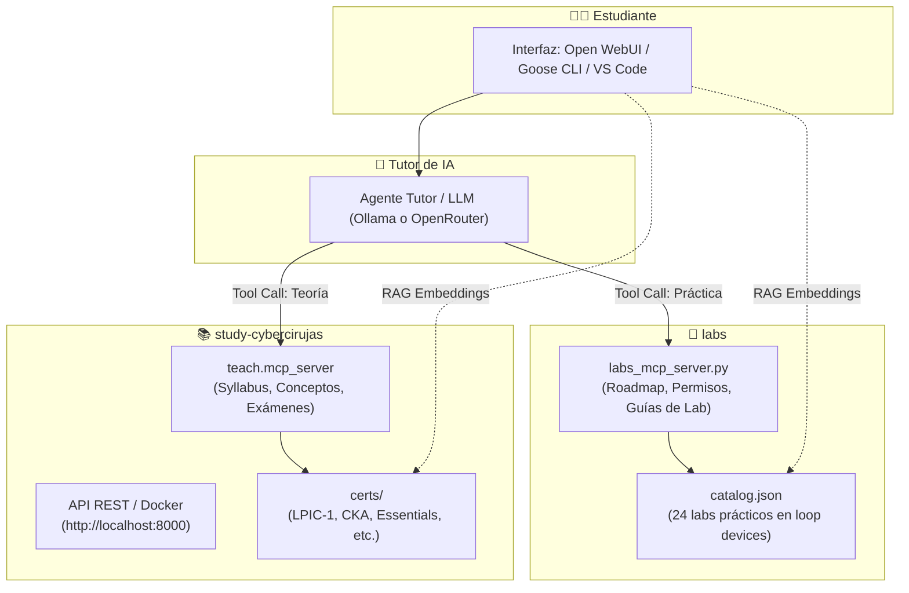

# 🧠 Integración del Tutor con study.cybercirujas (RAG + MCP)

Este documento detalla la arquitectura, el despliegue local y los métodos de integración para conectar el **Tutor de IA de este repositorio (`labs`)** con la base de conocimiento abierta de [**study.cybercirujas**](https://github.com/villadalmine/study-cybercirujas).

---

## 🎯 ¿Por qué conectar ambos proyectos? (El "Doble Cerebro")

El repositorio `labs` y `study-cybercirujas` son complementarios por naturaleza:

| Característica | `labs` (Este Repositorio) | `study-cybercirujas` |
|---|---|---|
| **Enfoque principal** | **100% Práctico / Hands-On**. | **Conceptual y Curricular Oficial**. |
| **Cobertura** | 24 laboratorios paso a paso con loop devices, LVM, ext4/xfs, monitoreo, systemd, kernel. | 28 certificaciones completas (LPIC-1, Linux Essentials, LPIC-3, CKA, CKAD, MCPA, etc.) con 726+ objetivos. |
| **Validaciones** | Metadatos estrictos (`catalog.json`), chequeo de entorno (WSL2, EC2, root, RAM). | Temarios congelados de vendors oficiales (LPI, CNCF), ejercicios teóricos y `break-and-fix labs`. |
| **Rol en el Tutor** | **El Laboratorio:** Prescribe comandos reales, valida requisitos y guía en la consola. | **La Enciclopedia:** Provee la teoría oficial, preguntas de certificación y citas bibliográficas. |



---

## 🚀 Paso 1: Clonar y Desplegar `study-cybercirujas` Localmente

Para garantizar soberanía y privacidad (estudio offline sin cuentas ni costos), clonamos el repositorio en tu máquina local. Se recomienda ubicarlo en la misma carpeta padre de `labs` (por ejemplo, en `~/Documents/GitHub/` o en tu home):

```bash
# Navegar a la carpeta padre donde está alojado 'labs'
cd ..

# Clonar el repositorio de study-cybercirujas (~130 MB)
git clone https://github.com/villadalmine/study-cybercirujas.git
cd study-cybercirujas
```

### Opción A: Despliegue con Entorno Virtual Python (Recomendado para MCP)

#### En Linux o WSL (Ubuntu / Debian):
```bash
sudo apt install -y git make python3-venv
make setup          # Crea .venv e instala el CLI 'teach' y dependencias (~20s)
make mcp-setup      # Instala las dependencias del protocolo MCP
make mcp-check      # Comprueba que el servidor MCP responde correctamente
```

#### En Windows (PowerShell nativo):
```powershell
py -m venv .venv
.venv\Scripts\pip install -e .
.venv\Scripts\pip install mcp
python -m teach.mcp_server --help
```

---

### Opción B: Despliegue con Docker (Recomendado para API REST y Navegación Web)

Si deseas contar con la interfaz web y la API REST en `http://localhost:8000` sin compilar dependencias:

```bash
docker run -d --name study-cybercirujas -p 8000:8000 ghcr.io/villadalmine/study-cybercirujas:latest
```

* **Interfaz web local:** <http://localhost:8000>
* **Documentación interactiva de la API:** <http://localhost:8000/docs>

---

## 🔌 Modalidad 1: Integración por MCP (Model Context Protocol)

El protocolo **MCP** permite que agentes inteligentes (como **Goose CLI**, **Claude Desktop**, **Cline** o **Continue.dev**) utilicen herramientas en tiempo real para consultar ambos repositorios sin necesidad de vectorizar previamente.

### Herramientas combinadas a disposición del Tutor:

Al conectar ambos servidores, el modelo pasa a tener **9 herramientas nativas**:

1. **Herramientas Teóricas (`study-cybercirujas`):**
   - `list_certs()`: Lista todas las certificaciones disponibles (LPIC-1, Linux Essentials, CKA, etc.).
   - `get_syllabus(cert)`: Devuelve los temas oficiales de un examen (id, títulos, pesos).
   - `get_topic(cert, topic, lang)`: Devuelve la teoría completa, ejercicios y fuentes oficiales de un objetivo.
   - `search_topics(query, cert)`: Busca conceptos clave en los temarios.

2. **Herramientas Prácticas (`labs`):**
   - `get_student_roadmap(environment, completed_labs)`: Recomienda el próximo laboratorio práctico compatible.
   - `verify_student_readiness(lab_id, has_root, environment)`: Valida permisos de superusuario y compatibilidad de SO.
   - `search_curriculum(query)`: Búsqueda semántica sobre los 24 laboratorios.
   - `get_lab_details(lab_id)`: Metadatos y objetivos del lab.
   - `read_lab_guide(lab_id)`: Guía completa paso a paso para ejecutar con loop devices.

---

### Configuración en Goose CLI (Terminal Agent)

Edita o crea tu archivo `~/.config/goose/config.yaml` (o usa la plantilla [`ai/tutor/mcp/goose_config.yaml`](file:///C:/Users/rino/Documents/GitHub/labs/ai/tutor/mcp/goose_config.yaml)):

```yaml
# ~/.config/goose/config.yaml
provider: openrouter # o 'ollama' con 'llama3.2:3b'
model: deepseek/deepseek-r1

extensions:
  # Servidor 1: Práctica de Labs Linux
  linux_labs_tutor:
    name: linux_labs_tutor
    cmd: python
    args:
      - "ai/tutor/mcp/labs_mcp_server.py"
    type: stdio
    enabled: true

  # Servidor 2: Teoría y Certificaciones Oficiales
  study_cybercirujas:
    name: study_cybercirujas
    cmd: python
    args:
      - "-m"
      - "teach.mcp_server"
    type: stdio
    enabled: true

  # Servidor 3: Ejecución de comandos del sistema
  developer:
    enabled: true
```

Inicia la sesión interactiva:
```bash
goose session
```
*Prueba a preguntarle:*
> *"Quiero estudiar el tema 104.1 de LPIC-1 sobre particiones y sistemas de archivos. Explícame la teoría oficial y luego dime qué laboratorio práctico de `labs` puedo hacer en mi máquina."*

---

### Configuración en VS Code (Extensión Cline)

Copia o fusiona [`ai/tutor/mcp/cline_mcp_settings.json`](file:///C:/Users/rino/Documents/GitHub/labs/ai/tutor/mcp/cline_mcp_settings.json) en `cline_mcp_settings.json`:

```json
{
  "mcpServers": {
    "linux-labs-tutor": {
      "command": "python",
      "args": ["ai/tutor/mcp/labs_mcp_server.py"],
      "disabled": false,
      "autoApprove": [
        "get_student_roadmap",
        "get_lab_details",
        "search_curriculum",
        "verify_student_readiness",
        "read_lab_guide"
      ]
    },
    "study-cybercirujas": {
      "command": "python",
      "args": ["-m", "teach.mcp_server"],
      "cwd": "../study-cybercirujas",
      "disabled": false,
      "autoApprove": [
        "list_certs",
        "get_syllabus",
        "get_topic",
        "search_topics"
      ]
    }
  }
}
```

---

## 📚 Modalidad 2: Integración por RAG (Bases de Conocimiento Locales)

Si prefieres usar una interfaz web conversacional como **Open WebUI** o **AnythingLLM**, puedes cargar todo el conocimiento en colecciones vectorizadas para que el modelo responda citando fuentes exactas.

### 1. Preparar y Exportar el Corpus con el Script Utilitario

Hemos provisto el script [`prepare_rag_corpus.py`](file:///C:/Users/rino/Documents/GitHub/labs/ai/tutor/mcp/prepare_rag_corpus.py) para que unifique y renombre automáticamente los archivos teóricos y prácticos:

```bash
# Desde la raíz del repositorio 'labs':
python ai/tutor/mcp/prepare_rag_corpus.py --certs lpic-1,lpi-010-160 --lang es
```

El script genera en `ai/tutor/rag_corpus_export/`:
1. `labs_practicos/`: Los 24 laboratorios prácticos de administración de sistemas.
2. `cybercirujas_teoria_es/`: Toda la teoría de LPIC-1 y Linux Essentials con nombres unívocos (ej: `lpic-1-104.1-content.md`, `lpi-010-160-2.1-exercises.md`).

---

### 2. Ingesta en Open WebUI

1. En tu navegador abre Open WebUI: `http://localhost:3000`.
2. Ve a **Workspace** (Espacio de trabajo) ➔ **Knowledge** (Bases de conocimiento).
3. Crea una nueva base de conocimiento llamada **`lpic1-linux-master`**.
4. Arrastra y suelta todos los archivos generados en `ai/tutor/rag_corpus_export/`.
5. Open WebUI indexará el contenido usando el modelo de embeddings local (`bge-m3` o `nomic-embed-text` de Ollama).
6. En un nuevo chat, selecciona el modelo local (`study-qwen3-4b` o `llama3.2:3b`), escribe `#` y adjunta la colección `lpic1-linux-master`.

---

## 🌐 Modalidad 3: Consumo directo de la API REST de study-cybercirujas

Si tu aplicación o script requiere consultas programáticas rápidas sin levantar un agente MCP completo, puedes consultar la API REST local:

```bash
API="http://localhost:8000"

# 1. Ver qué certificaciones están disponibles
curl -s $API/api/catalog | jq 'keys'

# 2. Ver el temario completo de LPIC-1
curl -s $API/api/certs/lpic-1 | jq '.topics[] | {id, title}'

# 3. Buscar conceptos relacionados con 'tune2fs' o 'inodes'
curl -s "$API/api/search?q=inodes&limit=3" | jq '.hits[] | {cert, id, title}'

# 4. Obtener la teoría en español del tema 104.1
curl -s "$API/api/certs/lpic-1/topics/104.1?lang=es" | jq '{title, generated_by, content}'
```

---

## 🎓 Flujo de Estudio Recomendado para el Alumno

Con ambos sistemas activos, el ciclo pedagógico es óptimo:

```text
[1. TEORÍA]            El alumno pregunta un concepto de examen (ej: "LVM y particiones GPT").
     ↓
[2. CYBERCIRUJAS]      El Tutor busca en study-cybercirujas y explica la teoría oficial del LPI con citas.
     ↓
[3. LABORATORIO]       El Tutor consulta 'labs_mcp_server', localiza el 'lab-3.2-lvm2-online-resize'
                       y verifica si el alumno está en WSL2 o EC2 con permisos sudo.
     ↓
[4. PRÁCTICA SEGURA]   El alumno corre el lab sobre loop devices (/dev/loop0), sin arriesgar su disco real.
     ↓
[5. EVALUACIÓN]        El alumno reporta sus comandos y el Tutor valida que el resize haya sido exitoso.
```

---

## 🔗 Referencias y Enlaces Locales
- Portal del Tutor de IA: [`ai/tutor/README.md`](README.md)
- Guía Maestra Paso a Paso: [`ai/tutor/GUIA_PASO_A_PASO.md`](GUIA_PASO_A_PASO.md)
- Motor Pedagógico: [`ai/tutor/tutor_engine.py`](tutor_engine.py)
- Servidor MCP de Laboratorios: [`ai/tutor/mcp/labs_mcp_server.py`](mcp/labs_mcp_server.py)
- Repositorio Upstream: [github.com/villadalmine/study-cybercirujas](https://github.com/villadalmine/study-cybercirujas)
