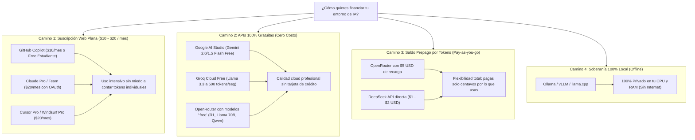
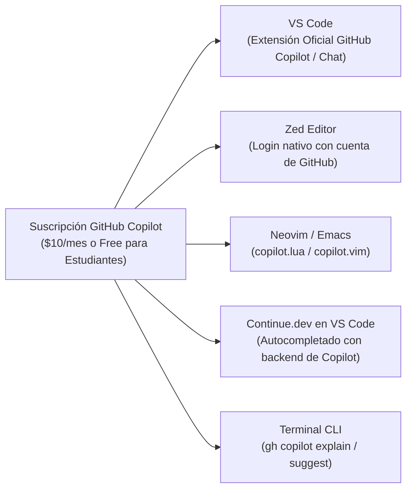

# 📊 Matriz Maestra de Suscripciones, APIs Comerciales, Tiers Gratuitos y Clientes

Esta guía sirve como **matriz viva y catálogo de referencia cruzada** para consultar, actualizar y combinar cualquier herramienta de IA (terminal, IDEs o editores modernos) con cualquier proveedor (suscripciones de $20/mes, claves de API prepagadas, modelos de API 100% gratuitos o motores locales offline).

El objetivo es que docentes y alumnos puedan elegir la **combinación más potente al menor coste posible**, aprovechando opciones gratuitas que muchos desconocen.

---

## 🗺️ Mapa de Financiamiento: Los 4 Caminos para Usar IA en Desarrollo



---

## 🏛️ Gran Matriz Cruzada de Compatibilidad

### 🥊 Tabla Comparativa 1: Desde la Suscripción Web que Pagas -> ¿Dónde puedes reutilizarla?

Uno de los mayores focos de confusión es creer que si pagas **$20/mes** por ChatGPT Plus o Claude Pro puedes poner esa misma cuenta en cualquier terminal agéntica abierta (Goose, OpenCode, Aider, Cline). **La realidad es que las suscripciones de consumidor son casi 100% cautivas:**

| Suscripción Web que Pagas | Costo Mensual | En su CLI / App Oficial | ¿Funciona en Frameworks de Terceros? (Goose, OpenCode, Aider, Cline) | ¿Funciona en Editores de Terceros? (Zed, Continue.dev, Neovim) | Diagnóstico Real para el Estudiante |
| :--- | :--- | :--- | :--- | :--- | :--- |
| **GitHub Copilot** | $10/mes (o **GRATIS** para estudiantes) | **SÍ** (`gh copilot`, extensiones oficiales) | **NO oficial** (requiere puentes/proxies intermedios). | **SÍ (Nativo)** en Zed Editor, Continue.dev y Neovim. | 🌟 **La más flexible en editores** sin pagar tokens adicionales. |
| **Claude Pro / Team** | $20/mes | **SÍ** (`claude` CLI oficial) | **NO.** Anthropic no permite usar tu login web en Goose o Aider. | **NO.** Requiere comprar créditos de API en Anthropic Console. | ⚠️ **Cautiva de su web y de Claude Code.** En terceros pagas por token. |
| **ChatGPT Plus / Pro** | $20 a $200 / mes | **SÍ** (Web y apps oficiales) | **NO (0% de soporte).** OpenAI no permite login web en terceros. | **NO.** Exige saldo prepagado en `platform.openai.com`. | 🚫 **100% Cautiva.** No puedes usarla en ningún agente ni terminal de terceros. |
| **Gemini Advanced** | $20/mes | **SÍ** (Web gemini.google.com) | **NO.** La suscripción de consumo no otorga claves de API. | **NO.** La suscripción de consumo no otorga claves de API. | 💡 **Innecesaria:** Google regala Gemini 2.0 Flash en **Google AI Studio** para cualquier herramienta. |
| **Cursor Pro / Windsurf** | $20/mes | **SÍ** (En sus propios IDEs) | **NO.** Es exclusiva dentro de su aplicación cerrada. | **NO.** No puedes exportar la suscripción a tu terminal. | 🔒 **Ecosistema cerrado.** Potente en su interfaz, inútil en CLI abierto. |
| **OpenRouter (Saldo Prepago)**| $0 cuota fija (Recargas $5) | N/A (Es pasarela universal) | **SÍ (100% Universal)** en Goose, OpenCode, Aider, Gentleman, Herder. | **SÍ (100% Universal)** en Zed, Continue, Cline, Neovim. | 🏆 **La opción recomendada para terminales.** Máxima libertad, centavos de costo. |

---

### ❓ Aclaración Clave: ¿Qué significa cada método de acceso?
Para evitar confusiones al configurar tu entorno, debes distinguir entre los tres métodos reales con los que se conecta una herramienta:

1. **🌐 Login Web OAuth (Navegador):**
   * El comando en la terminal abre una pestaña en tu navegador web (o te da una URL y un código de verificación).
   * Inicias sesión con tu usuario y contraseña de siempre (Google, GitHub o Anthropic).
   * **El CLI queda vinculado a tu suscripción web mensual** (como Claude Pro o GitHub Copilot) sin que tengas que copiar ninguna clave criptográfica.
2. **🔑 Solo Clave de API (`API_KEY` secreta):**
   * La herramienta **NO tiene pantalla de inicio de sesión ni puedes poner tu usuario y contraseña de chatgpt.com**.
   * Debes ir a la consola de desarrollador del proveedor (como [OpenRouter](https://openrouter.ai), [DeepSeek Platform](https://platform.deepseek.com) o [Google AI Studio](https://aistudio.google.com)), generar una clave alfanumérica (`sk-...` o `AIzaSy...`) y pegarla en tu terminal (`export ..._API_KEY="..."`).
   * **Aquí NO sirve tu suscripción de $20 de ChatGPT Plus web ni de Claude Pro:** pagas por token consumido o usas cuotas gratuitas de desarrollador.
3. **💻 Sin Cuenta / 100% Local (Offline):**
   * No requiere navegador, ni registro, ni conexión a internet, ni tarjetas. Solo tener instalado [Ollama](GLOSARIO.md#ollama) corriendo en tu máquina (`localhost:11434`).

---

### 📊 Tabla Comparativa 2: Desde el Cliente o Herramienta -> Métodos de Acceso y Modelos Soportados

| Cliente / Herramienta | ¿Cómo te Autenticas? (Método de Acceso) | ¿Sirve tu Suscripción Web ($20/mes)? | APIs Soportadas (vía Clave de API) | Tiers 100% Gratuitos Compatibles | Modelos Locales (Ollama / vLLM) |
| :--- | :--- | :--- | :--- | :--- | :--- |
| **Claude Code** (`claude`) | **Login Web OAuth** (`claude login`) o Clave API. | **SÍ para Claude Pro/Team (Oficial).** NO acepta ChatGPT Plus ni Copilot. | **Anthropic API** (`ANTHROPIC_API_KEY`). | No oficial. | No oficial (Enfocado en la nube). |
| **Goose CLI / OMP** | **Solo Clave de API** (En `goose configure` o config.yaml). | **NO.** Ninguna suscripción web ($20) funciona en Goose. Requiere API Key o Ollama. | **Anthropic, OpenAI, OpenRouter, Databricks, Groq**. | **SÍ** (Groq Free, OpenRouter `:free`, Gemini Free). | **SÍ (Nativo)** vía `localhost:11434`. |
| **OpenCode / Open Interpreter** | **Solo Clave de API** (Variables de entorno `OPENAI_API_KEY`). | **NO.** Ninguna suscripción web ($20) funciona en OpenCode. Requiere API Key o Ollama. | **OpenAI, Anthropic, DeepSeek, OpenRouter, Gemini, Mistral**. | **SÍ** (OpenCode Free, Groq, OpenRouter `:free`, Gemini). | **SÍ (Nativo)** vía flag `--local` o Ollama. |
| **Aider** | **Solo Clave de API** (Variables de entorno `.env` en tu shell). | **NO.** Ninguna suscripción web ($20) funciona en Aider. Requiere API Key o Ollama. | **Todas** (Anthropic, OpenAI, DeepSeek, OpenRouter, Mistral, Groq). | **SÍ** (OpenRouter `:free`, Groq, Google AI Studio). | **SÍ** (`--model ollama/llama3.2`). |
| **Gemini CLI / Antigravity (`agy`)** | **Login Web OAuth** (`gcloud auth login`) o Clave API. | **SÍ** (Cuentas Google Cloud / Workspace / Gemini Advanced). NO acepta ChatGPT Plus ni Claude Pro. | **Google Gemini API** (`GEMINI_API_KEY`) y Vertex AI. | **SÍ** (Google AI Studio Free Tier). | Soporta endpoints locales compatibles. |
| **OpenAI CLI (`openai`)** | **Solo Clave de API** (`export OPENAI_API_KEY=...`). | **NO.** ChatGPT Plus ($20) no incluye llamadas a la API oficial. | **OpenAI API** (`OPENAI_API_KEY`). | No oficial (Requiere saldo en OpenAI Platform). | Con flag `--api-base http://localhost:11434/v1`. |
| **Zed Editor** | **Login Web OAuth para Copilot**; Clave API para el resto. | **SÍ para GitHub Copilot ($10/mes).** NO para ChatGPT Plus ni Claude Pro (esos requieren API Key). | **Anthropic, OpenAI, OpenRouter, DeepSeek**. | **SÍ** (Google AI Studio y Groq vía endpoint compatible). | **SÍ (Nativo)** en ajustes de lenguaje sin plugins. |
| **Continue.dev (VS Code / JetBrains)** | **Login Web OAuth para Copilot**; Clave API para el resto. | **SÍ para GitHub Copilot.** NO para ChatGPT Plus ni Claude Pro (esos requieren API Key). | **Todas las APIs comerciales** (OpenRouter, Anthropic, OpenAI, etc.). | **SÍ** (Groq, OpenRouter `:free`, Google AI Studio). | **SÍ (Prioritario)** con auto-detección de Ollama. |
| **Cline / Roo Code (VS Code)** | **Solo Clave de API** (Se pega en la interfaz de la extensión). | **NO.** Ninguna suscripción web ($20) funciona en Cline. Requiere API Key o Ollama. | **Anthropic, OpenAI, OpenRouter, DeepSeek, AWS, GCP**. | **SÍ** (OpenRouter `:free`, Groq, Gemini). | **SÍ** (Proveedor Ollama local nativo). |
| **Cursor** | **Login Web OAuth** (Cuenta Cursor) o Clave API propia (*BYOK*). | **SÍ para Cursor Pro ($20/mes).** NO acepta ChatGPT Plus ni Claude Pro web. | **Anthropic, OpenAI, Google Gemini** (Modo BYOK). | **SÍ** (Google AI Studio Free vía custom endpoint). | **SÍ** configurando URL local. |
| **Windsurf (Codeium)** | **Login Web OAuth** (Cuenta de Windsurf/Codeium). | **SÍ para Windsurf Pro ($20/mes).** NO acepta ChatGPT Plus ni Claude Pro web. | Gestión interna de modelos de Codeium. | **SÍ** (Tier Free Cascade muy generoso). | Vía extensiones locales. |
| **Herder** | **Hereda el método del agente que lanza** (OAuth o API Key). | Depende del agente que ejecutes (si lanzas Goose o Aider, requiere API Key o Ollama). | Las mismas que soporte el agente configurado (Goose, Aider). | Las mismas del agente subyacente. | Las mismas del agente subyacente. |
| **Gentleman-AI Tools** | **Solo Clave de API** (Lee `OPENAI_API_KEY` de tu shell). | **NO.** No abre navegador ni tiene login web; solo lee variables. | **OpenAI, DeepSeek, Anthropic, OpenRouter**. | **SÍ** (OpenRouter `:free`, Groq). | **SÍ** (`http://localhost:11434`). |
| **Moshi CLI (Kyutai)** | **Sin Cuenta / 100% Local o Servidor de Audio**. | No aplica (Es un modelo fundacional libre de audio). | Usa servidor local o API de Kyutai Labs. | **SÍ** (Demo web gratuita en moshi.chat). | **SÍ (100% Local)** con aceleración GPU. |

---

## 🎁 3. El Secreto de los Tiers de API 100% Gratuitos (Sin Gastar un Centavo)

Muchos estudiantes desconocen que existen proveedores de API que ofrecen **modelos de clase mundial completamente gratis** mediante claves de API estándares:

### A. Google AI Studio (Gemini 2.0 y 1.5 Flash)
Google ofrece un nivel de desarrollo gratuito con cuotas astronómicas:
* **Modelos:** `gemini-2.0-flash`, `gemini-1.5-flash`, `gemini-1.5-pro`.
* **Cuota gratuita:** Hasta **15 peticiones por minuto (RPM)** y **1 millón de tokens por minuto (TPM)** sin pagar un solo dólar.
* **Cómo obtenerla:** Ve a [aistudio.google.com](https://aistudio.google.com), inicia sesión con tu cuenta de Google y pulsa **Get API Key**.
* **Uso en terminal:**
  ```bash
  export GEMINI_API_KEY="AIzaSy..."
  ```

### B. OpenRouter con Modelos `:free` (R1, Llama 70B y Qwen Coder)
OpenRouter mantiene una categoría de modelos con el sufijo `:free` provistos por la comunidad y centros de cómputo abiertos:
* **Modelos Disponibles Gratis:**
  * `deepseek/deepseek-r1:free` (Razonamiento profundo con cadena de pensamiento).
  * `meta-llama/llama-3.3-70b-instruct:free` (Modelo de 70B parámetros de Meta).
  * `qwen/qwen-2.5-coder-32b-instruct:free` (Especializado en programación y Bash).
* **Cómo usarlo:**
  1. Crea una cuenta en [openrouter.ai](https://openrouter.ai).
  2. Genera una API Key (no requiere ingresar tarjeta de crédito).
  3. En tu terminal o en OpenCode / Goose:
     ```bash
     export OPENROUTER_API_KEY="sk-or-v1-..."
     # En OpenCode:
     opencode --model openrouter/deepseek/deepseek-r1:free
     # En Aider:
     aider --model openrouter/deepseek/deepseek-r1:free
     ```

### C. Groq Cloud Free (Velocidad Extrema: 500 tokens/segundo)
Groq utiliza chips LPU (*Language Processing Units*) propietarios que procesan texto a una velocidad inalcanzable para GPUs tradicionales:
* **Modelos Gratis:** `llama-3.3-70b-versatile`, `qwen-2.5-coder-32b`, `mixtral-8x7b`.
* **Cómo obtenerla:** Regístrate en [console.groq.com](https://console.groq.com) y crea tu clave gratuita.
* **Uso en terminal:**
  ```bash
  export GROQ_API_KEY="gsk_..."
  # En Aider o Goose:
  aider --model groq/llama-3.3-70b-versatile
  ```

---

## 🐙 4. Cómo Aprovechar tu Suscripción de GitHub Copilot en Diferentes Herramientas

Si ya pagas **GitHub Copilot ($10/mes)** o tienes acceso gratuito como **estudiante o profesor** a través del *GitHub Student Developer Pack*, puedes reutilizarlo en múltiples entornos:



1. **En VS Code y JetBrains:** Instalas la extensión oficial de GitHub Copilot e inicias sesión con tu cuenta.
2. **En Zed Editor:** En los ajustes de Zed (`settings.json`), activas `features: { copilot: true }` y autorizas tu cuenta con un código de GitHub.
3. **En la Terminal con la CLI Oficial de GitHub (`gh`):**
   ```bash
   # Instalar la extension de Copilot en GitHub CLI
   gh extension install github/gh-copilot

   # Pedir explicaciones de comandos en la terminal
   gh copilot explain "iptables -t nat -A POSTROUTING -o eth0 -j MASQUERADE"

   # Pedir que sugiera un comando
   gh copilot suggest "buscar todos los archivos de mas de 100MB modificados en los ultimos 3 dias"
   ```

---

## 🌙 5. Proveedores Emergentes: Moonshot AI (Kimi), Mistral y Editores Modernos

### Moonshot AI (Kimi)
* **Punto fuerte:** Diseñado por Moonshot AI con ventanas de contexto gigantescas (hasta 2 millones de tokens) y excelente comprensión del lenguaje.
* **Compatibilidad de API:** Su endpoint es 100% compatible con el formato de OpenAI:
  * Base URL: `https://api.moonshot.cn/v1`
  * Modelos: `moonshot-v1-8k`, `moonshot-v1-32k`, `moonshot-v1-128k`.
* **Configuración en OpenCode / Continue:** Solo configuras la URL base hacia `https://api.moonshot.cn/v1` con tu clave de Moonshot.

### Zed Editor (El Editor de Alto Rendimiento en Rust)
* Creado por los autores originales de Atom y Tree-sitter.
* **Integración nativa de IA:** No necesitas plugins externos lentos. Zed incluye en su núcleo un panel de chat y autocompletado compatible con **Anthropic, OpenAI, GitHub Copilot y Ollama local** con cero latencia de interfaz.

---

## 📝 6. Cómo Mantener y Actualizar esta Matriz

Esta matriz está diseñada como un **documento colaborativo vivo**. Si aparece una nueva herramienta de terminal, un nuevo proveedor o un tier gratuito:

1. Abre este archivo en tu editor: [`ai/tutor/MATRIZ_SUSCRIPCIONES_Y_APIS.md`](MATRIZ_SUSCRIPCIONES_Y_APIS.md).
2. Agrega la nueva fila a la tabla de la Sección 2 indicando:
   * Nombre y comando del CLI.
   * Si acepta login web directo (OAuth) o solo API Keys.
   * Tiers gratuitos disponibles.
   * Soporte de modelos locales en Ollama.
3. Haz un commit descriptivo en tu rama Git:
   ```bash
   git commit -m "docs(ai/tutor): actualizar matriz con nuevo proveedor XYZ y modelos free"
   ```
