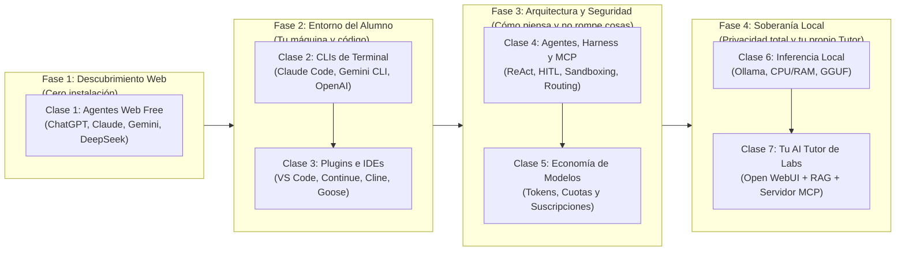
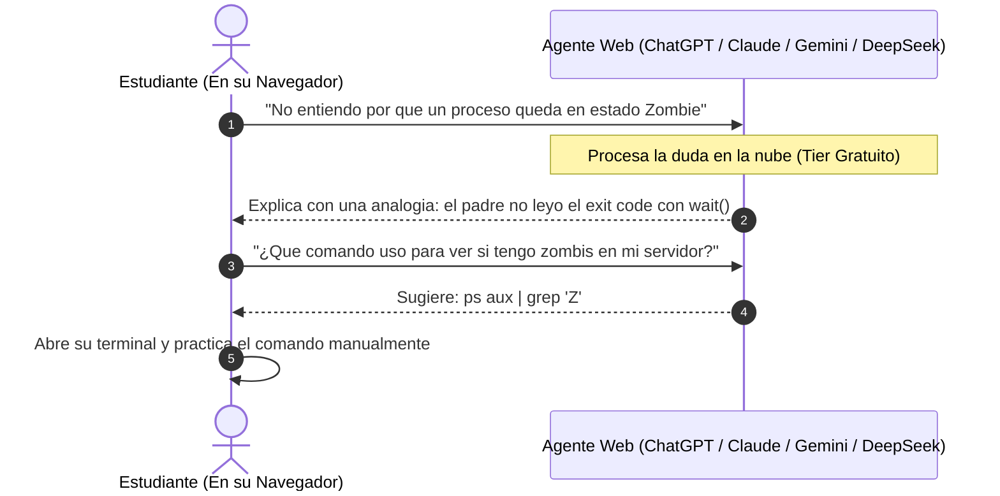
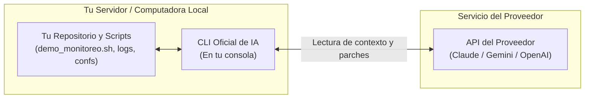
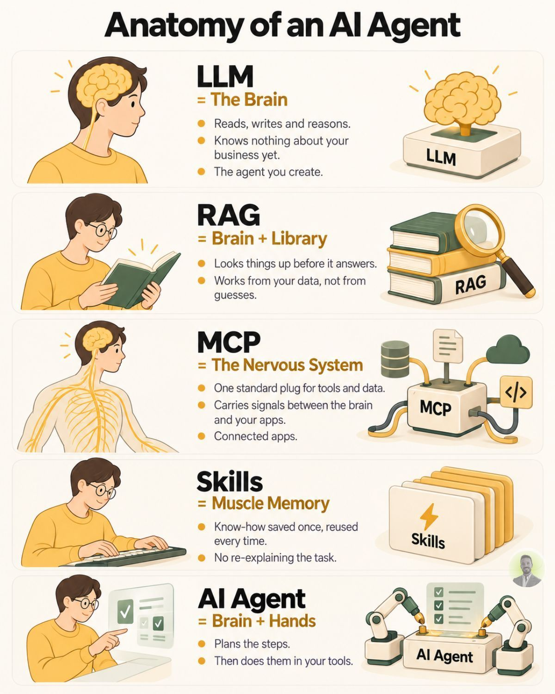
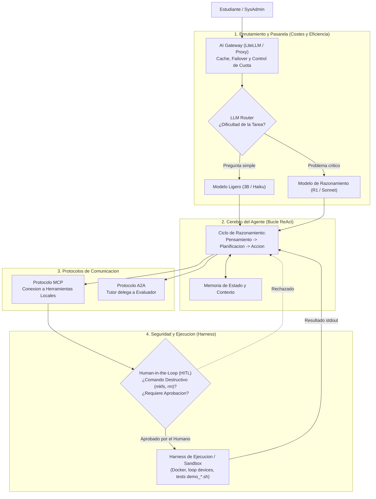
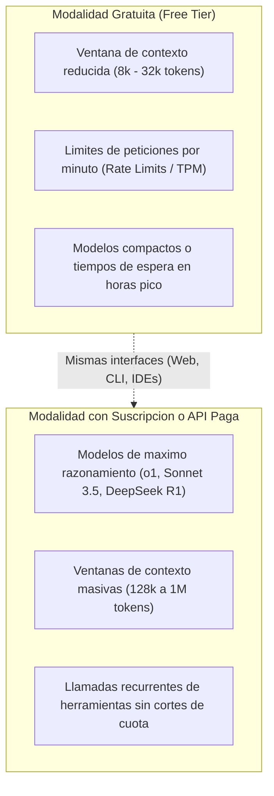
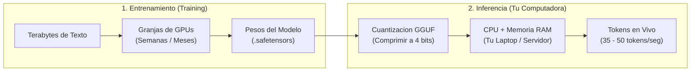
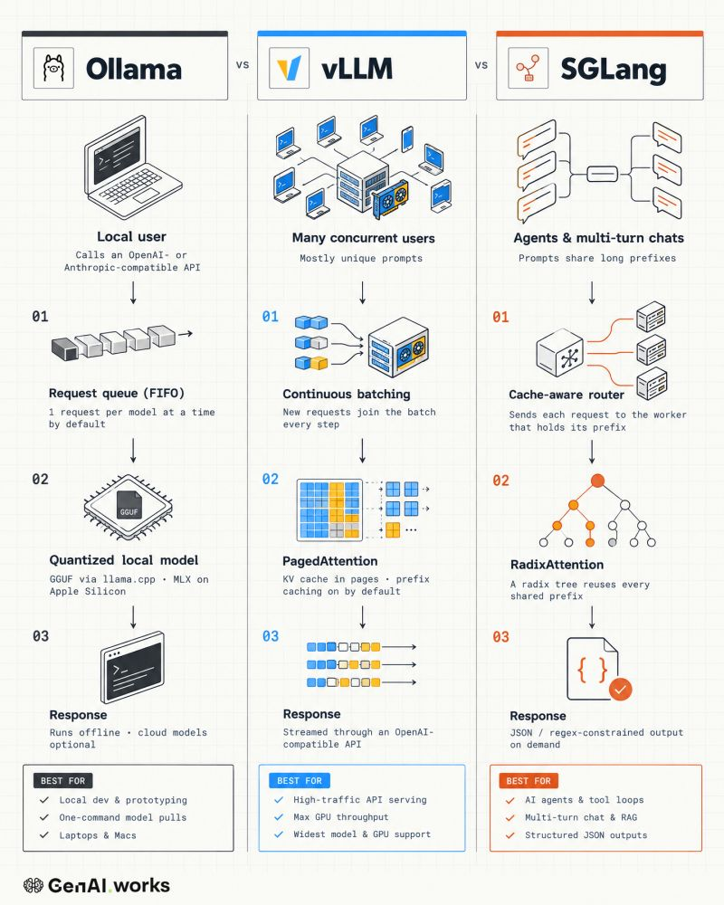
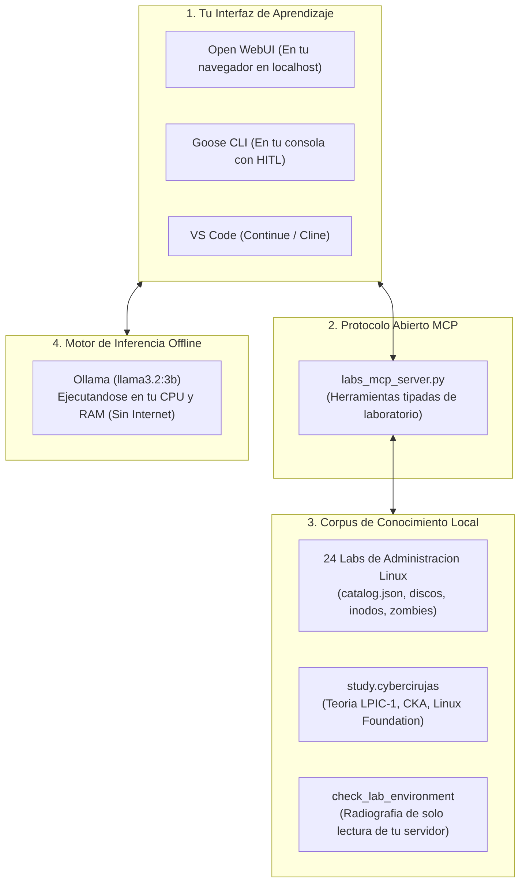

# 🎓 Guía Integral de IA para Desarrolladores y Administradores de Sistemas
## Ruta Pedagógica Clase a Clase: De Cero a tu Propio Tutor Soberano Local

Bienvenido a la guía maestra y entorno del **Tutor de Aprendizaje Asistido por Inteligencia Artificial** para la administración de servidores Linux y desarrollo de software.

Este documento está diseñado para que un docente o estudiante pueda **iterar clase a clase desde cero absoluto** (sin requerir conocimientos previos de inteligencia artificial) hasta dominar las herramientas del sector y culminar en el montaje de un **Tutor Soberano, Privado y Específico** que conoce cada laboratorio de este repositorio.

> [!NOTE] Glosario Técnico Oficial de IA
> Todos los términos especializados (*Inferencia*, *KV Cache*, *GGUF*, *Offloading*, *VRAM*, *Harness*, *HITL*, *MCP*, *Tokens*, etc.) cuentan con definiciones técnicas y enlaces a su documentación oficial en el [**`GLOSARIO.md`**](GLOSARIO.md).

---

## 🗺️ Mapa de la Ruta de Aprendizaje (Las 4 Fases de Evolución)

En lugar de saltar a instalar herramientas complejas, la formación sigue una progresión natural en cuatro etapas:



---

## 📅 Cronograma del Curso: Plan de Clases

| Clase | Tema Central | Nivel | ¿Qué necesitas hoy? | Lo que vas a dominar al terminar la clase |
| :--- | :--- | :--- | :--- | :--- |
| [**Clase 1**](#-clase-1-primeros-pasos-con-ia-gratuita-en-la-web-sin-gastar-dinero) | Agentes Web Gratuitos | Principiante (Cero) | Solo un navegador web | Resolver dudas de Linux, errores y teoría sin gastar un centavo. |
| [**Clase 2**](#-clase-2-de-la-web-a-la-terminal-agentes-de-línea-de-comandos-clis-oficiales) | CLIs Oficiales de Consola | Principiante | Terminal de comandos + Git | Conectar la IA a tu repositorio para auditar scripts y aplicar cambios. |
| [**Clase 3**](#-clase-3-la-ia-en-tu-editor-de-código-vs-code-jetbrains-y-frameworks) | Plugins de IDE y Frameworks | Intermedio | VS Code o JetBrains | Asistente integrado con autocompletado y agentes como Goose y Aider. |
| [**Clase 4**](#-clase-4-anatomía-de-un-agente-y-protocolos-modernos-harness-mcp-gateways-y-hitl) | Agentes, Harness y Protocolos | Intermedio | Conceptos de sistemas | Entender el ciclo ReAct, sandboxes de contención, MCP, A2A y control humano. |
| [**Clase 5**](#-clase-5-el-modelo-económico-tiers-gratuitos-vs-suscripciones-y-tokens) | Economía de Modelos (Free vs Paid) | Todos los niveles | Curiosidad sobre costes | Comprender tokens, ventanas de contexto, rate limits y facturación API. |
| [**Clase 6**](#-clase-6-soberanía-técnica-modelos-locales-en-tu-cpu-y-ram-ollama-vllm-sglang) | Inferencia Local en CPU y RAM | Intermedio / SysAdmin | Computadora con 8 GB RAM | Correr modelos de lenguaje 100% offline sin tarjeta gráfica dedicada. |
| [**Clase 7**](#-clase-7-proyecto-final-monta-tu-propio-ai-tutor-local-específico-y-socrático) | Proyecto Final: Tutor Soberano | Proyecto Integrador | Docker o Python + Ollama | Poner en marcha Open WebUI, RAG sobre los 24 labs y el servidor MCP del curso. |

---

## 📚 Clase 1: Primeros Pasos con IA Gratuita en la Web (Sin Gastar Dinero)

### 🤔 ¿Qué es la IA en palabras sencillas para quien recién empieza?
Un modelo de lenguaje de IA (**LLM**) es como un asistente que leyó miles de manuales técnicos, libros de sistemas y foros de programación. No es un "mago" ni un motor de búsqueda tradicional de Google: es un **motor de razonamiento lingüístico**. Cuando le haces una pregunta en español, predice y redacta la respuesta más coherente palabra por palabra.

En esta primera clase no instalaremos nada en tu computadora: utilizaremos los servicios web oficiales que ofrecen **acceso gratuito permanente**.

### 📋 Proveedores Oficiales con Planes Gratuitos Disponibles

| Proveedor | Servicio Web Oficial | Nivel Gratuito Incluido | Enfoque Pedagógico Recomendado |
| :--- | :--- | :--- | :--- |
| **Google** | [gemini.google.com](https://gemini.google.com) | Acceso a Gemini Flash y Pro con ventana de contexto muy amplia. | Lectura de guías extensas, resúmenes y preguntas conceptuales de Linux. |
| **Anthropic** | [claude.ai](https://claude.ai) | Acceso a Claude 3.5 Sonnet / Haiku (con cuota periódica de mensajes). | Excelente razonamiento lógico, explicación de scripts en Bash y C paso a paso. |
| **OpenAI** | [chatgpt.com](https://chatgpt.com) | Acceso ilimitado a GPT-4o mini y limitado a GPT-4o, soporte multimodal y Canvas. | Preguntas rápidas, analogías didácticas y estructuración de conceptos. |
| **DeepSeek** | [chat.deepseek.com](https://chat.deepseek.com) | Acceso gratuito total a DeepSeek-V3 y DeepSeek-R1 (con botón de razonamiento profundo). | Depuración de scripts complejos, análisis de logs crípticos y problemas de algoritmos. |
| **Moonshot AI** | [kimi.ai](https://kimi.ai) | Ventana de contexto gigante en su nivel gratuito. | Lectura de libros enteros de certificaciones (LPIC-1, Linux Foundation). |
| **Mistral AI** | [chat.mistral.ai](https://chat.mistral.ai) | Acceso gratuito a Le Chat (modelos Mistral Large y Codestral). | Programación de scripts y administración de sistemas de código abierto. |
| **Hugging Face** | [hf.co/chat](https://huggingface.co/chat) | Múltiples modelos abiertos (Llama 3, Qwen 2.5, Gemma). | Comparar libremente cómo responden diferentes modelos abiertos. |

### 🧪 Práctica en Clase: Cómo Estudiar con un Chat Web
En lugar de preguntarle *"dame la respuesta a mi tarea"*, usa al agente como un tutor interactivo:
1. **Pedir analogías sencillas:**  
   > *"Explícame qué es un inodo en Linux usando una analogía con un casillero o un archivador de oficina, para alguien que nunca usó Linux."*
2. **Interpretar errores reales:** Copia y pega un fallo de tu consola:  
   > *"Ejecuté `mount: /mnt/data: special device does not exist`. ¿Cuáles son las 3 causas más comunes y qué comando de diagnóstico debería correr primero?"*
3. **Cuestionarios socráticos:**  
   > *"Actúa como un profesor de Linux y hazme 3 preguntas sobre permisos octales (`chmod 755`) una por una. No me des la respuesta hasta que yo responda."*



> [!NOTE] Evolución en la Web: Memoria, Bots, Plugins y MCP
> Hoy en día las propias plataformas web comerciales están adoptando conceptos que nacieron en la terminal:
> * **Memoria persistente:** ChatGPT y Claude ahora recuerdan preferencias de sesiones anteriores (ej. que eres estudiante de Linux).
> * **Bots y Gems/Custom GPTs:** Permiten configurar asistentes especializados con documentos e instrucciones fijas.
> * **Plugins y MCP Web:** Herramientas como Claude Desktop ya admiten conectar servidores MCP locales directamente a su interfaz gráfica.

> [!WARNING] Limitación de la Clase 1
> El agente web vive encerrado en tu navegador: **no puede ver tus archivos locales**, no sabe en qué carpeta estás parado y no puede comprobar si tu servidor Linux está funcionando. Para solucionar esto, pasamos a la siguiente clase.

---

## 💻 Clase 2: De la Web a la Terminal: Agentes de Línea de Comandos (CLIs Oficiales)

### 🤔 ¿Qué es esto en palabras sencillas?
Hasta ahora abrías el navegador, copiabas un error de tu consola, lo pegabas en el chat y volvías a la consola.  
En esta clase eliminamos ese ida y vuelta: **llevamos la IA directamente a la pantalla negra de tu terminal**.

Un **CLI (*Command Line Interface*) oficial** es un programa que ejecutas dentro de la carpeta de tu proyecto. Tiene permiso para leer tus archivos locales, entender la estructura de Git y sugerir modificaciones exactas (*patches/diffs*) sobre tu código.



### 🛠️ Herramientas de Terminal Oficiales

1. **Anthropic Claude Code (`claude` CLI):**
   * Herramienta oficial de línea de comandos de Anthropic para terminal.
   * Navega directorios, busca palabras clave con `grep`, analiza ramas de Git y aplica parches precisos.
2. **Google Gemini CLI / Antigravity CLI (`gemini` / `agy` CLI):**
   * Herramienta oficial de Google para terminal que aprovecha el contexto largo de Gemini.
   * Ideal para consultar documentación pesada de infraestructura y generar scripts de despliegue.
3. **OpenAI CLI (`openai`):**
   * Herramienta oficial de consola para evaluar modelos, procesar entradas por tuberías (`stdin | openai`) y automatizar tareas.
4. **Herramientas de consola para DeepSeek y APIs abiertas:**
   * Utilidades de terminal que se conectan mediante endpoints HTTP estándar compatibles con la API de OpenAI.

### 🧪 Práctica en Clase: Reparando un Script desde la Terminal
```bash
# 1. Posicionarte en la carpeta de un laboratorio
cd linux/administrator/03_monitoreo_procesos

# 2. Invocar al CLI para auditar un script
claude "Revisa demo_monitoreo.sh, explicame por que no captura los procesos en estado zombie y muestrame el diff de correccion"
```
El CLI analiza el script, te muestra en color verde y rojo los cambios propuestos y te pregunta: `¿Deseas aplicar estos cambios? [s/n]`. Al confirmar, el archivo se actualiza solo.

---

## 🧩 Clase 3: La IA en tu Editor de Código (VS Code, JetBrains y Frameworks)

### 🤔 ¿Qué es esto en palabras sencillas?
La mayoría de los administradores y desarrolladores escriben sus scripts en un editor visual como **Visual Studio Code** o **JetBrains**. En lugar de tener una ventana de terminal separada, podemos integrar la IA **dentro de las pestañas de tu editor**, con autocompletado en tiempo real mientras escribes (como el texto predictivo de tu teléfono) y una ventana de chat lateral.

### 🏛️ Ecosistema de Extensiones y Frameworks

1. **En Visual Studio Code:**
   * **[Continue.dev](mcp/continue_config.json):** Extensión libre y de código abierto que permite conectar cualquier modelo (local con Ollama o en la nube) tanto para autocompletado con la tecla `Tab` como para chat contextual con atajos (`Ctrl+L` / `Cmd+L`).
   * **[Cline / Roo Code](mcp/cline_mcp_settings.json):** Agente autónomo integrado en VS Code que utiliza servidores [MCP](GLOSARIO.md#mcp-model-context-protocol) locales para inspeccionar archivos, ejecutar comandos en la terminal integrada y crear pruebas.
   * **GitHub Copilot (Tier Free):** Ofrece autocompletado básico y chat dentro de VS Code con una cuota mensual gratuita.
2. **En JetBrains (IntelliJ, PyCharm, CLion):**
   * Plugins oficiales de **Continue for JetBrains** y **Sourcegraph Cody** que llevan la asistencia de código contextual al entorno de JetBrains.
3. **En Editores Modernos y de Alto Rendimiento:**
   * **Zed Editor:** Editor ultrarrápido escrito en Rust con integración nativa (sin plugins) para Anthropic, OpenAI, GitHub Copilot y Ollama local.
   * **Cursor y Windsurf:** IDEs comerciales con asistentes integrados en profundidad y soporte para claves de API propias (*BYOK*).
4. **Grandes Frameworks Autónomos de Terminal:**
   * **OpenCode / Open Interpreter:** Terminales inteligentes que ejecutan código de manera interactiva y corrigen sus propios fallos basados en el error arrojado.
   * **Goose CLI / OMP (OpenMultiProject):** Agentes de terminal basados en extensiones y protocolos abiertos [MCP](GLOSARIO.md#mcp-model-context-protocol).
   * **Pi / Aider:** Herramientas de *pair-programming* en consola vinculadas a Git, que generan commits automáticos por cada laboratorio superado.
5. **Proyectos Comunitarios y Nichos Ligeros:**
   * Herramientas como **Gentleman Programming CLI**, micro-agentes en Python y scripts de consola minimalistas diseñados para desarrolladores que prefieren cero dependencias pesadas.

---

## 🤖 Clase 4: Anatomía de un Agente y Protocolos Modernos (Harness, MCP, Gateways y HITL)

### 🤔 ¿Qué es esto en palabras sencillas?
Aquí ocurre el salto conceptual más importante del curso: **comprender qué hace que un modelo de IA pase de ser un "loro que habla" a convertirse en un "Agente que actúa"**, y qué medidas de seguridad se requieren para que un agente no destruya un servidor de producción.

<p align="center">
  
</p>

> [!NOTE] 🧠 Metáfora Biológica de la Arquitectura de un Agente
> * **LLM = El Cerebro (*The Brain*):** Lee, escribe y razona. Es el motor fundacional, pero por sí solo no conoce los servidores ni los datos de tu empresa.
> * **RAG = Cerebro + Biblioteca (*Brain + Library*):** Consulta la documentación y el código antes de responder. Basa sus conclusiones en datos reales verificados, eliminando las alucinaciones.
> * **MCP = El Sistema Nervioso (*The Nervous System*):** El enchufe estándar de la industria que transporta señales entre el cerebro y tus herramientas o servicios locales.
> * **Skills = Memoria Muscular (*Muscle Memory*):** Procedimientos, directivas y guías guardadas una sola vez y ejecutadas siempre de forma consistente sin tener que re-explicar la tarea.
> * **AI Agent = Cerebro + Manos (*Brain + Hands*):** Planifica los pasos necesarios y luego los ejecuta activamente a través de tus herramientas de terminal y APIs.

A continuación, se detalla el flujo de ejecución completo desde que el usuario emite una orden hasta que el comando se evalúa en el arnés de seguridad:



### 🔍 Los 7 Pilares de un Agente de IA

1. **El Ciclo [ReAct (Reasoning + Action)](GLOSARIO.md#agente-de-ia-ai-agent):**  
   A diferencia de un chat estático, el agente opera en un ciclo continuo:
   $$\text{Pensamiento (Thought)} \longrightarrow \text{Acción (Action)} \longrightarrow \text{Observación (Observation)}$$
   *Ejemplo:* El agente piensa: *"Primero verificaré cuánto espacio libre hay en disco con `df -h`"*. Ejecuta el comando, lee la salida, y luego decide el siguiente paso.
2. **El [Harness (Arnés de Ejecución y Pruebas)](GLOSARIO.md#harness-entorno-de-ejecucion-evaluacion-y-sandbox):**  
   Es el andamiaje y entorno seguro donde se ejecuta el agente. El arnés aísla la ejecución en un contenedor o disco virtual temporal (*sandbox*) y ejecuta suites de pruebas automáticas (como los scripts `demo_*.sh` de cada laboratorio) para certificar matemáticamente si la tarea se cumplió con éxito.
3. **Protocolos Abiertos ([MCP](GLOSARIO.md#mcp-model-context-protocol) y [A2A](GLOSARIO.md#a2a-agent-to-agent)):**  
   * **MCP (Model Context Protocol):** Estándar de la industria para que el agente use herramientas locales (`tools`), lea documentación (`resources`) y cargue prompts de sistema sin atarse a ninguna empresa proveedora. En este curso, [`labs_mcp_server.py`](mcp/labs_mcp_server.py) es el servidor MCP oficial de los 24 laboratorios.
   * **A2A (Agent-to-Agent):** Permite que un Agente Tutor planifique la clase y delegue la ejecución a un Agente Especialista en consola.
4. **[LLM Routing](GLOSARIO.md#llm-routing-enrutamiento-dinamico-de-modelos) y [AI Gateways](GLOSARIO.md#ai-gateway-pasarela-de-modelos-y-proxies):**  
   * **Routing:** Un clasificador inteligente envía las preguntas sencillas a modelos pequeños y económicos (como `llama3.2:3b`), y reserva los modelos gigantes de razonamiento (como DeepSeek R1) para fallos complejos, ahorrando hasta un 80% de recursos.
   * **Gateways:** Proxies de red (como LiteLLM) que aportan caché (si dos alumnos preguntan lo mismo, responde al instante sin gastar cómputo) y conmutación por error (*failover* si un proveedor se cae).
5. **[Human-in-the-Loop (HITL)](GLOSARIO.md#human-in-the-loop-hitl) - Control Humano Obligatorio:**  
   En administración Linux, un agente nunca debe tener permisos absolutos para ejecutar comandos destructivos a ciegas. Si el agente planea ejecutar `mkfs.ext4`, `fdisk` o `rm -rf`, **el sistema se detiene y exige que el operador humano pulse 'S' para confirmar**.
6. **[Skills (Habilidades Modulares)](GLOSARIO.md#skills-habilidades-modulares-de-agentes):**  
   Paquetes de instrucciones y scripts que enseñan al agente a realizar tareas de dominio específicas (auditar inodos, configurar firewalls, analizar logs). Se cargan dinámicamente cuando se necesitan, siguiendo estándares como las [Tools de Vercel AI SDK](https://sdk.vercel.ai/docs/ai-sdk-core/tools-and-tool-calling) y los patrones de reglas de agentes de [Matt Pocock](https://github.com/mattpocock).
7. **[Memoria (Working vs Long-Term)](GLOSARIO.md#memoria-en-agentes-working-vs-long-term-memory):**  
   * **Working Memory:** La ventana de contexto de la sesión actual.
   * **Long-Term Memory:** Memoria persistente a largo plazo (sistemas como **Engram**) que recuerda el historial de comandos, errores corregidos y preferencias de distribución Linux entre reinicios.

> [!TIP] Configuración Avanzada de Terminal
> Para aprender a configurar en la terminal herramientas avanzadas como **Goose CLI / OMP**, orquestadores como **Herder**, memoria persistente con **Engram**, utilitarios de **Gentleman-AI** y voz en tiempo real con **Moshi (Kyutai)**, consulta el [**`TUTORIAL_ENTORNO_TERMINAL.md`**](TUTORIAL_ENTORNO_TERMINAL.md).

---

## 💳 Clase 5: El Modelo Económico: Tiers Gratuitos vs Suscripciones y Tokens

### 🤔 ¿Por qué los modelos no son infinitamente gratis?
Entrenar y servir modelos de inteligencia artificial requiere centros de datos enteros con miles de tarjetas gráficas que consumen megawatts de energía. Por eso existen límites y diferentes modelos de consumo.



### 📊 Desmitificando los Conceptos de Facturación

1. **¿Qué es un [Token](GLOSARIO.md#tokens-y-tokenizacion)?**  
   No es una palabra exacta. En promedio, 1 token equivale a unas 4 letras o sílabas en inglés y unas 2-3 en español o código. 1.000 tokens equivalen aproximadamente a 750 palabras.
2. **[Rate Limits (Límites de Tasa)](GLOSARIO.md#rate-limits-y-cuotas-tpm-rpm-rpd):**
   * **RPM (Requests Per Minute):** Cuántas veces puedes presionar "Enviar" en un minuto.
   * **TPM (Tokens Per Minute):** Cuántas palabras totales (pregunta + respuesta) puede procesar el proveedor por minuto.
3. **¿Cómo se usa la misma arquitectura con suscripción o API?**  
   La herramienta no cambia:
   * **En la Web:** Pasas de una cuenta free a un plan mensual ($20/mes en ChatGPT Plus o Claude Pro) para evitar colas de espera.
   * **En el CLI o en VS Code:** Ingresas tu clave de API personal (`ANTHROPIC_API_KEY` o un saldo prepago de $5 dólares en OpenRouter). Pagas solo las fracciones de centavo por token que consumas en tus prácticas.

### 💡 ¿Puedo usar mi suscripción de $20 de ChatGPT Plus o Claude Pro en la terminal?
* **En herramientas oficiales:** Cada empresa permite usar su propia suscripción en su propio CLI (ej: **Claude Code** permite `claude login` para usuarios de Claude Pro/Team; **GitHub Copilot CLI** permite usar tu suscripción con `gh copilot`).
* **En frameworks y terminales agénticas de terceros (Goose/OMP, OpenCode, Aider, Cline): NINGUNA suscripción mensual de $20 (ni ChatGPT Plus ni Claude Pro) funciona.** Las empresas bloquean el acceso por tarifa plana en terceros para evitar bucles agénticos infinitos sin cobro por uso. Todos los frameworks de terceros requieren **claves de API prepagadas (pay-per-token)**, **tiers gratuitos de API** o **modelos locales (Ollama)**.
* **En editores de terceros (Zed Editor, Continue.dev, Neovim):** La **única** suscripción web de consumo que tiene soporte oficial directo es **GitHub Copilot** ($10/mes o gratis para estudiantes).
* **El truco de los Tiers de API 100% Gratuitos:** Para alimentar herramientas de terceros sin gastar un centavo, puedes usar [Google AI Studio](https://aistudio.google.com) (Gemini 2.0 Flash con hasta 15 RPM / 1M TPM gratis), [Groq Cloud Free](https://console.groq.com) (Llama 3.3 a 500 tokens/seg) o modelos de [OpenRouter con etiqueta `:free`](https://openrouter.ai) (DeepSeek R1 free).

> [!TIP] Matriz Viva de Compatibilidad y Suscripciones
> Para consultar la matriz cruzada completa con todas las herramientas (Goose, OpenCode, Aider, Zed, Cursor, etc.), combinaciones de saldo $0, free tiers y cómo actualizar la tabla a futuro, consulta la guía dedicada: [**`MATRIZ_SUSCRIPCIONES_Y_APIS.md`**](MATRIZ_SUSCRIPCIONES_Y_APIS.md).

> [!TIP] Mensaje para el Alumno
> Para cursar este plan de estudios **no es obligatorio pagar ninguna suscripción**. En la Clase 6 y 7 aprenderás a correr los modelos completamente gratis y sin conexión en tu propia máquina.

---

## 🧠 Clase 6: Soberanía Técnica: Modelos Locales en tu CPU y RAM (Ollama, vLLM, SGLang)

### 🤔 ¿Qué es esto en palabras sencillas?
En esta clase abandonamos por completo la dependencia de servicios comerciales externos. **Descargamos el modelo a tu propia computadora y lo corremos 100% offline**, sin conexión a internet, sin suscripciones y sin enviar tus datos a servidores ajenos.

### 🔬 Conceptos Clave: Inferencia vs Entrenamiento



* **[Entrenamiento (Training)](GLOSARIO.md#entrenamiento-training-y-fine-tuning):** Es crear el modelo desde cero ajustando miles de millones de pesos numéricos con cálculos masivos. Requiere clústeres de servidores con supercomputadoras. **No se hace en computadoras comunes.**
* **[Inferencia (Inference)](GLOSARIO.md#inferencia-inference):** Es **usar** un modelo ya entrenado. Le pasas una pregunta, el modelo procesa los pesos estáticos y genera la respuesta. La inferencia es muy liviana y puede correr en procesadores comunes.

### 💾 ¿Cómo entra un modelo en una memoria RAM estándar de 4 u 8 GB?
Gracias a la técnica de **[cuantización](GLOSARIO.md#cuantizacion-quantization-y-gguf)** y al formato **[GGUF](GLOSARIO.md#cuantizacion-quantization-y-gguf)** de `llama.cpp`, los números de 16 bits del modelo original se comprimen a 4 bits (**Q4_K_M**):
* Un modelo de 3.2 mil millones de parámetros (`llama3.2:3b`) **pesa únicamente 2.0 GB de memoria RAM**.
* Gracias a las instrucciones vectoriales de los procesadores modernos ([AVX2 / AVX-512 / ARM NEON](GLOSARIO.md#avx2--avx-512--arm-neon)), corre a velocidades de **30 a 50 palabras por segundo en un procesador Intel o AMD estándar, sin necesidad de tarjeta gráfica dedicada (GPU)**.

### ⚙️ Motores de Inferencia Local: Ollama vs vLLM vs SGLang

Para ejecutar modelos localmente sin depender de la nube, la industria se ha consolidado en torno a tres arquitecturas de referencia según el caso de uso:

<p align="center">
  
</p>

| Motor de Inferencia | Arquitectura y Gestión de Memoria | Mejor Para (*Best For*) | Caso de Uso en este Curso |
| :--- | :--- | :--- | :--- |
| **🦙 Ollama** | Cola FIFO simple de peticiones, modelos cuantizados en formato **GGUF** vía `llama.cpp` o MLX en Apple Silicon. | Desarrollo local, prototipado rápido, laptops y computadoras sin GPU dedicada. | **El motor elegido para nuestro Tutor Soberano** en CPU y RAM (Clase 7). |
| **⚡ vLLM** | *Continuous batching* (agrupamiento continuo de peticiones) y **[PagedAttention](GLOSARIO.md#pagedattention)** (memoria KV Cache paginada estilo SO). | Servir APIs con alta concurrencia de múltiples usuarios simultáneos y máximo rendimiento en clusters de GPUs. | Despliegue corporativo en servidores dedicados de producción con alto tráfico. |
| **🔀 SGLang** | Enrutador consciente de caché (*Cache-aware router*), **RadixAttention** (reutilización de prefijos compartidos en árbol radix) y salidas JSON forzadas. | Agentes autónomos con bucles de herramientas (*tool loops*), chats multironda y consultas complejas de **RAG**. | Orquestaciones de multi-agentes que comparten prompts de sistema extensos. |

* **[AnythingLLM](GLOSARIO.md#anythingllm) y [Open WebUI](GLOSARIO.md#open-webui):** Aplicaciones web completas que actúan como interfaz gráfica visual conectándose a estos motores locales para chatear y buscar sobre documentos ([RAG](GLOSARIO.md#rag-retrieval-augmented-generation)).

> [!TIP] Guía Detallada de Hardware de Ollama
> Para aprender a instalarlo en Windows/Linux/Mac, auditar qué componente usa con `ollama ps` o forzar 100% de uso de CPU, consulta la guía especializada: [**`GUIA_OLLAMA_HARDWARE.md`**](GUIA_OLLAMA_HARDWARE.md).

---

## 🛡️ Clase 7 (Proyecto Final): Monta tu Propio AI Tutor Local, Específico y Socrático

### 🎯 La Meta Cumplida
Ahora que comprendes todo el camino, es hora de poner en marcha **el Tutor Soberano de este repositorio**, combinando todos los conceptos:
* Funciona **100% local en tu CPU y RAM con Ollama**.
* Conoce los **24 laboratorios prácticos de Linux** del curso mediante nuestro servidor MCP ([`mcp/labs_mcp_server.py`](mcp/labs_mcp_server.py)).
* Incorpora la teoría de **28 certificaciones internacionales** ([`INTEGRACION_STUDY_CYBERCIRUJAS.md`](INTEGRACION_STUDY_CYBERCIRUJAS.md)) vía [RAG](GLOSARIO.md#rag-retrieval-augmented-generation).
* Opera bajo el **[método socrático](GLOSARIO.md#metodo-socratico-socratic-tutoring-en-ia)** ([`system_prompt_tutor.md`](system_prompt_tutor.md)): no te regala el comando para copiar y pegar, te enseña a razonar y diagnosticar el kernel paso a paso.



---

## 🚀 Inicio Rápido: Levantando tu Tutor Local en 3 Pasos

Para completar tu proyecto final y tener a tu tutor respondiendo en menos de 5 minutos:

### Paso 1: Descargar los Modelos en Ollama (CPU y RAM)
```bash
# 1. Modelo de lenguaje socratico (solo 2.0 GB de RAM)
ollama pull llama3.2:3b

# 2. Modelo de embeddings para busqueda sobre los laboratorios (274 MB)
ollama pull nomic-embed-text
```

### Paso 2: Iniciar la Interfaz Web con Open WebUI

Elige la opción que prefieras según tengas o no Docker:

#### Opción A: Con Docker (Contenedor Aislado)
```bash
docker run -d -p 3000:8080 \
  --add-host=host.docker.internal:host-gateway \
  -v open-webui:/app/backend/data \
  --name open-webui --restart always \
  ghcr.io/open-webui/open-webui:main
```
Abre en tu navegador: `http://localhost:3000`.

#### Opción B: Sin Docker (Nativo con Python)
Ideal para computadoras de estudio o servidores sin soporte de contenedores:
```bash
# Instalar Open WebUI en tu entorno de Python (Python 3.11 o 3.12 recomendado)
pip install open-webui

# Iniciar el servidor
open-webui serve
```
Abre en tu navegador: `http://localhost:8080`.  
*(Al correr de forma nativa en tu máquina, se conecta automáticamente a Ollama en `http://127.0.0.1:11434` sin configuraciones adicionales).*

### Paso 3: Probar el Servidor MCP de Laboratorios
```bash
# Ejecutar y verificar la conexion de herramientas de laboratorio
python ai/tutor/mcp/labs_mcp_server.py
```

---

## 📚 Mapa de Archivos y Recursos del Repositorio

| Archivo / Recurso | Utilidad en el Curso |
| :--- | :--- |
| 📖 [**`GLOSARIO.md`**](GLOSARIO.md) | **Glosario Técnico Oficial:** Diccionario exhaustivo con más de 25 términos de IA, impacto en Linux y enlaces a la documentación oficial. |
| 📊 [**`MATRIZ_SUSCRIPCIONES_Y_APIS.md`**](MATRIZ_SUSCRIPCIONES_Y_APIS.md) | **Matriz Maestra de Suscripciones y Modelos:** Comparativa cruzada de todas las herramientas (Goose, OpenCode, Aider, Zed, Copilot, Cursor), APIs comerciales, modelos gratuitos de OpenRouter/Groq/Google y cómo actualizar la tabla. |
| 🛠️ [**`TUTORIAL_ENTORNO_TERMINAL.md`**](TUTORIAL_ENTORNO_TERMINAL.md) | **Entorno de Terminal Avanzado:** Configuración 100% terminal con Goose/OMP, OpenCode, gestión de claves de API, Herder, memoria con Engram, Gentleman-AI y voz con Moshi. |
| 📖 [**`GUIA_PASO_A_PASO.md`**](GUIA_PASO_A_PASO.md) | **Tutorial Maestro:** Instalación detallada de Ollama, Open WebUI, Goose CLI, VS Code y módulo de voz (Voice-to-Voice en CPU). |
| ⚙️ [**`GUIA_OLLAMA_HARDWARE.md`**](GUIA_OLLAMA_HARDWARE.md) | **Hardware de Ollama:** Instalación multiplataforma, cómo decide Ollama usar CPU vs GPU/VRAM, comando `ollama ps` y forzar 100% CPU. |
| 🧠 [**`INTEGRACION_STUDY_CYBERCIRUJAS.md`**](INTEGRACION_STUDY_CYBERCIRUJAS.md) | **Teoría Oficial de Certificaciones:** Conexión con 28 certificaciones internacionales (LPIC-1, CKA, etc.) vía MCP y RAG. |
| 🤖 [**`system_prompt_tutor.md`**](system_prompt_tutor.md) | **Prompt Socrático del Tutor:** La directiva pedagógica para guiar con pistas reflexivas en lugar de regalar soluciones. |
| 🔌 [**`mcp/labs_mcp_server.py`**](mcp/labs_mcp_server.py) | **Servidor MCP Python:** Expone las herramientas para consultar laboratorios, inspeccionar el sistema Linux y dar pistas progresivas. |
| 📦 [**`mcp/prepare_rag_corpus.py`**](mcp/prepare_rag_corpus.py) | **Constructor RAG:** Script para indexar automáticamente todas las guías Markdown del repositorio para Open WebUI. |
| 🛠️ [**`mcp/goose_config.yaml`**](mcp/goose_config.yaml) | Configuración lista para el agente de terminal **Goose CLI**. |
| 💻 [**`mcp/continue_config.json`**](mcp/continue_config.json) | Configuración de proveedor y modelo para **Continue.dev** en VS Code. |
| 🧩 [**`mcp/cline_mcp_settings.json`**](mcp/cline_mcp_settings.json) | Configuración de servidores MCP para **Cline / Roo Code** en VS Code. |
| 🐍 [**`mcp/openwebui_tools.py`**](mcp/openwebui_tools.py) | Herramienta en formato nativo para importar en la pestaña Tools de **Open WebUI**. |
