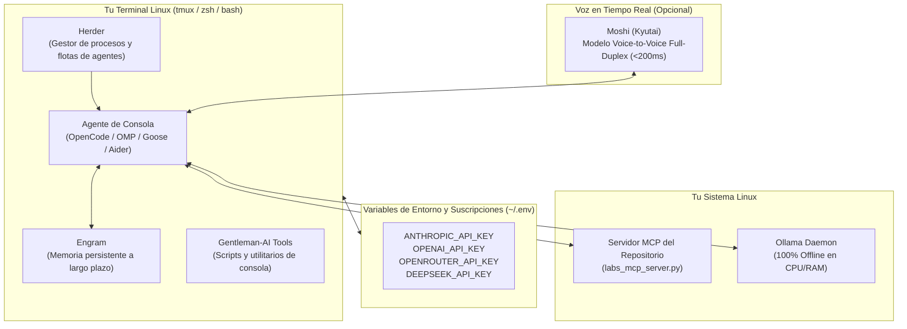
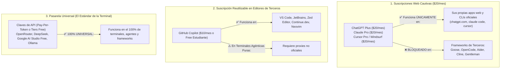
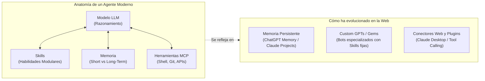

# 🛠️ Tutorial: Entorno de Terminal con Agentes de IA, Suscripciones, OMP / OpenCode, Herder y Moshi

Esta guía práctica enseña cómo configurar un **entorno de trabajo profesional 100% centrado en la terminal (CLI)** para la administración de servidores Linux y desarrollo de software asistido por Inteligencia Artificial.

Aprenderás a gestionar tus suscripciones mediante variables de entorno seguras, compararás herramientas activas como **OpenCode**, **OMP / Goose CLI** y **Herder**, integrarás memoria persistente con **Engram**, herramientas comunitarias de **Gentleman-AI** y explorarás la interacción por voz en tiempo real con **Moshi (Kyutai)**.

---

## 🗺️ Arquitectura del Entorno de Terminal



---

## 🔑 1. Gestión Segura de Suscripciones en la Terminal

Para utilizar modelos comerciales en la terminal sin ingresar contraseñas interactivamente, la industria estandariza el uso de **Variables de Entorno**.

### Configuración del archivo secreto de entorno (`~/.ai_keys`)
Crea un archivo protegido con permisos estrictos de lectura (solo accesibles por tu usuario):

```bash
# Crear archivo de variables con permisos 600 (solo lectura y escritura para tu usuario)
touch ~/.ai_keys
chmod 600 ~/.ai_keys

# Editar con nano o vim
nano ~/.ai_keys
```

Agrega las claves de los proveedores en los que tengas suscripción o saldo de API:
```bash
# Anthropic (Claude 3.5 Sonnet / Opus)
export ANTHROPIC_API_KEY="sk-ant-api03-tu-clave-aqui"

# OpenAI (GPT-4o / o1)
export OPENAI_API_KEY="sk-proj-tu-clave-aqui"

# DeepSeek (V3 / R1 vía API ultrabarata)
export DEEPSEEK_API_KEY="sk-tu-clave-deepseek"

# OpenRouter (Pasarela unificada con acceso a todos los modelos)
export OPENROUTER_API_KEY="sk-or-v1-tu-clave-openrouter"
```

### Cargar las variables automáticamente en tu shell
Añade la lectura del archivo a tu `~/.bashrc` o `~/.zshrc`:
```bash
echo '[ -f ~/.ai_keys ] && source ~/.ai_keys' >> ~/.bashrc
source ~/.bashrc
```

> [!CAUTION] Regla de Oro en Git
> **Nunca hagas `git add` de archivos `.env` o scripts que contengan claves de API.** Asegúrate de incluir `.ai_keys`, `.env` y `*_secrets*` en tu archivo `.gitignore` global.

---

## 💳 2. Suscripción Web ($20/mes) vs Crédito de API: ¿Qué Suscripciones Sirven en Herramientas de Terceros?

Uno de los errores y frustraciones más habituales entre los estudiantes es pensar:
> *"Si ya pago $20 dólares al mes por ChatGPT Plus o Claude Pro, ¿por qué no puedo poner mi cuenta en Goose, OpenCode o Aider y programar gratis todo el día?"*

La respuesta técnica es simple: **las empresas diferencian estrictamente entre suscripciones web cautivas de consumo y consumo de APIs para herramientas de desarrollo.**

### 🚨 La Regla de Oro: Oficiales vs Frameworks de Terceros

1. **En Herramientas Oficiales:**
   * Es lógico que cada empresa te permita usar su propia suscripción en su propia herramienta:
     * **Claude Code (`claude`):** **SÍ permite** iniciar sesión con tu cuenta de **Claude Pro o Claude Team** mediante `claude login`. ¡No necesitas comprar crédito de API aparte!
     * **GitHub Copilot CLI (`gh copilot`):** **SÍ permite** usar tu suscripción personal o de estudiante de GitHub Copilot.
     * **Gemini CLI / Antigravity (`agy`):** **SÍ permite** autenticarte con tu cuenta de Google Cloud / Workspace.
2. **En Frameworks y Terminales Agénticas de Terceros (Goose/OMP, OpenCode, Aider, Cline, Gentleman-AI):**
   * **NINGUNA suscripción mensual de $20 de consumidor (ni ChatGPT Plus, ni Claude Pro, ni Gemini Advanced) funciona directamente.**
   * ¿Por qué? Un agente autónomo puede hacer 40 llamadas recursivas con 50.000 tokens cada una para resolver un bug complejo. Con una tarifa plana de $20/mes las empresas perderían dinero. Por eso, **todas las herramientas agénticas de terceros se alimentan exclusivamente mediante Claves de API (Pay-Per-Token), Tiers Gratuitos de Desarrollador o Modelos Locales en Ollama.**
3. **La Excepción en Editores de Código:**
   * **GitHub Copilot ($10/mes o Free para Estudiantes):** Es la **única suscripción de consumidor** que tiene soporte oficial directo en editores y extensiones de terceros como **Zed Editor**, **Continue.dev** (VS Code / JetBrains) y **Neovim**.



### 🥊 Tabla Comparativa: ¿En qué herramientas de terceros puedes reutilizar cada suscripción mensual?

| Suscripción Web que Pagas | Costo Mensual | En su CLI / App Oficial | ¿Funciona en Frameworks de Terceros? (Goose, OpenCode, Aider, Cline) | ¿Funciona en Editores de Terceros? (Zed, Continue.dev, Neovim) | Diagnóstico Real para el Estudiante |
| :--- | :--- | :--- | :--- | :--- | :--- |
| **GitHub Copilot** | $10/mes (o **GRATIS** para estudiantes) | **SÍ** (`gh copilot`, VS Code) | **NO oficial** (requiere puentes/proxies intermedios). | **SÍ (Nativo)** en Zed Editor, Continue.dev y Neovim. | 🌟 **La más flexible en editores** sin pagar tokens adicionales. |
| **Claude Pro / Team** | $20/mes | **SÍ** (`claude` CLI oficial) | **NO.** Anthropic no permite usar tu login web en Goose o Aider. | **NO.** Requiere comprar créditos de API en Anthropic Console. | ⚠️ **Cautiva de su web y de Claude Code.** En terceros pagas por token. |
| **ChatGPT Plus / Pro** | $20 a $200 / mes | **SÍ** (Web y apps oficiales) | **NO (0% de soporte).** OpenAI no permite login web en terceros. | **NO.** Exige saldo prepagado en `platform.openai.com`. | 🚫 **100% Cautiva.** No puedes usarla en ningún agente ni terminal de terceros. |
| **Gemini Advanced** | $20/mes | **SÍ** (Web gemini.google.com) | **NO.** La suscripción de consumo no otorga claves de API. | **NO.** La suscripción de consumo no otorga claves de API. | 💡 **Innecesaria:** Google regala Gemini 2.0 Flash en **Google AI Studio** para cualquier herramienta. |
| **Cursor Pro / Windsurf** | $20/mes | **SÍ** (En sus propios IDEs) | **NO.** Es exclusiva dentro de su aplicación cerrada. | **NO.** No puedes exportar la suscripción a tu terminal. | 🔒 **Ecosistema cerrado.** Potente en su interfaz, inútil en CLI abierto. |
| **OpenRouter (Saldo Prepago)**| $0 cuota fija (Recargas $5) | N/A (Es pasarela universal) | **SÍ (100% Universal)** en Goose, OpenCode, Aider, Gentleman, Herder. | **SÍ (100% Universal)** en Zed, Continue, Cline, Neovim. | 🏆 **La opción recomendada para terminales.** Máxima libertad, centavos de costo. |

---

## 📊 3. Gran Tabla de Compatibilidad: Herramientas CLI vs Suscripciones y APIs

### ❓ Aclaración Fundamental: ¿Qué significa cada método de acceso?

Para evitar confusiones habituales entre los estudiantes, existen 3 formas concretas en que una herramienta se conecta con la inteligencia artificial:

1. **🌐 Login Web OAuth (Navegador):**
   * El CLI o editor abre tu navegador web o te da una URL con un código para verificar (`claude login`, `gh copilot`).
   * Inicias sesión con tu usuario y contraseña de siempre.
   * **Aprovecha directamente tu suscripción mensual** (Claude Pro/Team o GitHub Copilot) sin que tengas que generar ni pegar claves alfanuméricas raras.

2. **🔑 Solo Clave de API (`API_KEY` secreta):**
   * La herramienta **NO tiene pantalla de login web ni puedes poner tu usuario y contraseña de chatgpt.com**.
   * Debes entrar a la consola de desarrolladores del proveedor (como [OpenRouter](https://openrouter.ai), [DeepSeek Platform](https://platform.deepseek.com) o [Google AI Studio](https://aistudio.google.com)), crear una clave secreta (`sk-...`) y configurarla como variable de entorno o en un archivo de configuración.
   * **¿Sirve tu suscripción web de $20/mes (ChatGPT Plus o Claude Pro)? NO.** Para usar herramientas como Goose, OpenCode, Aider o Gentleman-AI, necesitas cargar saldo prepagado en la API o bien usar proveedores gratuitos / OpenRouter / modelos locales.

3. **💻 Sin Cuenta / 100% Local (Offline):**
   * No requiere navegador, ni registro, ni conexión a internet, ni tarjetas de crédito. Solo tener instalado [Ollama](GLOSARIO.md#ollama) corriendo en tu máquina (`localhost:11434`).

---

### 📋 Tabla de Compatibilidad Detallada

| Herramienta / CLI | ¿Cómo te Autenticas? (Método de Acceso) | ¿Sirve tu Suscripción Web ($20/mes)? | APIs Comerciales Soportadas (vía Claves de API) | ¿Soporta Modelos Locales? (Ollama / vLLM) | Cómo se Configura |
| :--- | :--- | :--- | :--- | :--- | :--- |
| **Claude Code** (`claude`) | **Login Web OAuth** (`claude login`) o Clave API. | **SÍ** (Tu cuenta de Claude Pro o Claude Team). | **Anthropic API** (`ANTHROPIC_API_KEY`). | No oficial (Optimizado para modelos Claude 3.5 en la nube). | Comando: `claude login` o variable `ANTHROPIC_API_KEY`. |
| **Goose CLI / OMP** | **Solo Clave de API** (En `goose configure` o config.yaml). | **NO.** Ninguna suscripción web ($20) funciona en Goose. Requiere API Key o Ollama. | **Anthropic, OpenAI, Databricks, OpenRouter, Groq**. | **SÍ (Nativo)** vía endpoint de Ollama (`localhost:11434`). | Comando interactivo `goose configure` o archivo `~/.config/goose/config.yaml`. |
| **OpenCode / Open Interpreter** | **Solo Clave de API** (Variables de entorno `OPENAI_API_KEY`). | **NO.** Ninguna suscripción web ($20) funciona en OpenCode. Requiere API Key o Ollama. | **OpenAI, Anthropic, DeepSeek, OpenRouter, Google Gemini, Mistral**. | **SÍ (Nativo)** vía flag `--local` o endpoint compatible con OpenAI. | Flags de arranque (`--model openrouter/deepseek/deepseek-r1`) o variables `OPENAI_API_KEY`. |
| **Aider** | **Solo Clave de API** (Variables de entorno `.env` en tu shell). | **NO.** Ninguna suscripción web ($20) funciona en Aider. Requiere API Key o Ollama. | **Todas** (Anthropic, OpenAI, DeepSeek, OpenRouter, Mistral, Groq, Bedrock). | **SÍ** (Ollama local con `--model ollama/llama3.2`). | Variable de entorno (ej: `export ANTHROPIC_API_KEY=...`) y comando `aider --model sonnet`. |
| **Gemini CLI / Antigravity (`agy`)** | **Login Web OAuth** (`gcloud auth login`) o Clave API. | **SÍ** (Cuentas Google Cloud / Workspace oficiales). NO acepta ChatGPT Plus ni Claude Pro. | **Google Gemini API** (`GEMINI_API_KEY`) y Vertex AI. | Soporta endpoints locales compatibles. | `gcloud auth application-default login` o `export GEMINI_API_KEY=...`. |
| **OpenAI CLI (`openai`)** | **Solo Clave de API** (`export OPENAI_API_KEY=...`). | **NO.** ChatGPT Plus ($20) no incluye llamadas a la API oficial. | **OpenAI API** (`OPENAI_API_KEY`). | Soporta flag `--api-base http://localhost:11434/v1`. | Variable de entorno `export OPENAI_API_KEY=...`. |
| **Continue.dev (VS Code / JetBrains)** | **Login Web OAuth para Copilot**; Clave API para el resto. | **SÍ para GitHub Copilot.** NO para ChatGPT Plus ni Claude Pro (esos requieren API Key). | **Todas las APIs comerciales** (OpenRouter, Anthropic, OpenAI, DeepSeek). | **SÍ (Prioritario)** con auto-detección de Ollama local. | Archivo JSON de configuración: [`continue_config.json`](mcp/continue_config.json). |
| **Cline / Roo Code** | **Solo Clave de API** (Se pega en la interfaz de la extensión). | **NO.** Ninguna suscripción web ($20) funciona en Cline. Requiere API Key o Ollama. | **Anthropic, OpenAI, OpenRouter, DeepSeek, AWS Bedrock, GCP Vertex**. | **SÍ** conectando al proveedor `Ollama` en su panel. | Interfaz gráfica de ajustes o archivo [`cline_mcp_settings.json`](mcp/cline_mcp_settings.json). |
| **Herder** | **Hereda el método del agente que lanza** (OAuth o API Key). | Depende del agente que ejecutes (si lanzas Goose o Aider, requiere API Key o Ollama). | Las mismas que soporte el agente configurado (Goose, Aider, OpenCode). | Las mismas del agente subyacente. | Variables de entorno pasadas al comando `herder spawn --env ...`. |
| **Gentleman-AI Tools** | **Solo Clave de API** (Lee `OPENAI_API_KEY` de tu shell). | **NO.** No abre navegador ni tiene login web; solo lee variables. | **OpenAI, DeepSeek, Anthropic, OpenRouter**. | **SÍ** cambiando la URL base a `localhost:11434`. | Variables exportadas en el shell (`OPENAI_API_KEY`, `OPENROUTER_API_KEY`). |
| **Moshi CLI (Kyutai)** | **Sin Cuenta / 100% Local o Servidor de Audio**. | No aplica (Es un modelo fundacional libre de audio). | Usa servidor local o API de Kyutai Labs. | **SÍ (100% Local)** con GPU o servidores locales de inferencia de audio. | Variable `MOSHI_SERVER_URL` o arranque del demonio local. |

---

## 🛠️ 4. Cómo Configurar tu Suscripción en Goose CLI / OMP y OpenCode

### Caso Práctico 1: Configurar Goose CLI / OMP con tu Proveedor Favorito

Goose CLI tiene un asistente interactivo que te guía para seleccionar tu proveedor de suscripción o modelo local:

```bash
# Iniciar el asistente de configuración
goose configure
```

1. **Seleccionar Proveedor:**
   * Elige `anthropic` (si tienes clave de Anthropic), `openai`, `openrouter` o `ollama` (100% local sin costo).
2. **Ingresar la Clave de API:**
   * Si elegiste `anthropic`, te pedirá tu clave: el asistente la guardará de forma cifrada en tu llavero del sistema operativo o en `~/.config/goose/config.yaml`.
3. **Seleccionar el Modelo:**
   * Para Anthropic: `claude-3-5-sonnet-latest`.
   * Para OpenRouter: `deepseek/deepseek-r1` o `meta-llama/llama-3.3-70b-instruct`.
   * Para Ollama local: `llama3.2:3b`.

**Configuración manual directa en `~/.config/goose/config.yaml`:**
```yaml
# Ejemplo: Goose configurado con OpenRouter para gastar solo centavos de saldo
GOOSE_PROVIDER: openrouter
GOOSE_MODEL: deepseek/deepseek-r1
OPENROUTER_API_KEY: sk-or-v1-tu-clave-aqui
```

---

### Caso Práctico 2: Configurar OpenCode / Open Interpreter con tu Suscripción

OpenCode utiliza el motor **LiteLLM**, lo que significa que detecta automáticamente cualquier variable de entorno que tengas exportada:

#### Opción A: Usar tu clave de OpenAI o Anthropic
```bash
# 1. Asegurarte de que la variable este activa
export ANTHROPIC_API_KEY="sk-ant-..."

# 2. Iniciar OpenCode indicando el modelo
opencode --model claude-3-5-sonnet-20241022
```

#### Opción B: Usar OpenRouter con modelos ultrabaratos (DeepSeek R1 / V3)
```bash
export OPENROUTER_API_KEY="sk-or-v1-..."
opencode --model openrouter/deepseek/deepseek-r1
```

#### Opción C: Usar Ollama 100% Local (Gratis, sin internet)
```bash
# Se conecta de forma automatica a http://localhost:11434
opencode --model ollama/llama3.2:3b
```

---

## 🥊 5. Comparativa de Herramientas de Terminal: ¿Cuál elegir?

| Herramienta | Enfoque Principal | Estado y Mantenimiento | Soporte de Suscripciones | Soporte MCP |
| :--- | :--- | :--- | :--- | :--- |
| **Goose CLI / OMP** | Agente de tareas de sistema y extensiones de herramientas. | **Muy activo** (Respaldado por Block). | Excelente (OpenAI, Anthropic, Databricks, Ollama). | **Nativo y prioritario** (Usa `labs_mcp_server.py` de forma directa). |
| **OpenCode / Open Interpreter** | Ejecución interactiva de código y pipelines en terminal. | **Activo** (Comunidad global amplia). | Nativo mediante LiteLLM y endpoints de OpenAI. | En desarrollo / vía plugins. |
| **Aider** | Pair-programming quirúrgico con commits automáticos de Git. | **Muy activo y maduro**. | El mejor para Git diffs con Claude 3.5 Sonnet y DeepSeek. | Enfocado en archivos y repositorio Git. |
| **Herder** | Orquestador y gestor de procesos para flotas de agentes CLI. | **Activo** en nicho de agentes concurrentes. | Hereda las variables del sistema. | Compatible con procesos hijos. |

### 🏆 Recomendación según tu objetivo:
* **Para administrar servidores Linux y hacer los 24 laboratorios de este curso:** Elige **Goose CLI / OMP** porque se conecta de forma nativa a nuestro servidor [`labs_mcp_server.py`](mcp/labs_mcp_server.py).
* **Para programar código C, scripts Bash extensos y refactorizar Git:** Elige **Aider** u **OpenCode**.

---

## ⚙️ 3. Configuración Paso a Paso de las Herramientas

### A. Configurar Goose CLI / OMP con el Servidor MCP del Curso
Goose CLI permite que el modelo en la nube (ej. Claude 3.5 Sonnet) use las herramientas locales de diagnóstico de Linux escritas en Python:

1. **Instalación:**
   ```bash
   # En Linux / macOS:
   curl -fsSL https://github.com/block/goose/releases/latest/download/goose-linux-x86_64.tar.gz | tar -xz
   sudo mv goose /usr/local/bin/
   ```
2. **Vincular el Servidor MCP de este Repositorio:**
   Copia el archivo de configuración [`mcp/goose_config.yaml`](mcp/goose_config.yaml) a tu carpeta de usuario:
   ```bash
   mkdir -p ~/.config/goose
   cp ai/tutor/mcp/goose_config.yaml ~/.config/goose/config.yaml
   ```
3. **Iniciar la Sesión:**
   ```bash
   goose session start
   ```
   *Ahora puedes escribir en la consola: "¿En qué consiste el laboratorio 03 de monitoreo de procesos?" y Goose consultará el catálogo de labs local automáticamente.*

---

### B. Herder: Orquestando Procesos de Agentes en la Terminal
Cuando trabajas en tareas largas (como indexar miles de documentos, compilar kernels o ejecutar pruebas de integración), no quieres que una sola sesión bloquee tu terminal.

**Herder** actúa como un gestor de procesos (*process manager*) para agentes:
* Permite levantar un agente en segundo plano (`background`).
* Supervisa el consumo de memoria y CPU.
* Mantiene logs de la conversación y estados de salida.

```bash
# Ejemplo conceptual de orquestacion con Herder
herder spawn --name "auditor-labs" --cmd "goose session --instruction 'Ejecuta el script demo_monitoreo.sh y analiza logs'"
herder status
herder logs auditor-labs -f
```

---

### C. Engram: Memoria Persistente de Largo Plazo
Uno de los mayores problemas de los agentes de consola es que **olvidan todo cuando cierras la terminal**.

**[Engram](GLOSARIO.md#memoria-en-agentes-working-vs-long-term-memory)** es una capa de memoria estructurada que almacena fragmentos de tus preferencias:
* Registra qué comandos fallaron en tu distribución Linux específica (ej. Fedora vs Ubuntu).
* Almacena las variables de configuración que utilizas frecuentemente.
* Cuando abres una nueva sesión semanas después, el agente consulta a Engram y recuerda tu historial técnico sin que tengas que volver a explicarle tu configuración.

---

### D. Gentleman-AI: Herramientas Comunitarias de Consola
Inspiradas en la filosofía de **Gentleman Programming**, son herramientas y micro-scripts diseñados para el desarrollador que prefiere utilitarios minimalistas:
* Cero dependencias pesadas de frameworks complejos.
* Wrappers en Bash o Python puro que toman la entrada estándar (`cat script.sh | gman "revisa errores"`) y devuelven el resultado limpio sin telemetría ni interfaces sobrecargadas.

---

### E. Moshi (Kyutai): Voz a Voz en Tiempo Real en la Terminal
**Moshi** es el modelo fundacional de voz a voz desarrollado por **Kyutai Labs**. A diferencia de los sistemas tradicionales (que primero pasan de voz a texto con Whisper, luego al LLM y luego a un sintetizador de voz, tardando 2 segundos), Moshi es **end-to-end full duplex**:
* Latencia ultra-baja: **menos de 200 milisegundos**.
* Puedes hablarle por el micrófono mientras estás en la terminal y escucharlo responderte con modulación de voz natural mientras ejecutas comandos.
* Se puede probar en la web oficial [moshi.chat](https://moshi.chat) o descargarse para servidores locales con GPU vía su repositorio oficial de código abierto.

---

## 🧠 4. Conceptos Clave de Agentes: Skills, Memoria y su Evolución hacia la Web



### 1. ¿Qué es un Skill (Habilidad)?
Un **Skill** es un paquete autocontenido de instrucciones especializadas, esquemas de validación y herramientas de código que enseñan al agente a realizar una tarea específica (por ejemplo: auditar permisos de Linux, crear reglas de firewall o analizar volcados de memoria). El agente solo carga el *skill* en su contexto cuando la tarea lo requiere, evitando saturar su ventana de contexto.

#### Referencias Canónicas del Sector en Skills:
* **[Vercel AI SDK Skills & Tool Calling](https://sdk.vercel.ai/docs/ai-sdk-core/tools-and-tool-calling):** La especificación estándar de Vercel para crear herramientas e invocar *skills* tipadas (`tool()`) con esquemas en TypeScript/Zod tanto en agentes de servidor como en interfaces interactivas ([Repositorio oficial Vercel AI](https://github.com/vercel/ai)).
* **[Matt Pocock (Total TypeScript) - AI Skills & Rules](https://github.com/mattpocock):** Matt Pocock es uno de los mayores referentes en el diseño de reglas de comportamiento (*Cursor Rules* y *Agent Skills*), estructurando prompts técnicos y restricciones estrictas para que los agentes resuelvan tareas complejas sin alucinar sintaxis ([Total TypeScript](https://www.totaltypescript.com/)).

### 2. Memoria de Corto Plazo vs Memoria de Largo Plazo
* **Memoria de Corto Plazo (*Working Memory / Context Window*):** El historial de los últimos mensajes del chat. Se borra al reiniciar la sesión.
* **Memoria de Largo Plazo (*Long-Term Memory*):** Base de datos vectorial o almacén clave-valor (como Engram o ChromaDB) donde el agente guarda hechos importantes sobre tu sistema que persisten a lo largo de los meses.

### 3. La Evolución en Clientes Web
Esta arquitectura de la terminal ahora se está trasladando a las interfaces web comerciales:
* **Memoria en ChatGPT / Claude:** Los chats web ahora recuerdan que eres administrador Linux y que prefieres respuestas en formato Bash.
* **Custom GPTs / Gems / Bots:** Son agentes preconfigurados con un *System Prompt* y *Skills* documentales específicos.
* **Integración MCP en la Web:** Clientes como Claude Desktop ya permiten conectar servidores locales MCP directamente a la interfaz gráfica.
