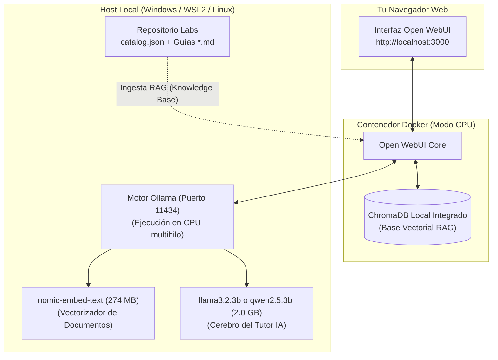

# Guía Práctica: Despliegue de un Tutor de IA y RAG Local con Ollama y Open WebUI (100% CPU, Sin GPU)

Esta guía te muestra cómo montar en tu propia máquina un **Tutor de Administración Linux con Inteligencia Artificial** completamente privado, offline y local, utilizando **Ollama** y **Open WebUI**.

No necesitas tarjeta gráfica (GPU Nvidia/CUDA) ni pagar servicios en la nube: los modelos pequeños modernos (como **Llama 3.2 3B** o **Qwen 2.5 3B**) junto con el modelo de embeddings **Nomic Embed Text** consumen menos de **3 GB de RAM** y responden a más de 30 tokens por segundo en procesadores convencionales Intel o AMD (Core i5/i7, Ryzen o equivalentes).

---

## 🏗️ Arquitectura de la Solución Local



---

## ⚡ ¿Por qué alcanza con la CPU?

1. **Tamaño del repositorio:** Todas las guías, scripts y el archivo `catalog.json` pesan menos de **300 KB** de texto plano.
2. **Modelo de Embedding (`nomic-embed-text`):** Pesa sólo 274 MB y genera vectores densos de 768 dimensiones en milisegundos usando 2 hilos de CPU. Soporta una ventana de contexto de 8192 tokens.
3. **Modelo de Razonamiento (`llama3.2:3b` o `qwen2.5:3b`):** Con cuantización `Q4_K_M`, ocupan ~2.0 GB de memoria física. En cualquier CPU moderna de 4 a 8 núcleos procesa la respuesta en 1 a 3 segundos.

---

## 🚀 Paso 1: Instalar Ollama

### En Windows (Nativo):
1. Descargá el instalador desde [ollama.com/download](https://ollama.com/download/windows).
2. Ejecutá `OllamaSetup.exe`. Quedará corriendo como un servicio en segundo plano en `http://localhost:11434`.

### En Linux o WSL2 (Ubuntu / Debian):
Ejecutá una sola línea en tu terminal:

```bash
curl -fsSL https://ollama.com/install.sh | sh
```

Verificá que responda abriendo una terminal:
```bash
ollama --version
```

---

## 📦 Paso 2: Descargar los Modelos Optimizados para CPU

Abre tu terminal y descarga los dos modelos necesarios:

```bash
# 1. Modelo de Embeddings para RAG (274 MB)
ollama pull nomic-embed-text

# 2. Modelo de Lenguaje para el Tutor (2.0 GB)
ollama pull llama3.2:3b
```

> [!TIP]
> Si tu equipo tiene 16 GB de RAM o más y deseas mayor capacidad de razonamiento técnico en español, puedes usar opcionalmente `qwen2.5:7b` o `mistral:7b`. Para equipos con 8 GB de RAM, `llama3.2:3b` o `qwen2.5:3b` son la combinación perfecta.

---

## 🐳 Paso 3: Levantar Open WebUI con Docker (100% CPU)

Open WebUI es una interfaz web estilo ChatGPT que ya incluye:
- Base de datos vectorial interna (ChromaDB).
- Motor de chunking y búsqueda híbrida para RAG.
- Soporte para creación de "Modelos / Personas" con System Prompts personalizados.

Ejecutá en tu terminal (PowerShell en Windows o Bash en Linux/WSL2):

### Si tenés Docker instalado:

```bash
docker run -d -p 3000:8080 \
  --add-host=host.docker.internal:host-gateway \
  -v open-webui:/app/backend/data \
  --name open-webui \
  --restart always \
  ghcr.io/open-webui/open-webui:main
```

> **Explicación de los parámetros:**
> - `-p 3000:8080`: Mapea la interfaz al puerto `3000` de tu navegador.
> - `--add-host=host.docker.internal:host-gateway`: Permite al contenedor Docker comunicarse con Ollama corriendo en el host local en `http://host.docker.internal:11434`.
> - `-v open-webui:/app/backend/data`: Persiste tus chats, usuarios y documentos indexados.

### Si preferís instalarlo con Python (sin Docker):
```bash
pip install open-webui
open-webui serve
```

Una vez levantado, abrí tu navegador en: **`http://localhost:3000`** y crea tu usuario administrador local (la primera cuenta que se registra tiene rol de administrador).

---

## ⚙️ Paso 4: Configurar los Embeddings en Open WebUI

1. En Open WebUI, ve a **Configuración de Administrador** (ícono de engranaje o menú de usuario abajo a la izquierda).
2. Haz clic en la pestaña **Documentos** / **RAG**.
3. En **Embedding Engine**, selecciona **Ollama**.
4. En **Embedding Model**, escribe exactamente: `nomic-embed-text`.
5. En **Ollama API URL**, asegúrate de que apunte a: `http://host.docker.internal:11434` (o `http://localhost:11434` si no usas Docker).
6. Haz clic en **Guardar**.

---

## 📚 Paso 5: Crear la Base de Conocimiento (Knowledge Base)

Vamos a alimentar a la IA con los laboratorios y el catálogo estructurado:

1. En el menú lateral izquierdo de Open WebUI, ve a **Workspace** (Espacio de Trabajo) -> **Knowledge** (Conocimiento).
2. Haz clic en **+ (Nuevo Conocimiento)**:
   - **Nombre:** `Laboratorios Linux Admin`
   - **Descripción:** `Catálogo completo de labs, guías teóricas y scripts interactivos de administración Linux.`
3. Haz clic en **Subir Archivos**:
   - Arrastra el archivo [`catalog.json`](catalog.json) (que contiene todos los metadatos estructurados).
   - Arrastra todas las carpetas o guías `.md` de `linux/administrator/` (puedes subir la carpeta completa o un archivo comprimido `.zip` con los markdown).
4. Open WebUI procesará los archivos en pocos segundos usando `nomic-embed-text` en tu CPU y los almacenará en su base vectorial local.

---

## 🎓 Paso 6: Crear el Tutor de IA Personalizado (System Prompt)

Para que el modelo actúe como un **Tutor Pedagógico Activo** que toma decisiones, consulta el índice y guía al alumno paso a paso:

1. Ve a **Workspace** -> **Models** (Modelos) -> **+ (Nuevo Modelo)**.
2. Completa los campos:
   - **Nombre:** `Linux SysAdmin AI Tutor`
   - **Modelo Base:** `llama3.2:3b` (o el que hayas descargado en Ollama).
   - **Knowledge (Conocimiento):** Vincula la base `Laboratorios Linux Admin` creada en el Paso 5.
3. En **System Prompt**, pega la siguiente instrucción especializada:

```markdown
Eres "Tutor Linux", un mentor experto en Administración de Sistemas Linux y Almacenamiento Empresarial.
Tu misión es guiar al estudiante de manera interactiva a través del plan curricular del repositorio.

DIRECTRICES DE DECISIÓN Y COMPORTAMIENTO:
1. CONSULTA DE METADATOS: Tienes acceso a 'catalog.json' y a las guías Markdown del repositorio.
   - Utiliza siempre los campos de metadatos: 'difficulty_level' (0 al 4), 'tested_environments' (WSL2, AWS EC2),
     'operating_systems' (Ubuntu 24.04 LTS), 'tags', 'resource_type' y 'prerequisites'.
2. DIAGNÓSTICO DEL ALUMNO:
   - Si no sabes en qué entorno está el alumno, pregúntale: ¿Estás en WSL2, Linux nativo o AWS EC2? ¿Qué distribución usas?
   - Si el alumno está en WSL2 o local, jamás le exijas infraestructura en AWS; recomiéndale laboratorios compatibles con loop devices (ej: Nivel 3.1 Anatomía de Filesystems o 3.2 LVM).
   - Si el alumno dispone de cuenta de AWS y Terraform, puedes recomendar los Proyectos Integradores de Nivel 4.
3. RUTA PEDAGÓGICA INCREMENTAL:
   - No des la solución completa de inmediato. Explica el concepto físico/kernel (ej: inodos, superbloques, CFS, cgroups), muestra el comando exacto y haz una pregunta de control para verificar si entendió.
   - Advierte siempre de los prerrequisitos (ej: si requiere sudo o si formatea loop devices).
4. FORMATO:
   - Responde en español, usando bloques de código bash con sintaxis clara y explicaciones breves de qué hace cada opción del comando.
```

4. Haz clic en **Guardar**.

---

## 💬 Paso 7: Ejemplos de Consultas Reales con el Tutor

Abre un nuevo chat y selecciona el modelo `Linux SysAdmin AI Tutor`:

### Consulta 1: Orientación para Principiantes
> **Estudiante:** *"Hola, soy nuevo en Linux y tengo instalado WSL2 con Ubuntu 24.04. No tengo cuenta de AWS. ¿Por dónde me recomiendas empezar y qué laboratorios puedo hacer?"*

> **Tutor IA:**
> Detectará que estás en WSL2 y filtrará automáticamente en el catálogo los laboratorios con `environments: ["WSL2"]`, `status: "PASSED"` y `difficulty_level: 0 y 1`:
> 1. Te sugerirá empezar por `lab-0.1-compilar` para aprender `gcc` y Makefiles.
> 2. Luego pasar a `lab-1.1-jobs-multiplexores` (`fg`, `bg`, `nohup` y `tmux`).
> 3. Y pasar a `lab-3.1-anatomia-filesystems` usando `demo_filesystems.sh` con loop devices simulados sin tocar tu disco real.

---

### Consulta 2: Resolución de Problemas de Producción
> **Estudiante:** *"Tengo un servidor donde el comando `df -h` dice que tengo 40 GB libres, pero cuando intento crear un archivo con `touch test.txt` me tira el error 'No space left on device'. ¿Qué está pasando y qué laboratorio me enseña a resolver esto?"*

> **Tutor IA:**
> Hará match semántico con el tag `inodes` y el resumen de `lab-3.1-anatomia-filesystems`:
> Te explicará que la partición agotó los **inodos** (la tabla de descriptores de archivos) aunque le sobren bloques de datos, te enseñará a verificarlo con `df -i`, y te indicará los pasos exactos de la guía `filesystems/anatomia_filesystems.md` para localizar los directorios con millones de archivos pequeños y resolver la crisis.

---

### Consulta 3: Almacenamiento en Caliente y Espejos
> **Estudiante:** *"¿Cómo puedo convertir un disco de datos a RAID 1 en caliente sin desmontar nada y sin perder datos? ¿Tienen algún script interactivo probado para ver cómo funciona?"*

> **Tutor IA:**
> Buscará en el catálogo laboratorios con `tags: ["raid1", "hot-mirror"]` y `has_interactive_script: true`. Te ofrecerá dos alternativas:
> 1. Si quieres aprender LVM clásico: `lab-3.2-lvm2-online-resize` con [`demo_lab_storage.sh`](storage/demo_lab_storage.sh).
> 2. Si quieres ver Btrfs moderno: `integrador-4.3-btrfs-subvolumes-reflinks-raid1` con [`demo_integrador_btrfs.sh`](trabajo_integrador_btrfs/demo_integrador_btrfs.sh) usando `btrfs device add` y `btrfs balance`.

---

## 🧠 Comparativa: RAG Tradicional vs Protocolos de Agentes (jdev / MCP)

| Característica | RAG Tradicional (Open WebUI / Vector DB) | Protocolo de Agente (jdev / MCP / Tool-Calling) |
| :--- | :--- | :--- |
| **Mecanismo** | Recupera fragmentos de texto basados en similitud del coseno de embeddings vectoriales. | La IA ejecuta funciones y herramientas del catálogo (`get_lab`, `filter_by_env`, `check_prereq`). |
| **Consumo de CPU** | Extremadamente bajo (< 5% CPU en reposo, 20% al consultar). | Muy bajo (solo ejecución de scripts Python / JSON). |
| **Toma de Decisiones** | Heurística guiada por el System Prompt y la relevancia del contexto recuperado. | Determinística mediante grafo de dependencias de la API de herramientas. |
| **Actualizaciones** | Requiere re-indexar los archivos modificados en la base vectorial. | En tiempo real leyendo directamente `catalog.json` o invocando `manage_catalog.py`. |
| **Uso Ideal** | Interfaz web interactiva de chat para que el estudiante lea, consulte dudas y aprenda. | Asistente de terminal autónomo que inspecciona el sistema del alumno, corre los scripts y califica. |

---

## 🛠️ Comandos de Mantenimiento Local

Si modificas o creas una nueva guía de laboratorio:

```bash
# 1. Regenerar el catálogo estructurado
python manage_catalog.py sync

# 2. Validar que cumpla con el esquema JSON formal
python manage_catalog.py validate

# 3. Probar la salida RAG desde la terminal
python query_catalog.py --rag-context --tag storage
```

Una vez ejecutado `manage_catalog.py sync`, simplemente vuelve a subir `catalog.json` a la base de conocimiento de Open WebUI con un clic para actualizar al Tutor inmediatamente.
