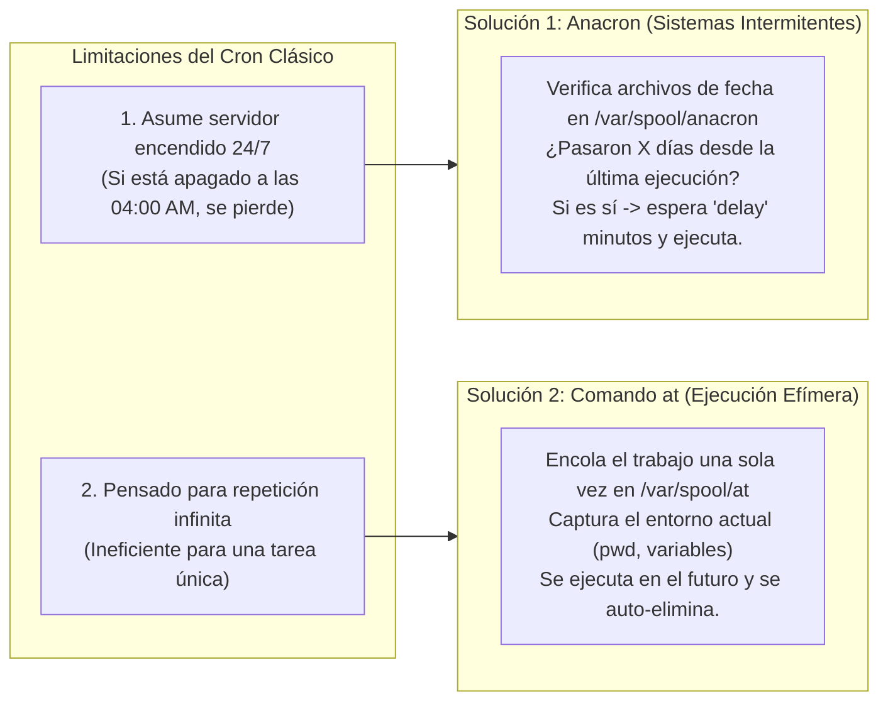
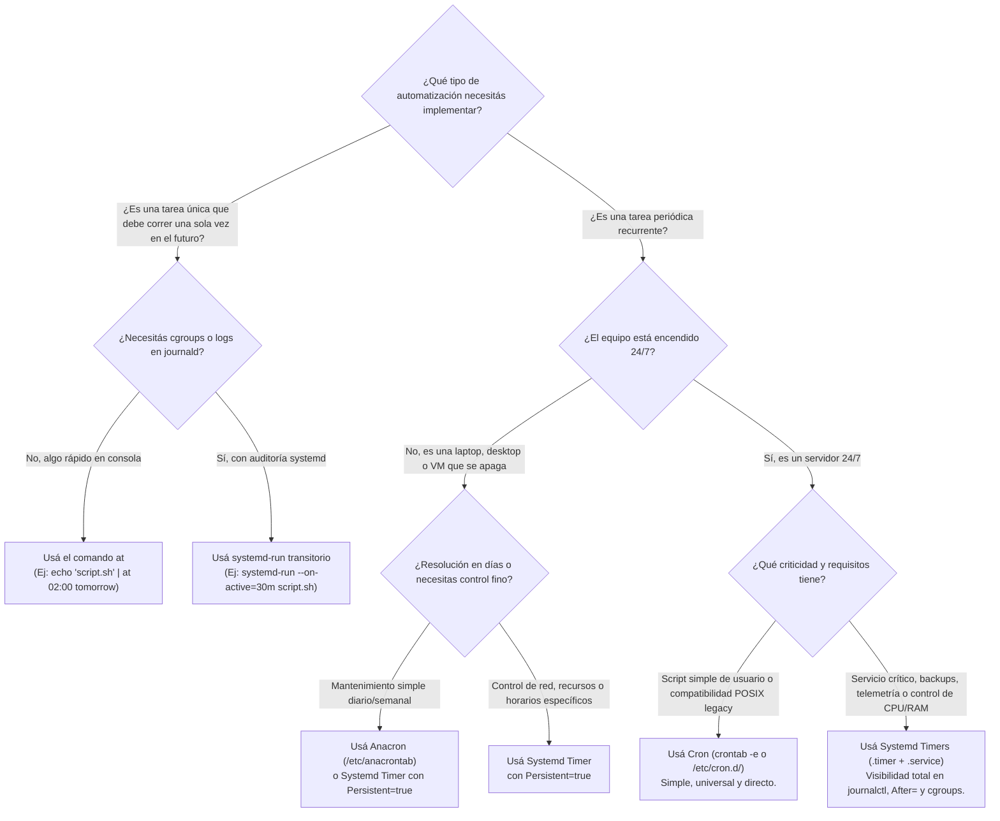

# Arquitecturas de Automatización y Planificación en Linux: De Unix V7 a Systemd Timers

> *"La Regla de Oro del SysAdmin: Ninguna herramienta de automatización, por avanzada que sea, funcionará correctamente si el reloj interno del sistema está desfasado. Automatiza hoy lo que tendrías que ejecutar dos veces mañana."*

En la administración profesional de servidores Linux, la intervención manual repetitiva es sinónimo de error humano, inconsistencia y fatiga operativa. Desde la rotación nocturna de logs y la ejecución de respaldos criptográficos hasta la recolección de telemetría cada pocos segundos, **el sistema operativo requiere motores de planificación deterministas** capaces de ejecutar trabajos sin supervisión humana.

Sin embargo, en Linux no existe un único planificador universal. A lo largo de más de cuatro décadas, el ecosistema ha evolucionado desde demonios minimalistas que despiertan cada minuto hasta orquestadores transaccionales integrados con el kernel mediante `cgroups` y registros binarios estructurados. Comprender **cuándo usar `cron`, `anacron`, `at` o `Systemd Timers`** —y cómo asegurar la sincronización temporal subyacente con **`Chrony (NTP)`**— constituye una competencia medular de cualquier administrador de sistemas o ingeniero SRE.

---

## 🕰️ 1. Evolución Histórica del Ecosistema de Automatización

La planificación de tareas en sistemas tipo Unix ha atravesado cuatro grandes eras tecnológicas, apoyadas sobre una capa base indispensable de sincronización de reloj:

```
+──────────────────────────────────────────────────────────────────────────────────────────────────────+
|                         LÍNEA DE TIEMPO: EVOLUCIÓN DE LA PLANIFICACIÓN EN LINUX                      |
|                                                                                                      |
|   [ 1979: Unix V7 Cron ] ──► [ 1987: Vixie Cron ] ──► [ 1997: at & Anacron ] ──► [ 2010s: Systemd ]  |
|   El pionero en Bell Labs.   Paul Vixie crea el       Bifurcación clave:         Enfoque moderno     |
|   Demonio básico que         estándar moderno:        • at: tareas únicas        nativo: separa      |
|   despierta cada minuto      introduce sintaxis         efímeras (ad-hoc).       .timer y .service,  |
|   para evaluar una tabla     avanzada (/, -, ,) y     • anacron: soporte para    integra journalctl, |
|   global del sistema.        crontabs por usuario.      equipos no 24/7.         red y cgroups v2.   |
|                                                                                                      |
|  ══════════════════════════════════════════════════════════════════════════════════════════════════  |
|        CAPA HABILITADORA INVISIBLE: Chrony (NTP) — Sincronización rigurosa del reloj del kernel      |
+──────────────────────────────────────────────────────────────────────────────────────────────────────+
```

1. **1979 | `Unix V7 Cron`:** El pionero desarrollado en Bell Labs. Introdujo la funcionalidad básica de un demonio en segundo plano que despierta cada 60 segundos para verificar si existe alguna tarea programada en una tabla global.
2. **1987 | `Vixie Cron` (y derivados modernos como `cronie`):** Creado por Paul Vixie, se convirtió en el estándar de facto de Linux. Introdujo la sintaxis avanzada de operadores matemáticos (pasos `/`, rangos `-`, listas `,`), las macros `@` y las listas de tareas independientes aisladas por usuario (`crontab -e`).
3. **1997 | `at` & `Anacron`:** La bifurcación de utilidades especializadas para cubrir los puntos ciegos de Cron:
   - **`at` (`atd`):** Diseñado para encolar **tareas únicas efímeras (*one-shot*)** en el futuro sin dejar basura residual en el crontab.
   - **`Anacron`:** Diseñado para **sistemas intermitentes (laptops, desktops, estaciones de trabajo)** que no están encendidos 24/7, garantizando que las tareas perdidas durante un apagado se ejecuten tras el próximo arranque.
4. **2010s | `Systemd Timers`:** El estándar moderno nativo en distribuciones empresariales actuales (Ubuntu, Debian, RHEL, Rocky Linux, Arch). Desacopla el *cuándo* (`.timer`) del *qué* (`.service`), ofreciendo logs nativos en `journalctl`, dependencias estrictas de red/montajes, resolución de microsegundos y control de recursos con `cgroups v2`.
5. **El Habilitador Invisible | `Chrony (NTP)`:** Ningún disparador temporal sirve si el reloj del servidor deriva (*clock drift*). `chronyd` mantiene el reloj del sistema rigurosamente sincronizado con servidores atómicos NTP para garantizar la exactitud de todos los triggers superiores.

---

## ⚖️ 2. Matriz de Decisión Operativa: ¿Qué Herramienta Elegir?

A continuación se presenta la **Matriz de Decisión Operativa** oficial para seleccionar el motor de planificación adecuado según la topología del hardware y la naturaleza del trabajo:

| Herramienta | Servidor 24/7 | Laptop / Desktop | Ejecución Única (Ad-Hoc) | Logs y Dependencias | Síntesis de Uso Ideal | Laboratorio Práctico en el Repo |
| :--- | :---: | :---: | :---: | :---: | :--- | :--- |
| **`Cron`** (`crond` / `cronie`) | ✅ **Ideal** | ❌ **Pérdida de tareas** *(Si está apagado a la hora exacta, no corre)* | ❌ **Residual** *(Deja código muerto en crontab)* | ⚠️ **Básicos** *(Syslog + Mail local)* | Tareas de fondo rápidas, scripts simples POSIX y mantenimiento periódico en servidores encendidos 24/7. | [`cron_crontab_planificacion.md`](cron_crontab_planificacion.md) · [`demo_cron_crontab.sh`](demo_cron_crontab.sh) |
| **`Anacron`** (`/etc/anacrontab`) | ⚠️ **Redundante** *(Salvo para tareas diarias/semanales)* | ✅ **Ideal** | ❌ **No diseñado** *(Mínimo resolución en días)* | ⚠️ **Básicos** *(Timestamps en `/var/spool/anacron`)* | Mantenimiento asíncrono (rotación de logs, auditorías) en hardware de oficina, laptops y VMs intermitentes. | [`anacron_at_tareas_asincronas.md`](anacron_at_tareas_asincronas.md) · [`demo_anacron_at.sh`](demo_anacron_at.sh) |
| **`at`** (`atd` / `batch`) | ✅ **Soportado** | ✅ **Soportado** | ✅ **Nativo** *(Se auto-elimina al terminar)* | ❌ **N/A** *(Sin dependencias de servicio)* | Trabajos ad-hoc retrasados, ventanas de mantenimiento puntuales y tareas pesadas cuando baje la carga (`batch`). | [`anacron_at_tareas_asincronas.md`](anacron_at_tareas_asincronas.md) · [`demo_anacron_at.sh`](demo_anacron_at.sh) |
| **`Systemd Timers`** (`.timer` + `.service`) | ✅ **Enterprise** | ✅ **Soportado** *(Con directiva `Persistent=true`)* | ✅ **Soportado** *(Con `systemd-run --on-active`)* | ✅ **Avanzados** *(`journalctl`, `After=`, `cgroups v2`)* | Servicios críticos de producción, entornos empresariales, backups seguros y arquitecturas con dependencias complejas. | [`systemd_timers_vs_cron_chrony.md`](systemd_timers_vs_cron_chrony.md) · [`demo_systemd_timers_chrony.sh`](demo_systemd_timers_chrony.sh) |

---

## 🔍 3. Análisis Arquitectónico de los 4 Motores + Capa NTP

### 3.1 El Servicio Core: `cron` y la Anatomía de `crontab`

`cron` es el demonio clásico que permanece residente en memoria y despierta una vez por minuto para inspeccionar:
- El archivo global del sistema: `/etc/crontab`
- Los fragmentos de paquetes del sistema: `/etc/cron.d/`
- Los directorios predefinidos por frecuencia: `/etc/cron.hourly/`, `/etc/cron.daily/`, `/etc/cron.weekly/`, `/etc/cron.monthly/`
- Las colas individuales de cada usuario: `/var/spool/cron/crontabs/<usuario>` (en Debian/Ubuntu) o `/var/spool/cron/<usuario>` (en RHEL/Rocky), gestionadas exclusivamente mediante el comando `crontab`.

#### El Motor de Configuración Global (`/etc/crontab`)
A diferencia de una sesión interactiva de terminal donde el usuario carga `.bashrc` o `.profile`, **`cron` ejecuta los comandos en un entorno limpio y minimalista**. Por ello, `/etc/crontab` define tres variables críticas de arquitectura:
- **`SHELL=/bin/bash`**: Define qué intérprete ejecutará las líneas (por defecto en crontabs de usuario suele ser `/bin/sh` básico).
- **`PATH=/sbin:/bin:/usr/sbin:/usr/bin`**: Establece las rutas de búsqueda de binarios. **Es la causa #1 de fallos en scripts automatizados:** si un script invoca un comando ubicado en `/usr/local/bin` sin usar su ruta absoluta, fallará en cron aunque funcione manualmente en la terminal del administrador.
- **`MAILTO=root`**: Define el buzón local al que se enviarán por correo electrónico las salidas estándar (`stdout`) y de error (`stderr`) si el comando no las redirige explícitamente.

#### Anatomía de los 5 Campos de Tiempo y Operadores
```
  *    *    *    *    *    [usuario]   comando_a_ejecutar
  ┬    ┬    ┬    ┬    ┬
  │    │    │    │    └─── [5to *] Día de la semana : 0 a 6 (0 o 7 = Domingo, o sun, mon, tue, wed, thu, fri, sat)
  │    │    │    └──────── [4to *] Mes              : 1 a 12 (o jan, feb, mar, apr...)
  │    │    └───────────── [3er *] Día del mes      : 1 a 31
  │    └────────────────── [2do *] Hora             : 0 a 23 (Formato 24 horas)
  └─────────────────────── [1er *] Minuto           : 0 a 59
```
*(Nota: El campo `usuario` solo existe en `/etc/crontab` y `/etc/cron.d/*`; en los crontabs de usuario creados con `crontab -e` se omite porque el trabajo corre con los permisos del propio usuario).*

| Operador / Macro | Nombre Técnico | Ejemplo Práctico | Significado Exacto |
| :--- | :--- | :--- | :--- |
| **`*`** | Comodín (*Wildcard*) | `0 4 * * *` | Todos los valores posibles del campo. Ej: todos los días a las 04:00 AM. |
| **`/`** | Intervalo divisible (*Step*) | `*/5 * * * *` <br> `0 */5 * * *` | Se ejecuta cada 5 minutos (`*/5`), o al minuto 0 cada 5 horas (`0 */5`). |
| **`-`** | Rango continuo (*Range*) | `0 9-18 * * *` | Se ejecuta al minuto 0 de cada hora continua entre las 09:00 y las 18:00 inclusive. |
| **`,`** | Lista discontinua (*List*) | `0 0 * 5,10 *` | Se ejecuta a medianoche solo en Mayo (5) y Octubre (10). *(Cron no tiene sintaxis de "cada 5 meses", por lo que deben listarse con coma).* |
| **`@yearly`** / **`@annually`** | Macro Anual | `@yearly /bin/anual.sh` | Equivalente a `0 0 1 1 *` (1 de enero a las 00:00). |
| **`@monthly`** | Macro Mensual | `@monthly /bin/mes.sh` | Equivalente a `0 0 1 * *` (Día 1 de cada mes a las 00:00). |
| **`@weekly`** | Macro Semanal | `@weekly /bin/sem.sh` | Equivalente a `0 0 * * 0` (Cada domingo a las 00:00). |
| **`@daily`** / **`@midnight`** | Macro Diaria | `@daily /bin/dia.sh` | Equivalente a `0 0 * * *` (Todos los días a las 00:00). |
| **`@hourly`** | Macro Horaria | `@hourly /bin/hora.sh` | Equivalente a `0 * * * *` (Al minuto 0 de cada hora). |
| **`@reboot`** | Macro de Inicio | `@reboot /bin/limpia.sh` | Se ejecuta **una única vez** durante la secuencia de arranque del demonio cron. |

> [!CAUTION]
> **Advertencia Operativa en `crontab`:**
> Las tres banderas principales del comando de usuario son `-l` (listar), `-e` (editar) y `-r` (eliminar inmediatamente todas las tareas sin confirmación). En un teclado QWERTY estándar, **la tecla `r` se encuentra pegada a la tecla `e`**. Un error de tipeo al escribir `crontab -r` purgará toda la planificación del usuario. Se recomienda siempre respaldar con `crontab -l > backup_cron.txt` o utilizar `crontab -i -r` para exigir confirmación interactiva.

---

### 3.2 Expandiendo el Ecosistema: `Anacron` y `at`



#### 1. `Anacron`: Para Sistemas Intermitentes
- **El Problema:** `cron` evalúa coincidencias exactas de reloj. Si una estación de trabajo o laptop tiene programado un backup a las `04:00 AM` y a esa hora está apagada o suspendida, al encenderse a las `09:00 AM` `cron` no hará nada y la tarea se perderá irrecuperablemente.
- **La Solución:** `anacron` no mira la hora exacta del reloj; trabaja con períodos en días (`1` diario, `7` semanal, `@monthly` mensual) configurados en `/etc/anacrontab`. Al iniciar el sistema, compara la fecha actual con el sello de tiempo (*timestamp* `YYYYMMDD`) guardado en `/var/spool/anacron/<job_id>`. Si han transcurrido $N$ o más días desde la última ejecución, aguarda los minutos definidos en el campo `delay` (para no saturar el disco durante el arranque) y lanza la tarea pendiente.

#### 2. El Comando `at`: Ejecución Efímera Ad-Hoc
- **El Problema:** Si necesitás ejecutar un reinicio, un cambio de regla de firewall o una migración de base de datos **una sola vez** mañana a las 02:00 AM, crear una línea en `crontab` es peligroso: si olvidás borrarla al día siguiente, el servidor volverá a reiniciarse inesperadamente la semana próxima o el mes próximo.
- **La Solución:** El demonio `atd` y el comando `at` permiten encolar trabajos de **ejecución única** con lenguaje natural (`now + 15 minutes`, `2:00 AM tomorrow`, `teatime`, `noon`). Además, a diferencia de `cron`, **`at` clona automáticamente todas las variables de entorno actuales del usuario y su directorio de trabajo (`$PWD`)** en el momento de encolar la orden, y destruye el script de la cola una vez finalizado.

---

### 3.3 El Estándar Moderno: `Systemd Timers`

En las distribuciones Linux contemporáneas (Ubuntu, Debian, RHEL, Rocky Linux, SUSE, Arch), **Systemd Timers** ha desplazado a `cron` y `anacron` como la arquitectura predeterminada para servicios del sistema.

```
                           ARQUITECTURA DESACOPLADA EN SYSTEMD
     ┌───────────────────────────────┐             ┌───────────────────────────────┐
     │       mi_tarea.timer          │   Dispara   │       mi_tarea.service        │
     │      (Define el CUÁNDO)       │ ──────────► │       (Define el QUÉ)         │
     │ • OnCalendar=*-*-* 03:00:00   │             │ • Type=oneshot                │
     │ • OnBootSec=5min              │             │ • After=network-online.target │
     │ • Persistent=true (Anacron)   │             │ • CPUQuota=30% / MemoryMax=1G │
     └───────────────────────────────┘             └───────────────┬───────────────┘
                                                                   │
                                                                   ▼ Captura stdout/stderr
                                                   ┌───────────────────────────────┐
                                                   │           journald            │
                                                   │   (Logs estructurados listos  │
                                                   │   para journalctl -u tarea)   │
                                                   └───────────────────────────────┘
```

#### Las 5 Ventajas Operativas de Systemd Timers sobre Cron:
1. **Desacoplamiento Lógico (`.timer` + `.service`):** En lugar de comprimir tiempo y comando en una sola línea críptica, `systemd` separa el disparador temporal (`mi_tarea.timer`) de la unidad de ejecución (`mi_tarea.service`). Esto permite ejecutar y probar la tarea manualmente en cualquier momento con `sudo systemctl start mi_tarea.service` sin esperar a que llegue la hora del timer ni copiar/pegar comandos desde el crontab.
2. **Visibilidad y Auditoría Forense en `journalctl`:** Todo lo que el script imprime por `stdout` o `stderr`, junto con su código de salida (`ExitCode`), tiempo de CPU consumido y PID, queda indexado automáticamente en el diario del sistema (`journalctl -u mi_tarea.service`), sin depender de servidores de correo locales (`postfix`/`sendmail`).
3. **Dependencias Condicionales Estrictas:** Permite exigir estados previos del sistema antes de correr la tarea. Por ejemplo, ejecutar un respaldo a las 03:00 AM **solo si** la interfaz de red está en línea (`After=network-online.target`) y el volumen cifrado está montado (`Requires=mnt-backup.mount`).
4. **Control de Recursos y Aislamiento (`cgroups v2`):** Un script lanzado por `cron` puede descontrolarse y consumir el 100% de la CPU y la memoria RAM, derribando la base de datos en producción. Con `systemd`, basta añadir `CPUQuota=25%`, `MemoryMax=512M` o `IOSchedulingClass=idle` en el `.service` para que el kernel contenga físicamente a la tarea.
5. **Fusión Nativa de Cron + Anacron + at:**
   - Funciona como `cron` mediante calendarios exactos (`OnCalendar=`).
   - Funciona como `anacron` añadiendo una sola línea: **`Persistent=true`** (guarda en disco la última ejecución y dispara la tarea al encender la máquina si se perdió el horario).
   - Funciona como `at` mediante timers transitorios en memoria con `systemd-run --on-active="15m" comando`.

---

### 3.4 La Capa Base: Sincronización de Tiempo con `Chrony (NTP)`

Como destaca la **Regla de Oro del SysAdmin**, cualquier planificación temporal carece de valor si el reloj del servidor está adelantado, atrasado o sufre deriva térmica en su cristal de cuarzo (*clock drift*).

En Linux conviven dos relojes:
- **RTC (*Real Time Clock* / Reloj de Hardware):** Alimentado por la pila CMOS de la placa base (o emulado por el hipervisor), mantiene la hora cuando el equipo está apagado. Se recomienda mantenerlo siempre en **UTC**.
- **System Clock (*Reloj del Kernel*):** Mantenido por interrupciones del temporizador en memoria RAM desde el momento del arranque. Es el reloj que consultan `cron`, `at`, `systemd` y los certificados TLS/Kerberos.

**`Chrony` (`chronyd` + `chronyc`)** es el cliente y servidor **NTP (*Network Time Protocol*)** moderno por defecto en RHEL, Rocky Linux, Ubuntu y Amazon Linux:
- Corrige desfases gradualmente (*slewing*) acelerando o desacelerando ligeramente los ticks del kernel para no provocar saltos bruscos hacia atrás en el tiempo que corromperían bases de datos o duplicarían ejecuciones de `cron`.
- Si detecta un desfase masivo al arrancar (por ejemplo, una VM que estuvo pausada), permite forzar un salto inmediato (*stepping*) mediante `makestep`.

---

## 🚦 4. Árbol de Decisión Rápida para Producción



---

## 🗺️ 5. Hoja de Ruta de los Laboratorios Prácticos de Automatización

Para dominar de punta a punta todos los componentes del temario oficial, seguí esta secuencia de laboratorios prácticos con scripts interactivos de demostración (`demo_*.sh`):

1. **Laboratorio 2.4 — Planificación Clásica con `cron` y `crontab`:**
   - 📖 Guía Paso a Paso: [`cron_crontab_planificacion.md`](cron_crontab_planificacion.md)
   - 💻 Script Interactivo: [`demo_cron_crontab.sh`](demo_cron_crontab.sh) · Limpieza: [`limpiar_cron_crontab.sh`](limpiar_cron_crontab.sh)
   - **Qué practicarás:** Anatomía de `/etc/crontab` (`SHELL`, `PATH`, `MAILTO`), los 5 campos, operadores (`*`, `/`, `-`, `,`), macros (`@yearly`, `@monthly`, `@daily`, `@hourly`, `@reboot`), gestión por usuario (`crontab -l`, `-e`, `-r`), control de acceso (`cron.allow` / `cron.deny`) y resolución del clásico fallo de variables de entorno `PATH`.

2. **Laboratorio 2.5 — Tareas Asíncronas y Sistemas Intermitentes con `Anacron` y `at`:**
   - 📖 Guía Paso a Paso: [`anacron_at_tareas_asincronas.md`](anacron_at_tareas_asincronas.md)
   - 💻 Script Interactivo: [`demo_anacron_at.sh`](demo_anacron_at.sh) · Limpieza: [`limpiar_anacron_at.sh`](limpiar_anacron_at.sh)
   - **Qué practicarás:** Configuración de `/etc/anacrontab` (`period`, `delay`, `job-identifier`), simulación forense de tarea perdida durante un apagado alterando `/var/spool/anacron/`, recuperación con `anacron -f -n`, y encolado de tareas únicas efímeras con `at`, inspección de entorno capturado (`at -c`), listado con `atq` y cancelación con `atrm`.

3. **Laboratorio 2.6 — El Estándar Moderno: `Systemd Timers` vs `Cron` y Sincronización `Chrony (NTP)`:**
   - 📖 Guía Paso a Paso: [`systemd_timers_vs_cron_chrony.md`](systemd_timers_vs_cron_chrony.md)
   - 💻 Script Interactivo: [`demo_systemd_timers_chrony.sh`](demo_systemd_timers_chrony.sh) · Limpieza: [`limpiar_systemd_timers_chrony.sh`](limpiar_systemd_timers_chrony.sh)
   - **Qué practicarás:** Auditoría de reloj y estrato NTP con `timedatectl` y `chronyc tracking` / `chronyc sources`, validación de expresiones de calendario con `systemd-analyze calendar`, migración de una tarea de `cron` hacia un par desacoplado `.timer` + `.service` con `Persistent=true`, dependencias de red y límites de `cgroups`, timers efímeros con `systemd-run` y auditoría en `journalctl`.

4. **Laboratorios Complementarios de Supervisión y Casos Reales en el Repositorio:**
   - 📖 Monitor de Memoria con Systemd Services: [`../systemd/systemd-memlogger.md`](../systemd/systemd-memlogger.md)
   - 📖 Backups Cifrados Automatizados con BorgBackup y Systemd Timers: [`../borg/borg-con-systemd-timers.md`](../borg/borg-con-systemd-timers.md)

---

## 🔗 6. Documentación y Fuentes Oficiales

| Tecnología | Propósito en el Stack | Documentación Oficial y Manuales Upstream |
| :--- | :--- | :--- |
| **`Cron` (`cronie` / Vixie)** | Planificador periódico clásico para servidores 24/7 | [man 5 crontab (Linux man-pages)](https://man7.org/linux/man-pages/man5/crontab.5.html) · [man 8 cron](https://man7.org/linux/man-pages/man8/cron.8.html) · [Repositorio Oficial cronie-crond](https://github.com/cronie-crond/cronie) |
| **`Anacron`** | Ejecución periódica tolerante a apagados | [man 5 anacrontab](https://man7.org/linux/man-pages/man5/anacrontab.5.html) · [man 8 anacron](https://man7.org/linux/man-pages/man8/anacron.8.html) |
| **`at` (`atd` / `batch`)** | Cola de trabajos efímeros de ejecución única | [man 1 at (POSIX / Linux)](https://man7.org/linux/man-pages/man1/at.1p.html) · [Arch Wiki: at](https://wiki.archlinux.org/title/At) |
| **`systemd.timer`** | Temporizadores modernos desacoplados con journald y cgroups | [freedesktop.org: systemd.timer(5)](https://www.freedesktop.org/software/systemd/man/systemd.timer.html) · [freedesktop.org: systemd.time(7)](https://www.freedesktop.org/software/systemd/man/systemd.time.html) |
| **`Chrony` (`chronyd`)** | Demonio y cliente de sincronización NTP de alta precisión | [Sitio Oficial Chrony Project](https://chrony-project.org/documentation.html) · [Red Hat Configuring NTP Using Chrony](https://docs.redhat.com/en/documentation/red_hat_enterprise_linux/9/html/configuring_basic_system_settings/configuring-time-synchronization_configuring-basic-system-settings) |
