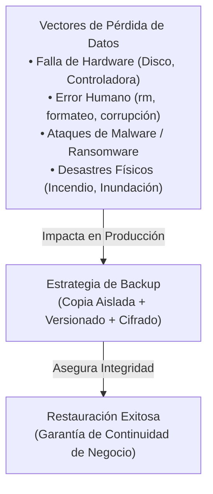
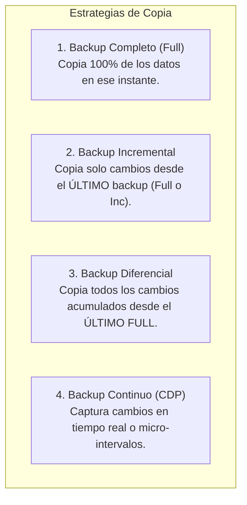
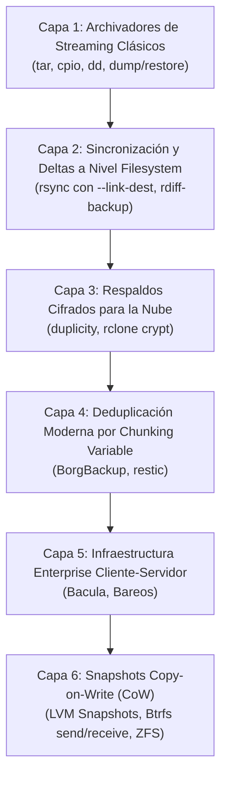
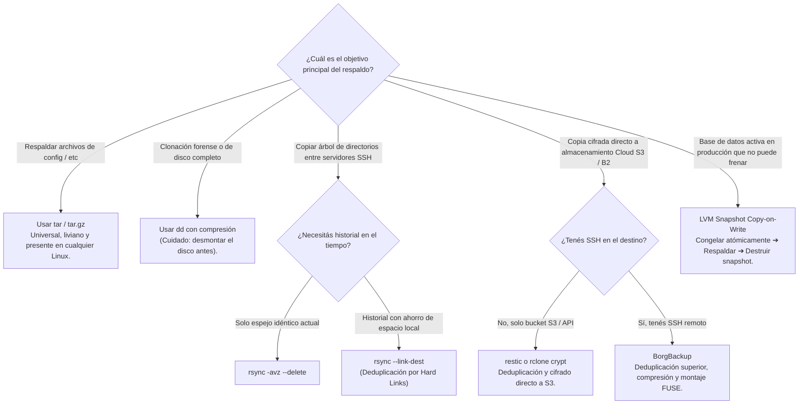

# Arquitecturas de Respaldo en Linux: Estrategias, Deduplicación y Matriz de Herramientas

> *"Existen dos tipos de administradores de sistemas: los que ya hacen backups regulares y prueban sus restauraciones, y los que van a empezar a hacerlo después de su primera catástrofe."*

En cualquier infraestructura informática —desde un servidor físico *Bare-Metal* en un centro de datos hasta contenedores y máquinas virtuales en la nube (AWS EC2, Google Cloud Compute Engine)— **la pérdida de datos es una certeza estadística**. Los discos mecánicos y SSD sufren desgaste físico (*Hardware Failure*), los desarrolladores cometen errores humanos (`DROP TABLE` o `rm -rf`), el malware o ransomware infecta sistemas y los desastres naturales pueden inutilizar una región geográfica completa.

El objetivo de esta guía es proporcionar el marco conceptual y taxonómico definitivo sobre cómo diseñar una política de copias de seguridad en Linux, contrastando las herramientas clásicas de UNIX con los motores modernos de deduplicación y almacenamiento en la nube.

---

## 🧭 1. Fundamentos: ¿Qué es un Backup y Qué Problemas Resuelve?

Un **backup (copia de seguridad)** es un duplicado consistente e independiente de los datos y metadatos de un sistema, almacenado en un medio secundario o ubicación externa, diseñado para permitir la reconstrucción fiel del estado operativo ante un evento destructivo.



### Los Dos Indicadores Críticos del Negocio: RPO y RTO

Toda arquitectura de copias de seguridad debe diseñarse en función de dos métricas operativas pactadas con la organización (*Service Level Agreement* - SLA):

```
+─────────────────────────────────────────────────────────────────────────────────────────────+
│                                 LÍNEA TEMPORAL DE UN DESASTRE                               │
│                                                                                             │
│  Último Backup                         Momento del Fallo                 Sistema Restaurado │
│       │◄───────────── RPO ─────────────►│◄─────────────────── RTO ───────────────►│         │
│       │    (Datos que se pierden)       │          (Tiempo sin servicio)          │         │
│───────┴─────────────────────────────────▲─────────────────────────────────────────┴─────────►
│                                    💥 DESASTRE                                      TIEMPO   │
+─────────────────────────────────────────────────────────────────────────────────────────────+
```

1. **RPO (Recovery Point Objective - Objetivo de Punto de Recuperación):**
   - Mide la **cantidad máxima de datos que la organización está dispuesta a perder**, expresada en tiempo.
   - *Ejemplo:* Si el backup corre una vez al día a las 02:00 AM y el servidor falla a las 18:00 PM, se habrán perdido 16 horas de transacciones de usuarios. Si el negocio no tolera perder más de 15 minutos de datos, el RPO exige backups continuos (CDP) o replicación de logs de transacciones cada cuarto de hora.
2. **RTO (Recovery Time Objective - Objetivo de Tiempo de Recuperación):**
   - Mide el **tiempo transcurrido desde que ocurre el desastre hasta que el servicio vuelve a estar 100% operativo**.
   - *Ejemplo:* Si tenés un archivo de backup de 5 Terabytes pero la velocidad de descarga y descompresión tarda 14 horas, tu RTO es de 14 horas. Si el SLA de la empresa exige estar arriba en 30 minutos, necesitas tecnologías de montaje instantáneo (*Borg mount*, snapshots CoW o copias locales de baja latencia).

---

## 📊 2. Tipos y Estrategias de Backup

Existen cuatro estrategias fundamentales para generar copias de seguridad en Linux, cada una con un balance particular entre velocidad de captura, espacio en disco consumido y tiempo de restauración:



### 1. Backup Completo (Full Backup)
- **Mecanismo:** Lee y respalda **todos y cada uno de los archivos o bloques** del directorio o sistema de archivos seleccionado, sin importar si cambiaron o no.
- **Ventajas:**
  - Es el método conceptualmente más simple.
  - La restauración es directa: basta con extraer un único archivo o paquete.
- **Desventajas:**
  - Es el más lento de generar (alto consumo de I/O de disco y red).
  - Ocupa enormes cantidades de espacio de almacenamiento si se repite con frecuencia.
- **Herramientas típicas:** `tar -cvpzf backup.tar.gz`, `dd`, `rsync -a`.

### 2. Backup Incremental
- **Mecanismo:** Respalda únicamente los datos que han sido añadidos o modificados **desde el último respaldo ejecutado, sin importar si ese último respaldo fue Full o Incremental**.
- **Ventajas:**
  - Es ultra rápido de generar (ventanas de backup muy pequeñas).
  - Consume el mínimo espacio en disco posible por sesión.
- **Desventajas (La Cadena de Restauración):**
  - Para restaurar el estado del día viernes, se debe restaurar el Full del domingo + el Inc del lunes + Inc del martes + Inc del miércoles + Inc del jueves + Inc del viernes. Si una sola cinta o archivo incremental intermedio se corrompe, los incrementales posteriores no pueden recuperarse.
- **Herramientas típicas:** `tar --listed-incremental`, `rsync --link-dest`, `duplicity`, `rdiff-backup`, `borg`.

### 3. Backup Diferencial
- **Mecanismo:** Respalda todos los archivos o bloques que han sido modificados **desde el último respaldo Completo (Full)**.
- **Diferencia clave con el Incremental:**
  - El primer diferencial tras el Full ocupa poco. Pero con el paso de los días, el diferencial acumula más y más cambios, creciendo en tamaño hasta que se ejecute el siguiente Full.
- **Ventajas:**
  - La restauración es mucho más rápida y segura que en el incremental: solo se necesita **el Full original + el ÚLTIMO archivo Diferencial**.
- **Desventajas:**
  - Consume más espacio de almacenamiento y ancho de banda que el incremental a medida que avanza la semana.
- **Herramientas típicas:** `duplicity`, `bacula`, scripts basados en `find -newer`.

### 4. Backup Continuo (Continuous Data Protection - CDP)
- **Mecanismo:** Captura y almacena de forma automatizada e instantánea cada cambio o transacción en micro-intervalos de tiempo (segundos o minutos).
- **Implementaciones en Linux:**
  - Suscripción a eventos del kernel mediante `inotify` / `fanotify`.
  - Replicación continua de logs de transacciones en bases de datos (WAL en PostgreSQL, Binlog en MySQL).
  - Snapshots Copy-on-Write y replicación de bloques en ZFS o Btrfs (`zfs send` periódico).
- **Ventajas:** RPO cercano a cero (pérdida prácticamente nula de transacciones).
- **Desventajas:** Mayor complejidad de infraestructura y requerimiento de almacenamiento de alto rendimiento.

---

## 🌍 3. Ubicación: Backup Local vs Backup Remoto (Y la Regla 3-2-1)

El almacenamiento del backup define su capacidad de resistir desastres:

```
┌─────────────────────────────────┬────────────────────────────────────────────────────────┐
│ CRITERIO                        │ BACKUP LOCAL                                           │ BACKUP REMOTO (OFFSITE / CLOUD)        │
├─────────────────────────────────┼────────────────────────────────────────────────────────┤
│ Ubicación Física                │ Mismo servidor, disco secundario, NAS en la misma LAN. │ Servidor externo por SSH, S3, Datacenter remoto. │
│ Latencia y Velocidad de Restore │ Ultra rápida (Gigabits por segundo / bus SATA/NVMe).   │ Limitada por el ancho de banda de Internet.     │
│ Costo de Transferencia          │ Cero costo de egreso.                                  │ Costos de transferencia de red (Cloud egress). │
│ Resistencia a Desastres Físicos │ NULA: Si el servidor o datacenter se incendia, se pierde.│ MÁXIMA: Inmune a incidentes del sitio local.  │
│ Resistencia a Ransomware        │ BAJA: Si el servidor es comprometido, el atacante borra │ ALTA: Con repositorios inmutables (WORM/Object Lock)│
│                                 │ los backups locales montados en `/mnt/backup`.        │ o credenciales de escritura ciega (*append-only*).│
└─────────────────────────────────┴────────────────────────────────────────────────────────┘
```

### 🏆 La Regla de Oro 3-2-1
En la administración profesional de infraestructuras se aplica de manera estricta la **Regla 3-2-1**:
1. **3 Copias:** Mantener tres copias de los datos importantes (los datos originales en producción + dos respaldos).
2. **2 Medios Distintos:** Almacenar las copias en al menos dos tipos de medios o tecnologías diferentes (por ejemplo, disco local / NAS interno + almacenamiento en la nube o cintas).
3. **1 Copia Fuera de Sitio (Offsite):** Al menos una de las copias de seguridad debe encontrarse geográficamente alejada del datacenter primario (en otra región de la nube o en una sucursal física remota).

---

## 🗂️ 4. Las 6 Capas Tecnológicas de Backup en Linux

El ecosistema de Linux ofrece múltiples herramientas desarrolladas a lo largo de 40 años. Es un error comparar directamente `tar` con `BorgBackup` o con `Bacula` sin entender en qué nivel de abstracción opera cada una:



---

## 📋 5. La Gran Matriz Comparativa de Herramientas de Backup

| Herramienta | Paradigma / Capa | Estrategias | Deduplicación | Cifrado Nativo | Destinos de Almacenamiento | Requiere Root | ¿Cuándo Usarla? (Mejor Caso) | ¿Cuándo NO Usarla? (Anti-patrón) |
| :--- | :--- | :--- | :--- | :--- | :--- | :--- | :--- | :--- |
| **`tar`** *(Tape Archive)* | Capa 1: Streaming | Full, Incremental (SNAR) | **Ninguna** | No (Requiere pipear a `gpg` o `openssl`) | Archivo local, cintas, stdout pipe | No (Solo para permisos del sistema) | Empaquetado portátil universal, respaldos de configuración (`/etc`), tuberías en scripts. | Archivos enormes con pequeños cambios diarios (crea archivos gigantescos redundantes). |
| **`dd`** | Capa 1: Bloque Crudo | Full (Bit a bit) | **Ninguna** | No (Requiere LUKS o tubería) | Discos locales, imágenes raw `.img`, stdout | **Sí** | Clonación forense, respaldo de MBR/GPT, migración de discos idénticos. | Sistemas de archivos activos en producción (provoca corrupción por escrituras al vuelo). |
| **`rsync`** | Capa 2: Sincronización | Full, Incremental (`--link-dest`) | **A nivel de archivo (Hard Links)** | No (Usa SSH en tránsito) | Local, SSH remoto, rsync daemon | Opcional | Espejado rápido de servidores, réplica de árboles de archivos, backups incrementales sin overhead. | Almacenamiento remoto en cloud sin acceso SSH (requiere filesystem POSIX para hard links). |
| **`rdiff-backup`** | Capa 2: Deltas reversibles | Espejo + Deltas hacia atrás | **A nivel de deltas (librsync)** | No (Vía SSH en tránsito) | Local, SSH remoto | Opcional | Cuando querés ver el backup más reciente como un directorio normal montado y viajar en el tiempo. | Repositorios que requieren cifrado de datos en reposo contra el proveedor del servidor de backup. |
| **`duplicity`** | Capa 3: Cifrado Cloud | Full, Incremental, Diferencial | **A nivel de deltas (librsync)** | **Sí (GnuPG asimétrico y simétrico)** | Local, SSH/SFTP, S3, WebDAV, Google Cloud, Azure | No | Respaldo desatendido hacia proveedores de nube no confiables (cero filtración de datos). | Ambientes que requieren restauraciones instantáneas de un solo archivo (debe reconstruir toda la cadena). |
| **`rclone`** | Capa 3: Cloud Sync | Espejo, Versionado | **Ninguna** | **Sí (`rclone crypt`)** | Más de 70 proveedores Cloud (S3, Drive, B2, Wasabi, Azure) | No | Sincronización masiva de datos hacia almacenamiento de objetos con cifrado transparente. | Deduplicación a nivel de bloques o retención compleja con políticas de poda fina. |
| **`BorgBackup`** | Capa 4: Deduplicación CDC | Incremental continuo en repositorio | **Extrema (Chunking Variable CDC)** | **Sí (AES-256-OCB / chacha20 autenticado)** | Local, SSH remoto, BorgBase | No (Opcional) | Servidores Linux, VPS, estaciones de trabajo; retención estricta con poda (`prune`) y montaje FUSE. | Objetos S3 puros sin agente SSH remoto instalado en el destino. |
| **`restic`** | Capa 4: Deduplicación CDC | Snapshots incrementales | **Extrema (Chunking CDC)** | **Sí (AES-256-CTR / Poly1305)** | Local, SFTP, S3 nativo, Azure, B2, REST | No | Respaldos deduplicados y cifrados que van DIRECTO a buckets S3/B2 sin intermediarios. | Sistemas muy antiguos sin binarios estáticos compatibles de Go. |
| **`Bacula` / `Bareos`** | Capa 5: Enterprise Multi-Daemon | Full, Incremental, Diferencial | Catálogo SQL / Volumen | Sí (Módulos criptográficos) | Cintas magnéticas (LTO), Pools de Discos, TLS | **Sí** | Datacenters con cientos de servidores, robots de cintas físicas, auditoría corporativa formal. | Un único servidor pequeño o laboratorio doméstico (la complejidad de configuración es extrema). |
| **`LVM Snapshots`** | Capa 6: Copy-on-Write | Snapshot atómico instantáneo | **Copy-on-Write (CoW)** | Depende de la capa inferior (LUKS) | Local (dentro del mismo Volume Group) | **Sí** | Congelar atómicamente el estado de bases de datos (MySQL/PostgreSQL) para respaldarlas en caliente. | No es un backup por sí mismo: si el disco físico muere, el snapshot muere con él. Requiere extraerse. |

---

## 🚦 6. Diagrama de Decisión: ¿Qué Herramienta Elegir?



---

## 🧪 7. La Prueba de Fuego: Verificación de Integridad y Recuperación

El error más grave de un equipo de operaciones es suponer que el backup funciona porque el comando terminó con código de salida `0`. Existen tres peligros silenciosos:

1. **Bit Rot (Deterioro Silencioso de Bits):** La degradación física del medio magnético puede alterar bytes dentro del archivo de backup sin que el sistema de archivos lo note, haciendo que falle la descompresión meses después.
   - *Mitigación:* Generar y registrar sumas de verificación criptográficas (`sha256sum backup.tar.gz > backup.tar.gz.sha256`) y verificarlas periódicamente con `sha256sum -c`.
2. **Archivos Bloqueados o Vacíos en Caliente:** Respaldar un archivo mientras una aplicación está escribiendo en él produce un archivo inconsistente o corrupto.
   - *Mitigación:* Usar snapshots de LVM/ZFS, locks de base de datos (`FLUSH TABLES WITH READ LOCK`) o volcado lógico oficial (`mysqldump`, `pg_dump`).
3. **Simulacro de Restauración Periódica:** Cada trimestre, el equipo debe restaurar un backup en una máquina virtual aislada y comprobar que los servicios arrancan. **"Un backup no verificado no es un backup; es solo una ilusión."**

---

## 🗺️ 8. Hoja de Ruta de los Laboratorios Prácticos

Esta guía se complementa con los siguientes laboratorios prácticos paso a paso en el repositorio:

1. **[`lab-3.5.1-backup-tar-rsync-incremental`](backup_tar_rsync_incremental.md):**
   *Respaldos Clásicos en Linux: Empaquetado con tar (Full e Incremental con SNAR) y Deduplicación Inteligente con rsync (--link-dest).*
   - Incluye script interactivo: [`demo_backup_tar_rsync.sh`](demo_backup_tar_rsync.sh)
   - Limpieza: [`limpiar_backup_tar_rsync.sh`](limpiar_backup_tar_rsync.sh)

2. **[`lab-3.5.2-backup-rdiff-duplicity`](backup_rdiff_duplicity.md):**
   *Respaldos Incrementales Basados en Deltas con rdiff-backup y Copias Cifradas con GPG hacia Almacenamiento Remoto con Duplicity.*
   - Incluye script interactivo: [`demo_backup_rdiff_duplicity.sh`](demo_backup_rdiff_duplicity.sh)
   - Limpieza: [`limpiar_backup_rdiff_duplicity.sh`](limpiar_backup_rdiff_duplicity.sh)

3. **[`lab-3.5.3-backup-dd-imagenes-lvm-snapshots`](backup_dd_imagenes_raw_lvm_snapshots.md):**
   *Respaldos a Nivel de Bloque Crudo (Imágenes de Disco con dd) y Copias Atómicas Consistentes con Snapshots LVM.*
   - Incluye script interactivo: [`demo_backup_dd_snapshots.sh`](demo_backup_dd_snapshots.sh)
   - Limpieza: [`limpiar_backup_dd_snapshots.sh`](limpiar_backup_dd_snapshots.sh)

4. **[`lab-3.5-borg-backup`](../borg/borg.md):**
   *BorgBackup: Inicialización cifrada (repokey), deduplicación por chunking, montaje FUSE (`borg mount`) y timers automáticos de systemd.*
   - Incluye script interactivo: [`demo_borg.sh`](../borg/demo_borg.sh)
