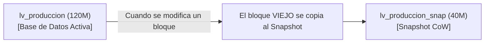

# Respaldos a Nivel de Bloque Crudo (dd) y Copias Atómicas con Snapshots LVM

> **Dificultad:** Avanzado (Nivel 3) | **Tiempo estimado:** 40 minutos | **Requisitos:** Privilegios de superusuario (`sudo`)

Cuando administramos servidores Linux, existen dos escenarios extremos donde las herramientas basadas en archivos (`tar`, `rsync`, `borg`) resultan insuficientes:

1. **Respaldos de Bajo Nivel / Clonación Forense:** Necesitamos respaldar el sector de arranque maestro (**MBR** o tabla de particiones **GPT**), particiones de arranque EFI o clonar un disco físico idéntico bit a bit sin importar qué sistema de archivos tenga. Para esto, la herramienta histórica por excelencia es **`dd`** (*Disk Dump*).
2. **El Problema de la Consistencia en Caliente (Zero-Downtime):** Si intentas hacer un backup de una base de datos en producción (MySQL, PostgreSQL) o de un servidor web activo leyendo los archivos mientras se escriben, obtendrás una copia corrupta e inservible (páginas a medio escribir en memoria caché del kernel). Para resolverlo sin apagar el servicio, la industria utiliza **Snapshots Copy-on-Write (CoW) en LVM**.

En este laboratorio dominarás ambas técnicas de nivel empresarial sobre almacenamiento virtualizado con dispositivos loop.

---

## 🗺️ Arquitectura del Laboratorio

```mermaid
flowchart TD
    subgraph BLOQUE_CRUDO["1. Respaldo a Nivel de Bloques (dd)"]
        MBR["Primeros 512 Bytes / 1MB\n(MBR + Tabla de Particiones)"] --> DD_STREAM["dd bs=512 count=1"]
        DD_STREAM --> GZIP["gzip / zstd"]
        GZIP --> IMG_FILE["mbr_backup.img.gz"]
    end

    subgraph LVM_COW["2. Consistencia en Caliente con Snapshots LVM"]
        LV_ORIGEN["Volumen de Producción (lv_datos)\n[En constante escritura]"]
        LV_ORIGEN -.->|"Congelamiento Atómico (Microsegundos)"| SNAP["Snapshot LVM (lv_snap)\n[Solo almacena bloques modificados CoW]"]
        SNAP -->|"Montaje Read-Only (/mnt/snap)"| BACKUP_SAFE["Copia 100% Consistente\n(tar / rsync / dd)"]
        BACKUP_SAFE --> RELEASE["lvremove lv_snap\n(Devuelve bloques al pool)"]
    end
```



---

## ⚙️ 1. Preparación del Almacenamiento LVM

Crearemos un entorno seguro y aislado en `/tmp` utilizando dispositivos loop de 256MB gestionados por LVM:

```bash
# 1. Crear directorio de trabajo e imágenes virtuales:
export LAB_DIR="/tmp/lab_dd_lvm"
mkdir -p "$LAB_DIR"
cd "$LAB_DIR"

truncate -s 256M disco_lvm.img
export LOOP_DEV=$(sudo losetup -f --show disco_lvm.img)
echo "Dispositivo loop creado: $LOOP_DEV"

# 2. Inicializar Physical Volume y Volume Group:
sudo pvcreate "$LOOP_DEV"
sudo vgcreate vg_backup_lab "$LOOP_DEV"

# 3. Crear Logical Volume de producción de 120MB y formatear en ext4:
sudo lvcreate -n lv_produccion -L 120M vg_backup_lab
sudo mkfs.ext4 -L "PROD_DATA" /dev/vg_backup_lab/lv_produccion

# 4. Montar en /mnt/produccion_lab e inyectar datos:
sudo mkdir -p /mnt/produccion_lab
sudo mount /dev/vg_backup_lab/lv_produccion /mnt/produccion_lab

sudo bash -c 'echo "BASE DE DATOS EMPRESARIAL v1" > /mnt/produccion_lab/database.db'
sudo bash -c 'dd if=/dev/urandom of=/mnt/produccion_lab/tabla_usuarios.dat bs=1M count=10 status=none'
sudo ls -lh /mnt/produccion_lab
```

---

## 💾 2. Acto 1: Copias Crudas de Bloques con `dd`

El comando `dd` opera por debajo del sistema de archivos, copiando sectores físicos brutos directamente desde `/dev/...`:

### 1. Respaldo del Sector de Arranque (MBR de 512 bytes)
En discos clásicos con particionado MBR, los primeros 512 bytes contienen el cargador de arranque (*bootloader*) y la tabla de particiones:

```bash
# Respaldar los primeros 512 bytes (MBR):
sudo dd if="$LOOP_DEV" of="${LAB_DIR}/mbr_backup.bin" bs=512 count=1 status=progress

# Inspeccionar con file y hexdump:
file "${LAB_DIR}/mbr_backup.bin"
```

### 2. Respaldo de una Partición Completa en Streaming Comprimido
Copiar un disco entero bloque por bloque puede generar un archivo inmenso lleno de ceros. La técnica profesional es canalizar la salida de `dd` hacia un compresor (`gzip` o `zstd`):

```bash
# Parámetros recomendados de alto rendimiento:
#  - bs=4M: Buffer de 4MB para reducir llamadas al sistema
#  - conv=noerror,sync: Si hay sectores dañados, los rellena con ceros sin abortar
#  - status=progress: Muestra la tasa de transferencia en MB/s
sudo dd if=/dev/vg_backup_lab/lv_produccion bs=4M conv=noerror,sync status=progress | gzip -c > "${LAB_DIR}/lv_produccion.img.gz"

ls -lh "${LAB_DIR}/lv_produccion.img.gz"
```

---

## ⚠️ 3. Acto 2: El Peligro de la Inconsistencia en Caliente

> [!CAUTION]
> **¿Por qué NUNCA se debe ejecutar `dd` directamente sobre un sistema de archivos montado en producción?**
> Cuando un sistema de archivos como ext4 o XFS está montado, el kernel mantiene buffers de páginas (*page cache*) y metadatos en memoria RAM que aún no se han sincronizado al disco (*dirty pages*).
> Si `dd` lee los bloques del disco mientras el servidor web o la base de datos está escribiendo, `dd` copiará la mitad de un archivo de la cabecera en un instante `T1` y el final del archivo en un instante `T2`. El resultado es una **imagen cruda corrupta e inconsistente** que fallará al restaurarse.

---

## 📸 4. Acto 3: La Solución Enterprise: Snapshots LVM Copy-on-Write

Para obtener una copia **100% consistente sin detener el servicio**, utilizamos la capacidad de **Snapshots Copy-on-Write (CoW)** de LVM:



### ¿Cómo Funciona un Snapshot LVM?
1. Se crea en **microsegundos**: no copia datos, solo crea una tabla de punteros virtuales idéntica al original.
2. **Copy-on-Write:** A partir de ese instante, cuando una aplicación escribe en `lv_produccion`, LVM intercepta la escritura, copia el bloque *original* sin modificar hacia el espacio reservado del snapshot, y luego permite la escritura en producción.
3. El snapshot mantiene congelada la imagen exacta de los datos en el milisegundo en que fue creado.

### Paso 1: Crear el Snapshot LVM en Caliente
Reservamos 40MB en el Volume Group para los cambios que ocurran durante el backup:

```bash
# Crear snapshot con nombre 'lv_snap_backup' de 40MB:
sudo lvcreate --snapshot -n lv_snap_backup -L 40M /dev/vg_backup_lab/lv_produccion

# Inspeccionar con lvs:
sudo lvs -o lv_name,lv_size,origin,data_percent,snap_percent vg_backup_lab
```
*(Observá que `origin` apunta a `lv_produccion` y `data_percent` arranca en 0.00%).*

### Paso 2: Continuar Modificando Producción
Demostremos que la base de datos sigue operando y escribiendo en vivo:

```bash
sudo bash -c 'echo "TRANSACCIÓN POST-BACKUP (Dato Nuevo)" >> /mnt/produccion_lab/database.db'
sudo bash -c 'dd if=/dev/urandom of=/mnt/produccion_lab/transacciones_nuevas.log bs=1M count=2 status=none'

echo "Contenido actual de producción:"
sudo cat /mnt/produccion_lab/database.db
```

### Paso 3: Montar el Snapshot en Modo Solo Lectura
Montamos el snapshot congelado en `/mnt/snapshot_seguro`:

```bash
sudo mkdir -p /mnt/snapshot_seguro
sudo mount -o ro /dev/vg_backup_lab/lv_snap_backup /mnt/snapshot_seguro

echo "Contenido visto desde el Snapshot congelado:"
sudo cat /mnt/snapshot_seguro/database.db
```

> [!NOTE]
> ¡Comprobación visual!: En `/mnt/snapshot_seguro/database.db` **NO existe** la línea *"TRANSACCIÓN POST-BACKUP"*. El snapshot tiene la fotografía matemática pura del momento exacto del congelamiento, inmune a las escrituras posteriores.

---

## 📦 5. Acto 4: Extracción Segura del Backup y Destrucción del Snapshot

Ahora podemos extraer el respaldo desde el snapshot con total tranquilidad mediante `tar` o `dd` sin interferir con producción:

```bash
# 1. Empaquetar de forma consistente desde el snapshot:
sudo tar -cvpzf "${LAB_DIR}/backup_consistente_db.tar.gz" -C /mnt/snapshot_seguro .

# 2. Desmontar el snapshot:
sudo umount /mnt/snapshot_seguro

# 3. CRÍTICO: Destruir el snapshot LVM para liberar espacio
# (Los snapshots CoW no deben dejarse olvidados porque al llenarse al 100% se invalidan):
sudo lvremove -y /dev/vg_backup_lab/lv_snap_backup

echo "✔ Snapshot desmontado y destruido. Espacio devuelto al Volume Group."
sudo lvs vg_backup_lab
```

---

## 🛠️ 6. Acto 5: Simulacro de Restauración y Chequeo con e2fsck

Simulamos un desastre total destruyendo el volumen de producción:

```bash
# 1. Simular formateo accidental del volumen de producción:
sudo umount /mnt/produccion_lab
sudo dd if=/dev/zero of=/dev/vg_backup_lab/lv_produccion bs=1M count=10 status=none

# 2. Restaurar la imagen cruda que extrajimos en el Acto 1:
echo "Restaurando imagen raw comprimida con zcat | dd..."
zcat "${LAB_DIR}/lv_produccion.img.gz" | sudo dd of=/dev/vg_backup_lab/lv_produccion bs=4M status=progress

# 3. Comprobar integridad del sistema de archivos con e2fsck:
sudo e2fsck -f -y /dev/vg_backup_lab/lv_produccion

# 4. Volver a montar y verificar los datos:
sudo mount /dev/vg_backup_lab/lv_produccion /mnt/produccion_lab
echo -e "\n✔ Archivos restaurados íntegros:"
sudo ls -lh /mnt/produccion_lab
sudo cat /mnt/produccion_lab/database.db
```

---

## 🖥️ 7. Script de Demostración Automatizada

Para ejecutar todo este flujo de forma didáctica en la terminal:

```bash
sudo ./linux/administrator/backup/demo_backup_dd_snapshots.sh
```
*(O en modo desatendido: `sudo ./linux/administrator/backup/demo_backup_dd_snapshots.sh --auto 2`).*

---

## 🧹 8. Limpieza Completa del Entorno

Para desmontar volúmenes, eliminar grupos LVM y liberar los dispositivos loop:

```bash
sudo ./linux/administrator/backup/limpiar_backup_dd_snapshots.sh
```

---

## 📚 9. Autoevaluación

<details>
<summary><strong>1. ¿Por qué es una mala práctica dejar un snapshot LVM activo de forma permanente en un servidor?</strong></summary>

Los snapshots LVM tradicionales utilizan Copy-on-Write y tienen un tamaño fijo preasignado (por ejemplo, 100MB o 2GB). Cada vez que producción escribe en un bloque modificado, el bloque viejo se copia al snapshot. Si la tasa de escrituras en producción supera el tamaño del snapshot, este alcanza el 100% de ocupación y el kernel lo marca automáticamente como <code>INVALID</code>, volviéndolo inservible y degradando el rendimiento de I/O de todo el Volume Group. Un snapshot debe crearse, respaldarse y destruirse lo más rápido posible.
</details>

<details>
<summary><strong>2. ¿Qué ventaja ofrece el parámetro conv=noerror,sync en un comando dd al respaldar un disco con sectores defectuosos?</strong></summary>

Por defecto, si <code>dd</code> encuentra un sector físico dañado (error de lectura de I/O), aborta inmediatamente la operación, dejando el backup incompleto. La bandera <code>noerror</code> le indica a <code>dd</code> que continúe leyendo a pesar de los fallos, y <code>sync</code> rellena los bloques que no se pudieron leer con bytes nulos (ceros) para preservar la alineación exacta de los desplazamientos de bytes (offsets) del sistema de archivos.
</details>

<details>
<summary><strong>3. ¿Qué diferencia conceptual existe entre hacer un dump con mysqldump/pg_dump y hacer un snapshot LVM del directorio de datos (/var/lib/mysql)?</strong></summary>

<code>mysqldump</code> realiza un volcado **lógico** (sentencias SQL `INSERT` y `CREATE TABLE`). Es portátil entre versiones de motor pero muy lento en bases de datos de cientos de gigabytes. El snapshot LVM realiza un congelamiento **físico** de bloques a nivel de almacenamiento en microsegundos, permitiendo respaldar terabytes de datos con RTO mínimo, aunque exige que la base de datos se restaure en la misma arquitectura y versión del motor.
</details>
