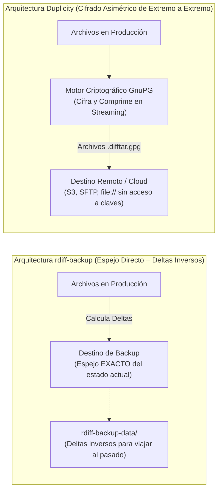

# Respaldos Incrementales Basados en Deltas (rdiff-backup) y Copias Cifradas Remotas (Duplicity)

> **Dificultad:** Intermedio (Nivel 3) | **Tiempo estimado:** 40 minutos | **Ambiente:** Linux / WSL2

En los entornos de producción modernos existen dos problemas críticos que las herramientas convencionales como `tar` o `rsync` simple no logran resolver de forma óptima:

1. **La paradoja de la velocidad vs el historial:** Queremos que la última versión de nuestros archivos esté inmediatamente accesible como un directorio normal (sin esperar horas a que termine una descompresión), pero a la vez necesitamos poder "viajar en el tiempo" a versiones de hace 3 días o 2 semanas. Esta es la especialidad de **`rdiff-backup`**.
2. **La desconfianza en el almacenamiento remoto (Zero-Trust Backup):** Cuando enviamos copias de seguridad fuera de nuestro datacenter hacia servidores SSH de terceros o almacenamiento de objetos en la nube (AWS S3, Google Cloud Storage, Backblaze B2), **el proveedor o un intruso en su red no debe tener acceso a nuestros datos**. Aquí entra en juego **`duplicity`**, que combina el algoritmo de deltas de `rsync` con cifrado asimétrico estricto de **GnuPG**.

---

## 🗺️ Arquitectura Comparativa: rdiff-backup vs Duplicity



---

## 📦 1. Instalación de Herramientas

En distribuciones basadas en Debian / Ubuntu:
```bash
sudo apt-get update && sudo apt-get install -y rdiff-backup duplicity gnupg
```

En distribuciones basadas en RHEL / Rocky Linux:
```bash
sudo dnf install -y epel-release
sudo dnf install -y rdiff-backup duplicity gnupg2
```

---

## 🕒 2. Acto 1: Respaldos con rdiff-backup (El Espejo Inteligente)

### ¿Cómo Funciona rdiff-backup?
A diferencia de otros sistemas de backup donde los deltas se aplican hacia adelante (lo que hace lento recuperar el día más reciente), `rdiff-backup` utiliza **deltas inversos (*reverse diffs*)**:
- El directorio de destino es **una copia idéntica y transparente** del estado más reciente.
- Si entrás al directorio de backup, podés abrir cualquier archivo directamente con `cat` o un editor de texto.
- En una carpeta oculta (`rdiff-backup-data/`), almacena los cambios matemáticos necesarios para reconstruir hacia atrás las versiones históricas anteriores.

### Paso 1: Preparar Directorio de Prueba
```bash
export LAB_DIR="/tmp/lab_rdiff_duplicity"
export SRC_DIR="${LAB_DIR}/produccion"
export RDIFF_DEST="${LAB_DIR}/backup_rdiff"

rm -rf "$LAB_DIR"
mkdir -p "$SRC_DIR/config" "$SRC_DIR/datos" "$RDIFF_DEST"

# Crear archivos de producción iniciales (Versión 1)
echo "DB_HOST=10.0.0.1; DB_PORT=5432" > "$SRC_DIR/config/app.conf"
echo "Registro de clientes v1" > "$SRC_DIR/datos/clientes.txt"
```

### Paso 2: Ejecutar el Primer Respaldo
```bash
rdiff-backup "$SRC_DIR" "$RDIFF_DEST"
```

Inspeccioná el destino:
```bash
ls -la "$RDIFF_DEST"
```
*(Observá que `app.conf` y `clientes.txt` están ahí como archivos normales, junto al subdirectorio de metadatos `rdiff-backup-data`).*

### Paso 3: Generar Cambios y Ejecutar un Segundo Respaldo
Simulamos el paso de las horas: modificamos la configuración y creamos un nuevo reporte:

```bash
sleep 2
echo "DB_HOST=10.0.0.2; DB_PORT=5432; TIMEOUT=30" > "$SRC_DIR/config/app.conf"
echo "Reporte de ventas de la tarde" > "$SRC_DIR/datos/ventas.txt"

# Segundo respaldo incremental:
rdiff-backup "$SRC_DIR" "$RDIFF_DEST"
```

### Paso 4: Generar un Tercer Respaldo y Borrar un Archivo
```bash
sleep 2
echo "DB_HOST=10.0.0.3; DB_PORT=5432; TIMEOUT=60" > "$SRC_DIR/config/app.conf"
rm -f "$SRC_DIR/datos/clientes.txt"

# Tercer respaldo incremental:
rdiff-backup "$SRC_DIR" "$RDIFF_DEST"
```

---

## 🔍 3. Acto 2: Viajar en el Tiempo con rdiff-backup

### 1. Listar el Historial de Sesiones de Respaldo
Para ver los puntos en el tiempo disponibles:
```bash
rdiff-backup -l "$RDIFF_DEST"
```
*(O de forma más detallada: `rdiff-backup --list-increment-sizes "$RDIFF_DEST"`).*

### 2. Recuperar el Archivo Borrado (`clientes.txt`)
En el estado actual del backup, `clientes.txt` ya no existe. Pero podemos pedirle a `rdiff-backup` que recupere la versión que existía hace unos instantes:

```bash
# Restaurar clientes.txt tal como existía hace 5 minutos (o hace 1 día con '1D'):
rdiff-backup -r now "${RDIFF_DEST}/datos/clientes.txt" /tmp/clientes_recuperado.txt 2>/dev/null || \
rdiff-backup --restore-as-of 5m "${RDIFF_DEST}/datos/clientes.txt" /tmp/clientes_recuperado.txt

echo "✔ Contenido del archivo histórico recuperado:"
cat /tmp/clientes_recuperado.txt
```

### 3. Purgar Incrementos Antiguos (Política de Retención)
Para evitar que el disco se llene indefinidamente, podés podar deltas viejos conservando el espejo actual intacto:

```bash
# Eliminar respaldos más antiguos que 30 días (para la prueba usamos 1 hora):
rdiff-backup --force --remove-older-than 1h "$RDIFF_DEST"
```

---

## 🔒 4. Acto 3: Respaldos Cifrados para la Nube con Duplicity

`duplicity` resuelve el escenario donde **el destino del respaldo no es un disco propio**, sino un servidor externo (SFTP, WebDAV) o un bucket de almacenamiento de objetos (Amazon S3, Azure Blob, Google Cloud Storage).

```
┌─────────────────────────────────────────────────────────────────────────────────────────────┐
│                          FLUJO DE TRABAJO CIFRADO CON DUPLICITY                             │
│                                                                                             │
│  [Archivos Locales] ──► [Librsync Deltas] ──► [Compresión gzip] ──► [Cifrado GnuPG]         │
│                                                                             │               │
│                                                        Transmisión cifrada  │               │
│                                                                             ▼               │
│                                                  [Destino: S3 / SFTP / file:///backup]      │
│                                                  • duplicity-full.vol1.difftar.gpg          │
│                                                  • duplicity-inc.vol1.difftar.gpg           │
│                                                  • duplicity-full-signatures.sigtar.gpg     │
└─────────────────────────────────────────────────────────────────────────────────────────────┘
```

### Paso 1: Configurar una Clave GPG de Prueba
Para pruebas automáticas o en scripts desatendidos, `duplicity` permite usar cifrado simétrico mediante la variable `PASSPHRASE` (o cifrado asimétrico con ID de clave GPG pública):

```bash
export PASSPHRASE="ClaveUltraSeguraDeProduccion2026!"
export DUPL_DEST="file://${LAB_DIR}/backup_duplicity_remote"
mkdir -p "${LAB_DIR}/backup_duplicity_remote"
```

### Paso 2: Ejecutar el Primer Respaldo Completo (Full)
```bash
duplicity "$SRC_DIR" "$DUPL_DEST"
```

Inspeccionemos el contenido del repositorio remoto:
```bash
ls -lh "${LAB_DIR}/backup_duplicity_remote"
```

> [!NOTE]
> Observá los nombres de los archivos generados:
> - `duplicity-full.20261031T...vol1.difftar.gpg`
> - `duplicity-full-signatures...sigtar.gpg`
> **Absolutamente todo está cifrado con AES y firmado con GPG.** Ni los nombres de tus archivos originales, ni sus rutas ni su contenido pueden ser leídos por quien administre el almacenamiento remoto sin la contraseña/clave.

### Paso 3: Ejecutar un Respaldo Incremental
Agregamos un nuevo archivo confidencial en producción:

```bash
echo "Clave API de Producción: sk-live-998877665544" > "$SRC_DIR/config/secret.key"

# Segundo respaldo (duplicity detecta que ya existe un full y genera un incremental):
duplicity "$SRC_DIR" "$DUPL_DEST"
```

Listamos el repositorio remoto:
```bash
ls -lh "${LAB_DIR}/backup_duplicity_remote"
```
*(Apareció un archivo nuevo `duplicity-inc....difftar.gpg` que contiene únicamente el delta cifrado).*

---

## 🔄 5. Acto 4: Política de Rotación y Restauración con Duplicity

### 1. Política de Full Mensual con Incrementales Diarios
En producción, nunca querés una cadena infinita de incrementales porque aumentaría el riesgo de rotura. El comando estándar de las diapositivas de clase permite forzar un Full automático si el último tiene más de un mes:

```bash
# Si el último Full tiene más de 1 mes (1M) o 7 días (7D), crea un Full nuevo; si no, hace un Incremental:
duplicity --full-if-older-than 1M "$SRC_DIR" "$DUPL_DEST"
```

### 2. Verificar el Estado del Repositorio
```bash
duplicity collection-status "$DUPL_DEST"
```

### 3. Simulacro de Restauración Completa
Eliminamos los datos originales de producción para probar el rescate:

```bash
rm -rf "${SRC_DIR:?}"/*
echo "Archivos en producción tras el borrado: $(ls -A "$SRC_DIR" | wc -l)"

# Restaurar la última versión desde el almacenamiento remoto cifrado:
duplicity restore "$DUPL_DEST" "$SRC_DIR"

echo -e "\n✔ Archivos restaurados exitosamente:"
ls -la "$SRC_DIR/config"
cat "$SRC_DIR/config/secret.key"
```

---

## 🖥️ 6. Script de Demostración Automatizada

Para ejecutar todo este flujo de forma didáctica en la terminal:

```bash
./linux/administrator/backup/demo_backup_rdiff_duplicity.sh
```
*(O en modo desatendido: `./linux/administrator/backup/demo_backup_rdiff_duplicity.sh --auto 2`).*

---

## 🧹 7. Limpieza del Laboratorio

Para purgar las carpetas de prueba y temporales:

```bash
./linux/administrator/backup/limpiar_backup_rdiff_duplicity.sh
```

---

## 📚 8. Autoevaluación

<details>
<summary><strong>1. ¿Por qué se dice que rdiff-backup utiliza "deltas inversos" (reverse diffs) y qué ventaja operativa ofrece?</strong></summary>

A diferencia de los sistemas tradicionales donde la versión más reciente requiere aplicar todos los incrementales sobre el primer full, `rdiff-backup` almacena el respaldo más reciente como un espejo directo (archivos planos normales). Los deltas almacenados en <code>rdiff-backup-data</code> registran cómo deshacer los cambios hacia el pasado. Esto significa que la restauración del estado actual tiene costo cero de reconstrucción (RTO mínimo) y permite inspeccionar los archivos al instante con comandos estándar del sistema como <code>cat</code> o <code>cp</code>.
</details>

<details>
<summary><strong>2. ¿Qué vulnerabilidad crítica previene Duplicity al utilizar GnuPG frente a rsync tradicional en copias a servidores externos?</strong></summary>

`rsync` transmite datos cifrados por la red si se usa SSH, pero los almacena en texto plano en el destino. Si el administrador del servidor de backup o el proveedor del bucket es comprometido, tiene acceso total a los datos. `Duplicity` cifra los bloques antes de enviarlos (*Client-Side Encryption*). En el destino solo residen blobs `.difftar.gpg` matemáticamente ininteligibles sin la clave privada o contraseña.
</details>

<details>
<summary><strong>3. ¿Qué función cumple la directiva --full-if-older-than 1M en Duplicity?</strong></summary>

Evita que las cadenas de respaldos incrementales crezcan de manera indefinida. Si la cadena fuera de cientos de días, la pérdida de un solo archivo intermedio corrompería todos los días posteriores. Esta directiva comprueba la antigüedad del último backup completo y, si supera el período configurado (por ejemplo, 1 mes o 30 días), inicia automáticamente un nuevo ciclo Full (*Nivel 0*), creando una nueva cadena independiente y segura.
</details>
