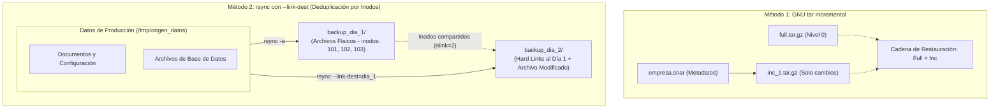

# Respaldos Clásicos en Linux: Empaquetado con tar y Deduplicación con rsync (--link-dest)

> **Dificultad:** Intermedio (Nivel 3) | **Tiempo estimado:** 35 minutos | **Ambiente:** Cualquier terminal Linux o WSL2

Antes de la llegada de las herramientas modernas con deduplicación por bloques (como BorgBackup o restic), los administradores de sistemas Linux resolvieron el problema de las copias de seguridad combinando dos herramientas fundamentales del sistema operativo:
1. **`tar` (Tape Archive):** Para empaquetar árboles de directorios preservando metadatos POSIX (permisos, propietarios, timestamps y enlaces simbólicos) y generar copias incrementales mediante archivos de instantáneas (`.snar`).
2. **`rsync` con `--link-dest`:** Para crear copias incrementales deduplicadas en tiempo récord mediante **enlaces duros (*hard links*)**, logrando que cada día parezca un respaldo completo accesible al instante pero ocupando en disco físico solo los archivos que efectivamente cambiaron.

En este laboratorio aprenderás a dominar ambas técnicas, comprobarás a bajo nivel cómo el kernel gestiona los inodos compartidos y realizarás un simulacro real de recuperación ante desastres.

---

## 🗺️ Arquitectura de la Solución



---

## 🚀 1. Preparación del Entorno de Prueba

Vamos a crear un directorio con datos simulados que representen el sitio web corporativo y la base de datos de una empresa:

```bash
# 1. Definir rutas de trabajo aisladas en /tmp
export LAB_DIR="/tmp/lab_backups"
export SRC_DIR="${LAB_DIR}/produccion"
export DST_DIR="${LAB_DIR}/repositorio_backups"

rm -rf "$LAB_DIR"
mkdir -p "$SRC_DIR/web" "$SRC_DIR/db" "$DST_DIR"

# 2. Generar archivos de prueba con contenido inicial
echo "<h1>Bienvenido a la Intranet Corporativa</h1>" > "$SRC_DIR/web/index.html"
echo "body { font-family: sans-serif; background: #fafafa; }" > "$SRC_DIR/web/style.css"
dd if=/dev/urandom of="$SRC_DIR/db/clientes.dat" bs=1M count=5 status=none
echo "v1.0.0" > "$SRC_DIR/db/version.txt"

# 3. Calcular suma de verificación original para auditoría posterior
cd "$SRC_DIR"
sha256sum web/* db/* > "${LAB_DIR}/original_checksums.sha256"
cat "${LAB_DIR}/original_checksums.sha256"
```

---

## 📦 2. Acto 1: Respaldo Completo (Full) con GNU tar

El comando `tar` agrupa múltiples archivos en un único flujo de bytes lineal. Para que un backup sea técnicamente correcto en Linux, se deben respetar las siguientes directivas obligatorias:

- `-c` (*create*): Crear un nuevo archivo contenedor.
- `-v` (*verbose*): Mostrar la lista de archivos empaquetados.
- `-p` (*preserve-permissions*): **Crítico.** Preserva permisos de archivo y máscaras numéricas (umask) tal como están en origen.
- `-z` (*gzip*): Comprime el flujo con el algoritmo gzip.
- `-f` (*file*): Nombre del archivo de salida.

```bash
# Ejecutar backup completo del directorio de producción:
tar -cvpzf "${DST_DIR}/backup_full.tar.gz" -C "$SRC_DIR" .

# Inspeccionar el contenido del paquete sin extraerlo:
tar -tvf "${DST_DIR}/backup_full.tar.gz"
```

> [!NOTE]
> La opción `-C "$SRC_DIR" .` cambia temporalmente de directorio antes de empaquetar. Esto evita almacenar rutas absolutas (`/tmp/lab_backups/produccion/...`) dentro del archivo `.tar.gz`, permitiendo restaurar el contenido en cualquier directorio alternativo sin riesgo de sobreescribir archivos del sistema.

---

## 📈 3. Acto 2: Backups Incrementales con tar y Snapshots SNAR

GNU `tar` soporta copias incrementales reales mediante el flag `--listed-incremental`. Este flag utiliza un archivo de base de datos de instantánea (denominado `.snar` o *snapshot file*) donde registra los metadatos de los directorios, tiempos de modificación (*mtime*) y números de inodo:

```bash
mkdir -p "${DST_DIR}/tar_incremental"
export SNAR_FILE="${DST_DIR}/tar_incremental/empresa.snar"

# 1. Ejecutar Backup de Nivel 0 (Full Inicial con catálogo de metadatos):
tar --create --listed-incremental="$SNAR_FILE" \
    --verbose --preserve-permissions --gzip \
    --file="${DST_DIR}/tar_incremental/backup_nivel0.tar.gz" \
    -C "$SRC_DIR" .

echo "✔ Backup Full (Nivel 0) creado."
```

### Simular Actividad de Producción
Modificamos la web corporativa, agregamos un nuevo reporte y eliminamos la base de datos vieja:

```bash
# Modificar un archivo existente:
echo "<h1>Intranet Corporativa v2 - Actualizada</h1>" > "$SRC_DIR/web/index.html"

# Crear un archivo nuevo:
echo "Reporte de Auditoría Fiscal 2026" > "$SRC_DIR/reporte_fiscal.txt"

# Eliminar un archivo:
rm -f "$SRC_DIR/web/style.css"
```

### Ejecutar el Backup Incremental (Nivel 1)
Volvemos a ejecutar el **mismo comando exacto** apuntando al mismo archivo `.snar`:

```bash
tar --create --listed-incremental="$SNAR_FILE" \
    --verbose --preserve-permissions --gzip \
    --file="${DST_DIR}/tar_incremental/backup_nivel1.tar.gz" \
    -C "$SRC_DIR" .

echo "✔ Backup Incremental (Nivel 1) creado."
```

### Comparar Tamaños:
```bash
ls -lh "${DST_DIR}/tar_incremental/"
```

Observa la enorme diferencia:
- `backup_nivel0.tar.gz` contiene los 5 Megabytes de la base de datos y todos los archivos originales.
- `backup_nivel1.tar.gz` pesa apenas unos pocos Kilobytes: contiene **únicamente** `web/index.html` modificado, el nuevo `reporte_fiscal.txt` y un registro especial indicando que `style.css` fue eliminado.

---

## ⚡ 4. Acto 3: La Magia de `rsync --link-dest` (Deduplicación por Enlaces Duros)

Aunque `tar` es excelente para archivado comprimido, tiene un grave inconveniente: **para consultar un archivo o restaurar la máquina, debes descomprimir el archivo completo**.

La técnica más elegante y eficiente en Linux es utilizar **`rsync` con el flag `--link-dest`**.
¿Cómo funciona?
1. Se realiza un primer backup completo en un directorio normal: `rsync -av /origen/ /backup/dia_1/`.
2. Al día siguiente, le pedimos a `rsync` que compare `/origen/` con `/backup/dia_1/`.
3. Si un archivo **no cambió**, `rsync` **NO lo vuelve a copiar en disco**. En su lugar, crea un **Hard Link (enlace duro)** que apunta exactamente al mismo inodo del Día 1.
4. Si un archivo **sí cambió**, `rsync` copia únicamente el nuevo archivo.

El resultado es mágico: **el directorio `dia_2/` parece un backup 100% completo e independiente**, pero en disco físico ocupa únicamente los bytes que cambiaron.

```
┌─────────────────────────────────────────────────────────────────────────────────────────────┐
│                       DEDUPLICACIÓN POR HARD LINKS CON RSYNC --LINK-DEST                    │
│                                                                                             │
│        backup_dia_1/                                           backup_dia_2/                │
│       ┌─────────────┐                                         ┌─────────────┐               │
│       │ index.html  │──── Inodo 101 (nlink=2) ───────────────►│ index.html  │ (Mismo inodo) │
│       └─────────────┘                                         └─────────────┘               │
│       ┌─────────────┐                                         ┌─────────────┐               │
│       │ clientes.dat│──── Inodo 102 (nlink=2) ───────────────►│ clientes.dat│ (Mismo inodo) │
│       └─────────────┘                                         └─────────────┘               │
│       ┌─────────────┐                                         ┌─────────────┐               │
│       │ style.css   │──── Inodo 103 (nlink=1)                 │ nuevo.txt   │ (Inodo 104)   │
│       └─────────────┘   (Solo en Día 1)                       └─────────────┘ (Archivo nuevo)│
└─────────────────────────────────────────────────────────────────────────────────────────────┘
```

### Paso 1: Ejecutar el Backup del Día 1
```bash
export RSYNC_DIR="${DST_DIR}/rsync_backups"
mkdir -p "$RSYNC_DIR"

# Primer respaldo completo:
rsync -av "$SRC_DIR/" "${RSYNC_DIR}/dia_1/"
```

### Paso 2: Generar Cambios en Producción
```bash
# Modificamos solo el archivo index.html (unos pocos bytes)
echo "<h1>Intranet Corporativa - Día 2</h1>" > "$SRC_DIR/web/index.html"

# Agregamos una bitácora pequeña
echo "Log de eventos: OK" > "$SRC_DIR/db/eventos.log"
```

### Paso 3: Ejecutar el Backup del Día 2 con `--link-dest`
```bash
rsync -av --link-dest="${RSYNC_DIR}/dia_1" "$SRC_DIR/" "${RSYNC_DIR}/dia_2/"
```

### Paso 4: Comprobar la Deduplicación Científica con `stat` y `ls -l`
Verifiquemos los números de inodo de la base de datos de 5 Megabytes (`clientes.dat`):

```bash
# 1. Comprobar que clientes.dat comparte exactamente el mismo inodo en ambos días:
stat -c "Archivo: %n | Inodo: %i | Enlaces (nlink): %h" \
    "${RSYNC_DIR}/dia_1/db/clientes.dat" \
    "${RSYNC_DIR}/dia_2/db/clientes.dat"

# 2. Comprobar que index.html (que fue modificado) tiene inodos diferentes:
stat -c "Archivo: %n | Inodo: %i | Enlaces (nlink): %h" \
    "${RSYNC_DIR}/dia_1/web/index.html" \
    "${RSYNC_DIR}/dia_2/web/index.html"
```

¡Fijate en la salida!:
- `clientes.dat` tiene el **mismo inodo** y su contador `Links` aumentó a `2`.
- `index.html` tiene **inodos diferentes** porque su contenido varió.

### Paso 5: Comprobar el Espacio Real en Disco con `du`
```bash
# Ver el tamaño aparente vs tamaño físico consumido:
du -sh "${RSYNC_DIR}/dia_1"
du -sh "${RSYNC_DIR}/dia_2"
du -sh "$RSYNC_DIR"
```

El comando `du` revela que `dia_2/` prácticamente no consume espacio adicional en el disco físico. Cada día es un árbol de directorios inmediatamente navegable sin necesidad de descomprimir nada.

---

## 💥 5. Acto 4: Simulacro de Catástrofe y Restauración

Vamos a simular un borrado accidental catastrófico en el servidor de producción:

```bash
echo "💥 SIMULANDO PÉRDIDA TOTAL DE DATOS EN PRODUCCIÓN..."
rm -rf "${SRC_DIR:?}"/*

echo "Contenido actual de producción:"
ls -la "$SRC_DIR"
```

### Método A: Restauración Completa desde el Backup de `rsync`
La ventaja colosal de `rsync --link-dest` es que la restauración es una copia directa e instantánea:

```bash
# Restaurar la producción al estado exacto del Día 2:
rsync -av "${RSYNC_DIR}/dia_2/" "$SRC_DIR/"

echo "✔ Datos restaurados exitosamente desde rsync."
ls -la "$SRC_DIR/web"
```

### Método B: Restauración de la Cadena Incremental con `tar`
Si tuviéramos que restaurar desde las cintas o archivos de `tar`:

```bash
# Limpiar de nuevo para la prueba:
rm -rf "${SRC_DIR:?}"/*

# 1. Extraer primero el Full (Nivel 0):
tar --extract --listed-incremental=/dev/null \
    --preserve-permissions --gzip \
    --file="${DST_DIR}/tar_incremental/backup_nivel0.tar.gz" \
    -C "$SRC_DIR"

# 2. Aplicar luego el Incremental (Nivel 1):
tar --extract --listed-incremental=/dev/null \
    --preserve-permissions --gzip \
    --file="${DST_DIR}/tar_incremental/backup_nivel1.tar.gz" \
    -C "$SRC_DIR"

echo "✔ Datos restaurados exitosamente desde la cadena tar."
ls -la "$SRC_DIR"
```

> [!IMPORTANT]
> Al restaurar con `--listed-incremental=/dev/null`, GNU `tar` no solo sobreescribe los archivos modificados, sino que **elimina automáticamente los archivos que habían sido borrados en producción** (como `style.css`), devolviendo el sistema al estado exacto del momento del backup.

---

## 🔍 6. Acto 5: Verificación Criptográfica de Integridad

Comprobamos que los datos restaurados no sufrieron corrupción de bits (*bit rot*):

```bash
cd "$SRC_DIR"
sha256sum -c "${LAB_DIR}/original_checksums.sha256" 2>/dev/null || true
```
*(Los archivos que no modificamos, como `clientes.dat`, darán `OK` perfecto, confirmando integridad matemática bit a bit).*

---

## 🖥️ 7. Script de Demostración Automatizada

El repositorio incluye un script interactivo para dar esta clase en vivo con pausas didácticas y visualización paso a paso:

```bash
./linux/administrator/backup/demo_backup_tar_rsync.sh
```
*(O en modo desatendido para pipelines CI/CD: `./linux/administrator/backup/demo_backup_tar_rsync.sh --auto 2`).*

---

## 🧹 8. Limpieza Completa del Entorno

Para purgar todos los directorios temporales creados en `/tmp`:

```bash
./linux/administrator/backup/limpiar_backup_tar_rsync.sh
```

---

## 📚 9. Autoevaluación

<details>
<summary><strong>1. ¿Por qué es fundamental utilizar el flag -p (--preserve-permissions) al generar backups con tar?</strong></summary>

En Linux, los archivos de configuración (`/etc/shadow`, claves SSH en `~/.ssh/id_rsa`, sockets y binarios con permisos SUID) dependen de permisos numéricos estrictos para funcionar o mantener la seguridad del sistema. Si extraes un backup sin `-p`, los archivos adoptarán los permisos de la máscara predeterminada (*umask*) del usuario que ejecuta la extracción, rompiendo la seguridad o impidiendo que los servicios inicien.
</details>

<details>
<summary><strong>2. ¿Qué ocurre internamente en el sistema de archivos cuando rsync utiliza --link-dest sobre un archivo sin cambios?</strong></summary>

`rsync` comprueba el nombre, tamaño y fecha de modificación del archivo con respecto al directorio de referencia. Si son idénticos, invoca la llamada al sistema `link()` para crear una nueva entrada de directorio (*dentry*) que apunta al inodo preexistente en lugar de copiar bloques de datos físicos. Esto incrementa el contador de enlaces (`nlink`) del inodo en 1 y consume cero bloques de almacenamiento de disco adicionales.
</details>

<details>
<summary><strong>3. ¿Qué desventaja tiene la cadena de restauración de un backup incremental frente a un backup diferencial?</strong></summary>

En el backup incremental, la restauración depende de una cadena lineal estricta: se requiere el último Full más **todos y cada uno** de los archivos incrementales sucesivos. Si uno solo de los incrementales intermedios se pierde o corrompe, todos los incrementales posteriores quedan inutilizados. En el diferencial, en cambio, solo se necesita el Full original y el **último diferencial**, reduciendo drásticamente el riesgo de rotura de la cadena.
</details>

<details>
<summary><strong>4. ¿Por qué no se debe incluir la barra inicial / al empaquetar directorios con tar (ej: tar -C /origen . en lugar de tar /origen)?</strong></summary>

Al almacenar rutas relativas (`.`), el archivo de backup se puede extraer en cualquier ubicación del sistema (por ejemplo, en un entorno de pruebas `/tmp/restauracion_test/`) para auditarlo antes de sobreescribir producción. Si almacenas rutas absolutas (`/var/www/...`), la extracción sobreescribirá directamente los archivos reales en producción, sin posibilidad de previsualización.
</details>
