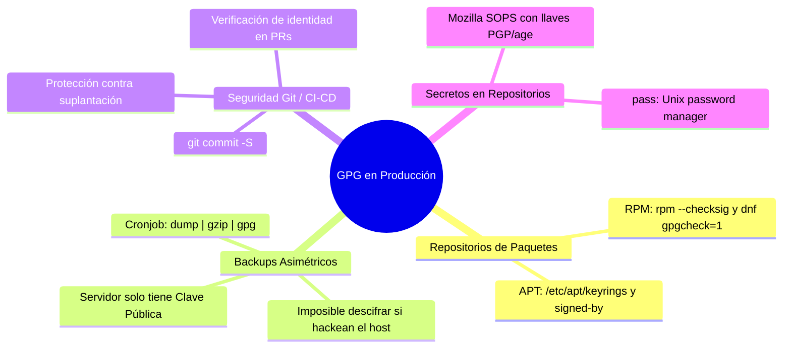
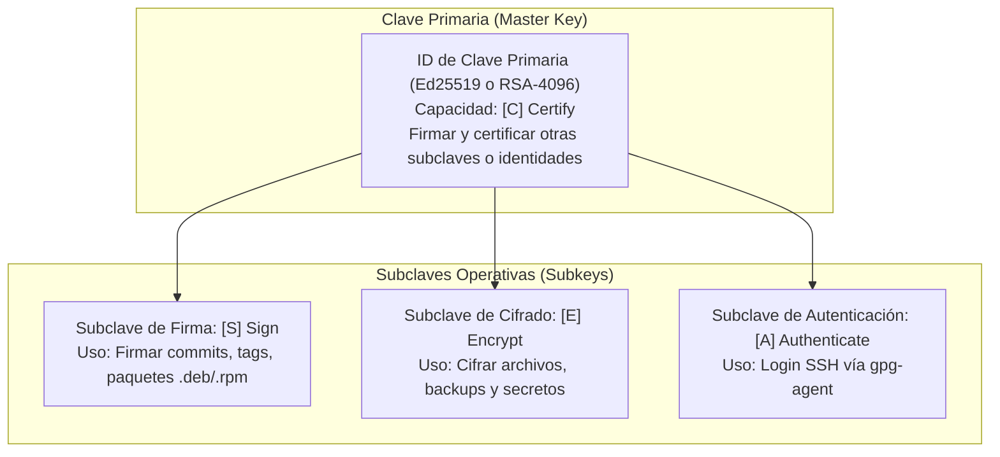
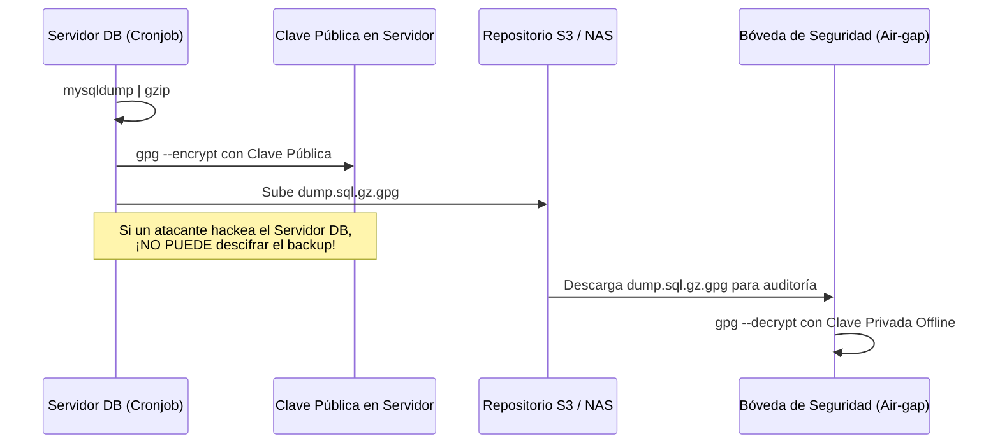

# Criptografía Asimétrica con GnuPG (GPG): Firmas de Repositorios y Backups Asimétricos

> [!NOTE]
> Para comprender la diferencia entre cifrado de bloques (**LUKS2**), cifrado de sistemas de archivos FUSE (**gocryptfs**) y cifrado asimétrico a nivel de archivo/aplicación (**GPG** y **age**), consultá la [Guía Comparativa de Arquitecturas de Cifrado](file:///C:/Users/rino/Documents/GitHub/labs/linux/administrator/cifrado/cifrado_arquitecturas_comparativa.md).

---

## 1. Resumen Ejecutivo en 60 Segundos

```bash
# 1. Generar par de claves (interactivo o desatendido)
gpg --full-generate-key

# 2. Listar claves públicas y privadas con sus huellas (fingerprints)
gpg --list-keys --keyid-format LONG
gpg --list-secret-keys --keyid-format LONG

# 3. Exportar clave pública en formato ASCII Armor (.asc)
gpg --armor --export sysadmin@empresa.com > /tmp/sysadmin.asc

# 4. Pipeline de backup asimétrico en producción (SOLO clave pública en el servidor)
tar -czf - /var/www/html | gpg --batch --yes --encrypt --recipient sysadmin@empresa.com > /backups/web_$(date +%F).tar.gz.gpg

# 5. Descifrar el backup (requiere clave privada y passphrase en estación segura)
gpg --decrypt /backups/web_2026-10-30.tar.gz.gpg | tar -xzf - -C /tmp/restaurado/

# 6. Firmar un archivo o release de software (Firma desasociada / Detached)
gpg --armor --detach-sign release-v2.0.tar.gz

# 7. Verificar integridad y autenticidad del binario
gpg --verify release-v2.0.tar.gz.asc release-v2.0.tar.gz
```

---

## 2. Del Mito Utópico a la Realidad: ¿Dónde se usa GPG en Producción?

Durante los años 2000, la criptografía PGP/GPG se popularizó con la idea utópica del *"Web of Trust"* (red de confianza) y el cifrado de correos electrónicos personales (`Thunderbird` + `Enigmail`). En la práctica real moderna, casi nadie cifra emails con PGP debido a su fricción de usabilidad.

Sin embargo, en **DevOps, SysAdmin, Infraestructura Cloud y Seguridad de la Cadena de Suministro (Supply Chain)**, GPG es un pilar fundamental en 4 áreas críticas:



---

## 3. Arquitectura Interna de GnuPG: Claves Primarias, Subclaves y Llaveros

GnuPG (`gpg`) implementa el estándar OpenPGP (**RFC 4880** / **RFC 9580**). A diferencia de SSH o TLS, un "par de claves" GPG es en realidad un **árbol de claves**:



### Conceptos Clave:
1. **Clave Primaria (Certify [C])**: Es la identidad raíz asociada a tu nombre y correo (`Uid`). Debe resguardarse celosamente. Si una subclave se compromete, la clave primaria puede revocarla sin perder la reputación ni las firmas previas.
2. **Subclave de Firma (Sign [S])**: Es la utilizada cada vez que ejecutás `gpg --sign` o `git commit -S`.
3. **Subclave de Cifrado (Encrypt [E])**: Es la utilizada al ejecutar `gpg --encrypt`. Cifra la clave de sesión simétrica aleatoria (normalmente AES-256) que protege el contenido.
4. **Almacenamiento Local**: En distribuciones modernas, las claves públicas residen en `~/.gnupg/pubring.kbx` (formato Keybox) y las privadas cifradas bajo `~/.gnupg/private-keys-v1.d/`.

---

## 4. Laboratorio Práctico: El Set Completo de Comandos GPG

### 4.1. Generación de Claves

#### Modo Interactivo:
```bash
gpg --full-generate-key
```
Seleccioná:
- Tipo: `(9) ECC (sign and encrypt) *default*` o `(1) RSA and RSA`
- Tamaño: Ed25519 o RSA 4096 bits
- Validez: `0` (no expira) o `2y` (expira en 2 años)
- Nombre y Correo: `SysAdmin Empresa <sysadmin@empresa.com>`
- Passphrase segura.

#### Modo Automatizado / Desatendido (Batch para CI/CD y Scripts):
```bash
cat << 'EOF' > /tmp/gpg-batch.conf
%no-protection
Key-Type: EDDSA
Key-Curve: ed25519
Key-Usage: sign
Subkey-Type: ECDH
Subkey-Curve: cv25519
Subkey-Usage: encrypt
Name-Real: Automation Backup Bot
Name-Email: backup-bot@empresa.com
Expire-Date: 0
%commit
EOF

gpg --batch --generate-key /tmp/gpg-batch.conf
rm -f /tmp/gpg-batch.conf
```

### 4.2. Listar Claves y Obtener Huellas (Fingerprints)
```bash
# Listar claves públicas con su ID largo (16 caracteres hexadecimales)
gpg --list-keys --keyid-format LONG

# Listar claves secretas
gpg --list-secret-keys --keyid-format LONG

# Obtener la huella digital completa (40 caracteres)
gpg --fingerprint backup-bot@empresa.com
```

Salida típica:
```text
pub   ed25519/4F82B91A6C23D81E 2026-10-30 [SC]
      Huella de clave = 8A3B 7F91 C2D4 55E0 91A2  B843 4F82 B91A 6C23 D81E
uid                 [absoluta] Automation Backup Bot <backup-bot@empresa.com>
sub   cv25519/910E234A56F781C2 2026-10-30 [E]
```

### 4.3. Exportación e Importación de Claves
```bash
# Exportar clave pública en texto plano ASCII (para compartir o subir al servidor)
gpg --armor --export backup-bot@empresa.com > backup-bot.pub.asc

# Exportar clave privada (¡ALTAMENTE CONFIDENCIAL! Solo para resguardar fuera de línea)
gpg --armor --export-secret-keys backup-bot@empresa.com > backup-bot.priv.asc

# Importar una clave pública en otra máquina
gpg --import backup-bot.pub.asc
```

### 4.4. Cifrado y Descifrado
```bash
# Cifrado simétrico simple (con contraseña compartida, sin claves asimétricas):
gpg --symmetric --cipher-algo AES256 archivo.tar.gz
# Genera archivo.tar.gz.gpg

# Cifrado asimétrico (con la clave pública del destinatario):
gpg --encrypt --recipient backup-bot@empresa.com datos_sensibles.txt
# Genera datos_sensibles.txt.gpg

# Descifrado (requiere tener la clave privada y conocer la passphrase):
gpg --decrypt datos_sensibles.txt.gpg > datos_sensibles_restaurados.txt
```

### 4.5. Firmas Digitales y Verificación
Existen tres tipos de firmas en GPG:
1. **Firma Embebida (`gpg --sign archivo`)**: Empaqueta el contenido original y la firma binaria en un solo archivo `.gpg`.
2. **Firma en Texto Claro (`gpg --clearsign mensaje.txt`)**: Agrega cabeceras ASCII legibles al inicio y pie del texto (`-----BEGIN PGP SIGNED MESSAGE-----`). Ideal para comunicados o contratos.
3. **Firma Desasociada (`gpg --detach-sign binario.tar.gz`)**: Crea un archivo separado `binario.tar.gz.asc` que contiene exclusivamente la firma criptográfica sin alterar el archivo original. **Es el estándar universal para distribuciones de software.**

```bash
# Crear firma desasociada ASCII:
gpg --armor --detach-sign release-2.0.0.tar.gz
# Genera release-2.0.0.tar.gz.asc

# Verificar la firma:
gpg --verify release-2.0.0.tar.gz.asc release-2.0.0.tar.gz
```
Si el archivo original fue modificado aunque sea en un solo bit, `gpg --verify` alertará con: `BAD signature`.

---

## 5. Casos de Producción en el Mundo Real

### Caso 1: Firma y Verificación de Repositorios APT Modernos (`signed-by`)

Durante años, la documentación antigua enseñaba a agregar claves de repositorios externos con `sudo apt-key add clave.asc`. **Ese método fue deprecado en Debian 11 y Ubuntu 22.04** porque agregaba la clave al llavero global `/etc/apt/trusted.gpg`, permitiendo que el repositorio de una aplicación pequeña pudiera firmar paquetes para reemplazar `glibc` o el `kernel` del sistema (escalada de privilegios).

#### La Forma Moderna (Arquitectura Segura de APT):
1. La clave pública se guarda en `/etc/apt/keyrings/` en formato binario (*dearmored*).
2. El repositorio se configura en `/etc/apt/sources.list.d/` con la directiva explícita `[signed-by=...]`:

```bash
# 1. Crear directorio seguro de llaveros si no existe
sudo install -m 0755 -d /etc/apt/keyrings

# 2. Descargar y desarmar la clave ASCII a formato binario seguro OpenPGP
curl -fsSL https://download.docker.com/linux/ubuntu/gpg | sudo gpg --dearmor -o /etc/apt/keyrings/docker.gpg
sudo chmod a+r /etc/apt/keyrings/docker.gpg

# 3. Asociar exclusivamente esa clave al repositorio de Docker:
echo \
  "deb [arch=$(dpkg --print-architecture) signed-by=/etc/apt/keyrings/docker.gpg] https://download.docker.com/linux/ubuntu \
  $(. /etc/os-release && echo "$VERSION_CODENAME") stable" | \
  sudo tee /etc/apt/sources.list.d/docker.list > /dev/null

# 4. Actualizar índices; APT verifica la firma InRelease contra /etc/apt/keyrings/docker.gpg
sudo apt-get update
```

### Caso 2: Verificación de Paquetes RPM con `rpm --checksig` (RHEL / Rocky / Fedora)

En el ecosistema Red Hat, todos los paquetes `.rpm` contienen firmas GPG integradas en su cabecera. Antes de instalar un RPM distribuido por un proveedor, se importa la clave institucional y se verifica:

```bash
# 1. Importar la clave pública del fabricante en la base de datos RPM del sistema
sudo rpm --import https://dl.fedoraproject.org/pub/epel/RPM-GPG-KEY-EPEL-10

# 2. Comprobar la firma digital y los hashes digest del paquete RPM:
rpm -K paquete-critico-1.0.rpm
# O de forma explícita:
rpm --checksig paquete-critico-1.0.rpm
```
Salida esperada:
```text
paquete-critico-1.0.rpm: digests signatures OK
```

### Caso 3: Pipeline Automatizado de Backups Asimétricos en Servidores

#### El Problema de Seguridad Clásico:
Un servidor de base de datos MySQL o PostgreSQL ejecuta un cronjob nocturno para respaldar los datos. Si el script cifra el backup con una contraseña simétrica o con una clave privada presente en el servidor, **si un atacante compromete el servidor root, puede leer la contraseña y descifrar todos los backups históricos de la empresa.**

#### La Solución Asimétrica de Producción:
El servidor de producción **SOLO tiene instalada la Clave Pública** de la empresa (`backup-vault@empresa.com`). **La Clave Privada NUNCA toca el servidor de base de datos**; se guarda en una bóveda sin conexión a internet (air-gapped) o en la máquina de auditoría.



#### Script de Producción para Cron (`/usr/local/bin/backup-asimetrico.sh`):
```bash
#!/usr/bin/env bash
set -euo pipefail

DEST="/backups"
RECIPIENT="backup-vault@empresa.com"
TIMESTAMP="$(date +'%Y%m%d_%H%M%S')"
BACKUP_FILE="${DEST}/backup_db_${TIMESTAMP}.tar.gz.gpg"

mkdir -p "$DEST"

# Streaming continuo: comprime y cifra en memoria sin tocar disco en texto plano
tar -czf - /var/log/ /etc/ | \
  gpg --batch --yes --trust-model always --encrypt --recipient "$RECIPIENT" \
  > "$BACKUP_FILE"

echo "Backup asimétrico generado exitosamente en: $BACKUP_FILE"
```

### Caso 4: Firma de Commits en Git y Protección de la Cadena de Suministro

En equipos de ingeniería, cualquiera con acceso a `git` puede configurar `git config user.name "Linus Torvalds"` y enviar un commit falso a un repositorio. Para garantizar que el código proviene de un desarrollador verificado, se configuran firmas GPG en Git:

```bash
# 1. Configurar la clave GPG en git
git config --global user.signingkey 4F82B91A6C23D81E

# 2. Habilitar la firma automática de todos los commits:
git config --global commit.gpgsign true

# 3. Hacer un commit firmado:
git commit -m "feat(security): implementar autenticación multifactor"

# 4. Verificar la firma del commit en el historial:
git log --show-signature -1
```
En plataformas como GitHub o GitLab, los commits firmados lucen una insignia verde de **Verified**.

---

## 6. Alternativas Modernas: ¿Por qué muchos eligen `age` y `SOPS`?

Aunque GPG es el estándar histórico, la comunidad criptográfica moderna a menudo critica su complejidad acumulada durante 30 años (múltiples algoritmos legados, formatos de paquetes crípticos y gestión de subkeys difícil).

Herramientas modernas como **`age`** (*Actually Good Encryption*) ofrecen una alternativa ligera:
- **Binario único**: No requiere demonios como `gpg-agent`.
- **Criptografía moderna no negociable**: Únicamente X25519, ChaCha20-Poly1305 y scrypt.
- **Formato UNIX simple**: Sintaxis intuitiva tipo SSH.

```bash
# Cifrar un archivo con una clave pública age:
age -r age1ql3z7hjy... secreto.txt > secreto.txt.age

# Descifrar con la clave privada:
age --decrypt -i clave_privada.txt secreto.txt.age
```

Para secretos en repositorios de Git (archivos `.env`, credenciales YAML de Kubernetes), herramientas como **Mozilla SOPS** permiten cifrar valores dentro de un JSON o YAML usando tanto claves PGP como claves `age` o KMS en la nube (AWS KMS, GCP KMS).

---

## 7. Demostración Interactiva en Vivo (`demo_gpg.sh`)

Para experimentar con el ciclo completo de claves, firmas detached, backups en streaming y verificación de integridad, ejecutá el script interactivo incluido en este módulo:

```bash
# Modo interactivo (pausa con [ENTER]):
./linux/administrator/gpg/demo_gpg.sh

# Modo desatendido para pruebas automatizadas:
./linux/administrator/gpg/demo_gpg.sh --auto 2
```

---

## 8. Autoevaluación

<details>
<summary><strong>1. ¿Por qué es un grave error de seguridad tener la clave privada de GPG en el mismo servidor web que genera los backups nocturnos?</strong></summary>

Porque si el servidor web es comprometido por un atacante (por ejemplo, mediante una vulnerabilidad RCE), el atacante obtendrá acceso a los archivos de backup y también a la clave privada capaz de descifrarlos. En un esquema asimétrico seguro, el servidor web solo debe poseer la clave pública para cifrar; la clave privada para descifrar debe residir exclusivamente en una estación de trabajo segura o una bóveda offline.
</details>

<details>
<summary><strong>2. ¿Por qué se deprecó apt-key add en Debian y Ubuntu modernos en favor de /etc/apt/keyrings/?</strong></summary>

Porque `apt-key add` añadía la clave pública del fabricante al llavero global `/etc/apt/trusted.gpg`. Esto significaba que APT consideraba esa clave válida para firmar paquetes de cualquier repositorio configurado en la máquina, abriendo la puerta a ataques de suplantación de paquetes centrales del sistema. La directiva moderna `[signed-by=/etc/apt/keyrings/repo.gpg]` confina la validez de la clave exclusivamente a ese repositorio en particular.
</details>

<details>
<summary><strong>3. ¿Cuál es la diferencia técnica entre una firma embebida (--sign) y una firma desasociada (--detach-sign)?</strong></summary>

Una firma embebida toma el archivo original, calcula su hash criptográfico, lo cifra con la clave privada y encapsula tanto el archivo como la firma dentro de un contenedor `.gpg`, modificando el archivo original. Una firma desasociada calcula la firma y la guarda en un archivo independiente (por ejemplo, `.asc` o `.sig`), dejando el binario o archivo original intacto e inalterado.
</details>

<details>
<summary><strong>4. ¿Qué ventaja ofrece age frente a GPG para scripts de automatización sencillos?</strong></summary>

`age` es una herramienta moderna y minimalista con una línea de comandos sin estado que no requiere bases de datos locales complejas de llaveros (`pubring.kbx`), ni demonios en segundo plano (`gpg-agent`), ni algoritmos criptográficos heredados en desuso, haciendo que los pipelines de integración continua sean más rápidos, robustos y fáciles de depurar.
</details>


---

## 🔗 Enlaces Oficiales de Referencia

- [Sitio Oficial de The GNU Privacy Guard (GnuPG)](https://gnupg.org/)
- [RFC 4880: OpenPGP Message Format (IETF)](https://www.rfc-editor.org/rfc/rfc4880)
- [RFC 9580: OpenPGP Cryptographic Standard (2024)](https://www.rfc-editor.org/rfc/rfc9580)
- [Debian Wiki: SecureApt y transición a /etc/apt/keyrings](https://wiki.debian.org/SecureApt)
- [Sitio Oficial de age-encryption](https://age-encryption.org/)
- [Mozilla SOPS: Secrets OPerationS Upstream](https://github.com/getsops/sops)
