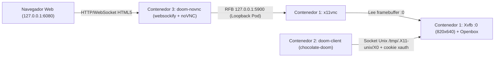

# 🎮 Lab 3.30: Stack Gráfico Desacoplado en Podman Pod — `Xvfb` + `Openbox` + DOOM + `x11vnc` + `noVNC` en tu Navegador

> *"La mejor prueba de que el modelo Cliente-Servidor de X11 es modular consiste en separar los procesos en **tres contenedores distintos dentro de un mismo Pod**: en un contenedor corre la pantalla virtual (`Xvfb`) y el Window Manager (`Openbox`), en otro separado corre la aplicación gráfica (`DOOM`) conectada únicamente por un socket Unix, y un tercero publica la sesión cifrada en tu navegador con `noVNC` consumiendo menos de 150 MB de RAM."*

---

## 🏗️ 1. Arquitectura del Pod `lab-doom-graficos`



```text
┌─────────────────────────── PODMAN POD: lab-doom-graficos ───────────────────────────┐
│  Namespace de red compartido (127.0.0.1 interno) · Puerto expuesto: 127.0.0.1:6080  │
│                                                                                     │
│  ┌──────────────────────────────┐     Volumen X11     ┌──────────────────────────┐  │
│  │ 1. doom-xserver              │   (lab-doom-x11)    │ 2. doom-client           │  │
│  │  • Xvfb :0 (820x640x24)      │◄═══ /tmp/.X11-unix ─┤  • chocolate-doom        │  │
│  │  • Openbox WM (~5 MB RAM)    │     + .Xauthority   │  • Solo usa socket X11   │  │
│  │  • x11vnc -> 127.0.0.1:5900  │                     │  • --wad en :ro opcional │  │
│  └──────────────▲───────────────┘                     └──────────────────────────┘  │
│                 │ RFB privado (5900 NO sale al host)                                │
│  ┌──────────────┴───────────────┐                                                   │
│  │ 3. doom-novnc                │                                                   │
│  │  • websockify :6080 + noVNC  │────► http://127.0.0.1:6080/vnc.html               │
│  └──────────────────────────────┘                                                   │
└─────────────────────────────────────────────────────────────────────────────────────┘
```

### 🛡️ Decisiones Clave de Diseño y Ahorro de RAM

1. **Sin entorno de escritorio pesado:** En vez de levantar GNOME/KDE (>1.5 GB RAM), usamos `Xvfb` (`820x640`, holgado para ventanas `640x480` u `800x600` con barra de título Openbox) + `Openbox` + `chocolate-doom` sin audio real (`SDL_AUDIODRIVER=dummy`) + `noVNC`. El Pod completo ocupa alrededor de **130–145 MB de RAM**.
2. **Compatible con Fedora Toolbox (`podman --remote`) y SELinux:** Al usar un **volumen nombrado (`lab-doom-x11`)** en vez de rutas `/tmp` del host/toolbox, el socket X11 funciona igual desde dentro de un *toolbox* o directo en el host. Si pasas un `--wad` propio, se monta en solo lectura (`:ro`) con `--security-opt label=disable` sin tocar etiquetas de tus carpetas personales.
3. **5900 nunca expuesto al exterior:** `x11vnc` corre con `-localhost` y el Pod solo publica `127.0.0.1:6080:6080`.
4. **Cero desperdicio tras la demo:** Al pulsar `[ENTER]` al terminar de jugar, el `trap` destruye inmediatamente el Pod y el volumen (0 MB RAM ocupados), dejando solo la imagen en caché para que la próxima demo arranque en ~2 segundos.

---

## 🚀 2. Ejecución Paso a Paso en Clase (Desde Toolbox o Host)

No necesitas permisos `root` ni modificar nada de tu sistema operativo anfitrión. Solo requiere `podman` y `python3` (ambos ya disponibles en tu Fedora Toolbox o Ubuntu).

### Opción A — Usando FreeDoom (Incluido de Serie, Cero Archivos Extra)

```bash
cd linux/administrator/graficos
./demo_doom_podman_browser.sh
```

### Opción B — Usando un WAD Clásico Local (`DOOM1.WAD` / `DOOM2.WAD`)

```bash
cd linux/administrator/graficos
./demo_doom_podman_browser.sh --wad /home/dalmine/Downloads/DOOMS/DOOM1.WAD
```

### Otros Modos Útiles

```bash
# Usar otro puerto local si 6080 está ocupado
./demo_doom_podman_browser.sh --port 6085

# Modo automático (sin pausa infinita, ideal verificación CI/test)
./demo_doom_podman_browser.sh --auto 0

# Dejar el Pod corriendo en segundo plano para seguir jugando
./demo_doom_podman_browser.sh --auto 0 --keep

# Apagar manualmente el Pod y liberar la RAM (conserva la imagen cacheada)
./limpiar_doom_podman_browser.sh

# Eliminar también la imagen del disco si quieres recuperar ~280 MB de almacenamiento
./limpiar_doom_podman_browser.sh --rmi
```

---

## 🎮 3. Jugando y Verificando en el Navegador

Cuando el script alcance el **Paso 5**, abre en tu navegador local:

```text
http://127.0.0.1:6080/vnc.html?autoconnect=true&resize=scale
```

| Tecla | Acción en DOOM |
| :--- | :--- |
| **Flechas `↑ ↓ ← →`** | Avanzar, retroceder y girar |
| **`Ctrl` (izquierdo o derecho)** | Disparar |
| **`Espacio`** | Abrir puertas / activar interruptores |
| **`Shift`** | Correr |
| **`1` – `7`** | Cambiar de arma |
| **`Esc` / `Enter`** | Menú y selección de dificultad |

Al terminar tu demostración, vuelve a la terminal y presiona **`[ENTER]`**: el Pod desaparece al instante y tu laptop recupera el 100% de la memoria RAM.

---

## 🏪 4. Ejercicios en Clase: Terminal Tonta (Supermercados/POS), Multiventana X11 y Salto a Apache Guacamole

### Ejercicio A — Simulación de Caja de Supermercado (*Zero Client* sin Estado Local)

1. Lanza el Pod (`./demo_doom_podman_browser.sh`), abre el navegador, comienza una partida nueva y camina unos pasos dentro del primer nivel.
2. **Cierra por completo la pestaña o ventana del navegador** (simulando que se apagó o reemplazó físicamente la terminal tonta de una caja de supermercado).
3. Vuelve a abrir `http://127.0.0.1:6080/vnc.html?autoconnect=true&resize=scale` desde el mismo navegador o desde otro dispositivo en la red SSH: **el juego y tu posición siguen exactamente donde los dejaste**.
4. **Conclusión arquitectónica:** El navegador (la terminal tonta) **no ejecuta lógica ni guarda estado**; todo vive en el servidor (`doom-xserver` + `doom-client`).

### Ejercicio B — Levantar una Segunda Ventana Gráfica Remota en Caliente (`xwininfo` + `Openbox`)

Mientras el Pod está activo en el Paso 5 (o con `--keep`), abre una segunda terminal en tu Toolbox o host e inspecciona cómo `Openbox` administra el foco entre clientes conectados al mismo socket X11:

```bash
# Ver las ventanas activas dentro del servidor Xvfb :0 del Pod
podman exec doom-xserver env DISPLAY=:0 XAUTHORITY=/tmp/.X11-unix/.Xauthority xwininfo -root -tree

# Verificar que el puerto VNC 5900 sigue privado dentro del Pod y no expuesto en tu laptop
ss -tlpn | grep -E '5900|6080'
```

*(Si pruebas con una imagen que incluya `xclock` o lanzas otra app cliente montando el mismo volumen `lab-doom-x11`, aparecerá como segunda ventana gestionada por `Openbox` dentro de la misma pestaña de `noVNC`).*

### Ejercicio C — Del Lab con `noVNC` (~30 MB RAM) al Bastion Empresarial con Apache Guacamole

Este mismo patrón es el bloque base de **Apache Guacamole** en producción:
* **Aquí (Lab liviano):** `doom-novnc` (`websockify` + `noVNC`) se conecta 1-a-1 por loopback a `127.0.0.1:5900`.
* **En producción multiusuario:** Reemplazas `noVNC` por dos servicios estándar (**`guacd`** en C + la webapp **`guacamole`** sobre HTTPS/TLS), apuntando `guacd` exactamente al protocolo VNC (`5900`), RDP (`3389`) o SSH (`22`) de tus servidores internos para sumar **login SSO/MFA, permisos RBAC y grabación de auditoría**.
