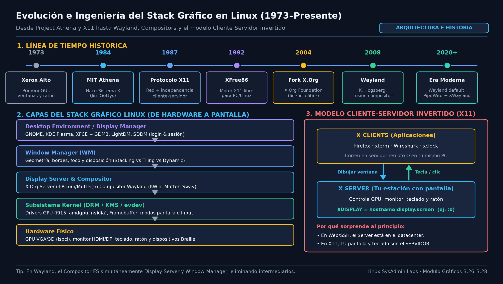
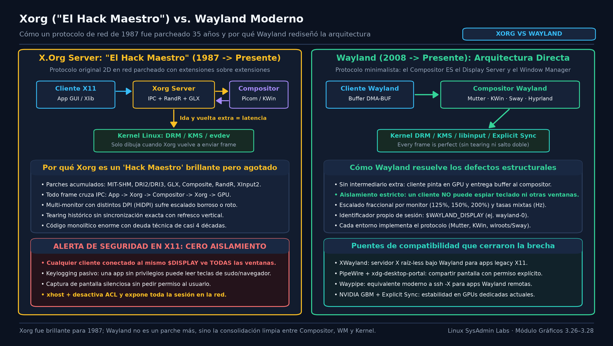
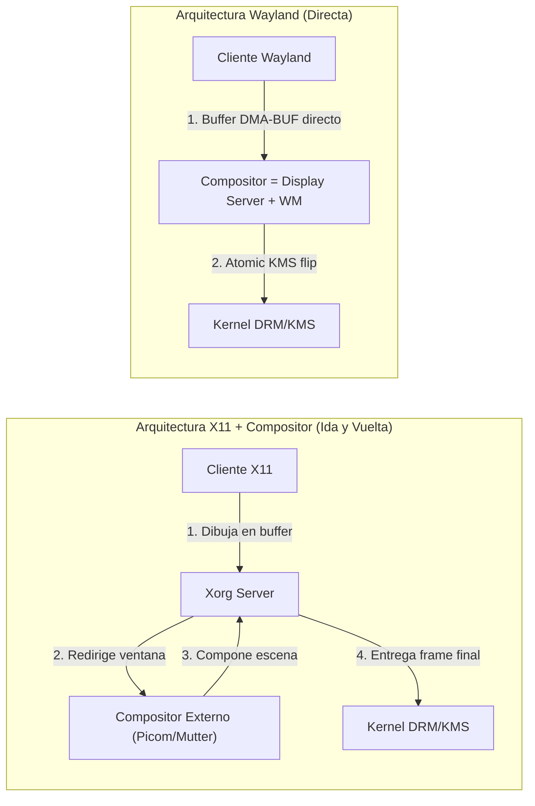
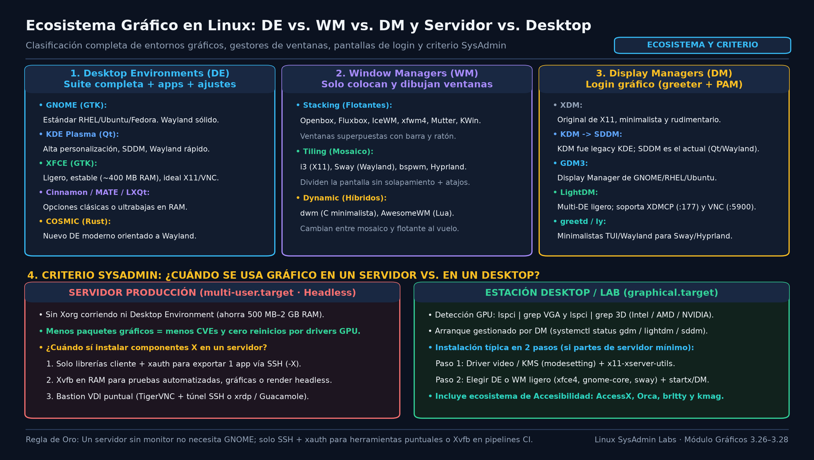
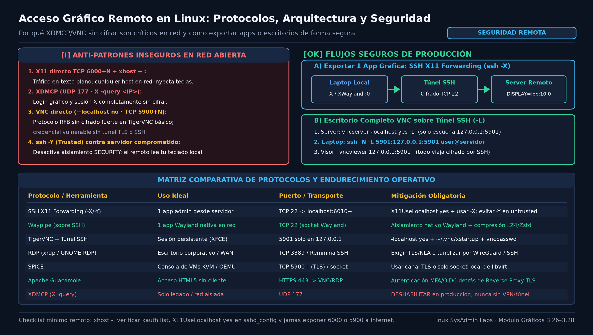
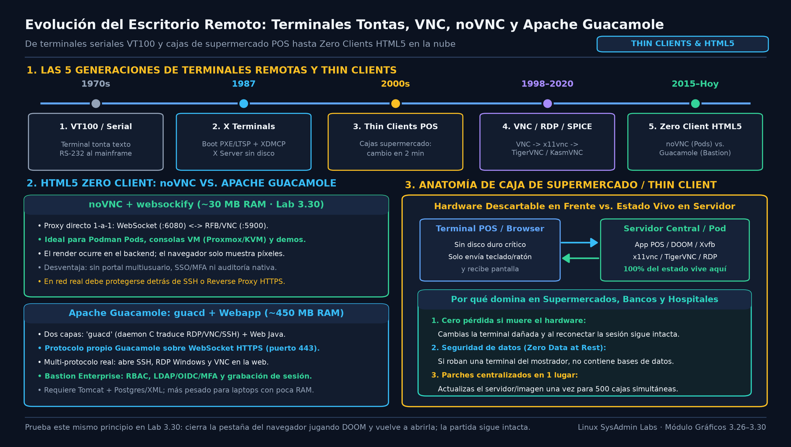

# 🖥️ Sistemas Gráficos en Linux: De X11/Xorg a Wayland, Gestores Gráficos, Servidor vs. Desktop y Acceso Remoto

> *"Linux no tiene un único sistema gráfico monolítico acoplado al núcleo: desde la GPU en el bus PCIe hasta los botones de una ventana en tu monitor, todo se construye por capas intercambiables. Entender dónde termina el Kernel, qué hace el Display Server y por qué un servidor de producción casi nunca corre un escritorio completo te evita brechas de seguridad, consumo innecesario de RAM y horas de troubleshooting a ciegas."*

---

## 🎯 Objetivos de esta Guía

Al finalizar este recorrido teórico-práctico dominarás:
1. **El stack gráfico completo de Linux** y por qué el **modelo Cliente-Servidor de X11 está invertido** respecto a la intuición web tradicional.
2. **La historia y evolución arquitectural (1973–Presente):** desde MIT Project Athena y X11 hasta **por qué Xorg es "el hack maestro"** que sobrevivió casi cuatro décadas, qué problemas estructurales arrastra (latencia, *tearing*, cero aislamiento / *keylogging*) y cómo **Wayland** los resuelve junto a `XWayland`, `PipeWire` y `xdg-desktop-portal`.
3. **La taxonomía real del ecosistema:** diferencias exactas entre **Kernel DRM/KMS**, **Display Server**, **Compositor**, **Window Manager** (*stacking*, *tiling*, *dynamic*), **Desktop Environment** (KDE Plasma, GNOME, XFCE y sucesores) y **Display Manager** (XDM, KDM, GDM3, LightDM, SDDM).
4. **Criterio de Administrador de Sistemas (Servidor vs. Desktop):** por qué un servidor corre *headless* (`multi-user.target`), cuándo sí se utilizan componentes X en servidores (`SSH X11 Forwarding`, `Xvfb` para CI/CD) y cómo se instala o diagnostica la capa gráfica en estaciones Linux.
5. **Configuración y diagnóstico de Xorg/Wayland:** `$DISPLAY`, `Xorg -version`, `xdpyinfo`, `xwininfo`, `xhost`, `xauth`, `/etc/X11/xorg.conf.d/`, `cvt`, `00-keyboard.conf` y `~/.xsession-errors`.
6. **Acceso gráfico remoto y mitigación de riesgos:** `SSH -X/-Y`, `Waypipe`, `XDMCP`, `TigerVNC` + túnel SSH `-L`, `RDP` (`xrdp`/`Remmina`), `SPICE` y `Apache Guacamole`.
7. **Accesibilidad en Linux:** `AccessX`, teclados en pantalla, lector **Orca**, Braille (**`brltty`**), ampliadores (`kmag`) y alto contraste.

---

## 🖼️ 1. Anatomía del Stack Gráfico y el Modelo Invertido de X11



En Windows o macOS, el subsistema de ventanas forma parte indivisible del sistema operativo. En Linux, en cambio, dibujar una ventana en pantalla es el resultado de **cinco capas desacopladas** que colaboran entre sí:

```
┌─────────────────────────────────────────────────────────────────────────────┐
│ 5. DESKTOP ENVIRONMENT & DISPLAY MANAGER                                    │
│    GNOME / KDE Plasma / XFCE + GDM3 / LightDM / SDDM (Login PAM + Sesión)   │
├─────────────────────────────────────────────────────────────────────────────┤
│ 4. WINDOW MANAGER (WM)                                                      │
│    Decide tamaño, posición, bordes, escritorios virtuales y foco            │
├─────────────────────────────────────────────────────────────────────────────┤
│ 3. DISPLAY SERVER & COMPOSITOR                                              │
│    X.Org Server (+ Picom/Mutter/KWin)   ó   Compositor Wayland unificado    │
├─────────────────────────────────────────────────────────────────────────────┤
│ 2. SUBSISTEMA GRÁFICO DEL KERNEL                                            │
│    DRM (Direct Rendering Manager) · KMS (Kernel Mode Setting) · evdev/input │
├─────────────────────────────────────────────────────────────────────────────┤
│ 1. HARDWARE FÍSICO                                                          │
│    GPU (Intel/AMD/NVIDIA en PCIe), Monitor HDMI/DP, Teclado, Ratón          │
└─────────────────────────────────────────────────────────────────────────────┘
```

### 🔄 El Modelo Cliente-Servidor "Invertido" de X11

Uno de los mayores choques conceptuales al estudiar **X Window System (X11)** es el significado de **Servidor** y **Cliente**:

* En la web o en SSH, el **Servidor** está en el *datacenter* y tu laptop es el **Cliente**.
* **En X11 ocurre exactamente al revés:**
  * El **X Server** es el programa que corre **frente a tus ojos**, controlando el hardware físico local: el monitor, la tarjeta gráfica, el teclado y el ratón. Su único trabajo es **dibujar píxeles** cuando alguien se lo pide y **enviar eventos de teclas/clics** hacia arriba.
  * Un **X Client** es cualquier aplicación gráfica (`Firefox`, `xterm`, `Wireshark`, `xclock`). El cliente puede ejecutarse en la **misma computadora** (hablando por un socket Unix local `/tmp/.X11-unix/X0`) o en un **servidor remoto al otro lado del planeta** (enviando órdenes de dibujo por red hacia tu pantalla).

> 💡 **Regla mnemotécnica infalible:** En X11, el que **sirve la pantalla y el teclado** es el **Servidor X**; la aplicación que **pide que le dibujen una ventana** es el **Cliente X**.

La variable de entorno **`$DISPLAY`** le indica a cada cliente X *a qué servidor debe conectarse*, usando el formato:

```text
hostname:display_number.screen_number
```

* Ejemplo local habitual: **`:0`** (o `:0.0`). Al omitir `hostname`, el cliente usa el socket Unix rápido de la máquina local sin pasar por la pila TCP/IP.
* Tanto el número de *display* (`0`) como el de *screen* (`0`) comienzan en **`0`**. Un segundo servidor X en el mismo equipo suele ser `:1` (puerto TCP `6001` si escucha en red; en general `6000 + N`).

---

## 📜 2. Historia Evolutiva (1973–Presente): De MIT Athena a Wayland

1. **1973–1983 — Prehistoria (Xerox Alto y W):** En Xerox PARC nace el paradigma WIMP (*Windows, Icons, Menus, Pointer*). En Stanford se crea el sistema de ventanas **W**, pensado para una arquitectura local específica.
2. **1984 — Nace X en el MIT:** El MIT Laboratory for Computer Science (Jim Gettys, Bob Scheifler y el **Project Athena** junto a DEC) adapta W y lanza **X**. El campus universitario tenía estaciones de distintos fabricantes conectados en red, así que necesitaban **transparencia de red**: que una aplicación científica corriera en un mainframe potente del sótano y mostrara su interfaz en la estación del escritorio.
3. **Finales de 1987 — Protocolo X11:** Se estandariza la versión **11 del protocolo X** (dos años después de Windows 1.0). X11 separó deliberadamente el mecanismo (*dibujar ventanas*) de la política (*cómo se ven y mueven*): por eso el servidor X **no está atado a ningún Window Manager ni entorno de escritorio**.
4. **1992–2003 — Era XFree86 en Linux:** Para llevar X11 a PCs x86 con Linux y BSD surgió **XFree86**, que durante una década fue sinónimo de soporte gráfico en Unix libre.
5. **2003–2004 — El Gran Fork hacia X.Org Foundation:** XFree86 introdujo una licencia incompatible con la GPL en su versión 4.4. Prácticamente toda la industria y los desarrolladores crearon un *fork* llamado **X.Org Server**, mantenido por la **X.Org Foundation**, convirtiéndose en el estándar universal de Linux durante dos décadas.
6. **2008 — Nace Wayland:** **Kristian Høgsberg**, desarrollador veterano tanto de Xorg como del subsistema DRM/DRI del kernel Linux, se dio cuenta de que los parches modernos de Linux (KMS, GEM, Mesa, evdev) ya hacían dentro del kernel casi todo el trabajo duro que antes hacía Xorg. Propone **Wayland** con una meta radical: *"Every frame is perfect"* (ningún parpadeo, ningún desgarro de imagen, arquitectura mínima).
7. **2020–Presente — Adopción Masiva de Wayland + Puentes Modernos:** Distribuciones líderes (Fedora, Ubuntu, Debian, RHEL) adoptan Wayland como sesión por defecto sobre GNOME (`Mutter`), KDE Plasma 6 (`KWin`) y compositores *tiling* (`Sway`, `Hyprland`), apoyándose en **`XWayland`** para apps heredadas y en **`PipeWire` + `xdg-desktop-portal`** para compartir pantalla con permisos granulares.

---

## 🧩 3. Por Qué Xorg es "El Hack Maestro" vs. la Arquitectura de Wayland



### 🛠️ Cómo Xorg se Convirtió en "El Hack Maestro"

El protocolo X11 de 1987 fue diseñado para enviar primitivas 2D simples (*"dibuja un rectángulo azul, escribe este texto con esta fuente del servidor"*) sobre redes lentas. Sin embargo, para los años 2000–2020 los usuarios exigían aceleración 3D OpenGL/Vulkan, transparencias, sombras, video a 144 Hz, múltiples monitores con resoluciones dispares (*HiDPI*), tabletas gráficas y gestos multitáctiles.

En lugar de desechar X11 y romper millones de programas, los ingenieros fueron **injertando extensiones maestras dentro del protocolo**:

* **MIT-SHM:** Memoria compartida local para no copiar mapas de bits por sockets en el mismo PC.
* **DRI / DRI2 / DRI3 + GLX:** Permitieron que el cliente hablara directo con la GPU en 3D sin serializar millones de triángulos por X11.
* **RandR (*Resize and Rotate*):** Añadió soporte dinámico para conectar/desconectar monitores y cambiar resoluciones en caliente.
* **Composite:** Permitió desviar el dibujado de cada ventana a un *buffer* fuera de pantalla para que un **Compositor externo** (`Picom`, `Compiz`, `KWin`) aplicara transparencias y efectos.
* **XInput2:** Añadió múltiples punteros y gestos *multitouch*.

El resultado fue un triunfo de ingeniería retrocompatible —**"el hack maestro"**—, pero a un costo arquitectónico enorme:



### ⚠️ Problemas Estructurales de Xorg

1. **Ida y vuelta innecesaria y *tearing*:** Cuando un compositor externo trabaja bajo Xorg, los eventos de entrada y los cuadros gráficos rebotan entre la app, Xorg y el compositor. Si la sincronización vertical falla, aparece *screen tearing* (imagen partida horizontalmente).
2. **🚨 Brecha crítica de seguridad (Cero aislamiento entre ventanas):** Por diseño original de 1987, cualquier cliente X11 conectado al mismo `$DISPLAY` forma parte de un espacio compartido: **cualquier aplicación sin privilegios puede capturar silenciosamente la pantalla entera o leer las pulsaciones de teclado (*keylogging*) dirigidas a tu gestor de contraseñas, navegador o terminal `sudo`**.
3. **Escalado fraccional y tasas de refresco mixtas rotas:** En Xorg existe un único *framebuffer* gigante compartido entre monitores; combinar un portátil 4K al 150% a 120 Hz con un monitor externo Full HD al 100% a 60 Hz produce borrosidad, caídas de FPS o bordes desalineados.
4. **Complejidad inmantenible:** Xorg acumula cientos de miles de líneas para hardware de los 90 (impresoras XPrint históricas, fuentes bitmap del servidor, etc.) que casi nadie usa.

### ✅ Cómo Wayland Soluciona el Problema (y Qué Desafíos Trajo)

Wayland no es "un programa servidor único": es un **protocolo de comunicación minimalista** donde **el Compositor, el Display Server y el Window Manager se fusionan en un solo proceso** (por ejemplo, `gnome-shell/Mutter` en GNOME, `kwin_wayland` en KDE Plasma, o `sway` / `Hyprland`).

* **Renderizado directo:** El cliente (GTK, Qt, SDL, navegador) dibuja en su propio buffer de GPU (`DMA-BUF`), avisa al compositor (*"nuevo frame listo"*), y el compositor compone todas las ventanas en un solo paso atómico hacia el kernel DRM/KMS.
* **Aislamiento estricto por ventana:** Un cliente Wayland **no sabe qué otras ventanas existen ni puede leer teclas que no estén dirigidas a su ventana activa**. Su variable de sesión ya no es `$DISPLAY`, sino **`$WAYLAND_DISPLAY`** (por ejemplo `wayland-0`).
* **Escalado independiente por monitor:** Cada monitor tiene su propia escala fraccional y tasa de refresco nativa.

**¿Qué problemas enfrentó Wayland en sus primeros años y cómo se resolvieron hoy?**

| Desafío Inicial en Wayland | Solución Moderna en Linux Actual |
| :--- | :--- |
| **Aplicaciones antiguas compiladas solo para X11** | **`XWayland`:** ejecuta un servidor X *rootless* bajo demanda como cliente del compositor Wayland (verificable con `pgrep -a Xwayland`). |
| **Capturas de pantalla, OBS, Zoom/Meet compartiendo escritorio** | **`PipeWire` + `xdg-desktop-portal`:** el compositor muestra un diálogo de sistema y solo entrega el flujo de video si el usuario autoriza expresamente esa pantalla o ventana. |
| **Drivers propietarios NVIDIA con parpadeos o frames fuera de orden** | Soporte de **GBM** + **Explicit Sync** en kernels/drivers/compositores recientes. |
| **Atajos globales (*Push-to-Talk*) y accesibilidad avanzada** | Protocolos específicos de Wayland (`GlobalShortcuts` portal, *input-method*, integración nativa en `at-spi2`/Orca). |
| **Exportar aplicaciones gráficas por red (`ssh -X` de Wayland)** | **`Waypipe`:** proxy ligero sobre SSH diseñado para serializar buffers Wayland comprimidos (LZ4/Zstd). |

---

## 🏛️ 4. Taxonomía del Ecosistema: DE vs. WM vs. Compositor vs. DM



Una fuente frecuente de confusión es mezclar la función de cada pieza. Observa la diferencia exacta:

| Componente | Qué Hace Realmente | Ejemplos Clave |
| :--- | :--- | :--- |
| **Display Server** | Habla con el hardware/kernel (`DRM/KMS/evdev`) y expone el protocolo de ventanas. | `Xorg` (X11), `Xvfb` (headless en RAM), Compositores Wayland. |
| **Compositor** | Toma las texturas de las ventanas y aplica transparencias, sombras, VSync y efectos 3D. | En X11 (separado): `Picom`, `Compton`. Integrado: `Mutter`, `KWin`, `xfwm4`, `Sway`. |
| **Window Manager (WM)** | Posiciona, redimensiona, enfoca y decora ventanas (bordes, botones cerrar/maximizar). | **Stacking:** `Openbox`, `Fluxbox`, `xfwm4`, `IceWM` · **Tiling:** `i3`, `Sway`, `Hyprland`, `bspwm` · **Dynamic:** `dwm`, `AwesomeWM`. |
| **Desktop Environment (DE)** | Suite completa: WM + Compositor + barra de tareas + gestor de archivos + panel de ajustes + apps. | **KDE Plasma** (Qt), **GNOME** (GTK), **XFCE** (GTK), **Cinnamon**, **MATE**, **LXQt**, **COSMIC** (Rust). |
| **Display Manager (DM)** | Pantalla gráfica de inicio de sesión (*greeter*): autentica usuario vía PAM y lanza su DE/WM. | **XDM**, **KDM** (legacy), **GDM3**, **LightDM**, **SDDM**, **`greetd`/`ly`**. |

### 🔍 Paradigmas de Window Managers y Desktop Environments

* **Window Managers *Stacking* (Apilables / Flotantes):** Las ventanas flotan libremente y se superponen unas sobre otras; se manejan principalmente con ratón y botones de título (`Openbox`, `Fluxbox`, `xfwm4`, `Mutter`, `KWin`). Ideales para uso intuitivo clásico.
* **Window Managers *Tiling* (En Mosaico):** Dividen el 100% de la pantalla en azulejos sin solapamiento ni espacio desperdiciado; se controlan casi íntegramente por teclado (`i3` en X11, `Sway` y `Hyprland` en Wayland, `bspwm`). Muy populares entre SysAdmins y programadores por velocidad con múltiples terminales.
* **Window Managers *Dynamic* (Dinámicos):** Alternan al vuelo entre disposición automática en mosaico y modo flotante (`dwm` configurado recompilando en C, `AwesomeWM` programable en Lua).

Y respecto a los **Desktop Environments** más representativos en servidores/estaciones Linux:

* **KDE Plasma:** Basado en **Qt**, extremadamente configurable (paneles, *widgets*, atajos, efectos de `KWin`), excelente rendimiento en hardware moderno y muy completo en Wayland con `SDDM`.
* **GNOME:** Basado en **GTK**, diseño limpio, minimalista y orientado a flujos sin distracciones; entorno por defecto en **Ubuntu Desktop**, **RHEL** y **Fedora Workstation**, con soporte maduro de Wayland (`Mutter` + `GDM3`).
* **XFCE:** Basado en **GTK**, muy ligero (~350–500 MB RAM) y fiel a la metáfora clásica de escritorio; excelente para máquinas virtuales de laboratorio, hardware modesto y sesiones remotas **VNC**.

### 🔐 Display Managers y Anatomía de LightDM

Un **Display Manager** arranca al finalizar el *boot* en `graphical.target`, autentica al usuario mediante **PAM** y lanza la sesión gráfica elegida:

* **XDM:** El pionero de X11; interfaz espartana de los años 90, hoy solo presente en sistemas minimalistas o legados.
* **KDM:** Fue el gestor clásico de KDE; quedó obsoleto y fue reemplazado por **SDDM** (*Simple Desktop Display Manager*), que usa QML/Qt y soporta Wayland.
* **GDM3:** Gestor oficial de GNOME (arranca sesiones Wayland y X11 de forma segura usando un usuario sin privilegios `gdm`).
* **LightDM:** Ligero, rápido, independiente de entorno (funciona igual de bien con XFCE, KDE o GTK *greeters*) y muy apreciado en aulas/servidores VDI porque integra de fábrica servidores **XDMCP** y **VNC**.

En `/etc/lightdm/lightdm.conf` (y subarchivos como `lightdm-kde-greeter.conf`), destacan cuatro secciones críticas:

```ini
[LightDM]
# Parámetros globales del demonio

[SeatDefaults]
greeter-session=lightdm-gtk-greeter
session-wrapper=/etc/X11/Xsession

[XDMCPServer]
enabled=false
port=177

[VNCServer]
enabled=false
command=Xvnc
port=5900
```

Para validar un cambio de tema o configuración en LightDM **sin cerrar tu sesión activa ni reiniciar el servidor**, y gestionarlo con `systemd`:

```bash
lightdm --test-mode --debug        # Simula el greeter en una ventana de prueba
sudo systemctl enable lightdm      # Habilita el arranque gráfico en el boot
sudo systemctl start lightdm       # Arranca el Display Manager ahora mismo
sudo systemctl stop lightdm        # Detiene el DM (útil antes de instalar drivers GPU)
```

---

## ⚖️ 5. Criterio SysAdmin: Servidor Headless vs. Desktop (y Guía de Instalación)

Una de las decisiones más importantes de arquitectura Linux es responder: **¿debo instalar entorno gráfico en este servidor?**

### 🏢 Por Qué en Servidores de Producción NO se Instala Escritorio

Si auditas un servidor Linux en producción (`AWS EC2`, nodos Kubernetes, bases de datos, web servers):

```bash
systemctl get-default
# Producción: multi-user.target   (Solo CLI + red + SSH, sin GUI)
# Desktop:    graphical.target    (Arranca Display Manager + Xorg/Wayland)
```

1. **Consumo de RAM y CPU:** Un escritorio completo consume entre **500 MB y 2+ GB de RAM** de base solo para existir, memoria robada a tu base de datos o caché de archivos.
2. **Superficie de ataque (CVEs):** Xorg, bibliotecas multimedia, navegadores y servicios D-Bus de escritorio multiplican por diez la cantidad de paquetes a parchar mensualmente.
3. **Estabilidad:** Una actualización del driver GPU o un cuelgue del entorno gráfico puede requerir reinicio o interferir con operaciones críticas.

### 🎯 Cuándo SÍ Aparecen Componentes X en un Servidor Real

Existen cinco escenarios legítimos donde un administrador utiliza piezas gráficas en un servidor sin convertirlo en un escritorio de oficina:

1. **Exportar una única aplicación gráfica administrativa por SSH (`ssh -X`):** Por ejemplo, ejecutar el instalador GUI de un software empresarial, `wireshark`, `virt-manager` o una consola Java desde el servidor viendo la ventana en tu laptop. **No necesitas instalar Xorg ni GNOME/XFCE en el servidor**: basta con `xauth` + los paquetes cliente de esa aplicación.
2. **Renderizado y pruebas automatizadas sin monitor (`Xvfb`):** El *X Virtual Framebuffer* simula una pantalla 100% en RAM. Lo usan pipelines CI/CD (Selenium, Playwright heredado, LibreOffice headless, generación de gráficas/imágenes) en servidores sin GPU.
3. **Jumpbox / Bastion VDI puntual:** Un nodo administrativo con **XFCE + TigerVNC** encapsulado exclusivamente detrás de un túnel SSH o **Apache Guacamole** para operar herramientas de red internas.
4. **Nodos con GPU para cómputo / visualización científica:** Servidores con tarjetas NVIDIA/AMD que renderizan en remoto mediante EGL/VirtualGL.
5. **Consola de rescate de hipervisor:** Acceso temporal por **SPICE/VNC** en KVM/Proxmox o iLO/iDRAC durante instalación o recuperación de arranque.

### 📦 Cómo se Instala el Stack Gráfico desde Cero (Referencia Conceptual)

Si partes de una instalación mínima tipo servidor (como una VM educativa) y quieres convertirla en estación gráfica X11, el proceso sigue siempre **dos pasos lógicos**:

#### Paso previo: Detectar tu tarjeta gráfica (GPU)

```bash
lspci | grep -i VGA    # Ej: Intel Corporation HD Graphics 620 / VMware SVGA II
lspci | grep -i 3D     # Ej: NVIDIA Corporation GM107M [GeForce GTX 950M]
```

#### Paso 1: Instalar el Servidor X, Utilidades y Driver de Video

* En distribuciones modernas con kernel Linux actual, el driver genérico **`modesetting`** (integrado en `xserver-xorg-core`) funciona sobre el subsistema **KMS** del kernel para Intel, AMD y máquinas virtuales modernas sin requerir drivers propietarios viejos.
* En escenarios específicos o legados se instalan paquetes por fabricante o hipervisor (`xserver-xorg-video-intel`, `xserver-xorg-video-amdgpu`, `xserver-xorg-video-vmware` / `xf86-video-vmware`).
* Para utilidades de inspección y diagnóstico:
  * **Debian / Ubuntu:** `sudo apt install xserver-xorg-core x11-xserver-utils x11-utils xinit`
  * **RHEL / Fedora:** `sudo dnf install xorg-x11-server-Xorg xorg-x11-server-utils xorg-x11-xinit`
* *(Nota de virtualización clásica)*: Al compilar *Guest Additions* en **VirtualBox** sobre sistemas basados en RHEL/CentOS, el instalador requiere cabeceras del núcleo y herramientas de compilación: `kernel-devel`, `dkms`, `make`, `bzip2` y `gcc`.

#### Paso 2: Elegir e Instalar el Window Manager o Desktop Environment

* **Entorno ligero completo (ideal VM de laboratorio o VNC):**
  `sudo apt install xfce4` (Ubuntu/Debian) · luego iniciar manualmente con `startx` o instalar `lightdm`.
* **Escritorio completo moderno (Wayland + X11):** `ubuntu-desktop` / `gnome-core` / `kde-plasma-desktop`.
* **Solo Window Manager *tiling* minimalista:** `i3` (X11) o `sway` (Wayland).

---

## 🛠️ 6. Configuración Modular, Variables y Diagnóstico de Xorg y Wayland

### 🔎 Comandos Esenciales de Diagnóstico en Vivo

| Comando | Qué Informa / Para Qué Sirve |
| :--- | :--- |
| **`Xorg -version`** | Muestra la versión exacta del servidor Xorg instalado, fecha de compilación y kernel actual *(imprime por stderr)*. |
| **`echo "$DISPLAY"`** | Indica el display X activo (`:0`, `localhost:10.0` en SSH Forwarding). |
| **`echo "$WAYLAND_DISPLAY"`** | Indica la sesión Wayland activa (`wayland-0` / `wayland-1`). |
| **`xdpyinfo \| grep -A 7 screen`** | Detalla dimensiones en píxeles (`1920x1080 pixels`), tamaño físico en mm, profundidad de color y *root window*. |
| **`xdpyinfo \| grep dimensions`** | Extrae de forma directa la resolución activa del display (`dimensions: 1366x768 pixels`). |
| **`xwininfo`** | Modo interactivo (haces clic en una ventana) o por ID (`xwininfo -root -tree` / `xwininfo -id <ID> -all`) para ver geometría, estado `IsViewable` y propiedades (`_NET_WM_PID` / `Process`). |
| **`pidof firefox`** | Obtiene rápidamente el PID de un cliente gráfico (complementario a `xwininfo -all \| grep Process`). |
| **`pgrep -a Xwayland`** | Comprueba en Wayland si `XWayland` está activo dando soporte a aplicaciones X11. |

### 📁 Configuración Moderna: `/etc/X11/xorg.conf` vs. `/etc/X11/xorg.conf.d/`

Antiguamente, configurar X requería generar manualmente **`/etc/X11/xorg.conf`** ejecutando `Xorg -configure` (o `X -configure`). Hoy en día ese archivo **ni siquiera suele existir**: Xorg autodetecta hardware mediante `udev` y KMS.

Cuando el administrador necesita ajustar solo un componente (como la distribución de teclado o la resolución fija de un monitor sin EDID), crea pequeños archivos modulares en **`/etc/X11/xorg.conf.d/*.conf`**, los cuales se leen **en orden alfanumérico** (donde el último parámetro coincidente sobrescribe a los anteriores).

Los bloques estructurales posibles dentro de estas configuraciones son:
1. **`ServerLayout`**: ensambla pantallas (`Screen`) y periféricos (`InputDevice`).
2. **`Files`**: rutas de fuentes y módulos.
3. **`Module`**: extensiones cargables del servidor X.
4. **`InputDevice` / `InputClass`**: ratones, touchpads y teclados (hoy `InputClass` con `MatchIsKeyboard "on"` es el estándar vía `udev`).
5. **`Monitor`**: rangos de refresco horizontal/vertical y líneas **`Modeline`** de resolución.
6. **`Device`**: controlador de la tarjeta gráfica (`Driver "modesetting"`, `"intel"`, etc.).
7. **`Screen`**: vincula un `Device` con un `Monitor` e incluye la `SubSection "Display"` con `Depth` y `Modes`.

#### Ejemplo 1 — Generar una resolución exacta con `cvt` y aplicarla:

```bash
cvt 1920 1080
# Modeline "1920x1080_60.00"  173.00  1920 2048 2248 2576  1080 1083 1088 1120 -hsync +vsync
```

Luego se inserta en `/etc/X11/xorg.conf.d/10-monitor.conf`:

```text
Section "Monitor"
    Identifier  "HDMI-1"
    Modeline    "1920x1080_60.00"  173.00  1920 2048 2248 2576  1080 1083 1088 1120 -hsync +vsync
    Option      "PreferredMode" "1920x1080_60.00"
EndSection
```

#### Ejemplo 2 — Configurar el teclado en `/etc/X11/xorg.conf.d/00-keyboard.conf`:

```text
Section "InputClass"
    Identifier "system-keyboard"
    MatchIsKeyboard "on"
    Option "XkbLayout" "latam"
    Option "XKbOptions" "terminate:ctrl_alt_bksp"
EndSection
```

*(En sistemas systemd modernos también puede gestionarse de forma unificada para consola TTY y X11 mediante `sudo localectl set-x11-keymap latam "" "" terminate:ctrl_alt_bksp`, y dentro de Wayland mediante los ajustes del propio compositor).*

### 🩺 Control de Acceso (`xhost` vs. `xauth`) y Logs (`.xsession-errors`)

* **`xhost` (ACL por host o identidad):** Controla qué máquinas o usuarios locales pueden conectarse al servidor X.
  * `xhost +192.168.0.141` / `xhost +inet6:fe80::...` / `xhost +local`
  * **`xhost +`**: **PELIGRO CRÍTICO** — desactiva el control de acceso y permite que *cualquier equipo en la red* se conecte a tu sesión X si el puerto TCP 6000 está abierto. Siempre se revierte con **`xhost -`** (o eliminando un host específico con `xhost -inet:192.168.0.141`, o editando `/etc/Xn.hosts`).
  * Reglas modernas *Server Interpreted* (`si`): `xhost +si:localuser:alumno`, `xhost +si:localgroup:wheel`, `xhost +si:hostname:madryn`, `xhost +si:ipv6:...`.
* **`xauth` (Autenticación por cookie criptográfica):** Método estándar seguro almacenado en **`~/.Xauthority`**. Cada servidor X genera un secreto aleatorio (`MIT-MAGIC-COOKIE-1`) de 128 bits.
  * `xauth list` (lista displays y cookies), `xauth info` (ruta y bloqueos de `.Xauthority`), `xauth merge /home/otro_usuario/.Xauthority` (útil puntualmente para habilitar sesiones entre usuarios autorizados en consola).
* **`~/.xsession-errors`:** Archivo histórico del usuario donde quedan registrados fallos de arranque de sesión, conflictos de `dbus-daemon`, advertencias `GTK`/`GDK`, agentes de claves duplicados o errores al ejecutar `startx`. En entornos `systemd` recientes gran parte de esa salida también se redirige al journal del usuario (`journalctl --user -b`).

---

## 🌐 7. Acceso Gráfico Remoto: Protocolos, Riesgos y Mitigaciones



Elegir mal el protocolo de acceso gráfico remoto es una de las fuentes más comunes de compromiso de sesiones de administrador. Veamos cada tecnología y cómo asegurarla:

### 1. SSH X11 Forwarding (`ssh -X` vs. `ssh -Y`) — El Estándar para 1 App en Servidores

Cuando administras un servidor Linux *headless* (o un equipo de laboratorio secundario) y necesitas abrir **una sola aplicación gráfica** viendo la ventana en tu laptop:

* **Lo que hace SSH internamente:**
  1. Tu laptop (cliente SSH) abre la conexión cifrada TCP 22 al servidor remoto.
  2. El demonio `sshd` en el servidor (si tiene `X11Forwarding yes`) abre un puerto proxy local en **`127.0.0.1:6010`** (`X11DisplayOffset 10`), exporta automáticamente `DISPLAY=localhost:10.0` e inyecta una cookie efímera en `~/.Xauthority` vía **`xauth`**.
  3. La app remota envía tráfico X11 al proxy local `localhost:10.0`, SSH lo cifra por el túnel TCP 22 y tu cliente SSH lo entrega a tu X Server o `XWayland` local.
* **🚨 Riesgo Crítico: `-X` (Untrusted) vs. `-Y` (Trusted):**
  * `ssh -X`: Utiliza la extensión **`SECURITY`** de X11 para generar una cookie *no confiable*, impidiendo que el servidor remoto capture pulsaciones de teclado, pantallas o ventanas ajenas de tu laptop. *(Es la opción recomendada por defecto).*
  * `ssh -Y`: Marca la conexión como **Trusted** (confiable). Otorga al servidor remoto **control absoluto sobre tu servidor X local**. Si te conectas con `ssh -Y` a un servidor comprometido por un atacante, ese servidor remoto puede ejecutar un *keylogger* sobre tu laptop local o inyectar comandos en tu terminal abierta.
  * **Mitigaciones en `/etc/ssh/sshd_config`:** Mantener `X11Forwarding yes` únicamente si hace falta, **exigir `X11UseLocalhost yes`** (nunca `no`, pues expondría el proxy X11 en `0.0.0.0:6010` a toda la red) y en el cliente `~/.ssh/config` mantener **`ForwardX11Trusted no`**.

### 2. Waypipe — El Sucesor Nativo de `ssh -X` para Wayland

Si tanto tu estación como el equipo remoto corren aplicaciones Wayland puras:

```bash
waypipe ssh usuario@servidor_remoto pavucontrol
```

A diferencia de X11, **Waypipe** transporta buffers Wayland comprimidos (LZ4/Zstd) sobre el túnel SSH conservando el **aislamiento nativo de seguridad de Wayland** (el servidor remoto nunca ve otras ventanas de tu laptop).

### 3. XDMCP (`X -query <IP>`) — El Protocolo Histórico Sin Cifrado

* **Qué es:** *X Display Manager Control Protocol* (puerto **UDP 177**). Permitía que un terminal ligero arrancara un servidor X local mínimo y pidiera la pantalla de login completa (LightDM/XDM) a un servidor remoto: `X -query 192.168.91.1`.
* **🚨 Riesgo:** Tanto el usuario/contraseña como toda la sesión gráfica viajan **100% en texto plano**. **Mitigación:** Mantener `[XDMCPServer] enabled=false` en LightDM y no utilizarlo nunca fuera de redes aisladas de laboratorio o túneles VPN/SSH.

### 4. VNC (TigerVNC / RFB) y su Aseguramiento con Túnel SSH

VNC (*Virtual Network Computing*) transmite el *framebuffer* visual completo (protocolo RFB en puertos **`5900 + N`**, donde `:1` = **`5901`**), ideal para sesiones persistentes ligeras con **XFCE** que siguen vivas aunque se corte tu conexión.

1. **Regla de oro:** **NUNCA ejecutes el servidor VNC como `root`** ni con `--localhost no` expuesto a Internet: el protocolo VNC tradicional tiene cifrado débil o nulo y trunca contraseñas largas.
2. **Archivo de inicio `~/.vnc/xstartup` (ejemplo seguro con XFCE):**
   ```bash
   #!/bin/sh
   unset SESSION_MANAGER
   unset DBUS_SESSION_BUS_ADDRESS
   vncconfig -nowin &
   exec dbus-launch xfce4-session
   ```
   *(Asegurar permisos ejecutables `chmod 700 ~/.vnc/xstartup` y definir clave con `vncpasswd`).*
3. **Ejecución segura vinculada solo a loopback + Túnel SSH:**
   ```bash
   # En el servidor remoto: solo escucha en 127.0.0.1:5901
   vncserver -localhost yes :1

   # En tu laptop local: crea el túnel cifrado por TCP 22
   ssh -N -L 5901:127.0.0.1:5901 usuario@servidor_remoto

   # Conectar el visor hacia tu propio localhost cifrado
   vncviewer 127.0.0.1:5901
   ```

### 5. RDP (`xrdp` / GNOME Remote Desktop / Remmina), SPICE y Apache Guacamole

* **RDP:** Protocolo nativo de Microsoft Windows implementado en Linux mediante **`xrdp`** (X11/VNC backend) o **GNOME Remote Desktop** (Wayland nativo con TLS). Ofrece mejor compresión y sonido/portapapeles bidireccional en enlaces WAN que VNC. En Linux destaca **Remmina** como cliente multi-protocolo (RDP, VNC, SPICE, SSH) que incluye una pestaña integrada para tunelizar la sesión directamente sobre SSH.
* **SPICE (*Simple Protocol for Independent Computing Environments*):** Diseñado específicamente para máquinas virtuales **KVM/QEMU**; acelera audio, video, múltiples monitores y redirección USB sobre canal TLS.
* **Apache Guacamole:** Gateway web *clientless* que traduce VNC, RDP y SSH a **HTML5/WebSocket sobre HTTPS (443)** detrás de un proxy inverso TLS, ideal para dar acceso controlado a equipos corporativos sin abrir puertos 5900 ni 3389 en firewalls perimetrales.

---

### 🏪 7.5 Evolución del Escritorio Remoto: Terminales Tontas (Supermercados/POS), VNC, TigerVNC, noVNC y Apache Guacamole



Para comprender por qué hoy existen demos como levantar un sistema gráfico completo en contenedores y jugarlo o administrarlo desde cualquier navegador, conviene seguir la línea evolutiva de las **terminales tontas (*Dumb Terminals*)** hasta los actuales ***Zero Clients* HTML5**:

1. **Terminales Tontas Seriales (1970s–1980s, ej. DEC VT100):** Pantallas monocromáticas sin CPU de propósito general ni disco duro conectadas por cable serial RS-232 a un *mainframe* UNIX. Solo enviaban pulsaciones de teclado y dibujaban texto enviado por el servidor.
2. **X Terminals y Boot por Red PXE / LTSP (1987–2000s):** Terminales que arrancaban un kernel mínimo por red (PXE/TFTP) y levantaban únicamente un **X Server** solicitando la pantalla de login vía **XDMCP** (*Linux Terminal Server Project*). Toda la lógica de las aplicaciones corría en el servidor central.
3. **Thin Clients en Supermercados, Cajas POS, Bancos y Hospitales:** ¿Por qué las cajas de cobro de un supermercado usan *Thin Clients* o escritorios centralizados?
   * **Hardware descartable en minutos:** Si se quema una caja en hora pico, desconectas la terminal y enchufas otra idéntica sin perder la venta en curso ni restaurar discos.
   * **Cero datos sensibles en el mostrador:** No hay bases de datos locales que puedan ser robadas físicamente.
   * **Cero mantenimiento descentralizado:** Parchar una vulnerabilidad o actualizar el software de caja se aplica una sola vez en el servidor/imagen central para cientos de sucursales.
4. **De VNC Clásico a `x11vnc`, `TigerVNC` y `KasmVNC`:**
   * **`VNC` clásico (RFB 1998):** Simple y multiplataforma, pero lento al enviar rectángulos sin compresión moderna y débil en seguridad si no se tuneliza.
   * **`x11vnc`:** No crea una pantalla virtual nueva; *raspa* (`scrape`) un X Server ya existente (`:0` físico o `Xvfb`), ideal para asistencia remota puntual o contenedores ligeros.
   * **`TigerVNC` (`Xvnc`):** Incorpora Xorg y el servidor RFB en un único binario optimizado con soporte *Tight/ZRLE*, cambio dinámico de resolución y TLS/VeNCrypt.
   * **`KasmVNC`:** Evolución moderna centrada en web/WebRTC/WebSocket, alta tasa de cuadros por segundo y múltiples usuarios con soporte Wayland/KMS en contenedores *webtop*.
5. **Era *Zero Client* HTML5 (`noVNC` vs. `Apache Guacamole`):** Elimina incluso la necesidad de instalar un cliente VNC/RDP en el equipo del usuario; **un navegador web cualquiera se convierte en terminal tonta universal**.

| Tecnología | Arquitectura / Capas | Cifrado / Seguridad | RAM Típica Backend | Cuándo Elegirla |
| :--- | :--- | :--- | :--- | :--- |
| **`x11vnc`** | Comparte display X11 vivo (`:0` / `Xvfb`) hacia RFB `:5900` | Nulo/básico por defecto (exigir `-localhost` + SSH/noVNC) | ~10–20 MB | Contenedores ligeros (Lab 3.30) o espejo de sesión física |
| **`TigerVNC` (`Xvnc`)** | X Server virtual + servidor RFB en 1 proceso | TLS opcional + túnel SSH `-L` recomendado | ~40–80 MB (+ DE) | Sesiones persistentes XFCE en bastions o servidores internos |
| **`noVNC` + `websockify`** | Proxy WebSocket (`:6080`) 1-a-1 directo a VNC (`:5900`) | HTTP local (`127.0.0.1`) o WSS detrás de Reverse Proxy | ~25–35 MB | Consola VM (Proxmox/KVM), labs portables y laptops con poca RAM |
| **`Apache Guacamole`** | Daemon C **`guacd`** (traduce RDP/VNC/SSH) + Webapp Java/Tomcat | **TLS 1.3 (HTTPS 443)** + RBAC, LDAP/OIDC/MFA y grabación | ~450–600 MB | **Bastion corporativo multiusuario** con auditoría y acceso sin VPN |
| **`RDP` (`xrdp`) / `SPICE`** | Protocolos optimizados de canal virtual (audio, USB, WAN) | TLS/NLA nativo o SSH/WireGuard | ~60–120 MB | Escritorios WAN (`RDP`) o consolas rápidas KVM/QEMU (`SPICE`) |

#### 🥑 Cómo Escala Esto Hacia Apache Guacamole en Producción

En entornos de aula o empresa con decenas de usuarios, **`noVNC` se reemplaza por Apache Guacamole**: su demonio nativo **`guacd`** habla directamente por red interna contra el backend (`VNC` `:5900`, `RDP` `:3389` o `SSH` `:22`) y lo convierte en flujos HTML5 unificados detrás de un único portal HTTPS con **autenticación MFA/SSO, permisos por grupo (RBAC) y grabación de sesiones**. En tu laptop personal o contenedor educativo aislado, en cambio, **`noVNC + websockify` (~30 MB RAM)** te ofrece exactamente el mismo concepto de *Zero Client* HTML5 sin necesitar Tomcat ni base de datos Postgres.

---

## ♿ 8. Accesibilidad en Entornos de Escritorio Linux

Un administrador de estaciones de trabajo Linux o entornos educativos también debe conocer las herramientas estándar que garantizan la accesibilidad en los **6 frentes clave**: teclado, ratón, lectores de pantalla, lupas/ampliadores, dispositivos Braille y temas de alto contraste.

### ⌨️ Herramientas de Teclado, Ratón y Teclados en Pantalla

* **AccessX (estándar clásico de X11 incorporado hoy en XKB, GNOME y KDE):**
  * **`StickyKeys` (Teclas adhesivas):** Permite pulsar atajos como `Ctrl+Alt+Supr` secuencia a secuencia en lugar de mantener todas las teclas simultáneamente.
  * **`MouseKeys` (Teclas de ratón):** Convierte el teclado numérico en un controlador preciso del puntero del ratón.
  * **`ToggleKeys` (Teclas de alternancia):** Emite señales acústicas al activar/desactivar `Caps Lock`, `Num Lock` o `Scroll Lock`.
  * **`SlowKeys` (Teclas lentas):** Exige mantener presionada una tecla un tiempo mínimo antes de registrarla para evitar pulsaciones accidentales.
  * **`RepeatKeys` y `BounceKeys` / `DelayKeys` (Teclas de rebote):** Ajustan o filtran repeticiones rápidas involuntarias causadas por temblor en las manos.
* **En KDE Plasma (Preferencias del Sistema ➔ Accesibilidad):** Centraliza alertas visuales/sonoras de timbre (*Bell*), teclas adhesivas, teclas lentas/rebote, gestos de activación y soporte de lector de pantalla.
* **Teclados en pantalla:** `xkbd`, `kvbd`, el teclado táctil integrado en GNOME Shell y herramientas modernas como `onboard` o `maliit-keyboard` (Wayland).

### 🗣️ Lector de Pantalla Orca, Braille (`brltty`) y Ampliadores (`kmag`)

* **Orca (entornos gráficos GNOME y KDE Plasma):** Lector y ampliador de código abierto que interactúa con las aplicaciones mediante la API **AT-SPI** *(a diferencia de `Emacspeak`, orientado a usuarios avanzados en terminal/Emacs)*.
  * Se activa rápidamente con **`Alt + Super + s`** o ejecutando `orca` / **`orca --setup`**.
  * Sus paneles principales configuran:
    1. **General:** Perfil activo, inicio automático y diseño de distribución (Desktop vs. Laptop).
    2. **Voz (*Speech*):** Elección de sintetizador (`speech-dispatcher` / `espeak-ng`), velocidad, tono, volumen, nivel de puntuación y verbosidad.
    3. **Braille:** Comunicación con pantallas Braille físicas mediante el demonio **`brltty`** en segundo plano, monitor Braille en pantalla, abreviaturas e indicadores de selección/hipervínculo.
    4. **Eco de teclado (*Key Echo*):** Lectura hablada al vuelo por carácter, palabra o frase.
    5. **Atajos, Pronunciación y Atributos de Texto:** Mapeo personalizado de teclas Orca, diccionario fonético y anuncio de formato (negrita, cursiva, tamaño).
* **Lupas y Alto Contraste:** Zoom nativo en GNOME (*Universal Access*), **`kmag`** (*KDE Magnifier*, lupa en tiempo real con seguimiento del foco/puntero), y temas de **Alto Contraste** y **Texto Grande**.

---

## 🗺️ 9. Hoja de Ruta Práctica en Ubuntu 24.04 LTS

Dado que instalar cinco máquinas virtuales con distintos entornos de escritorio sería poco práctico e improductivo en servidores, los **2 laboratorios interactivos** de este módulo te permiten verificar y dominar el stack gráfico completo **desde una única VM o servidor Ubuntu 24.04 LTS *headless*** (sin monitor ni GNOME instalado):

```bash
sudo apt update && sudo apt install -y xvfb xserver-xorg-core xcvt x11-utils \
  x11-xserver-utils x11-apps xauth pciutils procps openssh-server openssh-client \
  iproute2 python3
```

| Nivel | Sección | Guía Práctica | Script Interactivo | Qué Vas a Probar en Vivo |
| :--- | :--- | :--- | :--- | :--- |
| 🟡 **Intermedio** | **3.27** | [`x11_inspeccion_headless_xvfb_xauth.md`](x11_inspeccion_headless_xvfb_xauth.md) | [`demo_x11_headless.sh`](demo_x11_headless.sh) | Auditoría GPU (`lspci`), `Xorg -version`, `/etc/X11/xorg.conf.d/`, `cvt` Modeline, levantamiento de servidor X virtual **`Xvfb :99`** con cookie `xauth`, inspección `xdpyinfo` / `xwininfo` / `pidof`, prueba real del peligro de **`xhost +` vs `xhost -`** y comparación con Wayland. |
| 🟠 **Avanzado** | **3.28** | [`acceso_grafico_remoto_ssh_x11_vnc.md`](acceso_grafico_remoto_ssh_x11_vnc.md) | [`demo_acceso_grafico_remoto.sh`](demo_acceso_grafico_remoto.sh) | Exportación segura de una app gráfica vía **SSH X11 Forwarding (`ssh -X` vs `-Y`)** sobre `sshd` aislado (`DISPLAY=localhost:50.0` + cookie `xauth` + `xdpyinfo`/`xclock` cruzando el túnel cifrado), hardening `X11UseLocalhost yes`, túnel **SSH `-L` para VNC** (`~/.vnc/xstartup`) y guía para exportar apps desde un equipo remoto real hacia tu laptop. |
| 🎮 **Integrador** | **3.30** | [`podman_x11_vnc_novnc_doom.md`](podman_x11_vnc_novnc_doom.md) | [`demo_doom_podman_browser.sh`](demo_doom_podman_browser.sh) | Stack gráfico desacoplado en **Podman Pod** de 3 contenedores (`doom-xserver` con `Xvfb` + `Openbox` + `x11vnc`, `doom-client` con `chocolate-doom`/FreeDoom o `--wad` `:ro`, y `doom-novnc` con `websockify`/noVNC HTML5 en `127.0.0.1:6080`) con < 150 MB RAM, compatible con Fedora Toolbox y Ubuntu. |

---

## 🎓 Preguntas Socráticas para Clase

1. **¿Por qué si ejecutas `xclock` en un servidor remoto conectado por `ssh -X`, la CPU del reloj corre en el servidor pero los píxeles aparecen en tu laptop? ¿Quién es el Cliente X y quién el Servidor X en esa escena?**
2. **Si alguien te dice *"abre `xhost +` que no me abre la ventana"*, ¿qué brecha exacta estás abriendo en X11 y qué herramienta deberías usar en su lugar?**
3. **¿Por qué Xorg fue un "hack maestro" brillante pero hoy es una vulnerabilidad arquitectónica frente al aislamiento cliente-a-cliente de Wayland?**
4. **Si heredas un servidor web Ubuntu en AWS con `graphical.target`, 2 GB de RAM ocupados por GNOME y LightDM escuchando XDMCP en UDP 177, ¿qué 3 acciones concretas tomarías en tu primer día?**
