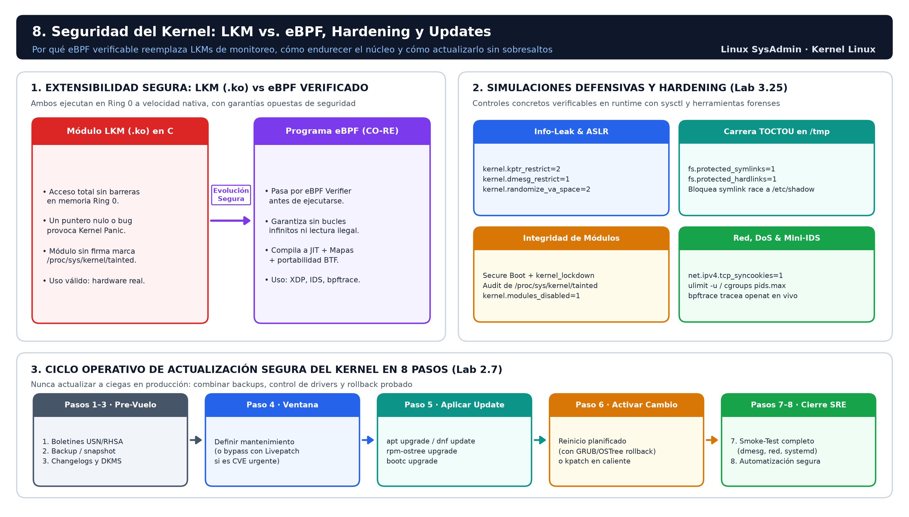

# Laboratorio 2.7: Plan de Actualización Continua del Kernel en 8 Pasos, Rollback y Livepatching

> **Dificultad:** Intermedio (Nivel 2) | **Tiempo estimado:** 40 minutos | **Script interactivo:** [`demo_actualizacion_kernel.sh`](demo_actualizacion_kernel.sh)

Actualizar el kernel Linux es una de las tareas más sensibles de un administrador de sistemas: un parche a tiempo cierra vulnerabilidades críticas de ejecución remota o escalada de privilegios en Ring 0, pero **una actualización mal planificada puede dejar un servidor sin drivers de red, sin módulo DKMS o sin arrancar**.

Este laboratorio transforma la metodología clásica de **8 pasos de actualización del kernel** en un **Runbook SRE moderno y reproducible**, cubriendo distribuciones tradicionales (`apt`, `dnf`, `zypper`, `pacman`), distribuciones inmutables (`rpm-ostree` / `bootc`), **rollback seguro**, **Livepatching en caliente** y **automatización sin riesgos**.

---

## 🗺️ 1. Flujo Completo de Actualización Segura en 8 Pasos



```text
  [1. Advisories] ──► [2. Backup/Snap] ──► [3. Changelogs/DKMS] ──► [4. Ventana + Rollback]
                                                                              │
  [8. Automatizar] ◄── [7. Smoke Test] ◄── [6. Reboot / kexec / Livepatch] ◄── [5. apt/dnf/bootc]
```

| Paso | Fase Operativa | Qué Hace el SysAdmin Realmente | Herramientas / Fuentes Clave |
| :---: | :--- | :--- | :--- |
| **1** | **Mantenerse informado** | Monitorea boletines oficiales de CVEs de kernel para su distribución (no solo `kernel.org`). | **Ubuntu:** [USN](https://ubuntu.com/security/notices) · **Debian:** [DSA](https://www.debian.org/security/) · **RHEL/Rocky:** RHSA / `dnf updateinfo list` · **Upstream:** `kernel.org` |
| **2** | **Copias de seguridad** | Genera snapshot de disco/VM antes de tocar `/boot` y respalda configs críticas (`/etc/modprobe.d`, `/etc/sysctl.d`, lista de paquetes). | LVM/Btrfs/ZFS snapshot, AMI/EBS snapshot, `tar`, BorgBackup ([Lab 3.5e](../borg/borg.md)) |
| **3** | **Verificar cambios y compatibilidad** | Lee el changelog de seguridad y valida si hay espacio libre en `/boot` y módulos externos (**DKMS** / **kABI**) compatibles con el nuevo kernel. | `apt-get changelog`, `rpm -q --changelog`, `dkms status`, `df -h /boot` |
| **4** | **Planificar ventana y rollback** | Elige ventana de bajo tráfico (o drena nodos del balanceador) y verifica que el kernel anterior siga retenido como opción de rollback en GRUB/OSTree. | `installonly_limit=3` en `dnf.conf`, `rpm-ostree status`, `grubby --info=ALL` |
| **5** | **Ejecutar la actualización** | Instala el paquete/imagen de kernel mediante el gestor nativo de la distro (nunca borrando el kernel en ejecución). | `apt upgrade`, `dnf upgrade kernel`, `rpm-ostree upgrade`, `bootc upgrade` |
| **6** | **Aplicar cambios (Reboot / `kexec` / Livepatch)** | Decide entre reinicio planificado completo, reinicio rápido `kexec` o parcheo en RAM en caliente (**Livepatch**) si el SLA exige *zero-downtime*. | `systemctl reboot`, `kexec`, `kpatch`, `canonical-livepatch`, `/sys/kernel/livepatch` |
| **7** | **Pruebas y verificaciones (*Smoke Test*)** | Valida tras el arranque que el kernel activo sea el esperado (`uname -r`), no haya fallos en `dmesg` ni servicios caídos. | `uname -r`, `dmesg -l err,crit`, `systemctl --failed`, `needrestart -k` |
| **8** | **Automatizar con seguridad** | Programa descargas/parches de seguridad automáticos con `unattended-upgrades`, `dnf-automatic` o Systemd Timers (**evitando auto-reboot ciego en prod**). | `unattended-upgrades`, `dnf-automatic.timer`, `systemd.timer` ([Lab 2.6](../automatizacion/systemd_timers_vs_cron_chrony.md)) |

---

## 🛠️ 2. Comandos por Familia de Distribución (Paso 5)

| Familia | Actualizar Solo Kernel / Seguridad | Ver Kernels Instalados | Purgar Kernels Antiguos con Seguridad |
| :--- | :--- | :--- | :--- |
| **Debian / Ubuntu (`apt`)** | `sudo apt update && sudo apt install --only-upgrade linux-image-generic` | `dpkg -l 'linux-image-*' \| grep ^ii` | `sudo apt autoremove --purge` *(conserva el actual y el anterior por defecto)* |
| **RHEL / Rocky / Alma / Fedora (`dnf`)** | `sudo dnf upgrade --security` o `sudo dnf upgrade kernel*` | `rpm -q kernel-core` | `sudo dnf remove --oldinstallonly` *(regido por `installonly_limit=3` en `/etc/dnf/dnf.conf`)* |
| **Fedora Atomic / RHEL Image Mode (`rpm-ostree` / `bootc`)** | `sudo rpm-ostree upgrade` o `sudo bootc upgrade` | `rpm-ostree status` / `bootc status` | Automático: mantiene despliegue activo + despliegue previo A/B para rollback |
| **openSUSE / SLES (`zypper`)** | `sudo zypper patch` / `sudo zypper up kernel-default` | `rpm -q kernel-default` | `sudo zypper purge-kernels` |
| **Arch Linux (`pacman`)** | `sudo pacman -Syu linux linux-headers` | `pacman -Q linux linux-lts` | N/A *(Arch sobreescribe el paquete único `linux`; por eso se suele instalar `linux-lts` en paralelo)* |

---

## ⏮️ 3. Compatibilidad DKMS / kABI y Rollback Garantizado

### 3.1 El Peligro de `DKMS` y los Módulos Fuera del Árbol
Si usás drivers externos al código oficial del kernel (**NVIDIA**, **OpenZFS**, **VirtualBox**, placas Wi-Fi propietarias), **DKMS** (*Dynamic Kernel Module Support*) recompila automáticamente esos `.ko` cada vez que entra un kernel nuevo.
- **Si actualizás el kernel pero faltan los `linux-headers-<nueva_version>` (o `kernel-devel`)**, DKMS falla y al reiniciar podés quedarte sin red, sin ZFS o sin entorno gráfico!
- **Comprobación obligatoria antes de reiniciar:**
  ```bash
  # Verificar que todos los módulos DKMS figuren como 'installed' para el NUEVO kernel
  dkms status
  ```
- **En RHEL/Rocky (kABI):** Red Hat garantiza estabilidad binaria (*Kernel ABI*) para símbolos certificados durante una versión mayor, permitiendo que muchos drivers empresariales sigan funcionando entre actualizaciones menores sin recompilar.
- **En distros Inmutables (`OSTree` / `bootc`):** No se usa DKMS local sino **`akmods`** o drivers pre-horneados dentro de la imagen OCI antes de desplegarla.

### 3.2 Cómo Hacer Rollback Si el Nuevo Kernel Falla
1. **En GRUB2 / BLS (RHEL / Fedora / Rocky):**
   ```bash
   # Ver todas las entradas disponibles con sus índices
   sudo grubby --info=ALL
   # Fijar como predeterminado el kernel anterior estable antes o después de probar
   sudo grubby --set-default=/boot/vmlinuz-<version-anterior>
   ```
2. **En Debian / Ubuntu:** En el menú de GRUB elegir *"Advanced options for Ubuntu"* y seleccionar el kernel previo; luego ajustar `GRUB_DEFAULT` en `/etc/default/grub` + `sudo update-grub` o desinstalar la versión defectuosa.
3. **En Distros Inmutables (`OSTree` / `bootc`):**
   ```bash
   # Vuelve atómicamente al commit anterior completo (kernel + /usr intactos)
   sudo rpm-ostree rollback
   # o en sistemas bootc:
   sudo bootc rollback
   ```

---

## ⚡ 4. ¿Reiniciar Siempre? `Reboot` vs `kexec` vs `Livepatching`

No toda actualización de kernel obliga a esperar 5 minutos de POST de BIOS en un servidor físico con 512 GB de RAM:

| Mecanismo | ¿Cómo Funciona? | Downtime | ¿Sirve para Actualizar Versión Mayor (ej. `6.8` → `6.12`)? |
| :--- | :--- | :---: | :---: |
| **Reinicio Tradicional (`reboot`)** | Apaga software, pasa por BIOS/UEFI POST, bootloader y carga el nuevo `vmlinuz`. | Alto (1–10 min en bare-metal) | ✅ **Sí** |
| **Arranque Rápido (`kexec`)** | El kernel vivo carga el nuevo `vmlinuz` + `initramfs` directo en RAM y salta a él **sin pasar por BIOS/UEFI**. | Bajo (segundos) | ✅ **Sí** (`kexec -l ... && systemctl kexec`) |
| **Livepatching (`kpatch` / Canonical Livepatch / SUSE kGraft)** | Inserta un módulo especial en `/sys/kernel/livepatch/` usando `ftrace` para redirigir funciones vulnerables en RAM **sin reiniciar procesos ni perder conexiones TCP**. | **0 segundos** | ❌ **No** *(solo parches críticos CVE puntuales hasta la siguiente ventana de mantenimiento)* |

```bash
# Inspeccionar si hay parches en caliente activos en el kernel actual
ls -la /sys/kernel/livepatch/ 2>/dev/null || echo "Sin parches livepatch activos"
```

---

## 🤖 5. Verificación Post-Reboot (Paso 7) y Automatización Segura (Paso 8)

### 5.1 Smoke-Test Obligatorio Tras Reiniciar
Nunca des por cerrada una ventana de mantenimiento solo porque volvió el ping. Ejecutá un smoke-test determinista:

```bash
# 1. Confirmar la versión activa en RAM
uname -r

# 2. Buscar errores críticos o oops del nuevo kernel en el arranque actual
sudo dmesg -l err,crit,alert,emerg

# 3. Confirmar que ningún servicio systemd haya quedado fallido
systemctl --failed --no-pager

# 4. Verificar si algún proceso viejo aún mantiene librerías/kernel pendientes (Debian/Ubuntu)
sudo needrestart -b 2>/dev/null || true
```

### 5.2 Automatización Segura (Por qué Cuidar `cron` y Auto-Reboots)
Aunque es posible programar descargas con `cron` y scripts personalizados, en producción moderna se prefieren **servicios nativos con bloqueo y ventanas controladas**:
- **Ubuntu / Debian (`unattended-upgrades`):** Descarga e instala parches de seguridad automáticamente (`/etc/apt/apt.conf.d/50unattended-upgrades`). Recomendación SRE: dejar `Unattended-Upgrade::Automatic-Reboot "false";` en clústeres stateful/BD y orquestar el reinicio tras drenar tráfico (o usar `kured` en Kubernetes leyendo `/var/run/reboot-required`).
- **RHEL / Rocky / Fedora (`dnf-automatic`):** Corre sobre `dnf-automatic.timer` (Systemd Timer) con `apply_updates = yes` y `upgrade_type = security`.
- **Systemd Timers:** Como viste en el [Lab 2.6](../automatizacion/systemd_timers_vs_cron_chrony.md), permiten registrar cada ejecución en `journalctl`, evitar solapamientos y condicionar la ejecución a red activa (`After=network-online.target`).

---

## 💻 6. Práctica Interactiva con `demo_actualizacion_kernel.sh`

El script ejecuta de punta a punta una **auditoría y simulación segura pre/post actualización** en `/tmp/lab_demo_kernel_update` (**sin reiniciar ni modificar paquetes reales de tu máquina**):

```bash
cd linux/administrator/kernel

# Modo interactivo paso a paso
sudo ./demo_actualizacion_kernel.sh

# Modo automático para validación rápida
sudo ./demo_actualizacion_kernel.sh --auto 0

# Limpieza manual si se corrió con --keep
sudo ./limpiar_actualizacion_kernel.sh
```

> 📖 **Glosario relacionado:** Consultá [DKMS y kABI](../GLOSARIO.md#dkms-y-kabi), [Livepatching y `kexec`](../GLOSARIO.md#livepatching-kpatch--canonical-livepatch-y-kexec) y [Distros Inmutables (`OSTree` / `bootc`)](../GLOSARIO.md#distros-inmutables-ostree-rpm-ostree-y-bootc).
