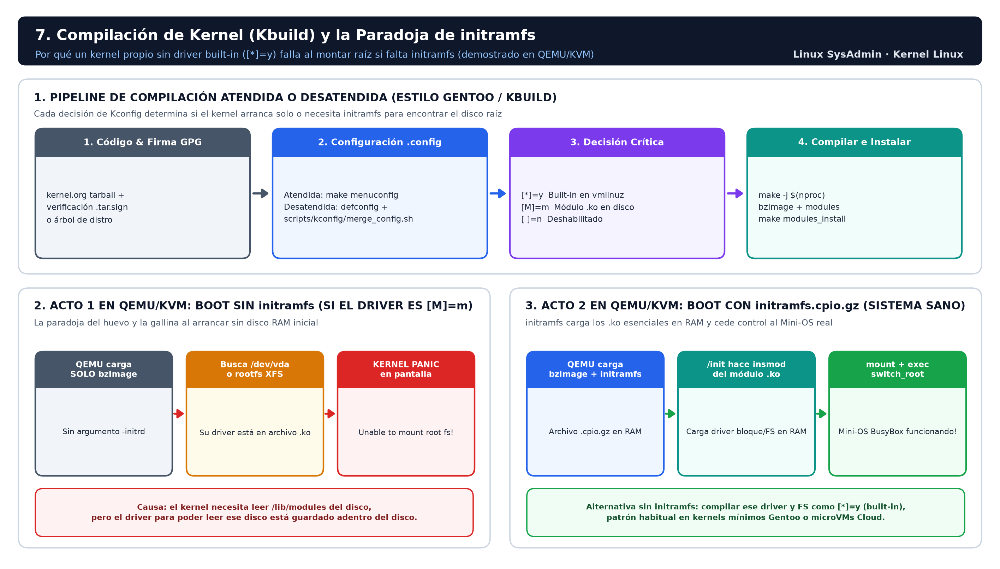

# Laboratorio 3.24: Compilación de Kernel Estilo Gentoo, Mini-OS Minimalista y Rol Crítico de `initramfs` en QEMU/KVM

> **Dificultad:** Avanzado (Nivel 3) | **Tiempo estimado:** 60 minutos | **Script interactivo:** [`demo_compilacion_kernel_initramfs.sh`](demo_compilacion_kernel_initramfs.sh)

¿Por qué existe el archivo **`initramfs`** (`initrd.img`) al lado de `vmlinuz` en `/boot` si ya existe un disco duro con Linux instalado? Y ¿cómo podés compilar tu propio kernel o armar un **Mini-OS minimalista** desde cero para probarlo en una máquina virtual **QEMU/KVM** directamente en tu laptop?

En este laboratorio lo vas a entender **construyendo y provocando un *Kernel Panic* real controlado en QEMU**, para luego resolverlo con tu propio `initramfs` construido a mano con `cpio`, módulos `.ko` y `BusyBox`.



---

## 🧩 1. La Paradoja del Huevo y la Gallina (`[*]=y` vs `[M]=m`)

Cuando compilás un kernel Linux (`Kconfig`), cada driver (NVMe, `virtio_blk`, controlador USB, filesystem `ext4`, `XFS`, `LUKS dm-crypt`, `LVM`, `RAID md`) ofrece tres estados posibles:
- **`[*]` (`=y`, *Built-in*):** El código queda **incrustado dentro de la imagen `bzImage` / `vmlinuz`**. Está disponible en RAM desde el milisegundo cero, pero engorda el kernel de forma permanente.
- **`[M]` (`=m`, *Module*):** El código se compila aparte en un archivo **`.ko`** dentro de `/lib/modules/<ver>/` en el disco raíz `/`. Mantiene al kernel liviano y modular. *(Cualquier `.ko` propio como el del [Lab 3.23](modulo_lkm_firmware_sim.md) puede incluirse aquí si hiciera falta en el boot).*
- **`[ ]` (`# is not set`):** El código ni siquiera se compila.

### ¿Qué pasa si compilás el driver de tu disco (ej. `virtio_blk`) o de tu filesystem (ej. `xfs`) como `[M]=m` y arrancás SIN `initramfs`?
1. El bootloader carga `vmlinuz` en RAM.
2. El kernel quiere montar el sistema raíz `/` (`root=/dev/vda`) que está en el disco.
3. Para leer el disco necesita el archivo `.ko` del controlador... **¡pero el `.ko` está guardado adentro del disco que todavía no pudo montar!**
4. Resultado inevitable: **`Kernel panic - not syncing: VFS: Unable to mount root fs`**.

### Cómo lo resuelve `initramfs` (`cpio.gz` + `/init` + `switch_root`)
1. El bootloader carga en RAM **dos archivos**: `vmlinuz` **y** `initramfs.cpio.gz`.
2. El kernel descomprime el `initramfs` en un sistema de archivos temporal en RAM (`rootfs`/`tmpfs`) y ejecuta el script o binario **`/init`** como PID 1.
3. `/init` carga los módulos necesarios (`insmod` / `modprobe` para `virtio_blk.ko`, `xfs.ko`, `dm-crypt`, LVM, RAID), espera a que aparezca el dispositivo de bloque, monta el disco real en `/mnt/root`, libera el ramdisk y ejecuta **`exec switch_root /mnt/root /sbin/init`**.

---

## ⚙️ 2. Compilación de Kernel Estilo Gentoo (Atendida y Desatendida)

### 2.1 Dependencias y Descarga Oficial Verificada
```bash
# En Debian / Ubuntu:
sudo apt-get install -y build-essential libncurses-dev bison flex libssl-dev libelf-dev bc cpio zstd xz-utils

# En Fedora / RHEL / Rocky:
sudo dnf install -y gcc make ncurses-devel bison flex openssl-devel elfutils-libelf-devel bc cpio zstd xz

# Descarga desde https://www.kernel.org/ + verificación GPG
curl -LO https://cdn.kernel.org/pub/linux/kernel/v6.x/linux-6.12.tar.xz
curl -LO https://cdn.kernel.org/pub/linux/kernel/v6.x/linux-6.12.tar.sign
xz -cd linux-6.12.tar.xz | gpg --verify linux-6.12.tar.sign -
tar -xf linux-6.12.tar.xz && cd linux-6.12
```

### 2.2 Modo A: Compilación Atendida Interactiva (Estilo Gentoo Clásico)
```bash
# Opción 1: Copiar la configuración base de tu sistema o detectar solo módulos actualmente activos
zcat /proc/config.gz > .config 2>/dev/null || cp /boot/config-$(uname -r) .config
make localmodconfig   # Recorta drivers que no están cargados hoy en tu máquina (acelera x5!)

# Abrir menú ncurses interactivo para activar/desactivar [*] vs [M] vs [ ]
make menuconfig

# Compilar kernel comprimido (bzImage) + módulos (.ko) usando todos los núcleos
make -j$(nproc) bzImage modules

# Instalar módulos y kernel en el sistema (en Gentoo / clásico)
sudo make modules_install
sudo make install
```

### 2.3 Modo B: Compilación Desatendida / Reproducible (CI/CD, Buildroot y Cloud)
Cuando necesitás compilar kernels minimalistas o en pipelines automatizados sin interacción humana:

```bash
# Base mínima (defconfig para x86_64 estándar, o tinyconfig para mini-kernel embebido < 1 MB)
make defconfig

# Aplicar un fragmento declarativo con ajustes precisos (sin tocar menuconfig)
cat <<'EOF' > mini_fragment.config
CONFIG_VIRTIO_PCI=y
CONFIG_VIRTIO_BLK=m
CONFIG_EXT4_FS=y
CONFIG_BLK_DEV_INITRD=y
CONFIG_DEVTMPFS=y
CONFIG_DEVTMPFS_MOUNT=y
CONFIG_SERIAL_8250=y
CONFIG_SERIAL_8250_CONSOLE=y
EOF

./scripts/kconfig/merge_config.sh -m .config mini_fragment.config
make olddefconfig

# Compilar de forma 100% desatendida en /tmp/kernel_build
make O=/tmp/kernel_build -j$(nproc) bzImage modules
make O=/tmp/kernel_build INSTALL_MOD_PATH=/tmp/kernel_rootfs modules_install
```

---

## 🔬 3. Montar un Mini-OS Minimalista y Probarlo en QEMU/KVM (Tu Laptop)

No necesitás una ISO de 2 GB para arrancar Linux. Con **3 piezas** podés levantar un OS embebido completo en tu laptop usando QEMU en menos de 2 segundos:
1. Un **kernel** (`vmlinuz` / `bzImage`).
2. Un **disco raíz minimalista** (`rootfs.img` con `BusyBox` estático + `/sbin/init`).
3. Un **`initramfs.cpio.gz`** con los `.ko` necesarios para el montaje del disco + `/init` haciendo `switch_root`.

```text
  Laptop (Host Linux + /dev/kvm)
    └── qemu-system-x86_64 -enable-kvm -nographic -m 512M \
          -kernel vmlinuz \
          -initrd initramfs.cpio.gz \
          -drive file=rootfs.img,format=raw,if=virtio \
          -append "root=/dev/vda console=ttyS0"
```

### Bonus: Cómo Emular una Board Edge ARM64 en tu Laptop (Cross-Compilation + Device Tree)
Para simular una placa tipo Raspberry Pi o gateway industrial ARM64 desde una laptop `x86_64`:
```bash
# Instalar toolchain cruzado y emulador ARM64:
# sudo apt-get install -y gcc-aarch64-linux-gnu qemu-system-arm

# Compilar kernel para ARM64 (genera arch/arm64/boot/Image y archivos .dtb Device Tree)
make ARCH=arm64 CROSS_COMPILE=aarch64-linux-gnu- defconfig
make ARCH=arm64 CROSS_COMPILE=aarch64-linux-gnu- -j$(nproc) Image dtbs

# Arrancar en QEMU emulando placa virtual ARM64 con Device Tree generado
qemu-system-aarch64 -M virt -cpu cortex-a72 -m 512M -nographic \
  -kernel arch/arm64/boot/Image \
  -initrd initramfs_arm64.cpio.gz \
  -append "console=ttyAMA0"
```

---

## 💻 4. Práctica Interactiva con `demo_compilacion_kernel_initramfs.sh`

El script implementa **ambos modos**:
- **Por defecto (`--fast`):** Toma un kernel real presente en el sistema (con su módulo de disco o filesystem compilado como `[M]=m`), fabrica desde cero un Mini-OS `rootfs.img` con `BusyBox` y ejecuta en **QEMU/KVM**:
  - **Acto 1 (Sin `-initrd`):** Demuestra en vivo el **`Kernel panic - not syncing: VFS: Unable to mount root fs`**.
  - **Acto 2 (Con `-initrd initramfs.cpio.gz`):** Carga los `.ko` en RAM dentro de `/init`, monta el disco, ejecuta `exec switch_root` y arranca exitosamente el Mini-OS embebido!
- **Con `--build-kernel`:** Descarga el código fuente oficial desde `kernel.org`, configura `CONFIG_VIRTIO_BLK=m` de forma desatendida (o atendida si agregás `--menuconfig`), compila `bzImage` + módulos y corre la misma demo de 2 actos con el kernel compilado por vos.

```bash
cd linux/administrator/kernel

# Demostración ágil en QEMU/KVM (2 actos: Kernel Panic vs Switch Root exitoso)
sudo ./demo_compilacion_kernel_initramfs.sh

# Modo automático rápido para pruebas E2E
sudo ./demo_compilacion_kernel_initramfs.sh --auto 0

# Compilación desatendida real desde fuentes kernel.org + demo en QEMU
sudo ./demo_compilacion_kernel_initramfs.sh --build-kernel --auto 0

# Limpieza manual si se usó --keep
sudo ./limpiar_compilacion_kernel_initramfs.sh
```

> 📖 **Glosario relacionado:** Consultá [`initramfs` y `switch_root`](../GLOSARIO.md#initramfs-cpio-y-switch_root) y [Device Tree (`.dtb`), MMU y Zephyr RTOS](../GLOSARIO.md#device-tree-dtb-mmu-uclinux-y-zephyr-rtos).
