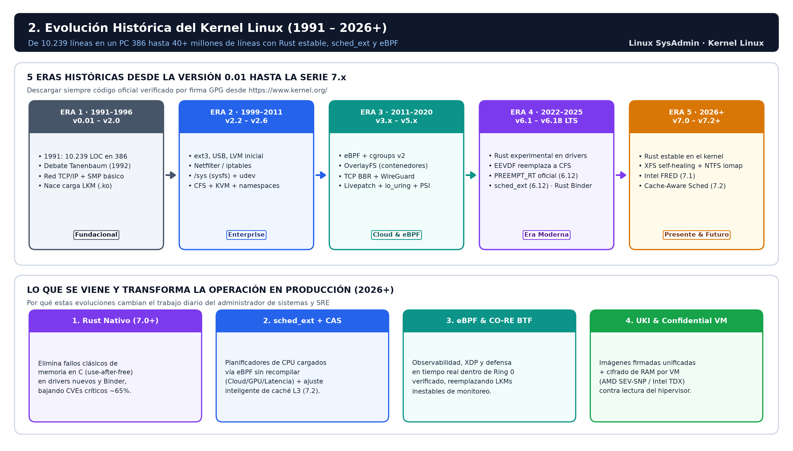
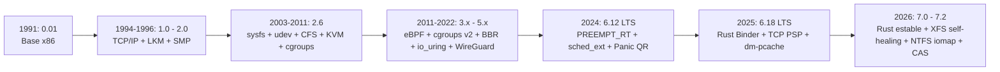
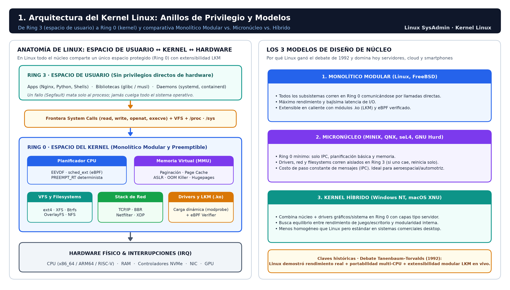
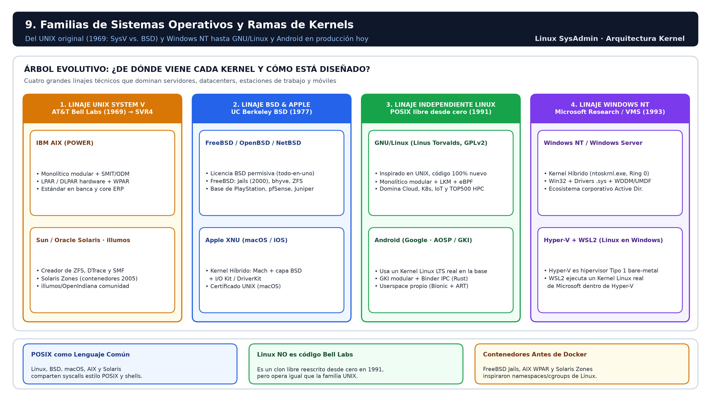
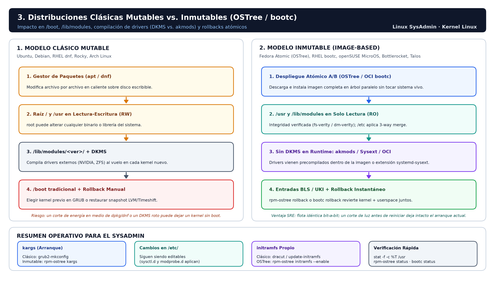
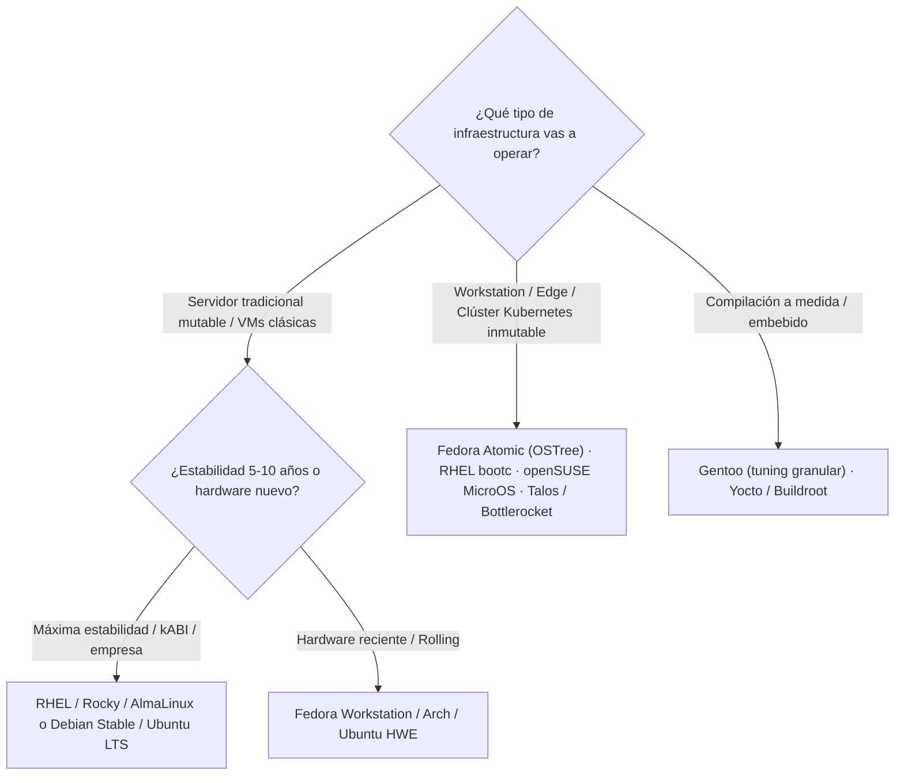
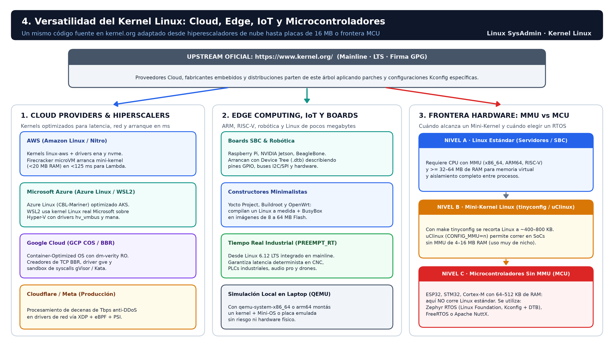
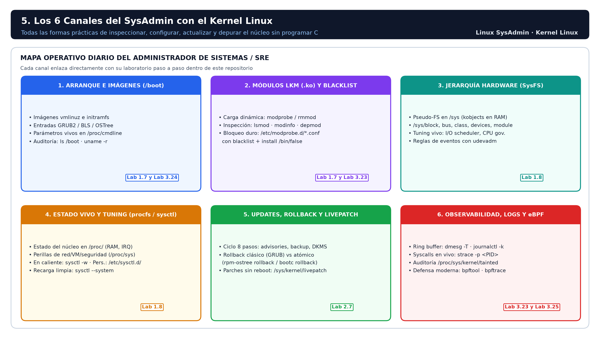

# Guía Maestra del Kernel Linux: De los Fundamentos a la Operación en Producción, Cloud, Distros Inmutables y Edge

> *"El kernel no es una caja negra mágica: es un único programa en ejecución continua con privilegios totales sobre el silicio. Todo lo que hace un SysAdmin —desde montar un disco o ajustar la red hasta contener un ataque— consiste en conversar con ese programa por canales bien definidos."*

Si nunca trabajaste directamente con el **núcleo (kernel)** de un sistema operativo, esta guía te lleva **desde cero absoluto** hasta entender cómo funciona por dentro, cómo evolucionó desde 1991 hasta la serie **7.x (2026)**, cómo se compara con otros linajes (UNIX, AIX, Solaris, BSD, macOS, Windows y Android), cómo se distribuye en servidores clásicos, distros inmutables (`OSTree` / `bootc`), proveedores Cloud (`AWS`, `Azure`, `GCP`) y dispositivos embebidos (`Edge` / `IoT` / microcontroladores), y cuáles son las **6 formas concretas** en que un administrador de sistemas opera con él todos los días.

Además, al final vas a encontrar la **ruta práctica de laboratorios**, donde cada concepto teórico se traduce en escenarios reales de operación (**Niveles 1, 2 y 3**, del **`1.7`** al **`3.29`**).

> [!TIP]
> **¿Cómo leer esta guía en clase sin trabarte con siglas?** Cada tecnología clave (como [Ring 0/3](../GLOSARIO.md#núcleo-monolítico-modular-ring-03-syscalls-y-preemption), [`sysfs`](../GLOSARIO.md#sysfs-sys-procfs-proc-y-udev), [`eBPF`](../GLOSARIO.md#ebpf-bpf-verifier-jit-y-co-re-btf) o [`OSTree`](../GLOSARIO.md#distros-inmutables-ostree-rpm-ostree-y-bootc)) se explica aquí de forma clara y enlazada **en su primera mención** al [**Glosario Técnico**](../GLOSARIO.md#arquitectura-del-kernel-linux-módulos-sysfs-inmutabilidad-seguridad-y-ebpf), donde vas a encontrar definiciones ampliadas y enlaces a la documentación oficial.

---

## 🧭 Mapa de Contenidos de la Guía

1. [¿Qué es el Kernel y por qué un SysAdmin debe dominarlo?](#-1-qué-es-el-kernel-y-por-qué-un-sysadmin-debe-dominarlo)
2. [Historia, el Debate Linus vs. Tanenbaum y Reseña de Versiones (0.01 → 7.2)](#-2-historia-el-debate-linus-vs-tanenbaum-y-reseña-de-versiones-001--72)
3. [Dónde se Descarga Oficialmente el Kernel y Ramas de Lanzamiento](#-3-dónde-se-descarga-oficialmente-el-kernel-y-ramas-de-lanzamiento)
4. [Arquitectura de Núcleos: Monolítico vs. Micronúcleo vs. Híbrido](#-4-arquitectura-de-núcleos-monolítico-vs-micronúcleo-vs-híbrido)
5. [Cómo Funciona el Kernel por Dentro (Ring 0, Syscalls, IRQs y Subsistemas)](#-5-cómo-funciona-el-kernel-por-dentro-ring-0-syscalls-irqs-y-subsistemas)
6. [Tipos de Kernel por Distribución y Sistemas Inmutables (OSTree / `bootc`)](#-6-tipos-de-kernel-por-distribución-y-sistemas-inmutables-ostree--bootc)
7. [Versatilidad del Kernel Linux: Cloud Providers (AWS, Azure, GCP) y Edge / IoT](#-7-versatilidad-del-kernel-linux-cloud-providers-aws-azure-gcp-y-edge--iot)
8. [Las 6 Formas en que un Administrador de Sistemas Interactúa con el Kernel](#-8-las-6-formas-en-que-un-administrador-de-sistemas-interactúa-con-el-kernel)
9. [Lo que se Viene en el Kernel Linux (Roadmap 2026+)](#-9-lo-que-se-viene-en-el-kernel-linux-roadmap-2026)
10. [Ruta Práctica de Laboratorios y Glosario Técnico](#-10-ruta-práctica-de-laboratorios-y-glosario-técnico)

---

## 🎯 1. ¿Qué es el Kernel y por qué un SysAdmin debe dominarlo?

Cuando encendés un servidor o una laptop, el hardware por sí solo (CPU, memoria RAM, placa de red, controlador NVMe) no entiende conceptos como *"archivo"*, *"usuario"*, *"socket TCP"* o *"permiso de lectura"*. Solo entiende voltajes, interrupciones eléctricas, registros del procesador y direcciones físicas de memoria.

El **Kernel** (del alemán/inglés *núcleo*) es el **primer programa del sistema operativo que carga el gestor de arranque en la memoria RAM** y permanece residente allí hasta que el equipo se apaga. Actúa como **árbitro único e intermediario obligatorio** entre todas las aplicaciones (espacio de usuario) y el hardware físico:

```text
+-------------------------------------------------------------------------------+
|                     ESPACIO DE USUARIO (User Space - Ring 3)                  |
|   Nginx   |   PostgreSQL   |   Docker/Podman   |   Bash   |   Python / Go     |
+-----+-------------+------------------+---------------+-------------+----------+
      |             |                  |               |             |
      +-------------+------------------+---------------+-------------+
                                       |  System Calls (read, write, execve...)
                                       v
+-------------------------------------------------------------------------------+
|                      ESPACIO DEL KERNEL (Kernel Space - Ring 0)               |
|  +---------------+  +---------------+  +---------------+  +----------------+  |
|  |  Scheduler    |  | Memoria Virt. |  |  VFS & Discos |  |  Red / eBPF    |  |
|  | (EEVDF/RT/scx)|  | (MMU / Swap)  |  | (ext4/XFS/dm) |  | (TCP/XDP/Netf) |  |
|  +---------------+  +---------------+  +---------------+  +----------------+  |
|                [ Device Drivers & Loadable Kernel Modules (.ko) ]             |
+--------------------------------------+----------------------------------------+
                                       |  Instrucciones privilegiadas / DMA / IRQ
                                       v
+-------------------------------------------------------------------------------+
|                           HARDWARE FÍSICO O VIRTUALIZADO                      |
|      CPU (x86_64/ARM64/RISC-V)   |   RAM   |   NVMe/SSD   |   NIC   |   USB   |
+-------------------------------------------------------------------------------+
```

### ¿Para qué le sirve saber esto a un SysAdmin en la vida real?
Un administrador que no entiende el kernel opera a ciegas cuando aparece un problema serio. Saber cómo funciona te permite resolver incidentes cotidianos de producción:
- **Una placa de red o USB falla o genera vulnerabilidad:** identificar el driver con `lspci -k`, revisar `dmesg` / `journalctl -k`, descargarlo con `modprobe -r` y bloquearlo persistentemente con [`blacklist` + `install /bin/false`](../GLOSARIO.md#lkm-loadable-kernel-modules-modprobe-y-blacklists).
- **Un servicio colapsa por falta de memoria o conexiones:** diagnosticar [OOM Killer](../GLOSARIO.md#mmu-memory-management-unit-paginación-page-cache-y-oom-killer), ajustar `vm.swappiness`, `net.core.somaxconn`, habilitar [TCP BBR](../GLOSARIO.md#io_uring-eevdf-y-sched_ext) o ampliar límites de descriptores con [`sysctl`](../GLOSARIO.md#sysctl-procsys).
- **Un equipo no arranca después de actualizar:** entender la relación entre `/boot/vmlinuz-*`, [`initramfs`](../GLOSARIO.md#initramfs-cpio-y-switch_root) y GRUB/[BLS](../GLOSARIO.md#bls-boot-loader-specification-y-uki)/[OSTree](../GLOSARIO.md#distros-inmutables-ostree-rpm-ostree-y-bootc) para elegir el kernel previo (*rollback*) y regenerar el ramdisk.
- **Necesitás parchar un CVE crítico sin reiniciar un servidor de bases de datos:** aplicar [**Livepatching**](../GLOSARIO.md#livepatching-kpatch--canonical-livepatch-y-kexec) (`kpatch` / Canonical Livepatch) o diagnosticar latencias en tiempo real con [**eBPF**](../GLOSARIO.md#ebpf-bpf-verifier-jit-y-co-re-btf) (`bpftrace`) sin riesgos de *Kernel Panic*.

---

## 📜 2. Historia, el Debate Linus vs. Tanenbaum y Reseña de Versiones (0.01 → 7.2)

### 2.1 Origen en Helsinki (1991) y el Debate Histórico de 1992
En **1991**, **Linus Torvalds**, un estudiante de ciencias de la computación de 21 años en la Universidad de Helsinki (Finlandia), comenzó a escribir un emulador de terminal en C y ensamblador para aprovechar su nueva PC con procesador **Intel 80386**. El sistema operativo educativo que usaba en la universidad, **MINIX** (creado por el profesor **Andrew S. Tanenbaum**), tenía restricciones de licencia para modificar y redistribuir cambios.

El **25 de agosto de 1991**, Linus envió un famoso mensaje al grupo Usenet `comp.os.minix` anunciando que estaba haciendo un sistema operativo libre (*"just a hobby, won't be big and professional like gnu"*), y el **17 de septiembre de 1991** publicó **Linux 0.01** (10.239 líneas de código). En **1992**, lo liberó bajo licencia **GPLv2**, combinándose con las herramientas del proyecto **GNU** (compilador `gcc`, `bash`, utilidades POSIX) para dar origen a los sistemas GNU/Linux completos.

En **enero de 1992**, estalló en Usenet el debate arquitectónico más célebre de la informática moderna bajo el título *"Linux is obsolete"*:
- **Andrew S. Tanenbaum (defensor del Micronúcleo):** Sostenía que un núcleo monolítico como Linux era un diseño anticuado de los años 70, frágil y poco portable (atado al hardware x86). Argumentaba que el futuro pertenecía a los **micronúcleos** como MINIX o GNU Hurd, donde los drivers y sistemas de archivos corrían aislados como procesos independientes.
- **Linus Torvalds (defensor pragmático del Núcleo Monolítico):** Respondió que los micronúcleos de la época sufrían una penalización severa de rendimiento por el **paso constante de mensajes (IPC)** y cambios de contexto entre servicios, mientras que su diseño monolítico era simple, rápido, funcionaba en hardware real accesible y cualquiera podía hackearlo y enviarlo por correo.

> **¿Quién tuvo razón con el paso del tiempo?**
> La historia terminó validando el pragmatismo de Linus para servidores y propósito general, **pero Linux adoptó lo mejor del otro mundo sin pagar el costo IPC**: incorporó **módulos cargables dinámicamente (LKM)**, **preemption** (apropiación en tiempo real) e incluso **eBPF** (extensibilidad segura verificada) para lograr modularidad manteniendo el rendimiento nativo de Ring 0. Por su parte, los micronúcleos modernos (`seL4`, `QNX`) triunfaron en nichos de altísima certificación de seguridad (aviación, automotriz, enclaves criptográficos).

---

### 2.2 Línea de Tiempo Completa de Versiones del Kernel (1991 – 2026)



```text
1991       1994      1996      2003-2011          2015-2020             2023-2026+
 │          │         │            │                  │                     │
 ▼          ▼         ▼            ▼                  ▼                     ▼
0.01       1.0       2.0          2.6               4.x - 5.x             6.6 - 7.2
Base x86   TCP/IP    SMP       sysfs (/sys)      cgroups v2 / BBR       EEVDF / PREEMPT_RT
10k LOC    Módulos   Multi-    udev / CFS        eBPF / io_uring        sched_ext (eBPF)
           LKM       CPU       KVM / namespaces  WireGuard / Lockdown   Rust estable (7.0)
                               (Base Contenedores)                      XFS self-heal / CAS
```



| Versión | Año / Mes | Hito / Cambio Arquitectónico Fundamental | Impacto Directo para el SysAdmin Moderno |
| :--- | :---: | :--- | :--- |
| **`0.01`** | Sep 1991 | Primer kernel publicado (~10.239 líneas, solo x86 386, sistema de archivos MINIX). | Nacimiento del proyecto; requería compilar todo el código ante cualquier cambio. |
| **`1.0`** | Mar 1994 | Primer lanzamiento estable de producción, pila de red **TCP/IP**, soporte básico de módulos. | Permitió usar Linux como servidor real en redes universitarias e Internet naciente. |
| **`1.2` – `2.0`** | 1995–1996 | **SMP** (multiprocesamiento simétrico), soporte multi-arquitectura (Alpha, SPARC, MIPS), carga dinámica de módulos (`kerneld`/`kmod`). | Escaló de PCs mono-CPU a servidores multi-procesador empresariales. |
| **`2.2` – `2.4`** | 1999–2001 | Filesystem con *journaling* **`ext3`**, soporte **USB**, firewall **`Netfilter/iptables`**, LVM1 inicial, gestión de memoria mejorada. | Convirtió a Linux en router/firewall empresarial y servidor de archivos resiliente ante apagones. |
| **`2.6`** | 2003–2011 | **Era fundacional del Linux moderno:** introduce **`sysfs` (`/sys`)**, **`udev`**, **O(1) y luego CFS Scheduler**, **`cgroups`**, **`namespaces`**, **KVM** (virtualización nativa), **`ext4`**, kernel apropiativo (*preemptible*). | Toda la base de administración actual (`udev`, `/sys`, contenedores Docker/Podman, virtualización KVM) nació en esta serie. |
| **`3.0` – `3.18`** | 2011–2014 | Renumeración simbólica por los 20 años; llegada de **Btrfs**, **OverlayFS**, **`eBPF`** extendido y **namespaces de usuario**. | Hizo posible el auge de los **contenedores** (Docker/Kubernetes) sobre capas OverlayFS y cgroups. |
| **`4.x`** | 2015–2018 | **`cgroups v2`** unificados, algoritmo de congestión **TCP BBR** (Google), **Livepatching** en mainline (`kpatch`/`kGraft`), **XDP** (procesamiento de paquetes a velocidad de tarjeta). | Control estricto de recursos en systemd/K8s, salto de rendimiento TCP y parches sin reiniciar. |
| **`5.x`** | 2019–2022 | **`io_uring`** (I/O asíncrono de altísimo rendimiento), **WireGuard** integrado en el kernel, **Kernel Lockdown** (integridad con Secure Boot), **PSI** (*Pressure Stall Information*). | VPN ultrarrápida nativa en Ring 0, bases de datos y servidores web con mínima latencia de syscalls. |
| **`6.1` LTS – `6.6` LTS** | 2022–2023 | Primer soporte experimental de **Rust** en el kernel (`6.1`) y reemplazo de CFS por el nuevo planificador **EEVDF** (`6.6`, *Earliest Eligible Virtual Deadline First*). | Mejor respuesta interactiva bajo carga y comienzo de la migración gradual hacia seguridad de memoria en drivers. |
| **`6.12` LTS** | Nov 2024 | Integración oficial de **`PREEMPT_RT`** (tiempo real duro tras ~20 años fuera del árbol), **`sched_ext`** (planificadores de CPU programables en eBPF) y códigos **QR en Kernel Panic** (`drm_panic`). | Un único kernel estándar sirve tanto para servidores cloud como para robótica/telecomunicaciones deterministas. *(LTS hasta dic. 2028).* |
| **`6.18` LTS** | Nov 2025 | Driver **Binder en Rust**, cifrado hardware **TCP PSP**, nuevo target **`dm-pcache`** en Device Mapper y escalabilidad UDP. | Primer gran driver IPC crítico de Android/Linux reescrito en Rust dentro de una rama LTS *(hasta dic. 2028).* |
| **`7.0`** | Abr 2026 | Cambio de dígito mayor (tras `6.19`, sin ruptura de compatibilidad), **Rust promovido a estable**, **auto-curación (*self-healing*) en XFS**, extensión de time-slice vía `rseq()`. | Cierra la fase experimental de Rust y lleva reparación autónoma en caliente a sistemas de archivos XFS empresariales. |
| **`7.1`** | Jun 2026 | Nuevo driver **NTFS nativo** moderno sobre `iomap`/`folios`, **Intel FRED** por defecto para manejo ágil de interrupciones y poda de **>140.000 líneas legacy** (ej. plataformas x86-486). | Desempeño nativo moderno con discos NTFS y limpieza de deuda técnica histórica en la rama x86. |
| **`7.2`** | Ago 2026 | **Cache-Aware Scheduling (CAS)** (agrupa tareas según dominios de caché LLC), **USB4STREAM**, *large folios* por defecto en Btrfs y soporte inicial Zen 6 / Apple M3. | Menor tasa de fallos de caché en CPUs multinúcleo modernos con decenas de cores y chiplets. |

> [!NOTE]
> **¿Por qué cambió la numeración en `2.6` → `3.0` → `4.0` → `5.0` → `6.0` → `7.0`?**
> Hasta `2.6`, el segundo dígito impar (`2.1`, `2.3`, `2.5`) indicaba ramas inestables de desarrollo y el par (`2.2`, `2.4`, `2.6`) ramas estables. Desde **`3.0` (2011)** ese esquema desapareció: Linus sube el número mayor aproximadamente cada ~20 versiones menores simplemente para mantener dígitos cómodos de leer, **sin implicar rupturas de compatibilidad para aplicaciones de usuario** (*"Never break userspace"* es la regla sagrada de Linux).

---

## 🌐 3. Dónde se Descarga Oficialmente el Kernel y Ramas de Lanzamiento

Si un administrador o distribuidor necesita obtener el código fuente original (*upstream / vanilla*) sin parches de terceros, **siempre** debe acudir a los repositorios oficiales de la **Linux Kernel Organization**:

| Recurso Oficial | URL | Para qué sirve |
| :--- | :--- | :--- |
| **Portal Principal y Tarballs** | [https://www.kernel.org/](https://www.kernel.org/) | Descarga oficial de tarballs comprimidos (`linux-x.y.z.tar.xz`), firmas PGP (`.tar.sign`) y estado actual de todas las ramas. |
| **Árboles Git Oficiales** | [https://git.kernel.org/](https://git.kernel.org/) | Repositorios Git oficiales (`torvalds/linux.git`, `stable/linux.git`, subsistemas de red, almacenamiento, etc.). |
| **Documentación Oficial** | [https://docs.kernel.org/](https://docs.kernel.org/) | Documentación técnica directa del árbol `Documentation/` (`admin-guide`, `sysctl`, `filesystems`, `bpf`). |
| **Resumen de Novedades por Versión** | [https://kernelnewbies.org/LinuxVersions](https://kernelnewbies.org/LinuxVersions) | Changelogs legibles por humanos de cada lanzamiento (`6.12`, `6.18`, `7.0`, `7.1`, `7.2`, etc.) con sus commits clave. |

### Las 4 Ramas Oficiales en `kernel.org`

1. **`mainline` (Rama Principal de Linus Torvalds):** Recibe nuevas funcionalidades cada ~9–10 semanas (incluyendo 2 semanas de *merge window* + 7–8 *Release Candidates* `-rc1`..`-rc7`).
2. **`stable`:** Mantenida por Greg Kroah-Hartman y Sasha Levin; toma cada versión *mainline* y aplica únicamente correcciones de bugs y parches de seguridad hasta la salida de la siguiente versión.
3. **`longterm` (LTS — *Long-Term Support*):** Versiones `stable` seleccionadas que reciben mantenimiento de seguridad y estabilidad durante **2 a 6 años** (ej. **`6.1`**, **`6.6`**, **`6.12`**, **`6.18`**). Son la base de Debian, Ubuntu LTS, Android, ChromeOS y equipos embebidos.
4. **`linux-next`:** Rama de integración diaria con el código que probablemente entrará en la *próxima* ventana de fusión (*merge window*), usada por desarrolladores y sistemas de CI para detectar conflictos tempranos.

### Verificación Criptográfica Obligatoria de Descarga (Ejemplo Real)
Nunca se compila un kernel bajado de Internet sin validar su firma PGP contra las llaves de Linus Torvalds o Greg Kroah-Hartman (como se practica también en el [Lab 3.4b de GPG](../gpg/gpg_firmas_repositorios_backups.md)):

```bash
# 1. Descargar el código fuente comprimido y su firma oficial desde kernel.org
curl -LO https://cdn.kernel.org/pub/linux/kernel/v7.x/linux-7.2.tar.xz
curl -LO https://cdn.kernel.org/pub/linux/kernel/v7.x/linux-7.2.tar.sign

# 2. Importar las llaves públicas oficiales de los mantenedores del kernel (una sola vez)
gpg --locate-keys torvalds@kernel.org gregkh@kernel.org

# 3. Descomprimir en pipe y verificar la firma GPG sobre el archivo .tar interno
xz -cd linux-7.2.tar.xz | gpg --verify linux-7.2.tar.sign -
# Salida esperada: gpg: Good signature from "Greg Kroah-Hartman <gregkh@kernel.org>"
```

---

## 🏗️ 4. Arquitectura de Núcleos: Monolítico vs. Micronúcleo vs. Híbrido

A nivel de diseño de sistemas operativos existen tres grandes familias arquitectónicas. Comprender su diferencia explica por qué Linux tiene el rendimiento que tiene y cómo protege (o expone) su memoria frente a drivers defectuosos.



```text
  [A] MONOLÍTICO MODULAR (Linux)        [B] MICRONÚCLEO (MINIX/QNX)         [C] HÍBRIDO (NT / XNU)
  +-----------------------------+      +---------------------------+      +---------------------------+
  | Apps        (Ring 3)        |      | Apps | FS | Net | Drivers |      | Apps | Subsistemas (R3)   |
  +--------------+--------------+      +--+----+----+-------+------+      +-------------+-------------+
                 | Syscall                | IPC (Paso de Mensajes)                      | LPC / Traps
  +--------------v--------------+      +--v----v----v-------v------+      +-------------v-------------+
  | Scheduler | VFS | TCP | LKM |      |  Micronúcleo Mínimo (R0)  |      | Núcleo + Drivers críticos |
  | Todo en Ring 0 (1 espacio)  |      |  (Solo IPC, Sched, MM)    |      | mixto Ring 0 / User       |
  +-----------------------------+      +---------------------------+      +---------------------------+
```

| Criterio | Núcleo Monolítico Puro / Modular (**Linux**, FreeBSD, AIX, Solaris) | Micronúcleo (**MINIX**, QNX, seL4, GNU Hurd) | Núcleo Híbrido (**Windows NT**, macOS XNU) |
| :--- | :--- | :--- | :--- |
| **Ubicación de servicios (VFS, Red, Drivers)** | Todos residen en el mismo espacio privilegiado (**Anillo 0 / Ring 0**) compartiendo estructuras internas y API directa del núcleo. | Divididos en servidores independientes en **espacio de usuario (Ring 3)** con aislamiento estricto de memoria. | El núcleo base y gran parte de los drivers críticos están en Ring 0, con algunos servidores delegados a espacio de usuario. |
| **Comunicación interna** | Llamadas directas a funciones de C/Rust en memoria compartida (nanosegundos). | **Paso constante de mensajes (IPC)** validados por el micronúcleo entre procesos separados. | Combinación de llamadas directas en kernel y mensajería ligera (LPC / Mach IPC). |
| **Rendimiento** | **Máximo:** mínima latencia en syscalls, I/O de disco y red de alta velocidad. | **Menor en carga general** debido a la sobrecarga de cambios de contexto y copia de mensajes IPC. | Alto, intermedio entre ambos enfoques. |
| **Aislamiento ante fallos** | **Crítico:** como cada módulo `.ko` corre en Ring 0 con acceso irrestricto al hardware, **un error en una rutina o módulo puede propagarse y provocar un Kernel Panic**. | **Muy alto:** si cae el servidor de audio o red, se reinicia ese proceso en usuario sin tumbar el núcleo. | Depende de dónde corra el driver afectado (ej. un driver de kernel en Ring 0 igualmente produce BSOD/Panic). |
| **Extensibilidad en caliente** | En Linux: mediante **Módulos Cargables (LKM)** que se compilan, cargan y descargan sin reiniciar. | Arranque/parada de procesos servidores estándar en usuario. | Drivers dinámicos (`.sys` / `.kext` o DriverKit). |

### Aclaración Técnica Clave: ¿Linux es "Monolítico Híbrido"?
En algunos textos introductorios se suele llamar a Linux *"núcleo monolítico híbrido"* porque toma ventajas prácticas de ambos mundos. Técnicamente, los arquitectos del kernel prefieren definir a Linux como un [**núcleo monolítico modular y apropiativo (*preemptible*)**](../GLOSARIO.md#núcleo-monolítico-modular-ring-03-syscalls-y-preemption):
1. **Modular en tiempo de ejecución:** A diferencia de un monolítico clásico de los años 80 (donde cambiar un driver exigía recompilar todo el kernel y reiniciar), Linux permite cargar y descargar extensiones (`.ko`, [**LKM**](../GLOSARIO.md#lkm-loadable-kernel-modules-modprobe-y-blacklists)) dinámicamente con `modprobe` mientras el servidor sigue operando.
2. **Apropiativo (*Preemptible*):** Desde Linux 2.6, las tareas y controladores dentro del kernel pueden ser **interrumpidos momentáneamente (*preempted*)** por actividades de mayor prioridad (gestión precisa de interrupciones de hardware y escalabilidad SMP multinúcleo).
3. **Drivers ocasionales en espacio de usuario:** Aunque casi todos los drivers viven en **Ring 0**, Linux expone interfaces para ejecutar controladores complejos en **espacio de usuario (Ring 3)** —como [**FUSE**](../GLOSARIO.md#vfs-virtual-file-system-y-fuse) (filesystems como `gocryptfs`, `sshfs`, `borg mount`), **`libusb`**, **`UIO`** y [**`VFIO`**](../GLOSARIO.md#sr-iov-y-vfio-pcie-passthrough) (asignación directa de GPUs/NICs a máquinas virtuales)— aislando fallos sin renunciar a la arquitectura monolítica del core.

---

### 4.2 Familias de Sistemas Operativos y Ramas de Kernels (UNIX, AIX, Solaris, BSD, macOS, Windows, Linux y Android)

Cuando trabajás en infraestructura real vas a escuchar nombres como *UNIX*, *AIX*, *Solaris*, *FreeBSD*, *macOS XNU*, *Windows NT* o *Android*. Conviene ubicar de qué familia viene cada uno y qué relación tiene su kernel con Linux (bajo el estándar común [**POSIX**](../GLOSARIO.md#posix-y-familias-de-sistemas-operativos-unix-aix-solaris-bsd-xnu-windows-nt-linux-y-android)):



```text
                    [ AT&T UNIX (Bell Labs, 1969) ]
                     ┌────────────┴────────────┐
                     ▼                         ▼
             [ UNIX System V ]         [ UC Berkeley BSD (1977) ]
              ├── IBM AIX               ├── FreeBSD · OpenBSD · NetBSD
              └── Sun/Oracle Solaris    └── Apple Darwin / XNU (macOS, iOS)
                  (illumos)

   [ Código independiente escrito desde cero ]
    ├── GNU/Linux (1991, POSIX libre, GPLv2) ──► Servidores, Cloud, HPC, Android (GKI)
    └── Microsoft Windows NT (1993, propietario) ──► Hyper-V + WSL2 (Kernel Linux real)
```

| Sistema Operativo | Linaje / Raíz | Modelo de Kernel y Rasgos Distintivos | Dónde Vive Hoy en Producción |
| :--- | :--- | :--- | :--- |
| **IBM AIX** | UNIX System V (IBM) | **Monolítico modular** propietario para arquitectura **IBM POWER**. Pionero en virtualización hardware ([`LPAR` / `DLPAR`](../GLOSARIO.md#aix-lpar-y-wpar-ibm-powervm)) y contenedores (`WPAR`), gestión con `SMIT` y `LVM` clásico. | Banca central, aseguradoras y grandes ERPs empresariales críticos. |
| **Solaris / `illumos`** | UNIX System V (Sun/Oracle) | Monolítico modular; cuna histórica de **ZFS**, **DTrace**, **SMF** y contenedores tempranos ([**Solaris Zones**](../GLOSARIO.md#solaris-zones-containers-y-ldoms)). Su continuación comunitaria open-source es **`illumos`** (*SmartOS*, *OmniOS*). | Datacenters Solaris legacy y plataformas *illumos* basadas en ZFS/Zones. |
| **FreeBSD / OpenBSD / NetBSD** | BSD UNIX (UC Berkeley) | Sistema base + kernel diseñados como una única unidad cohesiva bajo licencia permisiva BSD. **FreeBSD** aportó las pioneiras [**Jails**](../GLOSARIO.md#freebsd-jails-y-bhyve) (2000), el hipervisor [`bhyve`](../GLOSARIO.md#freebsd-jails-y-bhyve) y adopción de **OpenZFS**. **OpenBSD** prioriza auditoría extrema de seguridad (cuna de `OpenSSH` y `pf`). | Servidores de almacenamiento ZFS, firewalls (`pfSense`/`OPNsense`), routers Juniper y consolas Sony PlayStation. |
| **macOS / iOS (`XNU`)** | BSD + Mach (Apple) | **Kernel Híbrido `XNU`** (*X is Not Unix*): une un micronúcleo **Mach** (planificación, memoria, IPC) con la capa **BSD** (POSIX, red, permisos) y drivers orientados a objetos (**I/O Kit / DriverKit**). macOS cuenta con certificación oficial **UNIX**. | Estaciones de ingeniería, compilación Apple Silicon y dispositivos móviles iPhone/iPad. |
| **Microsoft Windows (`NT`)** | Independiente (VMS / NT) | **Kernel Híbrido** propietario (`ntoskrnl.exe` en Ring 0) totalmente ajeno al árbol UNIX; drivers `.sys`, subsistema Win32 e hipervisor bare-metal [**Hyper-V**](../GLOSARIO.md#xen-vmware-esxi-microsoft-hyper-v-y-wsl2) que hoy ejecuta también un **kernel Linux real para WSL2**. | Escritorios corporativos, Active Directory, cargas `.NET` / SQL Server y nube Azure. |
| **GNU/Linux** | Independiente (POSIX libre) | **Monolítico modular y apropiativo**, escrito desde cero bajo **GPLv2**, compatible POSIX con [`namespaces`](../GLOSARIO.md#contenedores-linux-chroot-namespaces-cgroups-v2-oci-docker-y-podman), `cgroups`, KVM e eBPF. | Estándar absoluto en Cloud, contenedores Kubernetes, servidores web, Edge y supercomputadoras TOP500. |
| **Android** | Derivado de Linux LTS | Usa un **Kernel Linux real** estandarizado mediante [**Android GKI**](../GLOSARIO.md#android-gki-y-binder-ipc) (*Generic Kernel Image*) + IPC [`Binder`](../GLOSARIO.md#android-gki-y-binder-ipc) (en proceso de migración a Rust), combinado con espacio de usuario propio (**Bionic libc** + **ART** en lugar de GNU/`systemd`). | Más de 3.000 millones de smartphones, tablets, TVs y sistemas automotrices. |

> [!TIP]
> **¿Querés entender cómo pasaron todos estos sistemas de correr un único OS físico a virtualizar servidores completos, contenedores, nubes y supercomputadoras de IA?** Continuá luego con la nueva guía **[Teoría Maestra de Virtualización, Contenedores, Cloud (OpenStack / K8s) y HPC (Slurm) (Lab 3.29)](../virtualizacion/virtualizacion_contenedores_cloud_hpc_teoria.md)**.

---

## ⚙️ 5. Cómo Funciona el Kernel por Dentro (Ring 0, Syscalls, IRQs y Subsistemas)

### 5.1 Anillos de Protección del Procesador (Ring 0 vs. Ring 3)
Los procesadores modernos (`x86_64` mediante Rings 0–3, `ARM64` mediante niveles de excepción `EL0`–`EL1`) imponen barreras por hardware para que ninguna aplicación común pueda sobrescribir la RAM de otro proceso o acceder al disco saltándose los permisos:

- **Ring 3 (`User Space` / `EL0`):** Donde corre todo tu software (`bash`, `nginx`, `python`, contenedores). Si un programa hace una división por cero o toca memoria ajena (`SIGSEGV`), **el kernel lo mata limpiamente sin afectar al resto del sistema**.
- **Ring 0 (`Kernel Space` / `EL1`):** Donde corre únicamente el kernel y los módulos `.ko`. Tiene acceso total a la MMU (tablas de páginas), instrucciones de CPU privilegiadas, registros PCIe y DMA. **Aquí un bug grave deriva en *Kernel Oops* o *Kernel Panic***.

### 5.2 El Puente: Llamadas al Sistema (*System Calls*) e Interrupciones (*IRQ*)
¿Cómo logra un programa en Ring 3 leer un archivo o abrir un socket si no puede tocar el disco ni la placa de red? Mediante dos mecanismos opuestos:

1. **De arriba hacia abajo — System Calls (`syscall`):** Un proceso pide un servicio al kernel (`openat`, `read`, `write`, `fork`/`clone`, `execve`, `socket`). La CPU ejecuta la instrucción especial `syscall`, cambia el privilegio de Ring 3 a Ring 0, el kernel valida permisos/capabilities, ejecuta la operación y devuelve el resultado. Podés observar esta conversación en vivo con `strace`:
   ```bash
   # Ver exactamente qué syscalls hace el comando 'ls' al hablar con el kernel
   strace -e trace=openat,read,write ls /boot
   ```
2. **De abajo hacia arriba — Interrupciones de Hardware ([`IRQ`](../GLOSARIO.md#irq-interrupciones-de-hardware-dma-y-topbottom-half)):** Cuando llega un paquete a la placa de red o presionás una tecla, el hardware dispara una señal eléctrica (**IRQ**) o transferencia [**DMA**](../GLOSARIO.md#irq-interrupciones-de-hardware-dma-y-topbottom-half). El procesador pausa el código actual, salta al manejador de interrupciones del kernel (**Top Half**, ultrarrápido con interrupciones deshabilitadas) y delega el trabajo pesado a una tarea diferida (**Bottom Half** / `softirq` / `kworker`) para no bloquear el resto del hardware.

### 5.3 Preemption (*Prevolcado* / Apropiación) y los 5 Grandes Subsistemas
Un servidor de producción puede compilar o ajustar el grado de apropiación del kernel (`CONFIG_PREEMPT_*`):
- **`PREEMPT_NONE`:** Maximiza el rendimiento bruto de CPU (*throughput*) en servidores batch/cómputo; el código en Ring 0 no se interrumpe hasta terminar o ceder voluntariamente.
- **`PREEMPT_VOLUNTARY` / `PREEMPT_DYNAMIC`:** Equilibrio moderno de distros servidor/desktop (Ubuntu, Fedora, RHEL); permite cambiar dinámicamente el comportamiento en el arranque vía `preempt=full|voluntary|none`.
- **`PREEMPT_RT` (integrado en mainline `6.12`):** Convierte *spinlocks* internos en mutexes apropiativos y mueve manejadores de IRQ a hilos planificables, garantizando latencias deterministas de microsegundos para audio pro, robótica, telcos 5G y trading.

Internamente, todo ese código se organiza en **5 grandes subsistemas**:
1. **Planificador de Procesos (*Scheduler*):** Reparte los núcleos físicos de CPU entre hilos ejecutables (antes **CFS**, hoy [**EEVDF**](../GLOSARIO.md#io_uring-eevdf-y-sched_ext), o políticas personalizadas vía [**`sched_ext`**](../GLOSARIO.md#io_uring-eevdf-y-sched_ext)).
2. **Gestión de Memoria Virtual (*MM*):** Administra páginas de RAM mediante la [**MMU**](../GLOSARIO.md#mmu-memory-management-unit-paginación-page-cache-y-oom-killer), espacio de intercambio (*swap*), [**Page Cache**](../GLOSARIO.md#mmu-memory-management-unit-paginación-page-cache-y-oom-killer) (caché de disco en RAM libre) y asignadores de objetos (`SLUB`).
3. [**VFS (*Virtual File System*)**](../GLOSARIO.md#vfs-virtual-file-system-y-fuse) y Almacenamiento: Ofrece una API POSIX uniforme (`open`/`read`/`write`) sin importar si debajo hay `ext4`, `XFS`, `Btrfs`, `NFS`, `tmpfs`, `LVM2`, `LUKS dm-crypt` o `RAID md`.
4. **Subsistema de Red (*Networking Stack*):** Implementa TCP/IP, UDP, `Netfilter`/`nftables`, sockets, `WireGuard`, TCP `BBR` y rutas de paquete programables en XDP/eBPF.
5. **Controladores de Dispositivos (*Drivers*) e IPC:** Abstrae buses PCIe, USB, NVMe, gráficas (DRM), consola y comunicación entre procesos (`pipes`, `unix sockets`, memoria compartida, `futex`).

---

## 🐧 6. Tipos de Kernel por Distribución y Sistemas Inmutables (`OSTree` / `bootc`)

Aunque todas las distribuciones Linux parten del mismo árbol upstream de `kernel.org`, **cada familia de distribución compila, configura, parchea y entrega el kernel de forma distinta**.

### 6.1 Sabores de Kernel en Distribuciones Clásicas

| Distribución / Familia | Paquetes / Ramas de Kernel Típicas | Filosofía y Características del Kernel |
| :--- | :--- | :--- |
| **Debian** | `linux-image-amd64` (LTS estable) y `-backports` | Máxima estabilidad, base LTS de `kernel.org` con parches críticos de seguridad backportados y pocos cambios disruptivos durante el ciclo. |
| **Ubuntu** | `linux-generic`, `linux-image-generic-hwe-*` (Hardware Enablement), `linux-lowlatency`, `linux-aws`/`azure`/`gcp` | Las versiones LTS mantienen su kernel inicial o adoptan el kernel de versiones intermedias vía **HWE** para soportar hardware nuevo; incluye AppArmor y Canonical Livepatch. |
| **RHEL / Rocky / AlmaLinux** | `kernel`, `kernel-core`, `kernel-modules`, `kernel-rt` | **Estabilidad de [kABI](../GLOSARIO.md#dkms-y-kabi)** (*Kernel Application Binary Interface*): conservan el número de versión base durante 10 años backportando miles de mejoras de drivers y CVEs para no romper software empresarial certificado. |
| **Fedora Workstation / Server** | `kernel` (seguimiento rápido del mainline estable) | Muy cercano a `kernel.org` estable más reciente (ej. serie 6.x → 7.x dentro del ciclo de una misma Fedora) con soporte temprano de tecnologías como Btrfs, SELinux, PipeWire y eBPF. |
| **Arch Linux** | `linux` (vanilla), `linux-lts`, `linux-zen` (tuning interactivo/gaming), `linux-hardened` | Entrega rápida de kernels recientes con configuraciones cercanas a upstream y sabores alternativos instalables lado a lado. |
| **Gentoo** | `gentoo-sources`, `gentoo-kernel`, `gentoo-kernel-bin` | Control total de cada opción `Kconfig` (`make menuconfig`), compilado a medida para las instrucciones exactas de la CPU local (`-march=native`) con mínima huella de drivers innecesarios. |
| **Real-Time (RHEL RT / Ubuntu RT / Mainline `6.12+`)** | `kernel-rt`, `linux-realtime` | Activa `CONFIG_PREEMPT_RT` para garantizar tiempos de respuesta acotados y determinismo estricto. |

---

### 6.2 Sección Especial: Kernels en Distribuciones Inmutables (`OSTree`, `rpm-ostree`, `bootc`, Btrfs Transaccional)

En la administración moderna de escritorios corporativos, servidores de borde (*Edge*) y nodos Kubernetes, ganó enorme peso el modelo [**Inmutable / Basado en Imágenes (*Image-Based Linux*)**](../GLOSARIO.md#distros-inmutables-ostree-rpm-ostree-y-bootc): **Fedora Atomic** (Silverblue, Kinoite, **Sway Atomic**), **RHEL Image Mode (`bootc`)**, **openSUSE MicroOS / Aeon**, **AWS Bottlerocket**, **Flatcar Container Linux**, **Talos Linux**, **SteamOS** y **NixOS**.



#### ¿Cómo funcionan a nivel de kernel y almacenamiento?
A diferencia de una distro tradicional donde `apt` o `dnf` modifican archivos sueltos sobre un `/` y `/usr` escribibles, una distro inmutable con **OSTree / `bootc`** trata al sistema operativo completo (binarios de sistema + **kernel `/boot/ostree/...` + `/lib/modules/<ver>`**) como un **único artefacto versionado, atómico y de solo lectura (*read-only*)**:

1. **`/usr` y `/lib/modules` montados en Solo Lectura (`ro`):** Nadie —ni siquiera `root` en ejecución normal— puede editar manualmente archivos bajo `/usr` o inyectar binarios arbitrarios en `/lib/modules` sin crear un nuevo despliegue versionado (protegido opcionalmente mediante **`fs-verity`** o **`dm-verity`**).
2. **Despliegue Atómico A/B y *3-Way Merge* de `/etc`:**
   - `/var` y `/home` conservan datos mutables entre reinicios.
   - `/etc` es editable y al actualizar recibe una **fusión a tres vías (*3-way merge*)** entre la imagen vieja, tu configuración local y la imagen nueva.
   - La nueva versión del sistema y su nuevo kernel se preparan en un árbol paralelo bajo `/ostree/deploy/<os>/deploy/<commit>.0/` y crean una nueva entrada **BLS** (*Boot Loader Specification*) en `/boot/loader/entries/`, **sin tocar el kernel ni el sistema en ejecución**. Solo se activan al reiniciar.
3. **Modelos hermanos:**
   - **`bootc` (Image Mode):** Empaqueta el kernel y el rootfs directamente como una **imagen OCI estándar de contenedor**, permitiendo construir, firmar (`cosign`), probar en CI/CD y distribuir actualizaciones del sistema operativo entero desde un registry Docker/OCI.
   - **openSUSE MicroOS (`transactional-update`):** Usa snapshots **Btrfs Read-Only**; cada actualización crea un snapshot oculto escribible, actualiza kernel/paquetes dentro y lo marca como inmutable para el próximo arranque.
   - **Talos Linux / Bottlerocket:** Kernels ultrarecortados sin SSH ni shell tradicional, gobernados por API declarativa y particiones A/B firmadas con `dm-verity`.

#### ¿Qué impacto operativo real tiene esto para un SysAdmin al gestionar el Kernel?

| Dimensión Operativa | Distro Clásica (`apt` / `dnf`) | Distro Inmutable (`rpm-ostree` / `bootc` / MicroOS) |
| :--- | :--- | :--- |
| **Ubicación del Kernel y `/lib/modules`** | `/boot/vmlinuz-<ver>` + `/lib/modules/<ver>` (escribible por `root`). | Dentro del commit OSTree/OCI (`/usr/lib/modules/<ver>` + `/boot/ostree/...` o **UKI** unificado); `/lib/modules` es **read-only**. |
| **Drivers externos (`NVIDIA`, `VirtualBox`, `ZFS`)** | [**DKMS**](../GLOSARIO.md#dkms-y-kabi) compila el módulo `.ko` localmente en cada actualización de kernel dentro de `/lib/modules`. | **DKMS tradicional no funciona en runtime** porque `/lib/modules` es solo lectura y no hay toolchain en la imagen base. Se usan **`akmods` / `kmods` precompilados**, imágenes derivadas (`bootc`/Containerfile) o extensiones **`systemd-sysext`**. |
| **Parámetros de arranque (`kargs`)** | Editar `/etc/default/grub` y correr `grub2-mkconfig` / `update-grub`. | Comando declarativo **`rpm-ostree kargs --append=...`** (o `bootc` metadata), ligado a cada despliegue versionado. |
| **Riesgo de actualización cortada a la mitad** | Alto: un corte de luz durante `dpkg`/`dnf` puede dejar `initramfs` sin generar o kernel inconsistente. | **Nulo:** la descarga y el nuevo árbol se validan antes de escribir la entrada BLS; si falla la energía, el arranque actual queda intacto. |
| **Rollback si un kernel nuevo falla** | Manual (elegir kernel viejo en GRUB si aún no se purgó, o restaurar backup/snapshot). | **Instantáneo y completo (kernel + userspace juntos):** `rpm-ostree rollback` o `bootc rollback`, o elegir la entrada `ostree:1` en GRUB. |
| **Edición de `sysctl` y `modprobe.d`** | `/etc/sysctl.d/*.conf` y `/etc/modprobe.d/*.conf` (si está en `initramfs`, requiere `dracut`/`update-initramfs`). | **Siguen funcionando igual en `/etc/`** (que sí es escribible), aunque activar `initramfs` regenerado en OSTree requiere `rpm-ostree initramfs --enable`. |

#### Árbol de Decisión Rápida: ¿Qué Distro / Modelo de Kernel Elegir?



> [!TIP]
> Podés comprobar hoy mismo si estás en una distro inmutable ejecutando `stat -f -c %T /usr` o `rpm-ostree status` / `bootc status`. Si ves `/ostree` en `/proc/cmdline` o `ostree` en `/boot`, estás operando un despliegue atómico A/B.

---

## ☁️ 7. Versatilidad del Kernel Linux: Cloud Providers (`AWS`, `Azure`, `GCP`) y `Edge / IoT`

Una de las pruebas más contundentes de la arquitectura del kernel Linux es que **el mismo núcleo base escala desde una supercomputadora o nube pública global hasta un router doméstico o un sensor industrial**.



### 7.1 Cómo Implementan y Modifican el Kernel los Principales Proveedores Cloud

En la nube pública, los proveedores raramente ejecutan un kernel genérico de escritorio sin tocar: compilan **sabores optimizados** (*cloud kernels*) eliminando miles de drivers físicos innecesarios (tarjetas de sonido, impresoras, Bluetooth, Wi-Fi antiguo) para acelerar el arranque, reducir memoria y reforzar parches de virtualización:

| Proveedor / Empresa | Proyecto / Sabor de Kernel | Cómo lo Implementan y Qué Cambian |
| :--- | :--- | :--- |
| **Amazon Web Services (AWS)** | • **Amazon Linux 2023 (`kernel`)**<br>• **`linux-aws`** (Ubuntu)<br>• **AWS Bottlerocket** (inmutable)<br>• **Firecracker MicroVM** | • Compilado específicamente para el [**AWS Nitro System**](../GLOSARIO.md#cloud-iaas-y-openstack-nova-neutron-cinder-glance-keystone) con drivers de alto rendimiento **`ena`** (Elastic Network Adapter) y **`nvme`** directo sin emulación pesada.<br>• [**Firecracker**](../GLOSARIO.md#microvms-y-sandboxes-firecracker-kata-containers-y-gvisor) (el motor detrás de **AWS Lambda** y **Fargate**) usa un **mini-kernel Linux minimalista sin BIOS/PCI legacy (`< 20 MB`)** capaz de arrancar microVMs aisladas con KVM en **menos de 125 ms**.<br>• **Nitro Enclaves** recorta CPU/RAM para ejecutar enclaves criptográficos aislados sobre el mismo host Linux. |
| **Microsoft Azure** | • **Azure Linux** (antes **CBL-Mariner**)<br>• **`linux-azure`** (Ubuntu)<br>• **WSL2 Kernel** (`microsoft-standard-WSL2`) | • Microsoft mantiene **su propia distribución Linux** (Azure Linux) con kernel curado y endurecido para hospedar AKS y servicios internos de Azure.<br>• Incluye optimizaciones para el bus de hipervisor [**Hyper-V**](../GLOSARIO.md#xen-vmware-esxi-microsoft-hyper-v-y-wsl2) (`hv_vmbus`, `hv_netvsc`, `hv_storvsc`), aceleración RDMA/InfiniBand en clústeres de IA y soporte **`mana`** (Microsoft Azure Network Adapter).<br>• En Windows, [**WSL2**](../GLOSARIO.md#xen-vmware-esxi-microsoft-hyper-v-y-wsl2) ejecuta un **kernel Linux real de código abierto** mantenido por Microsoft en GitHub (`microsoft/WSL2-Linux-Kernel`) corriendo sobre un hipervisor ligero. |
| **Google Cloud (GCP)** | • **Container-Optimized OS (COS)**<br>• **`linux-gcp`** (Ubuntu)<br>• **gVisor** (kernel en user-space) | • **COS** (usado por defecto en **Google Kubernetes Engine / GKE**) deriva de ChromiumOS (construido con herramientas de **Gentoo/Portage**): sistema de archivos raíz inmutable verificado criptográficamente con **`dm-verity`**, kernel optimizado con el driver de red virtual **`gve`** (Google Virtual NIC) y el algoritmo de congestión **TCP BBR** (creado por Google).<br>• Para multi-tenancy extremo, [**gVisor**](../GLOSARIO.md#microvms-y-sandboxes-firecracker-kata-containers-y-gvisor) reimplementa la superficie de syscalls de Linux en un kernel sandboxed escrito en Go. |
| **Otros Casos Destacados** | • **Cloudflare** (Edge global)<br>• **Meta** (Datacenters)<br>• **Oracle UEK** / **Valve SteamOS** | • **Cloudflare** procesa millones de paquetes DDoS por segundo con **eBPF + XDP** dentro del kernel Linux antes de asignar buffers `sk_buff`.<br>• **Meta** lidera internamente **Btrfs**, **PSI** y **`sched_ext`** para exprimir hasta el último ciclo de CPU en sus flotas.<br>• **SteamOS** usa base inmutable Arch + kernels optimizados con baja latencia y parches DRM/Mesa para Proton/gaming portátil. |

---

### 7.2 Edge Computing, Sistemas Embebidos, Boards y Microcontroladores

Cuando salimos del datacenter hacia fábricas, antenas 5G, routers, drones, cámaras con IA o vehículos autónomos, la pregunta deja de ser *"¿qué distro instalo?"* y pasa a ser *"¿cuánta RAM y Flash tengo, necesito tiempo real y mi chip tiene MMU?"*:

1. **Boards ARM64 / RISC-V (*Single Board Computers*):**
   - Placas como **Raspberry Pi**, **NVIDIA Jetson** (Edge AI), **BeagleBone** o placas RISC-V no tienen BIOS/ACPI clásica como una PC x86. En su lugar, el bootloader (como **U-Boot**) le entrega al kernel un archivo binario llamado [**Device Tree (`.dtb`)**](../GLOSARIO.md#device-tree-dtb-mmu-uclinux-y-zephyr-rtos) que describe qué pines GPIO, buses I2C/SPI, UART y controladores físicos existen en esa placa exacta.
2. **Sistemas Minimalistas y Constructores de Imágenes Embebidas:**
   - **OpenWrt:** Linux completo funcionando en routers con apenas **8–16 MB de Flash y 64–128 MB de RAM**, usando kernel parcheado para switches de red y `squashfs` + `overlayfs`.
   - **Buildroot y Yocto Project:** No son distros prearmadas, sino fábricas que compilan de forma reproducible y desatendida el compilador cruzado (*cross-compiler*), un **mini-kernel Linux recortado** (solo los drivers de esa board), el **`initramfs`**, BusyBox y la app única del dispositivo.
   - **Mini-kernel desde `kernel.org`:** El propio árbol oficial incluye el target **`make tinyconfig`** que genera un kernel booteable de **menos de 1 MB** (entre ~400 KB y ~900 KB sin drivers) ideal para entender la anatomía mínima o emular sistemas minimalistas en **QEMU** en tu propia laptop (como haremos en el **Lab 3.24**!).
3. **La Frontera Física: MMU y Microcontroladores (MCU):**
   - **Linux estándar exige una MMU (*Memory Management Unit*)** para memoria virtual, aislamiento entre procesos y `fork()`. Por eso suele requerir al menos **16–32 MB de RAM** (aunque con `tinyconfig` y `uClinux` —soporte `CONFIG_MMU=n` integrado en el kernel— puede arrancar en microcontroladores ARM Cortex-M7 o RISC-V sin MMU con ~4–8 MB de SRAM ejecutando XIP desde Flash).
   - **Debajo de esa frontera (ESP32, STM32, Arduino, sensores con 64 KB – 512 KB de RAM):** No se usa Linux, sino un **RTOS** (*Real-Time Operating System*). El referente moderno de la propia **Linux Foundation** es [**Zephyr RTOS**](../GLOSARIO.md#device-tree-dtb-mmu-uclinux-y-zephyr-rtos), que adopta exactamente la misma filosofía y herramientas del kernel Linux (**`Kconfig`** para `menuconfig` y **Device Tree `.dts`**), junto con **FreeRTOS** y **Apache NuttX**.

| Segmento | Hardware Típico | RAM / Flash Típica | ¿Tiene MMU? | Kernel / Sistema Recomendado |
| :--- | :--- | :---: | :---: | :--- |
| **Cloud / Bare-Metal** | Servidores `x86_64` / `ARM64` Neoverse | GBs – TBs RAM | ✅ Sí | Linux distro estándar o Cloud (`linux-aws`, `bootc`, COS) |
| **MicroVM Serverless** | Hipervisor KVM (Firecracker / Cloud Hypervisor) | 128 MB – GBs | ✅ Sí | **Mini-kernel Linux** recortado (`< 20 MB`, sin BIOS/PCI legacy) |
| **Edge / SBC Industrial** | Raspberry Pi, NVIDIA Jetson, Gateway ARM | 512 MB – 16 GB | ✅ Sí | Linux + **Device Tree (`.dtb`)** + Yocto/Buildroot + `PREEMPT_RT` |
| **Router / Appliance Ultraligero** | MIPS / ARM embebido (OpenWrt, cámara IP) | 16 – 128 MB RAM | ✅ Sí (o `uClinux`) | **Mini-kernel Linux (`tinyconfig`/recortado)** + `BusyBox` + `squashfs` |
| **Microcontrolador (MCU)** | ESP32, STM32, nRF52, Cortex-M0/M4 | **64 KB – 512 KB RAM** | ❌ No | **Zephyr RTOS** (Linux Foundation), FreeRTOS o NuttX |

---

## 🛠️ 8. Las 6 Formas en que un Administrador de Sistemas Interactúa con el Kernel

En el día a día operativo, toda administración real del kernel Linux pasa por **6 interfaces concretas** (sin tener que leer millones de líneas de C):



| Canal de Interacción | Qué es y Dónde Vive | Comandos y Archivos Clave | Lab Práctico donde lo Dominás |
| :--- | :--- | :--- | :--- |
| **1. Arranque e Imágenes (`/boot`)** | Imágenes comprimidas del núcleo (`vmlinuz`), ramdisk temporal (`initramfs`), símbolos, parámetros de arranque y entradas GRUB/BLS/OSTree. | `ls -la /boot`, `ls /boot/loader/entries`, `uname -a`, `cat /proc/cmdline`, `grubby` | **[Lab 1.7](modulos_lkm_blacklists_boot.md)** & **[Lab 3.24](compilacion_kernel_initramfs.md)** |
| **2. Módulos Cargables (`LKM`)** | Drivers y subsistemas `.ko` cargados/descargados en caliente dentro de Ring 0, junto con reglas de alias, parámetros y listas negras. | `lsmod`, `modinfo`, `modprobe`, `insmod`, `rmmod`, `depmod`, `/etc/modprobe.d/*.conf` | **[Lab 1.7](modulos_lkm_blacklists_boot.md)** & **[Lab 3.23](modulo_lkm_firmware_sim.md)** |
| **3. Jerarquía de Dispositivos (`sysfs`)** | Pseudo-sistema de archivos en `/sys` que expone la topología real de hardware, buses, drivers, colas I/O, frecuencia CPU y parámetros de módulos. | `/sys/{block,bus,class,devices,module,kernel}`, `udevadm`, escritura directa en atributos `rw` | **[Lab 1.8](sysfs_proc_sysctl_tuning.md)** |
| **4. Estado Vivo y Tuning (`procfs` + `sysctl`)** | Pseudo-sistema `/proc` (procesos, memoria, interrupciones, *taint*) y perillas de ajuste en caliente bajo `/proc/sys/` gobernadas por `sysctl`. | `sysctl -a`, `sysctl -w`, `sysctl -p`, `sysctl --system`, `/etc/sysctl.d/99-*.conf`, `/proc/sys/kernel/tainted` | **[Lab 1.8](sysfs_proc_sysctl_tuning.md)** & **[Lab 3.25](seguridad_ataques_kernel_ebpf.md)** |
| **5. Ciclo de Vida, Updates y Livepatch** | Plan de actualización continua en 8 pasos, compatibilidad DKMS/kABI, rollback en GRUB o OSTree, `kexec` y parches en vivo sin reiniciar. | `apt`, `dnf`, `rpm-ostree`, `bootc`, `needrestart`, `kpatch`, `canonical-livepatch`, `/sys/kernel/livepatch` | **[Lab 2.7](actualizacion_kernel_rollback_livepatch.md)** |
| **6. Observabilidad, Logs y eBPF** | Inspección del *ring buffer* del kernel, trazado de syscalls y programas eBPF verificados en Ring 0 con cero riesgo de cuelgue. | `dmesg -T`, `journalctl -k`, `strace`, `bpftool`, `bpftrace`, `/sys/kernel/security/lockdown` | **[Lab 3.23](modulo_lkm_firmware_sim.md)** & **[Lab 3.25](seguridad_ataques_kernel_ebpf.md)** |

---

## 🔮 9. Lo que se Viene en el Kernel Linux (Roadmap 2026+)

Conocer hacia dónde avanza el desarrollo actual te prepara para las arquitecturas que vas a operar en los próximos años:

1. **Rust en Subsistemas Core (`7.0+`):** Tras volverse estable en **Linux 7.0**, Rust deja de limitarse a drivers experimentales y se expande hacia capas de red, sistemas de archivos y drivers DRM/GPU, reduciendo drásticamente vulnerabilidades históricas de corrupción de memoria (*use-after-free*, *buffer overflow*) que representan ~60–70% de los CVEs en C.
2. **Planificadores Programables con `sched_ext` (`6.12+`):** Permite cargar algoritmos de planificación de CPU escritos en **eBPF** en caliente —sin recompilar el kernel— para cargas específicas (gaming de ultra-baja latencia, colas de microservicios en nube o planificación consciente de GPU e híbridos *big.LITTLE*).
3. **Convergencia `EEVDF` + `Cache-Aware Scheduling` + `PREEMPT_RT`:** Mejor colocación de hilos en cachés L3/LLC compartidas (`7.2`) combinada con latencia determinista en el mismo kernel mainline.
4. **Reemplazo de LKM de Diagnóstico por `eBPF` y `CO-RE`:** Las herramientas modernas de observabilidad, firewalling y seguridad (Cilium, Falco, Tetragon, `bpftrace`) corren en el **BPF Verifier** usando información de tipos **BTF** (*Compile Once – Run Everywhere*), eliminando módulos propietarios inestables.
5. **Seguridad Hardware & Arranque Verificado ([`UKI`](../GLOSARIO.md#bls-boot-loader-specification-y-uki) + [*Confidential Computing*](../GLOSARIO.md#confidential-computing-amd-sev-snp-e-intel-tdx)):** Adopción masiva de **Unified Kernel Images** firmadas para Secure Boot (junto a sistemas inmutables `bootc`/OSTree) y soporte nativo para cifrado de RAM por VM (**AMD SEV-SNP** e **Intel TDX**) donde ni siquiera el proveedor cloud o el hipervisor pueden leer la memoria del kernel invitado.
6. **[`io_uring`](../GLOSARIO.md#io_uring-eevdf-y-sched_ext) Zero-Copy y Limpieza de Deuda Legacy:** Consolidación de I/O asíncrono de red y bloque sin cambiar de contexto continuamente, mientras el árbol sigue podando arquitecturas obsoletas de los 90 (`7.1`).

---

## 🧭 10. Ruta Práctica de Laboratorios y Glosario Técnico

En los siguientes laboratorios progresivos (**de menor a mayor complejidad**) vas a llevar cada concepto de esta guía a la terminal y comprobar exactamente cómo responde el kernel Linux frente a decisiones reales de administración:

| Nivel y Laboratorio | Conceptos y Escenarios que Vas a Dominar | Qué Vas a Comprobar en Vivo |
| :--- | :--- | :--- |
| **🟢 [Lab 1.7: `/boot`, Módulos LKM y Blacklists](modulos_lkm_blacklists_boot.md)** <br>*(Script: [`demo_modulos_blacklists.sh`](demo_modulos_blacklists.sh))* | • Inspección completa de imágenes de arranque en `/boot` (incluyendo entradas BLS y OSTree).<br>• Inventario de módulos activos (`lsmod`, `modinfo`, `lspci -k`) y reconstrucción de dependencias (`depmod`).<br>• Auditoría integral de módulos en lista negra (`/etc/modprobe.d`, `/usr/lib/modprobe.d`, `modprobe --showconfig`).<br>• Endurecimiento físico: bloquear almacenamiento masivo USB (`usb-storage`/`uas`) al inicio **sin deshabilitar teclados/ratones (`usbhid`)**. | Auditoría real de `/boot` y `/proc/cmdline`, carga y descarga segura del módulo inocuo `dummy`, diferencia en vivo entre `blacklist` y `install /bin/false`, verificación con `modprobe -n -v` y plantilla de hardening CIS. |
| **🟢 [Lab 1.8: `sysfs`, `/proc` y Tuning con `sysctl`](sysfs_proc_sysctl_tuning.md)** <br>*(Script: [`demo_sysfs_sysctl.sh`](demo_sysfs_sysctl.sh))* | • Anatomía del árbol `/sys` (`block`, `bus`, `class`, `devices`, `fs`, `kernel`, `module`, `power`) y su vínculo con `udev`.<br>• Parámetros esenciales de producción con `sysctl` (Red TCP/BBR, Memoria Virtual VM, Seguridad, Límites de `inotify` y descriptores). | Exploración viva de drivers y planificadores de disco I/O en `/sys`, cambios temporales y persistentes con `sysctl -w` / `/etc/sysctl.d/`, y prueba aislada de `ip_forward` dentro de un *network namespace* (`ip netns`). |
| **🟡 [Lab 2.7: Plan de Actualización en 8 Pasos, Rollback y Livepatch](actualizacion_kernel_rollback_livepatch.md)** <br>*(Script: [`demo_actualizacion_kernel.sh`](demo_actualizacion_kernel.sh))* | • Flujo completo de mantenimiento del kernel sin improvisar: monitoreo de boletines CVE (`USN`/`RHSA`), copias de seguridad pre-cambio y verificación de módulos externos (**DKMS** / `kABI`).<br>• Elección entre reinicio planificado (`apt`/`dnf`/`rpm-ostree`/`bootc`), rollback y **parcheo en caliente (*Livepatch*)**.<br>• Verificación post-arranque (*smoke test*) y automatización segura sin reinicios sorpresa. | Runbook automatizado de backup de configuración, comparación entre kernel instalado vs. en ejecución (`uname -r`), revisión de entradas de rollback GRUB/OSTree, estado en `/sys/kernel/livepatch` y ejecución del *smoke-test* del sistema. |
| **🟠 [Lab 3.23: Compilar e Instalar un Módulo LKM Educativo (Simulación Firmware)](modulo_lkm_firmware_sim.md)** <br>*(Script: [`demo_lkm_firmware_sim.sh`](demo_lkm_firmware_sim.sh))* | • Estructura real de un driver LKM escrito en C (`edu_firmware_sim.c`) compilado contra los *headers* del kernel mediante **Kbuild (`Makefile`)**.<br>• Registro de eventos en `dmesg` / `journalctl -k` / `syslog`, exposición dinámica en `/sys/module/` y `/proc/`, firma criptográfica y **Kernel Taint**. | Compilación de `edu_firmware_sim.ko`, carga en memoria como firmware `v1.0.0`, lectura de su estado en `/proc/edu_firmware_sim` y logs del kernel, simulación de actualización en caliente a `v2.0.0-patched` y descarga limpia. |
| **🟠 [Lab 3.24: Compilación estilo Gentoo, Mini-OS Embebido y Paradoja `initramfs` en QEMU/KVM](compilacion_kernel_initramfs.md)** <br>*(Script: [`demo_compilacion_kernel_initramfs.sh`](demo_compilacion_kernel_initramfs.sh))* | • Compilación atendida (`make menuconfig`) y desatendida (`defconfig` / `merge_config.sh`).<br>• Impacto crítico de compilar un driver de almacenamiento o filesystem como **`[*]=y` (built-in)** vs. **`[M]=m` (módulo `.ko`)**.<br>• Construcción desde cero de un **Mini-OS minimalista** y arranque emulado de una placa/servidor en **QEMU/KVM**. | **Demostración en 2 actos en QEMU/KVM:** (1) arrancar el kernel sin `initramfs` provocando `Kernel panic: VFS: Unable to mount root fs`; (2) arrancar con `initramfs.cpio.gz` cargando el driver `.ko` en RAM y ejecutando `switch_root` hacia el Mini-OS funcionando. |
| **🟠 [Lab 3.25: Simulación de Ataques al Kernel, Hardening y Observabilidad/Defensa con eBPF](seguridad_ataques_kernel_ebpf.md)** <br>*(Script: [`demo_seguridad_ataques_ebpf.sh`](demo_seguridad_ataques_ebpf.sh))* | • Reproducción controlada de 4 vectores de ataque al kernel (fuga de punteros en `/proc/kallsyms` + ASLR, condición de carrera TOCTOU con symlinks en `/tmp`, auditoría forense de rootkits/LKM/*Taint*/*Lockdown* y agotamiento de procesos/SYN).<br>• Observabilidad segura moderna con **eBPF** (`Verifier`, JIT, Mapas, CO-RE BTF) usando `bpftool` y `bpftrace`. | Contraste de direcciones de memoria con ASLR `0` vs. `2`, bloqueo real de *symlink race* con `fs.protected_symlinks=1`, decodificación de bits *tainted* y **Mini-IDS eBPF en vivo** alertando lecturas no autorizadas sobre un archivo señuelo. |
| **🟠 [Teoría 3.29: Virtualización, Contenedores, Cloud (OpenStack / K8s) y HPC (Slurm)](../virtualizacion/virtualizacion_contenedores_cloud_hpc_teoria.md)** <br>*(Guía Teórica Maestra)* | • De mainframes IBM e hipervisores hardware (`VT-x`, `AMD-V`, `SLAT`, `IOMMU`, `VirtIO`) hasta **KVM**, **VMware ESXi**, **Hyper-V / WSL2**, precursores (**AIX LPAR**, **Solaris Zones**, **FreeBSD Jails**), **Contenedores/MicroVMs**, **OpenStack**, **Kubernetes + K9s** y **Slurm HPC**. | Comprensión integral de dónde termina el kernel de una máquina física, cómo se virtualiza/aísla para miles de inquilinos en nube pública y cómo se exprime el silicio bare-metal para IA científica. |

> [!TIP]
> **¿Dudas con algún término técnico?** Consultá la sección dedicada de [**Kernel Linux, Módulos, SysFS, Inmutabilidad, Seguridad y eBPF**](../GLOSARIO.md#arquitectura-del-kernel-linux-módulos-sysfs-inmutabilidad-seguridad-y-ebpf) y la de [**Virtualización, Contenedores, Cloud y HPC**](../GLOSARIO.md#virtualización-contenedores-cloud-openstack--kubernetes-y-hpc-slurm) en el Glosario Técnico.
