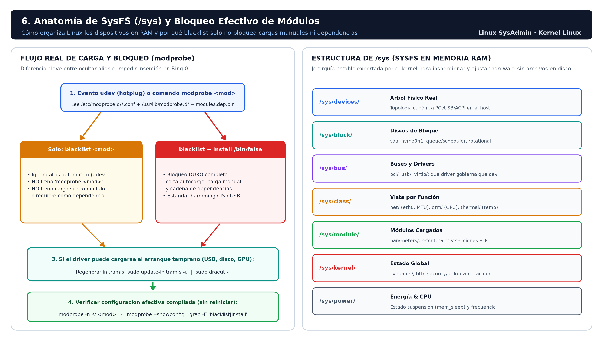

# Laboratorio 1.7: Anatomía de `/boot`, Módulos LKM y Listas Negras (`blacklist`)

> **Dificultad:** Inicial / Intermedio (Nivel 1) | **Tiempo estimado:** 35 minutos | **Script interactivo:** [`demo_modulos_blacklists.sh`](demo_modulos_blacklists.sh)

En la [Guía Maestra del Kernel](kernel_arquitectura_historia_guia_maestra.md) vimos que Linux es un núcleo **monolítico modular**: mantiene la velocidad de Ring 0, pero permite cargar y descargar controladores en tiempo de ejecución como **Módulos Cargables del Kernel (`LKM`, archivos `.ko`)**.

En este laboratorio vas a dominar tres competencias operativas esenciales para cualquier administrador de sistemas:
1. **Inspeccionar `/boot`** para saber qué kernels existen instalados en el disco, cuál está corriendo en RAM y con qué parámetros arrancó.
2. **Operar módulos LKM en vivo** (`lsmod`, `modinfo`, `modprobe`, `insmod`, `rmmod`, `depmod`) y detectar qué driver controla cada placa de hardware.
3. **Diagnosticar y bloquear módulos problemáticos o inseguros** mediante listas negras en `/etc/modprobe.d/` (incluyendo **bloqueo seguro de almacenamiento USB** y perfiles CIS de seguridad).

---

## ⚡ 1. Cheat Sheet Rápida de `/boot` y Módulos

| Objetivo | Comando Principal | Qué Muestra / Qué Hace |
| :--- | :--- | :--- |
| **Ver el kernel activo en RAM** | `uname -r` / `uname -a` | Versión exacta en ejecución (debe coincidir con `/lib/modules/$(uname -r)`). |
| **Listar kernels en `/boot`** | `ls -lh /boot/vmlinuz*` | Imágenes comprimidas de kernels instalados (en BLS/OSTree también `/boot/loader/entries/`). |
| **Ver argumentos de arranque** | `cat /proc/cmdline` | Parámetros pasados por GRUB/systemd-boot al kernel actual (`root=`, `ro`, `quiet`, etc.). |
| **Listar módulos cargados** | `lsmod` | Lista módulos en memoria, tamaño en bytes y contador de uso / dependientes. |
| **Ver metadatos de un `.ko`** | `modinfo <modulo>` | Ruta del archivo `.ko`, licencia, parámetros, alias de hardware y firma criptográfica. |
| **Cargar / Descargar módulo** | `sudo modprobe <mod>` <br> `sudo modprobe -r <mod>` | Resuelve dependencias automáticamente leyendo `modules.dep.bin`. |
| **Ver blacklists efectivas** | `modprobe --showconfig \| grep -E '^(blacklist\|install)'` | Muestra la configuración **real consolidada** de `/etc` + `/usr/lib` + `/run`. |
| **Simular carga con reglas** | `modprobe -n -v <modulo>` | Muestra en seco (*dry-run*) qué haría `modprobe` respetando alias y blacklists. |

---

## 📂 2. Anatomía del Directorio `/boot` (Clásico, BLS y OSTree)

El directorio `/boot` almacena todo lo que el gestor de arranque (`GRUB2` o `systemd-boot`) necesita leer **antes** de que exista el sistema de archivos raíz montado:

```text
/boot/
├── vmlinuz-6.8.0-45-generic       <-- Imagen comprimida del Kernel ejecutable (Linux bzImage)
├── initrd.img-6.8.0-45-generic    <-- (o initramfs-*.img) Disco RAM inicial con drivers de arranque
├── config-6.8.0-45-generic        <-- Archivo .config exacto usado para compilar ese kernel
├── System.map-6.8.0-45-generic    <-- Tabla de símbolos de direcciones internas del kernel (debug)
├── grub/  (o grub2/)              <-- Configuración y módulos del bootloader GRUB2
├── efi/                           <-- Partición ESP UEFI (cuando el sistema bootea por UEFI)
└── loader/entries/*.conf          <-- Entradas BLS modernas (Fedora, RHEL 9/10, sistemas OSTree)
```

### Cómo listar todos los kernels instalados en `/boot`
Dependiendo de la arquitectura de tu distribución, aplicá estos comandos de inspección:

```bash
# 1. En Debian, Ubuntu y RHEL/CentOS clásicos: listar imágenes de kernel en /boot
ls -lh /boot/vmlinuz*

# 2. Listar también las imágenes initramfs / initrd asociadas
ls -lh /boot/initr*

# 3. En distribuciones modernas con Boot Loader Specification (Fedora, RHEL 9+, Rocky 9+)
ls -la /boot/loader/entries/ && grep -H '^title\|^linux' /boot/loader/entries/*.conf

# 4. En distribuciones inmutables con OSTree / bootc (Fedora Atomic, RHEL Image Mode)
ls -la /boot/ostree/ 2>/dev/null || true
rpm-ostree status 2>/dev/null || true

# 5. Comparar lo instalado en /boot contra el kernel realmente ejecutándose en memoria
uname -r
```

> [!TIP]
> **¿Por qué suele haber 2 o 3 kernels distintos en `/boot`?**
> Por seguridad operativa: las distribuciones mantienen al menos el kernel anterior junto al nuevo para permitir **rollback** desde el menú de arranque si una actualización falla. Si `/boot` es una partición separada pequeña (500 MB–1 GB) y acumulás demasiados kernels viejos sin purgar (`apt autoremove`), podés quedarte sin espacio e impedir futuras actualizaciones.

---

## 🧩 3. Gestión de Módulos Cargables del Kernel (`LKM`)



Los módulos compilados viven en `/lib/modules/$(uname -r)/kernel/` (comprimidos normalmente como `.ko`, `.ko.xz` o `.ko.zst`). El árbol se organiza por subsistemas (`drivers/`, `fs/`, `net/`, `crypto/`, `sound/`).

### 3.1 `modprobe` vs `insmod` / `rmmod` y `depmod`
- **`insmod /ruta/archivo.ko`:** Inserta un archivo `.ko` puntual directamente en el kernel. **No resuelve dependencias** ni lee `/etc/modprobe.d/`. Se usa principalmente en `initramfs` o desarrollo de drivers propios ([Lab 3.23](modulo_lkm_firmware_sim.md)).
- **`rmmod <modulo>`:** Descarga un módulo puntual si nadie lo está usando (`Used by = 0`).
- **`modprobe <modulo>` / `modprobe -r <modulo>`:** Es la **herramienta estándar de producción**. Busca el módulo por nombre en `/lib/modules/$(uname -r)/`, resuelve la cadena completa de dependencias leyendo `modules.dep.bin`, aplica alias/opciones/blacklists de `modprobe.d/` y lo carga o descarga ordenadamente.
- **`depmod -a`:** Escanea `/lib/modules/$(uname -r)/` y reconstruye los índices binarios `modules.dep`, `modules.dep.bin` y `modules.alias`. Es obligatorio ejecutarlo cada vez que copiás un módulo `.ko` nuevo manualmente a `/lib/modules/`.

```bash
# Inspeccionar módulos activos en memoria (Nombre | Tamaño en bytes | Usado por)
lsmod | head -n 15

# Ver a qué driver pertenece cada tarjeta PCI física (Red, GPU, NVMe)
lspci -k

# Ver ficha técnica completa de un módulo antes de tocarlo (archivo, licencia, parámetros, alias)
modinfo dummy
```

---

## 🚫 4. Listas Negras (`blacklist`), Troubleshooting y Bloqueo Seguro de USB

Cuando un módulo del kernel provoca congelamientos, incompatibilidades con un hardware específico, conflictos con otro driver (ej. `nouveau` vs driver propietario NVIDIA) o abre una superficie de ataque innecesaria (ej. `usb-storage` en servidores corporativos), se recurre a las **listas negras de `modprobe`**.

### 4.1 Cómo Listar Todos los Módulos en Lista Negra (Blacklist)
En Linux moderno las reglas no están en un único archivo; se distribuyen en tres directorios ordenados por prioridad:
1. `/etc/modprobe.d/*.conf` *(mayor prioridad: reglas personalizadas del administrador)*
2. `/run/modprobe.d/*.conf` *(reglas temporales en tiempo de arranque)*
3. `/usr/lib/modprobe.d/*.conf` *(reglas predeterminadas de la distribución y paquetes)*

```bash
# Método A: Inspeccionar los archivos fuente de configuración
grep -rnE '^\s*(blacklist|install)\s+' /etc/modprobe.d/ /usr/lib/modprobe.d/ 2>/dev/null

# Método B (Recomendado): Preguntar directamente a modprobe la configuración efectiva compilada
modprobe --showconfig | grep -E '^(blacklist|install)' | sort -u
```

> [!IMPORTANT]
> **¿Por qué buscar tanto `blacklist` como `install`?**
> En entornos modernos, muchas reglas de bloqueo real usan `install <modulo> /bin/false` o `install <modulo> /bin/true`. Si solo hacés `grep blacklist`, te perdés la mitad de los bloqueos efectivos del sistema.

---

### 4.2 Flujo Completo de Troubleshooting con Blacklists

Ante un problema sospechoso de driver (ej. falla intermitente de red, sonido, Bluetooth o GPU), el protocolo de diagnóstico es:

1. **Inventariar módulos cargados y asociarlos al hardware:**
   ```bash
   lsmod
   lspci -k
   ```
2. **Correlacionar con los registros del kernel (`dmesg` y `journalctl`):**
   ```bash
   dmesg -T -l err,warn | tail -n 30
   journalctl -k -b --no-pager | grep -iE 'error|fail|firmware|usb|net'
   ```
3. **Probar la descarga en caliente sin reiniciar (si el módulo no está bloqueado en uso):**
   ```bash
   sudo modprobe -r <nombre_modulo>
   ```
4. **Confirmar la incompatibilidad e impedir su carga futura en `/etc/modprobe.d/`:**
   Crear un archivo dedicado (ej. `/etc/modprobe.d/99-blacklist-custom.conf` o `/etc/modprobe.d/blacklist.conf`):
   ```ini
   # Bloquear carga por alias automático (hardware hotplug)
   blacklist <nombre_modulo>

   # Bloqueo duro: impide incluso carga manual o por dependencia de otro módulo
   install <nombre_modulo> /bin/false
   ```
5. **Regenerar `initramfs` si el módulo se carga al inicio temprano del boot:**
   ```bash
   # Debian / Ubuntu
   sudo update-initramfs -u -k all

   # RHEL / Rocky / AlmaLinux / Fedora clásica
   sudo dracut -f --regenerate-all

   # Actualizar mapa de dependencias si hubo cambios de archivos .ko
   sudo depmod -a
   ```
6. **Verificar sin reiniciar:**
   ```bash
   # Comprobar que modprobe ahora resuelve a /bin/false (simulando con -n -v)
   modprobe -n -v <nombre_modulo>
   # Verificar que ya no figure en memoria
   lsmod | grep <nombre_modulo>
   ```

> [!WARNING]
> **Nota técnica sobre guías antiguas (`modprobe -a`):**
> En documentación heredada a veces se menciona *"ejecutar `modprobe -r <mod>` seguido de `modprobe -a`"* para recargar configuraciones. En realidad, **`modprobe -a` (`--all`) carga múltiples módulos pasados como argumentos** y **no** "recarga reglas de blacklist": `modprobe` siempre lee `/etc/modprobe.d/*.conf` automáticamente cada vez que se invoca. Lo que sí es obligatorio tras editar blacklists de módulos tempranos (disco, GPU, USB) es **regenerar `initramfs`** (`update-initramfs -u` o `dracut -f`) para que la copia del archivo `.conf` quede dentro del disco RAM inicial.

---

### 4.3 Diferencia Crítica: `blacklist <mod>` vs `install <mod> /bin/false`

Esta es una de las trampas más comunes en entrevistas y auditorías de seguridad Linux:

| Directiva en `/etc/modprobe.d/*.conf` | ¿Bloquea auto-carga por hardware (`udev`)? | ¿Bloquea `modprobe <mod>` manual? | ¿Bloquea carga por dependencia de otro módulo? |
| :--- | :---: | :---: | :---: |
| **`blacklist mi_modulo`** | ✅ **Sí** (ignora los `alias` internos del `.ko`). | ❌ **No** (un usuario root o script que ejecute `modprobe mi_modulo` lo carga igual). | ❌ **No** (si el módulo B depende de `mi_modulo`, el kernel lo carga igual). |
| **`blacklist mi_modulo`** <br>➕ **`install mi_modulo /bin/false`** | ✅ **Sí** | ✅ **Sí** (reemplaza la acción de inserción por el binario `/bin/false`, que aborta con error). | ✅ **Sí** (corta la cadena de dependencias). |

---

### 4.4 Caso Práctico: Evitar que se Carguen al Inicio los Módulos Relacionados con USB

Un caso clásico de endurecimiento físico en servidores de datacenter, kioscos o estaciones corporativas es impedir que alguien enchufe un pendrive y monte almacenamiento USB (`Rubber Ducky` / fuga de datos), pero **sin dejar al administrador sin teclado ni mouse USB**.

#### ⚠️ Error fatal del principiante: NO bloquees `usbhid`, `xhci_hcd` ni `usbcore`
- `xhci_hcd` / `ehci_hcd` / `usbcore`: son los controladores del bus USB entero.
- `usbhid`: controla **teclados y ratones USB**. Si lo bloqueás en un servidor físico o laptop, te quedás sin teclado en la consola local!

#### ✅ La forma correcta y segura: bloquear solo almacenamiento masivo USB (`usb-storage`, `uas` y `ums-*`)
```ini
# /etc/modprobe.d/99-disable-usb-storage.conf
# Bloquea dispositivos de almacenamiento masivo USB sin afectar teclados (usbhid) ni buses base
blacklist usb-storage
install usb-storage /bin/false

blacklist uas
install uas /bin/false
```

Luego aplicar en el `initramfs` (por si un disco USB estuviera enchufado en el boot) y verificar:
```bash
sudo update-initramfs -u    # o sudo dracut -f en RHEL/Rocky/Fedora
modprobe -n -v usb-storage
# Salida esperada: install /bin/false
```

*(Nota: si querés bloquear **todo** dispositivo USB nuevo salvo teclados/dispositivos autorizados en entornos de alta seguridad, la solución moderna de producción complementaria se llama **USBGuard**, que aplica políticas por Vendor/Product ID desde espacio de usuario).*

---

## 🛡️ 5. Casos Extra de Hardening CIS de Módulos

Las guías de endurecimiento **CIS Benchmark** para Ubuntu y RHEL recomiendan deshabilitar sistemas de archivos y protocolos de red legacy raramente usados en servidores para reducir la superficie de exploits en Ring 0:

```ini
# /etc/modprobe.d/99-cis-hardening.conf
# Sistemas de archivos antiguos o poco usados en servidores cloud
install cramfs /bin/false
blacklist cramfs
install freevxfs /bin/false
blacklist freevxfs
install jffs2 /bin/false
blacklist jffs2
install hfs /bin/false
blacklist hfs
install hfsplus /bin/false
blacklist hfsplus
install udf /bin/false
blacklist udf

# Altavoz interno de PC (clásico en desktop/laptop)
blacklist pcspkr
install pcspkr /bin/false
```

> [!NOTE]
> **Secure Boot y Firma de Módulos (`.ko`):**
> Cuando el equipo arranca con **UEFI Secure Boot** activo, el kernel entra en modo de integridad (*Lockdown*) y **rechaza cargar cualquier módulo `.ko` que no esté firmado** con una clave de confianza (clave de la distro o clave MOK registrada con `mokutil`). Esto afecta directamente a drivers externos compilados por **DKMS** (`nvidia`, `virtualbox`, `zfs`), tema que retomaremos en los [Labs 2.7](actualizacion_kernel_rollback_livepatch.md) y [3.23](modulo_lkm_firmware_sim.md).

---

## 💻 6. Práctica Interactiva con `demo_modulos_blacklists.sh`

El script de este laboratorio audita tu sistema real de forma 100% segura y demuestra el ciclo completo de carga, descarga y bloqueo (`blacklist` vs `install /bin/false`) usando el módulo inocuo `dummy` (un dispositivo de red virtual estándar del kernel):

```bash
cd linux/administrator/kernel

# Modo interactivo para estudiar o proyectar en clase (pausas con ENTER)
sudo ./demo_modulos_blacklists.sh

# Modo automático rápido para verificación E2E
sudo ./demo_modulos_blacklists.sh --auto 0

# Limpieza manual si corriste con --keep
sudo ./limpiar_modulos_blacklists.sh
```

> 📖 **Glosario relacionado:** Consultá las definiciones de [LKM (Loadable Kernel Modules)](../GLOSARIO.md#lkm-loadable-kernel-modules-modprobe-y-blacklists), [`initramfs`](../GLOSARIO.md#initramfs-cpio-y-switch_root) y [BLS (Boot Loader Specification)](../GLOSARIO.md#bls-boot-loader-specification-y-uki).
