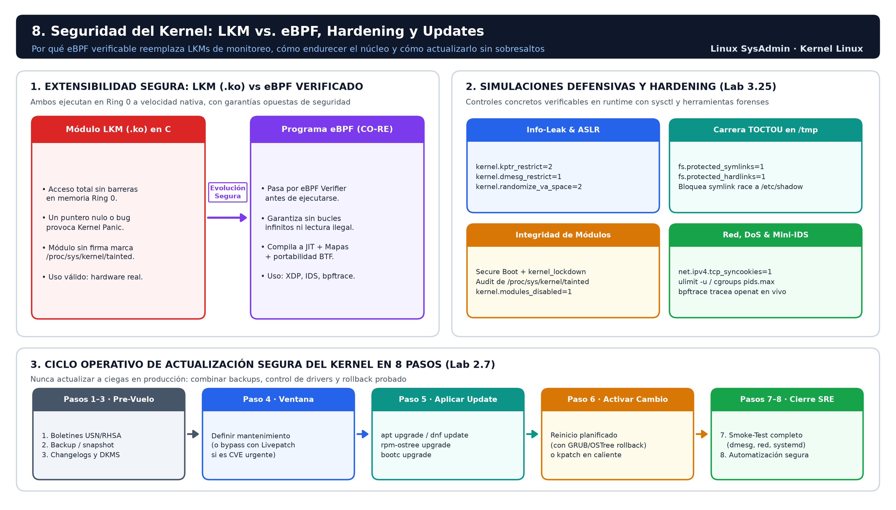

# Laboratorio 3.25: Seguridad del Kernel, Simulación de Ataques Defensivos y eBPF en Vivo

> **Dificultad:** Avanzado (Nivel 3) | **Tiempo estimado:** 50 minutos | **Script interactivo:** [`demo_seguridad_ataques_ebpf.sh`](demo_seguridad_ataques_ebpf.sh)

Si el kernel corre en **Ring 0** con poder absoluto sobre toda la memoria, los discos y la red, **cualquier vulnerabilidad o mala configuración en el núcleo compromete el sistema completo** (incluyendo todos sus contenedores y máquinas virtuales).

En este laboratorio vamos a reproducir en un entorno controlado **4 ataques o fugas clásicas a nivel de kernel** junto a sus mitigaciones, y luego vas a ver por qué **eBPF** revolucionó la observabilidad, el networking y la detección de intrusos (*Runtime Security*) sin arriesgar un *Kernel Panic*.



---

## 🛡️ Parte A: 4 Simulaciones Defensivas de Ataques al Kernel y su Mitigación

### 1. Fuga de Direcciones del Kernel (`Info-Leak`) y ASLR / KASLR
Para explotar una corrupción de memoria, un atacante necesita saber en qué dirección exacta de la RAM vive cada función (`commit_creds`, `prepare_kernel_cred`) o el *stack* de un proceso.
- **KASLR / ASLR (`kernel.randomize_va_space=2`):** Aleatoriza las direcciones base del kernel en el arranque (*KASLR*) y las del *stack*, *heap* y librerías de cada proceso (*ASLR*).
- **El peligro de `kptr_restrict=0` y `dmesg_restrict=0`:** Si un usuario sin privilegios puede leer direcciones reales en `/proc/kallsyms` o volcados en `dmesg`, **anula la aleatorización de KASLR**!
- **Prueba reproducible:**
  ```bash
  # Como usuario normal, si kptr_restrict=0 verás direcciones hexadecimales reales; con =2 verás 0000000000000000
  su -s /bin/sh nobody -c "head -n 3 /proc/kallsyms"
  ```

### 2. Ataque *Symlink Race* (TOCTOU) en Directorios Compartidos (`/tmp`)
Un clásico ataque de escalada de privilegios ocurre cuando un servicio ejecutado como `root` escribe o abre un nombre predecible dentro de `/tmp` (`chmod 1777`), y un usuario sin privilegios creó antes un enlace simbólico apuntando a `/etc/shadow` o a un archivo sensible.
- **Mitigación nativa en el VFS del Kernel:** `fs.protected_symlinks=1` y `fs.protected_hardlinks=1`.
- Cuando `fs.protected_symlinks=1`, el kernel **prohíbe seguir enlaces simbólicos** en directorios sticky escribiles por cualquiera (`world-writable`) si el dueño del enlace no coincide con el dueño del directorio ni con quien intenta seguirlo — devolviendo **`EACCES (Permission denied)`** incluso a `root`!

### 3. Detección Forense de Rootkits LKM, *Kernel Taint* y *Lockdown*
Como un LKM corre en Ring 0, un rootkit clásico a nivel kernel intenta ocultar su nombre de la lista enlazada que lee `lsmod` (`/proc/modules`).
- **Tácticas de defensa y forense:**
  1. Cruzar **`lsmod`** contra **`/sys/module/`** y el *ring buffer* (`dmesg`).
  2. Revisar **`/proc/sys/kernel/tainted`** (siempre debe ser `0` en servidores críticos sin drivers propietarios).
  3. Usar **UEFI Secure Boot + `lockdown=integrity`** (`/sys/kernel/security/lockdown`), que exige firma criptográfica válida para todo `.ko` y bloquea escritura directa en `/dev/mem` o `/dev/kmem`.
  4. En servidores estáticos de ultra-alta seguridad: activar **`sysctl -w kernel.modules_disabled=1`** al final del arranque. Una vez en `1`, **ni siquiera `root` puede cargar o descargar módulos hasta el próximo reinicio**!

### 4. Contención de SYN Flood, IP Spoofing y *Fork Bomb* (PID Exhaustion)
- **SYN Flood / Spoofing:** `net.ipv4.tcp_syncookies=1` evita llenar la tabla de conexiones semi-abiertas ante paquetes SYN falsificados sin handshake completo; `net.ipv4.conf.all.rp_filter=1` descarta paquetes con IP de origen imposible en esa interfaz.
- **Agotamiento de tabla de procesos (*Fork Bomb*):** Limitar el número máximo de procesos por usuario (`ulimit -u`) o por servicio (`TasksMax=` / `pids.max` en `cgroups v2`, [Lab 2.3](../systemd/systemd-cgroups.md)) frena el colapso con `Resource temporarily unavailable`.

---

## ⚡ Parte B: eBPF — Programar el Kernel Sin Riesgo de *Kernel Panic*

Históricamente, si querías inspeccionar cada syscall, filtrar paquetes antes de `iptables` o detectar un intruso dentro del kernel, tenías que programar un módulo **LKM en C** (arriesgando colgar todo el servidor).

**eBPF (*Extended Berkeley Packet Filter*)** cambió esa regla para siempre: permite cargar pequeños programas compilados a bytecode en el kernel de forma segura y dinámica.

| Dimensión | Módulo LKM Tradicional (`.ko`) | Programa **eBPF** (`bpftool` / `bpftrace` / Cilium) |
| :--- | :--- | :--- |
| **Seguridad de memoria** | Acceso irrestricto a toda la RAM de Ring 0. Un bug = **Kernel Panic**. | Validado previamente por el **eBPF Verifier** (rechaza bucles infinitos, punteros nulos o lecturas fuera de rango antes de ejecutarse). |
| **Portabilidad entre kernels** | Hay que recompilar por cada versión exacta (`vermagic` / `DKMS`). | **CO-RE (*Compile Once – Run Everywhere*):** usa información de tipos **BTF** (`/sys/kernel/btf/vmlinux`) para adaptarse entre versiones. |
| **Rendimiento** | Código máquina nativo. | Compilado al vuelo por el **JIT (*Just-In-Time*)** a instrucciones nativas `x86_64`/`ARM64`. |
| **Casos de uso estrella** | Drivers físicos de hardware, nuevos filesystems. | **Networking** (Cilium CNI, Cloudflare XDP anti-DDoS), **Observabilidad** (`bpftrace`), **Seguridad** (Falco, Tetragon) y **Scheduling** (`sched_ext`). |

```text
  Código C / bpftrace (User Space)
         │  (clang -target bpf)
         ▼
    Bytecode eBPF ──► Syscall bpf() ──► [ eBPF VERIFIER del Kernel ]
                                            ├─ ¿Puntero inválido o loop infinito? -> RECHAZADO (sistema a salvo!)
                                            └─ ¿Seguro y acotado? ──► Compilador JIT ──► Hook (Tracepoint/kprobe/XDP)
                                                                                              │
                                                                                     Mapas / RingBuffer ──► User Space
```

### Comandos Esenciales de `bpftool` y `bpftrace`

```bash
# 1. Ver programas y mapas eBPF activos actualmente en el kernel (ej. systemd cgroups, firewall)
sudo bpftool prog list
sudo bpftool map list

# 2. Comprobar qué capacidades eBPF y BTF soporta tu kernel
ls -lh /sys/kernel/btf/vmlinux
sudo bpftool feature probe kernel | head -n 30

# 3. Trazar en tiempo real cada comando ejecutado en el sistema (hook en syscall execve)
sudo bpftrace -e 'tracepoint:syscalls:sys_enter_execve { printf("pid=%d comm=%s cmd=%s\n", pid, comm, str(args->filename)); }'

# 4. Histograma de latencias (en nanosegundos) de llamadas openat() por proceso
sudo bpftrace -e 'tracepoint:syscalls:sys_enter_openat { @start[tid] = nsecs; } tracepoint:syscalls:sys_exit_openat /@start[tid]/ { @lat_ns[comm] = hist(nsecs - @start[tid]); delete(@start[tid]); }'

# 5. Mini-IDS eBPF: alertar inmediatamente si alguien intenta abrir un archivo secreto
sudo bpftrace -e 'tracepoint:syscalls:sys_enter_openat /str(args->filename) == "/tmp/vault_secret.key"/ { printf("[ALERTA eBPF IDS] pid=%d uid=%d comm=%s intento leer %s\n", pid, uid, comm, str(args->filename)); }'
```

---

## 💻 3. Práctica Interactiva con `demo_seguridad_ataques_ebpf.sh`

El script ejecuta las **4 simulaciones defensivas** (con un mini programa C real `aslr_probe.c` compilado en `/tmp`, prueba real de symlink TOCTOU con usuario `nobody`, auditoría forense de `tainted` y contención de `ulimit -u`) y cierra ejecutando **`bpftool` y un Mini-IDS eBPF en vivo con `bpftrace`**, restaurando todos los valores de `sysctl` al finalizar:

```bash
cd linux/administrator/kernel

# Modo interactivo paso a paso
sudo ./demo_seguridad_ataques_ebpf.sh

# Modo automático
sudo ./demo_seguridad_ataques_ebpf.sh --auto 0

# Limpieza manual si se usó --keep
sudo ./limpiar_seguridad_ataques_ebpf.sh
```

> 📖 **Glosario relacionado:** Consultá [Kernel Taint, KASLR y Lockdown](../GLOSARIO.md#kernel-taint-kaslr-kptr_restrict-y-kernel-lockdown) y [eBPF, BPF Verifier, JIT y CO-RE (BTF)](../GLOSARIO.md#ebpf-bpf-verifier-jit-y-co-re-btf).
