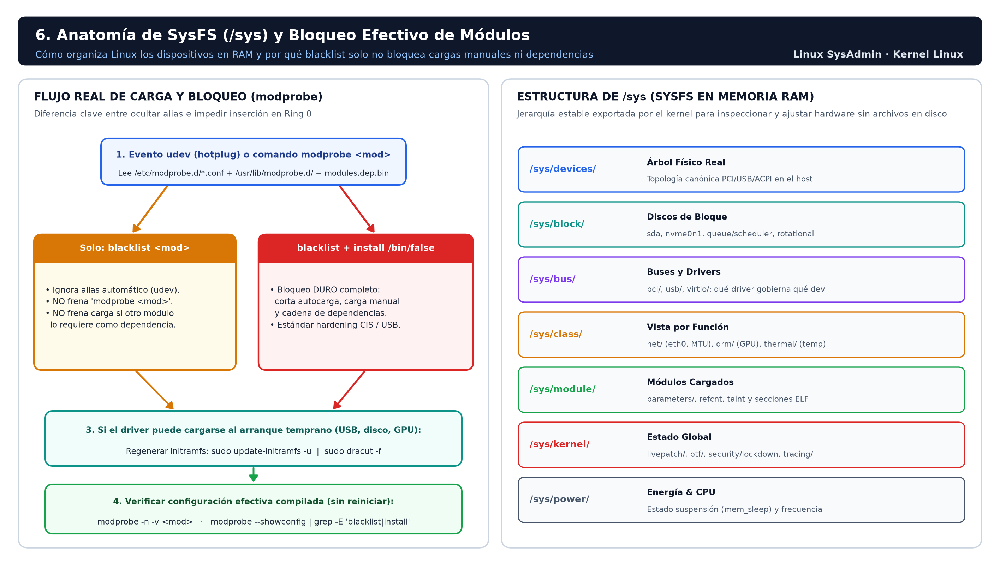

# Laboratorio 1.8: Estructura de `sysfs` (`/sys`), `/proc` y Tuning con `sysctl`

> **Dificultad:** Inicial / Intermedio (Nivel 1) | **Tiempo estimado:** 40 minutos | **Script interactivo:** [`demo_sysfs_sysctl.sh`](demo_sysfs_sysctl.sh)

En Linux *"todo es un archivo"*, y ese principio incluye la comunicación directa con el **Kernel en memoria RAM**. Sin reiniciar el servidor ni recompilar código, un administrador puede leer sensores térmicos, averiguar qué driver controla una placa de red, cambiar el planificador de disco de un SSD, habilitar el enrutamiento IP o endurecer la pila TCP/IP usando dos pseudo-sistemas de archivos virtuales: **`/proc` (`procfs`)** y **`/sys` (`sysfs`)**, junto a la herramienta **`sysctl`**.

---

## ⚡ 1. Cheat Sheet Rápida: `/proc` vs `/sys` vs `/dev` y `sysctl`

| Interfaz / Comando | Tipo / Naturaleza | Propósito Principal | Ejemplo Práctico Real |
| :--- | :--- | :--- | :--- |
| **`/proc`** (`procfs`) | Pseudo-FS en RAM | Estado vivo de **procesos** (`/proc/<PID>/`), memoria, CPU y parámetros tunables (`/proc/sys/`). | `cat /proc/meminfo` · `cat /proc/cmdline` · `cat /proc/sys/vm/swappiness` |
| **`/sys`** (`sysfs`) | Pseudo-FS en RAM (orientado a objetos `kobject`) | Jerarquía unificada de **hardware físico, buses, drivers, discos, módulos y subsistemas** del kernel. | `readlink /sys/class/net/eth0/device/driver` · `/sys/block/sda/queue/scheduler` |
| **`/dev`** (`devtmpfs` + `udev`) | Nodos de dispositivo (char/block) | Puntos de acceso para leer/escribir bytes o bloques hacia un hardware (`sda`, `nvme0n1`, `ttyS0`). | `lsblk` · `udevadm info -q all -n /dev/nvme0n1` |
| **`sysctl`** | CLI sobre `/proc/sys/` | Consultar y ajustar en caliente variables del kernel (y persistirlas en `/etc/sysctl.d/`). | `sysctl -w vm.swappiness=10` · `sudo sysctl --system` |

---

## 🌳 2. Anatomía Completa de `sysfs` (`/sys`) y su Relación con `udev`

Antes de Linux 2.6, la información de hardware estaba dispersa o desordenada dentro de `/proc`. **`sysfs` (`/sys`)** se creó en el kernel **2.6** para ofrecer una **vista estrictamente estructurada** donde cada directorio y archivo representa un objeto interno del kernel (`kobject`) y un atributo legible o modificable en caliente.



```text
/sys/
├── block/       --> Enlaces simbólicos a dispositivos de bloque (sda, vda, nvme0n1, loop0, dm-0)
│                    └── nvme0n1/queue/scheduler   (planificador I/O: none, mq-deadline, bfq, kyber)
│                    └── nvme0n1/queue/rotational  (0 = SSD/NVMe, 1 = HDD mecánico)
├── bus/         --> Organiza hardware por tipo de bus (pci, usb, virtio, i2c, scsi, platform)
│                    └── pci/drivers/              (qué driver atiende cada Vendor:Device ID)
├── class/       --> Organiza dispositivos por función lógica (net, block, drm, thermal, power_supply, tty)
│                    └── net/eth0/operstate        (up / down) y device/driver -> enlace al módulo
├── devices/     --> ÁRBOL FÍSICO CANÓNICO REAL (todos los demás directorios apuntan aquí vía symlinks)
├── fs/          --> Subsistema de filesystems cargados (ext4, xfs, btrfs, cgroup, fuse)
├── kernel/      --> Estado y features globales del núcleo (livepatch, security/lockdown, btf, tracing)
├── module/      --> TODOS los módulos activos y parámetros built-in!
│                    └── <modulo>/parameters/      (parámetros vivos del módulo)
│                    └── <modulo>/refcnt           (contador de referencias: cuántos lo usan)
└── power/       --> Estados de suspensión/energía del sistema (mem, disk, state)
```

### Casos de Uso Reales en `/sys` que todo SysAdmin Usa

```bash
# 1. Averiguar exactamente qué driver del kernel controla cada interfaz de red física/virtual
for iface in /sys/class/net/*; do
    name=$(basename "$iface")
    drv=$(readlink -f "$iface/device/driver" 2>/dev/null | xargs basename 2>/dev/null || echo "virtual/loopback")
    echo "$name -> driver: $drv"
done

# 2. Ver si un disco es rotacional (HDD=1) o SSD/NVMe (0) y qué planificador I/O tiene activo
cat /sys/block/*/queue/rotational 2>/dev/null
cat /sys/block/*/queue/scheduler 2>/dev/null
# Ejemplo de salida: [none] mq-deadline kyber bfq   (los corchetes indican el activo)

# 3. Cambiar en caliente el I/O scheduler de un disco (ej. en bases de datos o SSD SATA)
# echo mq-deadline | sudo tee /sys/block/sda/queue/scheduler

# 4. Inspeccionar la frecuencia actual y el gobernador de energía de la CPU 0
cat /sys/devices/system/cpu/cpu0/cpufreq/scaling_governor 2>/dev/null
# Valores típicos: powersave | performance | schedutil

# 5. Leer parámetros vivos de un módulo cargado (ej. loop o tcp_cubic)
ls -la /sys/module/*/parameters/ 2>/dev/null | head -n 20

# 6. Consultar la topología udev asociada a un nodo en /dev usando la ruta de /sys
udevadm info --query=all --path=/sys/class/net/lo
```

> [!NOTE]
> **¿Cómo trabajan juntos `sysfs` y `udev`?**
> Cuando conectás un disco NVMe o un pendrive, el kernel crea el objeto en `/sys/devices/...` y dispara un evento **uevent** por un socket netlink hacia **`systemd-udevd`** en espacio de usuario. `udevd` lee los atributos de `/sys` (Vendor ID, serial, UUID), carga el driver apropiado vía `modprobe` si hace falta y crea los enlaces estables en `/dev/disk/by-uuid/`.

---

## 🎛️ 3. Tuning en Caliente con `sysctl` (`/proc/sys`)

Mientras `/sys` describe **hardware y módulos**, el subárbol **`/proc/sys/`** expone cientos de variables de comportamiento del kernel (red, memoria virtual, límites del VFS y seguridad). El comando `sysctl` traduce automáticamente puntos por barras:

```text
sysctl net.ipv4.ip_forward   <===>   /proc/sys/net/ipv4/ip_forward
sysctl vm.swappiness         <===>   /proc/sys/vm/swappiness
sysctl kernel.kptr_restrict  <===>   /proc/sys/kernel/kptr_restrict
```

### 3.1 Comandos Esenciales y Jerarquía de Archivos Persistentes
- `sysctl -a` → Lista absolutamente todos los parámetros visibles del kernel actual.
- `sysctl vm.swappiness` → Lee un parámetro puntual.
- `sudo sysctl -w vm.swappiness=10` → Cambia el valor **en caliente en RAM** (se pierde al reiniciar).
- `sudo sysctl -p /etc/sysctl.d/99-custom.conf` → Aplica un archivo de configuración específico de inmediato.
- `sudo sysctl --system` → Recarga todos los archivos de configuración en el **orden oficial de precedencia** (el archivo alfabéticamente mayor gana):
  1. `/usr/lib/sysctl.d/*.conf` *(valores por defecto de paquetes/distro)*
  2. `/run/sysctl.d/*.conf` *(generados en runtime)*
  3. `/etc/sysctl.d/*.conf` *(configuraciones del administrador, usar prefijo `99-custom.conf`)*
  4. `/etc/sysctl.conf` *(heredado; en muchas distros modernas ya es opcional o deprecado frente a `/etc/sysctl.d/`)*

---

### 3.2 Tabla Maestra: Parámetros `sysctl` Típicos de Producción

Estos son los parámetros reales que un SysAdmin / DevOps ajusta en servidores web, bases de datos, routers, nodos Kubernetes y equipos endurecidos:

#### A. Red y Pila TCP/IP (`net.*`)
| Parámetro | Valor Típico | Qué Hace y Cuándo Cambiarlo |
| :--- | :---: | :--- |
| **`net.ipv4.ip_forward`** | `0` (host) / `1` (router/Docker/K8s) | Habilita el reenvío de paquetes entre interfaces. Obligatorio en routers, VPN WireGuard, Docker y nodos Kubernetes. |
| **`net.ipv4.tcp_congestion_control`** | `bbr` (con `net.core.default_qdisc=fq`) | Activa **TCP BBR** (Google): mejora drásticamente el throughput y baja la latencia frente a pérdida de paquetes en WAN/Internet respecto al clásico `cubic`. |
| **`net.core.somaxconn`** | `4096` o `16384` (vs default `4096`/`128`) | Tamaño máximo de la cola de conexiones entrantes aceptadas por un socket (`listen()`). Crítico en Nginx, HAProxy y Redis bajo alta concurrencia. |
| **`net.ipv4.tcp_syncookies`** | `1` | Protección básica contra ataques **SYN Flood** cuando se llena la cola de conexiones semi-abiertas. |
| **`net.ipv4.conf.all.rp_filter`** | `1` (strict) o `2` (loose) | *Reverse Path Filtering*: descarta paquetes con IP de origen falsificada (*IP spoofing*) si no entrarían por la ruta de retorno esperada. *(En routers asimétricos o ciertos túneles usar `2`)*. |

#### B. Memoria Virtual y Caché de Disco (`vm.*`)
| Parámetro | Valor Típico | Qué Hace y Cuándo Cambiarlo |
| :--- | :---: | :--- |
| **`vm.swappiness`** | `1` – `10` (BD) / `60` (default) | Tendencia del kernel (`0`–`200`) a intercambiar páginas anónimas hacia swap frente a liberar *Page Cache*. Bajarlo a `1`–`10` evita latencias en bases de datos (PostgreSQL/Redis); en nodos Kubernetes suele ir swap desactivado salvo `NodeSwap`. |
| **`vm.dirty_ratio`** / **`vm.dirty_background_ratio`** | `10` / `5` (vs `20`/`10`) | Porcentaje máximo de RAM que puede llenarse con escrituras sucias pendientes de bajar a disco antes de frenar procesos (`dirty_ratio`) o despertar flusheo en segundo plano (`dirty_background_ratio`). |
| **`vm.overcommit_memory`** | `0` (heurístico), `1` (siempre), `2` (estricto) | Política de asignación de RAM. Redis recomienda `1` para evitar fallos en `fork()` durante snapshots `BGSAVE`. |
| **`vm.max_map_count`** | `262144` o `1048576` (default `65530`) | Máximo de regiones de memoria mapeada (`mmap`) por proceso. **Requisito obligatorio** para Elasticsearch, OpenSearch y muchos motores modernos/juegos Proton. |

#### C. Seguridad del Kernel (`kernel.*`, `fs.*`)
| Parámetro | Valor Seguro | Qué Mitiga |
| :--- | :---: | :--- |
| **`kernel.kptr_restrict`** | `2` (o `1`) | Oculta punteros de memoria del kernel en `/proc/kallsyms` para dificultar exploits de escalada de privilegios (evita filtrar direcciones tras KASLR). |
| **`kernel.dmesg_restrict`** | `1` | Impide que usuarios no privilegiados lean `dmesg` (evita fuga de información del hardware y direcciones de fallos). |
| **`kernel.randomize_va_space`** | `2` (Full ASLR) | Aleatoriza stack, mmap, heap y código PIE en cada ejecución de proceso. Nunca dejarlo en `0` en producción. |
| **`kernel.sysrq`** | `0` o `176` | Controla las combinaciones mágicas Alt+SysRq (en producción se restringe para evitar reinicios/dumps físicos no autorizados). |
| **`fs.protected_hardlinks`** & **`fs.protected_symlinks`** | `1` y `1` | Bloquea ataques clásicos de condición de carrera (*TOCTOU symlink/hardlink race*) dentro de directorios compartidos como `/tmp`. *(Lo demostramos en vivo en el [Lab 3.25](seguridad_ataques_kernel_ebpf.md)!)*. |

#### D. Límites Globales del Sistema (`fs.*`)
| Parámetro | Valor Típico | Qué Evita |
| :--- | :---: | :--- |
| **`fs.file-max`** | `2097152`+ | Tope global de descriptores de archivos abiertos en todo el kernel (`Too many open files in system`). |
| **`fs.inotify.max_user_watches`** | `524288` | Límite de archivos vigilados por usuario (`tail -f`, IDEs, `kubelet`, `systemd`, `syncthing`). Cuando se agota aparece `No space left on device` aunque el disco esté vacío! |

---

## 💻 4. Práctica Interactiva con `demo_sysfs_sysctl.sh`

El script ejecuta en vivo una inspección de `/sys`, audita los parámetros críticos de producción, prueba persistencia en `/etc/sysctl.d/` (restaurando los valores exactos en `cleanup()`) y demuestra `net.ipv4.ip_forward` de forma aislada dentro de un *network namespace* (`ip netns`) efímero:

```bash
cd linux/administrator/kernel

# Modo interactivo paso a paso
sudo ./demo_sysfs_sysctl.sh

# Modo automático rápido
sudo ./demo_sysfs_sysctl.sh --auto 0

# Limpieza manual si corriste con --keep
sudo ./limpiar_sysfs_sysctl.sh
```

> 📖 **Glosario relacionado:** Consultá [`sysfs` (`/sys`) y `udev`](../GLOSARIO.md#sysfs-sys-procfs-proc-y-udev) y [`sysctl` (`/proc/sys`)](../GLOSARIO.md#sysctl-procsys).
