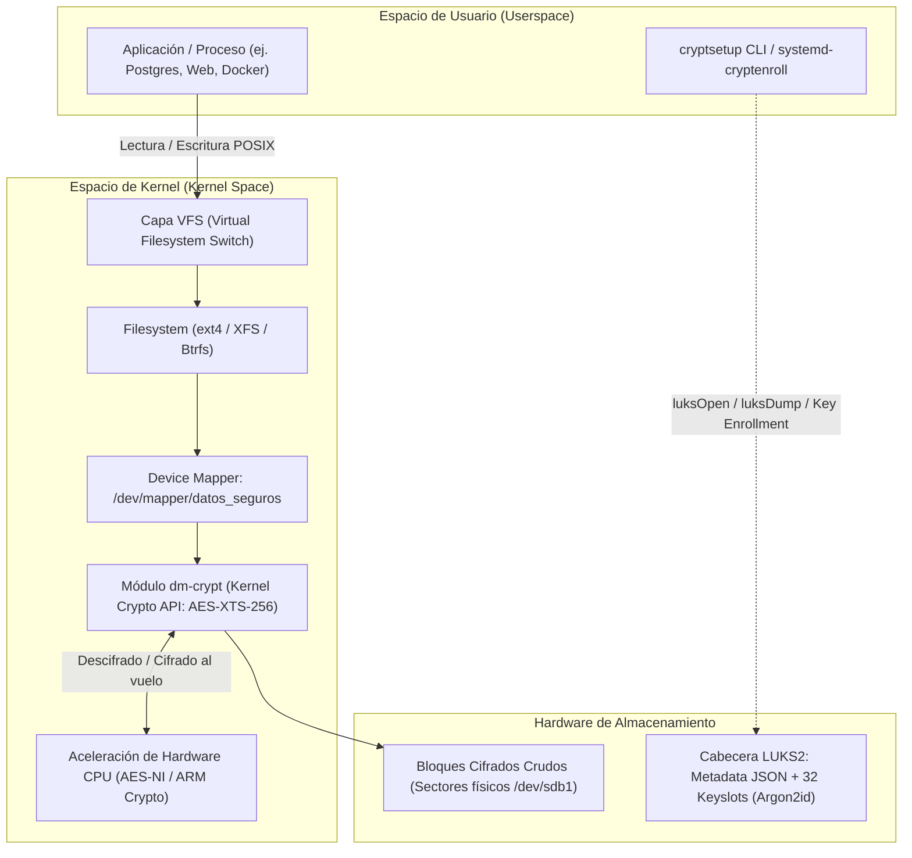
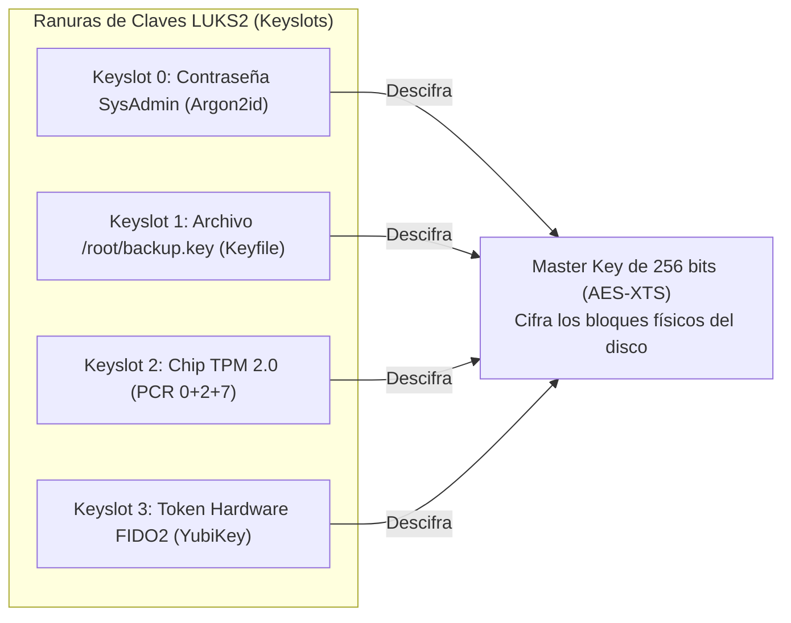

# Cifrado de Bloques en Reposo con LUKS2: dm-crypt, Keyslots, TPM 2.0 y NBDE

> [!NOTE]
> Este laboratorio profundiza en el cifrado de nivel de bloques (**Block-level Encryption / FDE**). Para una comparativa de alto nivel entre cifrado de bloques (LUKS2), sistemas de archivos apilados (gocryptfs) y cifrado asimétrico a nivel de archivo/aplicación (GPG y age), consultá la [Guía de Arquitecturas de Cifrado en Linux](../cifrado/cifrado_arquitecturas_comparativa.md).

---

## 1. Resumen Ejecutivo en 60 Segundos

```bash
# 1. Formatear dispositivo con LUKS2 moderno (Argon2id por defecto)
sudo cryptsetup -y -v luksFormat --type luks2 /dev/sdb1

# 2. Inspeccionar cabeceras criptográficas y keyslots asignados
sudo cryptsetup luksDump /dev/sdb1

# 3. Abrir contenedor criptográfico (crea /dev/mapper/datos_seguros)
sudo cryptsetup luksOpen /dev/sdb1 datos_seguros

# 4. Crear filesystem ext4 y montar en el árbol VFS
sudo mkfs.ext4 /dev/mapper/datos_seguros
sudo mount /dev/mapper/datos_seguros /mnt/seguro

# 5. Desmontar y bloquear el contenedor (cierra el canal dm-crypt del kernel)
sudo umount /mnt/seguro
sudo cryptsetup luksClose datos_seguros

# 6. Desbloqueo moderno automático con chip TPM 2.0 (systemd)
sudo systemd-cryptenroll --tpm2-device=auto --tpm2-pcrs=0+2+7 /dev/sdb1

# 7. Respaldo obligatorio de cabeceras de metadatos (DRP)
sudo cryptsetup luksHeaderBackup /dev/sdb1 --header-backup-file /root/sdb1_luks_header.img
```

---

## 2. Arquitectura Interna del Kernel: VFS, dm-crypt y LUKS2

El cifrado con **LUKS** (*Linux Unified Key Setup*) no cifra archivos individuales, sino **sectores y bloques crudos de disco**. Toda la arquitectura reside en el kernel de Linux gracias al subsistema `device-mapper` y al módulo criptográfico `dm-crypt`.



### ¿Cómo funciona el esquema de dos niveles de claves?
1. **Master Key (Clave Maestra)**: Es una clave pseudoaleatoria de alta entropía (normalmente AES de 256 o 512 bits) que cifra directamente todos los sectores del disco. **Nunca se almacena en texto plano en el disco**.
2. **Keyslots (Ranuras de Claves)**: LUKS2 dispone de hasta 32 ranuras independientes. Cada slot contiene una copia de la Master Key cifrada con una contraseña de usuario, un token FIDO2, un secreto sellado por TPM2 o un keyfile.
3. **Argon2id (KDF)**: Para proteger la contraseña contra ataques de fuerza bruta masivos con GPUs y ASICs, LUKS2 utiliza por defecto la función de derivación de claves **Argon2id**, intensiva tanto en CPU como en memoria RAM.

| Componente | LUKS1 (Antiguo / Legado) | LUKS2 (Estándar Actual) |
| :--- | :--- | :--- |
| **KDF por defecto** | PBKDF2 (Vulnerable a cluster de GPUs) | **Argon2i / Argon2id** (Resistente a memoria y ASIC) |
| **Metadatos** | Cabecera binaria fija de 2 MB | **Cabecera JSON extensible** (hasta 16 MB) |
| **Resiliencia ante fallos** | Cabecera única (si se corrompe, se pierde todo) | **Cabecera primaria y secundaria redundante** (auto-curación) |
| **Límite de Keyslots** | 8 ranuras fijas | **32 ranuras configurables** |
| **Integración Hardware** | Scripts externos manuales | **Nativa con systemd (TPM2, FIDO2, PKCS#11)** |
| **Chequeo de Integridad** | No soportado | Soporte nativo para dm-integrity (HMAC-SHA256) |

---

## 3. Práctica Paso a Paso: Loop Device vs Disco Físico

Podés experimentar con LUKS sin riesgo utilizando un **disco virtual (loop device)** de 512 MB, o aplicar la misma secuencia sobre una partición real (`/dev/sdb1`).

### 3.1. Laboratorio con Loop Device (100% Seguro)

#### Paso 1: Crear la imagen y vincularla a un loop device
```bash
sudo fallocate -l 512M /var/tmp/disco_luks.img
LOOP_DEV=$(sudo losetup --find --show /var/tmp/disco_luks.img)
echo "Dispositivo asignado: $LOOP_DEV"
```

#### Paso 2: Inicializar el formato LUKS2 (`luksFormat`)
```bash
# Formateo con LUKS2 interactivo
sudo cryptsetup -y -v luksFormat --type luks2 "$LOOP_DEV"
```
> [!IMPORTANT]
> El comando te pedirá escribir `YES` (en mayúsculas) y definir una contraseña segura. `luksFormat` destruye los datos previos del dispositivo.

#### Paso 3: Inspeccionar la cabecera y el Keyslot 0 (`luksDump`)
```bash
sudo cryptsetup luksDump "$LOOP_DEV"
```
Revisá los campos en la salida:
- `Version: 2`
- `Cipher name: aes`, `Cipher mode: xts-plain64`
- `PBKDF: argon2id` (indica la memoria y tiempo de iteración calculados en el host).
- `Keyslot 0: luks2` (activo y asignado).

#### Paso 4: Abrir el contenedor y mapear en el kernel (`luksOpen`)
```bash
sudo cryptsetup luksOpen "$LOOP_DEV" datos_seguros
ls -l /dev/mapper/datos_seguros
sudo cryptsetup status datos_seguros
```

#### Paso 5: Crear el sistema de archivos ext4 y montar
```bash
sudo mkfs.ext4 /dev/mapper/datos_seguros
sudo mkdir -p /mnt/seguro
sudo mount /dev/mapper/datos_seguros /mnt/seguro

# Escribir un archivo confidencial de prueba
echo "CONFIDENCIAL: Clave API y secretos bancarios 2026" | sudo tee /mnt/seguro/secreto.txt
sudo cat /mnt/seguro/secreto.txt
```

#### Paso 6: Cerrar y comprobación forense contra robo físico
```bash
# Desmontar filesystem
sudo umount /mnt/seguro

# Cerrar el dispositivo mapeado
sudo cryptsetup luksClose datos_seguros

# Verificar que /dev/mapper/datos_seguros ya no existe
ls -l /dev/mapper/datos_seguros 2>&1 || echo "Mapeo cerrado en el kernel."

# Inspección forense con 'strings' sobre el dispositivo físico crudo:
sudo strings "$LOOP_DEV" | grep "CONFIDENCIAL" || echo "✔ Cero coincidencias: Datos 100% cifrados."
```

#### Paso 7: Limpieza del entorno de pruebas
```bash
sudo losetup -d "$LOOP_DEV"
sudo rm -f /var/tmp/disco_luks.img
sudo rmdir /mnt/seguro
```

---

## 4. Gestión de Claves y Ciclo de Vida de Keyslots

En entornos corporativos nunca se utiliza una única contraseña compartida. LUKS permite múltiples contraseñas, llaves en archivo (*keyfiles*) y credenciales de revocación.



### Operaciones Esenciales de Keyslots:

#### 1. Agregar una segunda contraseña o keyfile (`luksAddKey`)
Permite que otro administrador o un script de backup tenga su propia clave sin compartir la contraseña maestra:
```bash
# Agregar una segunda contraseña:
sudo cryptsetup luksAddKey /dev/sdb1

# O agregar una clave desde un archivo protegido con permisos 0400:
sudo dd if=/dev/urandom of=/root/disco_seguro.key bs=512 count=1
sudo chmod 0400 /root/disco_seguro.key
sudo cryptsetup luksAddKey /dev/sdb1 /root/disco_seguro.key
```

#### 2. Cambiar la contraseña de una ranura (`luksChangeKey`)
Modifica la frase de paso de un keyslot sin cambiar la Master Key y **sin necesidad de recifrar los gigabytes de datos del disco**:
```bash
sudo cryptsetup luksChangeKey /dev/sdb1
```

#### 3. Revocar o destruir una clave comprometida (`luksKillSlot` / `luksRemoveKey`)
Si un operador abandona la empresa o una clave se filtró:
```bash
# Eliminar la clave del Keyslot 1:
sudo cryptsetup luksKillSlot /dev/sdb1 1

# O revocar ingresando la contraseña que se quiere deshabilitar:
sudo cryptsetup luksRemoveKey /dev/sdb1
```

---

## 5. El Escenario Moderno: Automatización con TPM 2.0 y Clevis/Tang

Pedir una contraseña en cada arranque de un servidor es inviable en datacenters con cientos de máquinas o servidores en la nube sin consola interactiva.

### 5.1. Desbloqueo Automático Medido con TPM 2.0 (`systemd-cryptenroll`)

El chip **TPM 2.0** (*Trusted Platform Module*) permite desbloquear el disco automáticamente al arrancar, **pero únicamente si el sistema no ha sido adulterado** (firmware UEFI, tabla de particiones y kernel intactos mediante registros PCR):

```bash
# 1. Verificar soporte de TPM2 en el sistema
systemd-cryptenroll --tpm2-device=list

# 2. Enrolar el disco cifrado al chip TPM2 vinculándolo a los registros PCR 0, 2 y 7 (Secure Boot)
sudo systemd-cryptenroll --tpm2-device=auto --tpm2-pcrs=0+2+7 /dev/sdb1

# 3. Generar una clave de recuperación de emergencia por si cambia la placa madre o BIOS
sudo systemd-cryptenroll --recovery-key /dev/sdb1
```

Configuración en `/etc/crypttab`:
```text
# <target>      <source>         <keyfile>  <options>
datos_seguros   /dev/sdb1        none       tpm2-device=auto,discard
```

### 5.2. Desbloqueo en Red para Datacenters: NBDE (Clevis + Tang)

En centros de datos empresariales donde un servidor físico no tiene TPM o se migran máquinas virtuales, se utiliza **Network-Bound Disk Encryption (NBDE)**:
1. **Servidor Tang**: Un servidor central interno en la LAN segura que actúa como oráculo criptográfico.
2. **Cliente Clevis**: En el arranque, Clevis consulta al servidor Tang a través de la red local. Si el servidor responde correctamente (demostrando que la máquina está físicamente conectada en el datacenter de la empresa), el volumen LUKS se desbloquea automáticamente.
3. **Protección**: Si alguien extrae físicamente el servidor o el disco rígido fuera de las instalaciones de la empresa, el disco queda 100% inaccesible porque no puede comunicarse con el servidor Tang.

```bash
# Vincular el disco a un servidor Tang corporativo en la red interna:
sudo clevis luks bind -d /dev/sdb1 tang '{"url":"http://tang.datacenter.internal:8888"}'
```

---

## 6. Respaldo de Cabeceras (DRP) y Consideraciones SSD (TRIM)

### 6.1. Respaldo Obligatorio de Cabecera (`luksHeaderBackup`)

> [!WARNING]
> La cabecera LUKS ocupa los primeros megabytes del disco. Si un error de escritura, una tabla de particiones corrupta o sectores defectuosos dañan esos primeros sectores, **la Master Key se destruye y el 100% de los datos se pierde irremediablemente**, incluso si recordás la contraseña correcta.

```bash
# Exportar respaldo de la cabecera LUKS2 (guardar en un medio externo cifrado):
sudo cryptsetup luksHeaderBackup /dev/sdb1 --header-backup-file /root/backup_header_sdb1.img

# Restaurar cabecera en caso de desastre o corrupción:
sudo cryptsetup luksHeaderRestore /dev/sdb1 --header-backup-file /root/backup_header_sdb1.img
```

### 6.2. Soporte TRIM y Rendimiento en Discos NVMe / SSD

Por defecto, dm-crypt deshabilita el comando `TRIM` (*discards*) porque permite a un atacante inferir qué sectores del disco están vacíos (fuga leve de metadatos de espacio ocupado). Sin embargo, en discos SSD y NVMe modernos, no usar TRIM deteriora drásticamente la velocidad de escritura y la vida útil del disco.

Para habilitar TRIM:
```bash
# Apertura con soporte de descarte (TRIM):
sudo cryptsetup luksOpen --allow-discards /dev/sdb1 datos_seguros

# En /etc/crypttab:
datos_seguros  UUID=xxxx-xxxx  none  luks,discard
```

---

## 7. 4 Casos Reales en Producción

### Caso 1: Rotación de Personal y Revocación de Accesos sin Downtime
- **Problema**: Un ingeniero senior con la contraseña de cifrado del cluster de bases de datos renuncia a la empresa. Se requiere revocar su acceso sin desmontar la base de datos ni recifrar los 10 Terabytes de almacenamiento.
- **Solución**: Se utiliza `cryptsetup luksAddKey` para enrolar la nueva contraseña corporativa en el Keyslot 1, y luego `cryptsetup luksKillSlot /dev/sdb1 0` para volatilizar la clave anterior del Keyslot 0. El disco sigue montado y operando sin un solo milisegundo de caída.

### Caso 2: Cripto-Destrucción Segura de Discos al Fin de Vida (Crypto-shredding)
- **Problema**: Al dar de baja servidores físicos en un datacenter o devolver instancias virtuales en AWS/Azure, el sanitizado con `dd if=/dev/zero` puede demorar 18 horas y desgastar discos SSD.
- **Solución**: Con LUKS2 se ejecuta `cryptsetup erase /dev/sdb1` o se sobrescriben los primeros 16 MB con ceros. Al desaparecer la Master Key cifrada de la cabecera, la totalidad de los datos restantes en el disco se convierte instantáneamente en ruido aleatorio e irrecuperable. Cumple normativas **NIST SP 800-88** y **DoD 5220.22-M**.

### Caso 3: Despliegue de Servidores Edge con TPM 2.0 y Arranque Seguro
- **Problema**: Dispositivos IoT o servidores industriales en sucursales bancarias están expuestos a robo físico. Deben arrancar sin operarios humanos que ingresen contraseñas por teclado.
- **Solución**: Se enrola el disco con `systemd-cryptenroll --tpm2-device=auto --tpm2-pcrs=0+2+7`. El disco solo arranca si está en el chasis original y el firmware UEFI no ha sido manipulado con un pendrive atacante.

### Caso 4: Montaje Automático en Servidores de Base de Datos vía `/etc/crypttab`
- **Problema**: Un servidor MySQL tiene sus datos en `/var/lib/mysql` montado sobre un disco secundario cifrado `/dev/sdb1`. Debe desbloquearse automáticamente durante el inicio si un keyfile interno seguro está presente.
- **Solución**: Se asocia un keyfile de 512 bytes guardado en `/etc/keys/mysql_disk.key` (con permisos `0400` root) y se parametriza `/etc/crypttab`:
  ```text
  mysql_data  UUID=3a4b5c6d-...  /etc/keys/mysql_disk.key  luks,discard
  ```
  Y en `/etc/fstab`:
  ```text
  /dev/mapper/mysql_data  /var/lib/mysql  ext4  defaults,nofail  0 2
  ```

---

## 8. Laboratorio Interactivo con Script de Demostración

El repositorio incluye el script [`demo_luks.sh`](demo_luks.sh) para dar clases o realizar pruebas automatizadas paso a paso:

```bash
# Modo interactivo (pausa con [ENTER] en cada fase):
sudo ./linux/administrator/luks/demo_luks.sh

# Modo desatendido para pipelines de prueba (espera 2s entre pasos):
sudo ./linux/administrator/luks/demo_luks.sh --auto 2
```

---

## 9. Autoevaluación

<details>
<summary><strong>1. ¿Por qué cambiar la contraseña de LUKS con luksChangeKey toma apenas un par de segundos incluso en un disco de 10 Terabytes?</strong></summary>

Porque LUKS utiliza un esquema de dos niveles de claves. La clave maestra (Master Key) que cifra los 10 Terabytes de sectores físicos nunca se modifica. Lo único que hace `luksChangeKey` es descifrar la Master Key en memoria y volver a cifrarla con la nueva contraseña dentro de la cabecera de metadatos (un bloque de apenas unos pocos kilobytes).
</details>

<details>
<summary><strong>2. ¿Qué ventaja ofrece Argon2id sobre PBKDF2 en LUKS2?</strong></summary>

PBKDF2 solo requiere ciclos de CPU, lo que permite a un atacante construir clusters masivos de GPUs o chips ASIC dedicados para probar miles de millones de contraseñas por segundo. Argon2id es una función de derivación de claves que demanda grandes cantidades de memoria RAM (memory-hard), lo que anula la ventaja de las GPUs y encarece exponencialmente cualquier ataque de fuerza bruta.
</details>

<details>
<summary><strong>3. Si la cabecera de un volumen LUKS se corrompe por sectores defectuosos y no existe un luksHeaderBackup, ¿se pueden recuperar los datos si se conoce la contraseña?</strong></summary>

No. Si la cabecera física (especialmente los keyslots y la copia cifrada de la Master Key) se destruye, es matemáticamente imposible recuperar los datos del disco, sin importar cuántas contraseñas o frases de paso recuerde el usuario. Por eso, realizar un `luksHeaderBackup` es una tarea obligatoria de DRP.
</details>

<details>
<summary><strong>4. ¿Cómo evita Clevis/Tang que un servidor robado de un datacenter pueda ser descifrado?</strong></summary>

Porque la clave de desbloqueo no reside en el servidor cliente ni en su disco rígido. Durante el arranque en red, Clevis interactúa con el servidor Tang a través de la LAN privada del centro de datos. Si el servidor físico es retirado de las instalaciones, no tiene conectividad con el oráculo Tang, la negociación criptográfica falla y el volumen permanece bloqueado en modo de solo ruido cifrado.
</details>


---

## 🔗 Enlaces Oficiales de Referencia

- [GitLab Oficial de cryptsetup](https://gitlab.com/cryptsetup/cryptsetup)
- [Documentación del Kernel de Linux: dm-crypt](https://docs.kernel.org/admin-guide/device-mapper/dm-crypt.html)
- [Red Hat Enterprise Linux: Managing encrypted storage with LUKS](https://access.redhat.com/documentation/en-us/red_hat_enterprise_linux/9/html/security_hardening/managing-encrypted-storage-with-luks_security-hardening)
- [Latchset Clevis & Tang (NBDE) Upstream](https://github.com/latchset/clevis)
- [Manual de systemd-cryptenroll (freedesktop.org)](https://www.freedesktop.org/software/systemd/man/systemd-cryptenroll.html)
