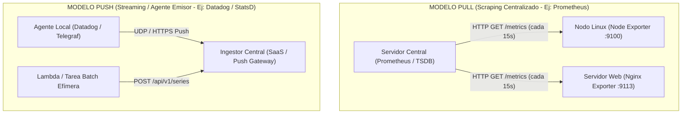

# Arquitecturas de Monitoreo y Observabilidad en Linux: Paradigmas (Pull vs Push), los 4 Pilares y Matriz Comparativa

> *"Si no podés medirlo de forma continua y multidimensional, no podés gestionarlo ni defender su disponibilidad cuando colapsa en producción."*

En la administración de infraestructura contemporánea —desde servidores dedicados *Bare-Metal* hasta clústeres de cómputo en la nube (AWS EC2, Google Cloud) y microservicios en Kubernetes—, **el monitoreo ya no se limita a saber si un servidor responde a un `ping` o si un disco superó el 90% de ocupación**.

El paradigma moderno ha transitado de la **supervisión reactiva** clásica a la **Observabilidad proactiva**. Diseñar una arquitectura de telemetría sólida exige comprender en profundidad qué tipo de señal estamos recolectando, cómo se transporta a través de la red (el debate **PULL vs PUSH**) y qué motor de almacenamiento permite correlacionar fallas sin saturar la memoria ni arruinar los presupuestos operativos.

---

## 🧭 1. De la Monitorización Clásica a la Observabilidad

Tradicionalmente, la monitorización respondía una única pregunta binaria: **¿Está roto el sistema?** (*Yes/No*). La observabilidad va mucho más allá e infiere el **estado interno de un sistema complejo a partir del análisis de sus salidas externas**.

```
+───────────────────────────────────────────────────────────────────────────────────────────────────+
|                                  ESPECTRO DE RESPUESTA OPERATIVA                                  |
|                                                                                                   |
|  1. DISPONIBILIDAD (Blackbox)     --> ¿Los usuarios pueden usar la plataforma?                    |
|  2. SÍNTOMAS (Métricas)           --> ¿Qué componente se está degradando y con qué velocidad?     |
|  3. CONTEXTO FORENSE (Logs)       --> ¿Qué evento exacto causó la excepción o el fallo de kernel? |
|  4. CAUSA RAÍZ (Trazas APM)       --> ¿En qué llamada de red o microservicio se produjo el cuello?|
+───────────────────────────────────────────────────────────────────────────────────────────────────+
```

### Las 3 Preguntas de la Operación en Producción:
1. **¿Qué está fallando?** → Señales cuantitativas numéricas (**Métricas**).
2. **¿Por qué está fallando?** → Textos estructurados con contexto de ejecución (**Logs**).
3. **¿Dónde se originó el cuello de botella?** → Grafos de dependencias y latencias distribuidas (**Trazas**).

---

## 🏛️ 2. Los 4 Pilares de la Observabilidad Moderna

Para auditar y gobernar un parque de servidores Linux en producción se combinan cuatro señales de telemetría complementarias:

```
                          LOS 4 PILARES DE LA TELEMETRÍA
                     ┌──────────────────────────────────────┐
                     │         OBSERVABILIDAD TOTAL         │
                     └──────────────────┬───────────────────┘
                                        │
         ┌──────────────────┬───────────┴──────────┬──────────────────┐
         ▼                  ▼                      ▼                  ▼
   ┌───────────┐      ┌───────────┐          ┌───────────┐      ┌───────────┐
   │  MÉTRICAS │      │   LOGS    │          │  TRAZAS   │      │ PROBES    │
   │  (TSDB)   │      │ (Text/JSON│          │   (APM)   │      │(Sintético)│
   └─────┬─────┘      └─────┬─────┘          └─────┬─────┘      └─────┬─────┘
         │                  │                      │                  │
   Valores numéricos  Eventos con alto       Seguimiento del     Pruebas externas
   agregables en el   contexto y detalle     ciclo de vida de    de disponibilidad
   tiempo (CPU, RAM,  (syslog, journald,     una petición entre  (HTTP 200, TLS,
   I/O, Disk, Net).   nginx access.log).     servicios (Spans).  resolución DNS).
```

### 1. Métricas (TSDB - Time Series Database)
- **Definición**: Series temporales compuestas por un identificador, marcas de tiempo (*timestamps*), valores numéricos de coma flotante y pares clave-valor (*etiquetas o labels*).
- **Ejemplos**: `node_cpu_seconds_total`, `custom_disk_usage_percent`, `node_memory_MemAvailable_bytes`.
- **Ventaja**: Almacenamiento ultracompacto (1-2 bytes por muestra mediante algoritmos como Gorilla/Chimp), alta velocidad de cómputo matemático e ideales para alertas en tiempo real.

### 2. Registros o Logs (Eventos)
- **Definición**: Flujo cronológico de cadenas de texto enriquecidas (preferentemente JSON estructurado) emitidas cuando ocurre un evento discreto.
- **Ejemplos**: `/var/log/syslog`, `journalctl -u nginx`, eventos `OutOfMemory` del kernel Linux (`dmesg`).
- **Ventaja**: Contienen la máxima riqueza contextual (mensajes de error, stack traces, identificadores de usuario y parámetros de peticiones).
- **Desventaja**: Almacenamiento masivo y costoso; indexar texto libre exige infraestructuras pesadas de almacenamiento (Elasticsearch, Loki).

### 3. Trazas Distribuidas (Distributed Tracing / APM)
- **Definición**: Grafo acíclico dirigido (DAG) de tramos temporizados (*Spans*) que registran el viaje completo de una petición HTTP o RPC a través de múltiples procesos, bases de datos y servidores.
- **Ejemplos**: Jaeger, Grafana Tempo, AWS X-Ray, OpenTelemetry.
- **Ventaja**: Revela con precisión milimétrica si la lentitud de una página web se debe a una consulta SQL bloqueada en PostgreSQL, a un fallo en Redis o a la red.

### 4. Pruebas Sintéticas y Probes de Caja Negra (Blackbox)
- **Definición**: Monitores externos que interrogan a la máquina simulando la experiencia de un cliente final desde el exterior del datacenter.
- **Ejemplos**: Prometheus Blackbox Exporter, Uptime Kuma, Pingdom.
- **Ventaja**: Detecta fallas que los agentes internos ignoran (vencimiento de certificados SSL/TLS, caídas de DNS o reglas erróneas en un firewall perimetral).

---

## 🔄 3. El Debate Arquitectural: PULL vs PUSH

La decisión más trascendental al diseñar la recolección de métricas en Linux radica en la dirección de la conexión de red: **¿El servidor central consulta a los nodos (PULL) o los nodos transmiten sus métricas hacia el ingestor central (PUSH)?**



---

### ⚖️ Tabla Comparativa Técnica: PULL vs PUSH

| Criterio Operativo | Modelo PULL (Scraping) | Modelo PUSH (Streaming / Agente Emisor) |
| :--- | :--- | :--- |
| **Herramientas representativas** | **Prometheus**, VictoriaMetrics, Thanos, Google Cloud Managed Prometheus. | **Datadog**, AWS CloudWatch Agent, Graphite/StatsD, Telegraf, InfluxDB. |
| **Control de frecuencia de muestreo** | **Centralizado**: El servidor define cada cuánto tiempo scrapea cada grupo de máquinas. | **Descentralizado**: Cada agente local decide su propia tasa de envío. |
| **Detección de nodo caído (*Dead Host*)** | **Inmediata y nativa**: Si el scrape HTTP falla o da timeout, la métrica `up{instance="..."} == 0` dispara la alerta al instante. | **Ambigua**: La ausencia de datos puede significar que el servidor murió, o que hay congestión de red, o que el agente falló. |
| **Topología de red y Firewalls** | Requiere que el servidor de monitoreo pueda alcanzar el puerto HTTP del nodo (complejo en redes privadas con NAT estricto). | **Favorable para NAT**: El nodo inicia la conexión saliente hacia el endpoint central (puerto 443 HTTPS abierto). |
| **Sobrecarga de red en incidentes** | **Predecible y constante**: El servidor mantiene la misma cadencia independientemente del estado de la infraestructura. | **Peligro de avalancha (*Thundering Herd*)**: Miles de nodos reintentando envíos pueden hacer un ataque DoS al ingestor. |
| **Depuración manual en caliente** | **Extremadamente simple**: Basta con ejecutar `curl -s http://localhost:9100/metrics` en la terminal para ver los datos crudos. | Complejo: Exige inspeccionar colas locales del agente o logs de transmisión a endpoints cifrados. |
| **Cargas efímeras / Serverless / Batch** | Desfavorable: Un script de cron que dura 2 segundos puede terminar antes del siguiente ciclo de scrape (requiere Pushgateway). | **Ideal**: La tarea ejecuta, empuja su telemetría y finaliza limpiamente. |

---

## 📜 4. Evolución Tecnológica: Monitoreo Clásico vs Moderno

```
+──────────────────────────────────────────────────────────────────────────────────────────────────────+
|                                    LÍNEA DE TIEMPO DEL MONITOREO                                     |
|                                                                                                      |
|  GENERACIÓN 1 (Años 1990 - 2005) - Host-Centric & Polling Binario                                    |
|  - Herramientas: Nagios, MRTG, Cacti, Zabbix clásico.                                                |
|  - Filosofía: Servidores físicos monolíticos que duraban años (*Pets*). Comandos de chequeo          |
|    discretos (OK, WARNING, CRITICAL) mediante scripts bash que se ejecutaban por SSH o NRPE.         |
|                                                                                                      |
|  GENERACIÓN 2 (Años 2006 - 2014) - Push Metrics & TSDB Jerárquica                                    |
|  - Herramientas: Graphite, Carbon, StatsD, RRDtool, Ganglia.                                         |
|  - Filosofía: Métricas cuantitativas continuas, pero estructuradas mediante cadenas jerárquicas con  |
|    puntos (ej: `servers.web01.cpu.system`). Rígidas y difíciles de agregar en la nube.               |
|                                                                                                      |
|  GENERACIÓN 3 (Años 2015 - Actualidad) - Dimensional TSDB & Cloud Native                             |
|  - Herramientas: Prometheus, VictoriaMetrics, Thanos, Grafana Loki, Mimir.                           |
|  - Filosofía: Servidores y contenedores efímeros (*Cattle*). Modelo de datos dimensional por         |
|    etiquetas clave-valor (*labels*). Consultas declarativas multidimensionales con PromQL y LogQL.   |
|                                                                                                      |
|  GENERACIÓN 4 (Actualidad - Futuro) - OpenTelemetry & Observabilidad Unificada                       |
|  - Herramientas: OpenTelemetry (OTel), Datadog, Grafana Cloud, Dynatrace.                            |
|  - Filosofía: Especificación abierta neutral (OTLP) que unifica Métricas, Logs y Trazas en un        |
|    único pipeline de recolección desacoplado del backend de almacenamiento.                          |
+──────────────────────────────────────────────────────────────────────────────────────────────────────+
```

---

## ⚖️ 5. Tabla Comparativa Definitiva de Arquitecturas de Monitoreo

A continuación se contrastan las 14 tecnologías y plataformas de observabilidad más relevantes del ecosistema Linux en dos matrices complementarias:

### Matriz 1: Taxonomía, Modelo de Datos y Caso de Uso en Producción

| Herramienta / Stack | Paradigma Principal | Tipo de Telemetría | Enfoque Histórico | Motor de Datos / Storage | Lenguaje de Consulta | Costo / Licencia | Caso de Uso Óptimo en Producción |
| :--- | :--- | :--- | :--- | :--- | :--- | :--- | :--- |
| **Prometheus + Node Exporter** | **PULL** (Scrape HTTP) | Métricas numéricas | Moderno (Cloud Native) | TSDB local en bloques de chunks (compresión Gorilla) | **PromQL** | Código Abierto (Apache 2.0) | Estándar indiscutido para servidores Linux, contenedores Docker y clústeres Kubernetes. |
| **VictoriaMetrics** | **PULL / PUSH** híbrido | Métricas numéricas | Moderno (High Scale) | TSDB de compresión ultra-alta / Integración Object Storage | **MetricsQL / PromQL** | Open Source (Apache 2.0) | Reemplazo directo o almacenamiento a largo plazo de Prometheus con menor consumo de RAM/disco. |
| **Grafana Mimir / Thanos** | **PULL** federado | Métricas numéricas | Moderno (Distributed) | Chunks inmutables en AWS S3, GCS o Azure Blob | **PromQL** | AGPLv3 (Mimir) / Apache 2.0 (Thanos) | Infraestructuras multi-región o multi-tenant a escala global con retención indefinida. |
| **Datadog / New Relic** | **PUSH** (Agente HTTPS) | Métricas, Logs, Trazas y Sintéticos | Moderno (SaaS All-in-One) | Propietario en nube SaaS | Sintaxis propietaria / Dashboards GUI | **SaaS Comercial** (Facturación mensual por nodo/volumen) | Corporaciones que priorizan rapidez de despliegue y cero administración de servidores de telemetría. |
| **InfluxDB + Telegraf (TICK)** | **PUSH** (Streaming) | Métricas y Eventos | Moderno intermedio | TSDB TSM / InfluxDB 3.0 (Apache Arrow & Parquet) | **InfluxQL / Flux / SQL** | MIT / InfluxData Core | Cargas IoT, sensores industriales, telemetría temporal de alta frecuencia y devops. |
| **Netdata** | **PULL / PUSH** híbrido | Métricas en tiempo real | Moderno de borde (*Edge*) | Base de datos circular en memoria de alta velocidad | Dashboards web automáticos | GPLv3 / Cloud Freemium | Diagnóstico granular segundo a segundo de un servidor Linux individual sin configuración previa. |
| **Graphite + StatsD** | **PUSH** (UDP / TCP) | Métricas numéricas | Clásico intermedio | Whisper (.wsp) jerárquico de tamaño fijo | Funciones jerárquicas | Open Source | Métricas simples de aplicación (*counters/timers*) en infraestructuras y monolitos heredados. |
| **Nagios Core / Cacti** | **PULL** (Polling de scripts) | Estados discretos (OK/WARN/CRIT) | Clásico (Años 90/2000) | Archivos RRD / Base relacional | Chequeos binarios (exit codes 0, 1, 2) | Open Source (GPL) | Servidores legacy estáticos con necesidades básicas de notificación por ping/puerto. |
| **Zabbix** | **PULL / PUSH** híbrido | Métricas y Estados | Clásico evolucionado | Base de datos relacional (PostgreSQL / MySQL) | Expresiones Zabbix SQL | Open Source (GPL / AGPL) | Datacenters con equipamiento de red SNMP y servidores físicos centralizados. |
| **Checkmk** | **PULL** (Agente ligero/SSH) | Métricas y Estados | Clásico evolucionado | Motor RRD optimizado / Livestatus | Livestatus / GUI | Open Source (GPL) / Commercial | Grandes infraestructuras híbridas que buscan la simplicidad de Nagios pero con escala moderna. |
| **Grafana Loki** | **PUSH** (Promtail / Fluent Bit) | **Logs y Eventos** | Moderno | Almacenamiento en objetos (S3/GCS) indexando solo etiquetas | **LogQL** | Open Source (AGPLv3) | Recolección masiva de logs correlacionada con las mismas etiquetas dimensionales de Prometheus. |
| **Elastic Stack (ELK / OpenSearch)** | **PUSH** (Filebeat / Logstash) | **Logs, Métricas y Eventos** | Moderno / Enterprise | Índices invertidos Lucene en disco | **KQL / Lucene / SQL** | Elastic License / Apache 2.0 (OpenSearch) | Búsqueda forense profunda de texto completo, auditoría de seguridad y análisis SIEM/SOC. |
| **OpenTelemetry + Jaeger / Tempo** | **PUSH** (OTLP gRPC/HTTP) | **Trazas (APM)** y Métricas | Vanguardia estándar | Backends desacoplados (Tempo, Jaeger, ClickHouse) | **TraceQL / Jaeger UI** | Open Source (CNCF) | Diagnóstico de latencia distribuida y mapa de microservicios sin acoplarse a un proveedor propietario. |
| **Blackbox Exporter** | **PULL** (Sondas externas) | **Pruebas Sintéticas** | Moderno | Expone métricas en formato Prometheus | **PromQL** | Open Source (Apache 2.0) | Vigilancia perimetral externa de certificados SSL/TLS, códigos HTTP 200, resolución DNS e ICMP. |

---

### Matriz 2: Requerimientos Operativos, Protocolos y Resiliencia de Red

| Herramienta / Agente | Protocolo de Red / Wire Protocol | Overhead en Agente (CPU/RAM) | Tolerancia a Fallas de Red (Buffer Local) | Resistencia a Alta Cardinalidad | Motor de Alertas Nativo | Curva de Aprendizaje |
| :--- | :--- | :--- | :--- | :--- | :--- | :--- |
| **Prometheus / Node Exporter** | HTTP GET (OpenMetrics texto plano / Protobuf) | **Mínimo** (~15 MB RAM, <0.5% CPU) | ❌ Nula (el scrape simplemente falla si se cae la red) | Media (requiere dimensionamiento de RAM) | **Alertmanager** (Deduplicación, Silencios, Routing) | Media (aprender PromQL) |
| **VictoriaMetrics** | HTTP GET / POST (Prometheus format, Influx line) | **Bajo** (~30 MB RAM) |  Buffer en vmagent con cola en disco opcional | **Alta** (maneja decenas de millones de series) | vmalert (compatible con reglas Prometheus) | Baja-Media (compatible con PromQL) |
| **Datadog Agent** | HTTPS POST (Payload JSON comprimido) | Medio-Alto (~150-300 MB RAM) |  Buffer en memoria y cola local en disco | Alta (manejada en nube SaaS) | Datadog Monitors (Alertas inteligentes por ML) | Baja (interfaz web gráfica) |
| **Telegraf / InfluxDB** | TCP/UDP/HTTP (Influx Line Protocol) | Bajo-Medio (~40 MB RAM) |  Buffer configurable en RAM y disco | Media-Baja (TSM sensible a tags de alta cardinalidad) | Kapacitor / InfluxDB Tasks | Media |
| **Netdata Agent** | HTTP Streaming / Websockets | Bajo (~50-80 MB RAM) |  Buffer circular local en RAM | Media | Motor de salud integrado (alertas de kernel/sistema) | **Muy Baja** (cero configuración inicial) |
| **StatsD / Carbon** | UDP no fiable (texto plano delimitado) | **Ultraligero** (<10 MB RAM) | ❌ Ninguna (UDP descarta paquetes perdidos) | ❌ Pésima (cada variación crea un archivo .wsp en disco) | Requiere herramientas externas (Seyren, Grafana) | Baja |
| **Nagios / NRPE** | TCP binario propietario (NRPE puerto 5666) | Ligero en reposo / Picos en forks de bash | ❌ Nula (falla el check por timeout) | No aplica (no maneja series temporales) | Motor de notificaciones interno por scripts | Media (sintaxis de configuración engorrosa) |
| **Zabbix Agent 2** | TCP persistente (JSON binario comprimido) | Bajo (~25 MB RAM en Go) |  Cola local en modo activo | Media | Motor integrado de triggers y acciones | Media-Alta |
| **Promtail / Fluent Bit (Loki)** | HTTP POST (Protobuf OTLP / Snappy) | **Bajo** (~20-40 MB RAM) |  Positions file y buffer en memoria/disco | **Muy Alta** (no indexa valores de log, solo labels) | Grafana Alerting / Ruler | Media |
| **Filebeat (Elasticsearch)** | TCP con TLS / Lumbarjack Protocol | Medio (~40-80 MB RAM) |  Registro de registry y spool local | Alta (requiere clústeres elásticos con suficiente RAM) | Kibana Alerting / Watcher | Media-Alta |
| **OpenTelemetry Collector** | OTLP sobre gRPC (HTTP/2) o HTTP Protobuf | Configurable según pipelines (30-100 MB) |  Memory / File Storage Queue extensions | Muy Alta | Delegado al backend de observabilidad | Media-Alta |
| **Blackbox Exporter** | HTTP / TCP / ICMP / DNS / TLS probe | Mínimo (~15 MB RAM) | No aplica (sonda puntual externa) | No aplica | Alertmanager | Baja |

---

## 🔬 6. Comparativa de Modelos de Datos: Jerárquico vs Dimensional

Para entender por qué Prometheus y las herramientas modernas reemplazaron a los monitores clásicos, consideremos cómo se modela una métrica de red:

### Modelo Clásico / Jerárquico (Graphite, StatsD)
La información se codifica rígidamente en la cadena del nombre:
```
produccion.datacenter_us_east.servidor_web_01.red.eth0.bytes_in
produccion.datacenter_us_east.servidor_web_02.red.eth0.bytes_in
```
*Problema*: Si querés calcular la suma de tráfico de todos los servidores web sin importar el datacenter, las expresiones con asteriscos (`produccion.*.*.red.eth0.bytes_in`) son lentas y se rompen cuando agregás una nueva jerarquía (como una zona de disponibilidad).

### Modelo Dimensional / Etiquetado (Prometheus, OpenMetrics)
Una única métrica contiene múltiples dimensiones ortogonales:
```promql
node_network_receive_bytes_total{datacenter="us-east", host="web01", role="web", device="eth0"} 412958102
node_network_receive_bytes_total{datacenter="us-east", host="web02", role="web", device="eth0"} 819283719
```
*Ventaja*: Con **PromQL** podés consultar con flexibilidad absoluta:
```promql
# Tráfico de un host puntual
node_network_receive_bytes_total{host="web01"}

# Tráfico agregado de todo el clúster de servidores web
sum(rate(node_network_receive_bytes_total{role="web"}[5m]))
```

---

## 🎯 7. Árbol de Decisión Operativa

Utilizá este árbol de decisiones para elegir la arquitectura correcta según la necesidad de tu infraestructura:

```
¿Qué necesidad de observabilidad tenés que resolver?
│
├── 1. Métricas de sistema operativo Linux (CPU, RAM, Disco, RAID, Red)
│   ├── ¿Infraestructura moderna, contenedores o VMs en la nube?
│   │   └── ► Usá Prometheus + Node Exporter + Grafana (Estándar de la industria).
│   └── ¿Retención de métricas por 2 o más años con terabytes de series temporales?
│       └── ► Usá Prometheus federado con VictoriaMetrics o Thanos sobre S3.
│
├── 2. Registros y Auditoría Forense de Errores (Logs)
│   ├── ¿Buscás correlacionar logs con tus métricas de Prometheus de forma económica?
│   │   └── ► Usá Grafana Loki con Promtail o Fluent Bit.
│   └── ¿Requerís búsquedas complejas de texto libre, análisis de seguridad y SIEM?
│       └── ► Usá Elastic Stack (Filebeat + Logstash + Elasticsearch + Kibana).
│
├── 3. Depuración de lentitud y cuellos de botella en aplicaciones (APM)
│   └── ► Usá OpenTelemetry (SDKs en código) + Jaeger / Grafana Tempo.
│
├── 4. Monitoreo de disponibilidad externa y certificados TLS
│   └── ► Usá Prometheus Blackbox Exporter o Uptime Kuma.
│
└── 5. Infraestructuras heredadas con switches físicos y switches SNMP
    └── ► Usá Zabbix.
```

---

## ⚠️ 8. Anti-patrones y Errores Fatales en Producción

### 1. Explosión de Cardinalidad (*High Cardinality Disaster*)
- **El error**: Incluir datos no acotados (como IDs de usuario, direcciones IP de clientes o tokens JWT) dentro de las etiquetas (*labels*) de Prometheus.
- **La consecuencia**: Cada combinación de etiquetas crea una nueva serie temporal en la TSDB. 100.000 usuarios distintos multiplicados por 10 códigos HTTP generan 1.000.000 de series temporales, agotando toda la memoria RAM del servidor Prometheus y provocando un pánico OOM (*Out Of Memory*).
- **Regla de oro**: Las etiquetas deben ser de cardinalidad finita y conocida (códigos HTTP de estado, métodos `GET`/`POST`, nombres de servicios o entornos `prod`/`staging`).

### 2. Fatiga de Alertas (*Alert Fatigue*)
- **El error**: Configurar alertas para cada variación irrelevante de CPU (ej: alertar si la CPU supera el 85% por 30 segundos).
- **La consecuencia**: El equipo de operaciones recibe cientos de correos o notificaciones diarias que ignora sistemáticamente. Cuando ocurre una catástrofe real, la alerta pasa desapercibida.
- **Regla de oro**: Alertá sobre **síntomas que impactan a los usuarios** (errores 5xx, latencia excesiva, saturación irreversible de disco), no sobre el uso natural de los recursos del hardware.

### 3. Tratar a las Métricas como si Fueran Logs
- **El error**: Intentar almacenar mensajes de error o descripciones completas de excepciones dentro del sistema de métricas.
- **Regla de oro**: Las métricas dicen *cuándo* y *cuánto*; los logs explican *el porqué detallado*.

### 4. Ilusión de Disponibilidad por Monitoreo Únicamente Interno (*Whitebox*)
- **El error**: Confiar en que todo funciona porque Node Exporter y Nginx reportan métricas normales desde adentro del servidor.
- **La consecuencia**: El certificado SSL expiró o la zona DNS externa se cayó; los clientes no pueden acceder, pero tus dashboards internos se muestran en verde. Complementá siempre con sondas **Blackbox** externas.

---

## 🤖 9. La Nueva Frontera: AI SRE, Agentes Autónomos y Remediación en Observabilidad

### 9.1 ¿Por qué la Telemetría Moderna es el "Sistema Sensorial" de la Inteligencia Artificial?
Uno de los avances más revolucionarios en la administración moderna de infraestructura es el surgimiento del **AI SRE (Site Reliability Engineering impulsado por Inteligencia Artificial)** y los **Agentes Autónomos de Remediación (*Self-Healing Systems*)**.

Los Modelos de Lenguaje (LLMs) carecen por sí mismos de noción del estado de un servidor: si se les pide diagnosticar una falla sin contexto, recurren a suposiciones teóricas o alucinaciones. Sin embargo, cuando se conectan a un stack moderno de observabilidad:
* Las **Métricas (Prometheus/OpenMetrics)** actúan como los *ojos y signos vitales*: detectan de forma determinista anomalías cuantitativas (`cpu_usage > 95%`, `lvm_mirror_health == 0`, `disk_inodes_free == 0`).
* Los **Logs (Loki/Elasticsearch)** proveen el *contexto forense*: mensajes exactos de excepción, llamadas fallidas de kernel y rastros en `journalctl`.
* Las **Trazas (OpenTelemetry/Tempo)** revelan el *grafo de propagación*: qué microservicio o consulta SQL exacta introdujo la latencia.

Al transformar la telemetría en **contexto estructurado**, los agentes de IA dejan de ser chatbots pasivos y se convierten en **motores de razonamiento causal en tiempo real** capaces de ejecutar el ciclo completo de respuesta ante incidentes.

```
                           EL BUCLE DE AUTORREMEDIACIÓN (AI SRE)
    ┌──────────────────────────────────────────────────────────────────────────────┐
    │                                                                              │
    │   1. DETECCIÓN          2. TRIAGE Y CORRELACIÓN     3. DIAGNÓSTICO FORENSE   │
    │   Alertmanager          Agente AI analiza           Agente ejecuta tools     │
    │   dispara alerta  ───►  métricas y correlaciona ──► de lectura no invasivas  │
    │   (ej: Inodos 99%)      con logs recientes          (lsof, df -i, journalctl)│
    │                                                               │              │
    │   ┌───────────────────────────────────────────────────────────┘              │
    │   ▼                                                                          │
    │   4. EVALUACIÓN Y GUARDRAILS   5. REMEDIACIÓN ACOTADA     6. VERIFICACIÓN    │
    │   ¿Riesgo destructivo?         Ejecución de Runbook       Re-scrape de métricas│
    │   ¿Requiere aprobación humana?─►(rotación/liberación) ──► Confirmación de SLO│
    │   (Human-in-the-Loop)                                     restaurado (up==1) │
    │                                                                              │
    └──────────────────────────────────────────────────────────────────────────────┘
```

---

### 9.2 Taxonomía de Agentes para SRE y Operaciones Linux

En el ecosistema contemporáneo conviven diferentes clases de agentes según su autonomía, patrón de diseño y nivel de supervisión:

| Tipo de Agente | Patrón de Diseño | Grado de Autonomía | Nivel de Riesgo Operativo | Caso de Uso Típico |
| :--- | :--- | :--- | :--- | :--- |
| **Agente Reactivo Clásico** | Reglas deterministas *If-This-Then-That* | Muy Alto (Automatismo ciego) | Alto si la condición es imprevista | Reinicio automático de contenedores en Kubernetes (*Liveness Probes*), auto-scaling por umbral fijo. |
| **Agente ReAct (Single-Agent)** | Bucle iterativo de **Pensamiento -> Acción (Tool Call) -> Observación** | Medio-Alto (Acotado por herramientas disponibles) | Medio (Requiere guardrails estrictos) | Diagnóstico forense interactivo, investigación de causa raíz e inspección de servidores individuales. |
| **Agente Plan-and-Execute** | Planificación previa de un grafo acíclico de pasos antes de ejecutar | Medio | Bajo-Medio | Migraciones complejas de datos, actualizaciones de paquetes por fases y balanceos programados. |
| **Enjambre Multi-Agente (*Multi-Agent Swarm*)** | Roles especializados: *Incident Commander*, *Storage Specialist*, *Network SRE* y *Security Auditor* | Alto | Controlado por el supervisor del enjambre | Respuesta orquestada a incidentes mayores en arquitecturas complejas de nube y microservicios. |
| **Copiloto Asistido (*Human-in-the-Loop*)** | El agente investiga, redacta el plan de solución con comandos exactos y **solicita confirmación humana antes de mutar el sistema** | Bajo (Humano al mando) | **Mínimo** (Recomendado para producción bancaria/crítica) | Remediación de servicios productivos donde un comando erróneo provocaría pérdida de datos. |

---

### 9.3 Protocolos y Estándares: El Rol Revolucionario de MCP (Model Context Protocol)

Históricamente, integrar un modelo de lenguaje con herramientas de administración de sistemas requería código ad-hoc y adaptadores propietarios. Hoy, la industria converge hacia estándares abiertos:

1. **Model Context Protocol (MCP)**:
   * Diseñado por Anthropic y adoptado rápidamente como estándar abierto de la industria por OpenAI, Google y herramientas de desarrollo autónomo.
   * Funciona bajo una arquitectura **Cliente-Servidor mediante JSON-RPC 2.0**:
     * **Servidor MCP**: Un proceso ligero que expone de forma segura herramientas (`tools`), recursos (`resources`) y plantillas (`prompts`) de Linux (ej: un servidor MCP que permite listar contenedores Docker, ejecutar `df` o consultar Prometheus).
     * **Cliente MCP**: El modelo de lenguaje (como Antigravity, Claude Code o un script de terminal) que invoca herramientas a través del servidor MCP sin acoplamiento directo al sistema operativo subyacente.
2. **OTLP (OpenTelemetry Protocol)**:
   * Estándar para transmitir telemetría directamente a los pipelines de análisis de IA.
3. **OpenMetrics / Prometheus API**:
   * Endpoint estandarizado `/api/v1/query` que permite a los agentes consultar series temporales mediante expresiones PromQL sin necesidad de procesar pantallas de texto.

---

### 9.4 Matriz Comparativa: Herramientas y Agentes de AI SRE

| Plataforma / Herramienta | Enfoque Principal | Protocolos / Interfaces | Soporte CLI / Terminal | Nivel de Automatización | Fortalezas | Limitaciones |
| :--- | :--- | :--- | :--- | :--- | :--- | :--- |
| **K8sGPT** | Diagnóstico de Kubernetes | Kubernetes API / OpenAI / Local LLMs | Sí (CLI nativo `k8sgpt analyze`) | Solo diagnóstico (Recomienda, no muta por defecto) | Ultrarrápido, filtros SRE especializados, soporte de modelos locales (Ollama). | Restringido exclusivamente al plano de control y pods de Kubernetes; no apto para Linux OS puro. |
| **Antigravity / jdev SRE CLI** | Observabilidad Linux, Cloud & Storage | **MCP (Model Context Protocol)**, Bash, Subagentes | Sí (CLI interactivo y headless) | Bounded Execution (Diagnóstico + Remediación aprobada) | Máxima integración con herramientas del sistema operativo, sandboxing, guardrails y arquitectura multi-agente. | Requiere entorno compatible con especificación de agentes MCP. |
| **Claude Code SRE Workflows** | Diagnóstico forense y runbooks interactivos | Terminal Bash, MCP, APIs REST | Sí (CLI nativo) | Asistido con Human-in-the-Loop | Profundo razonamiento contextual en repositorios y logs de servidores. | Orientado a desarrollo de software y terminal asistida; requiere supervisión del operador. |
| **OpenDevin / All-Hands DevOps** | Agente autónomo de infraestructura | Docker sandbox, Bash, Navegador headless | Sí (Web GUI + CLI) | Autónomo en contenedor | Resuelve tareas end-to-end complejas de despliegue y resolución de bugs. | Alto consumo de recursos; riesgo de loops no deseados si no se acotan los objetivos. |
| **Shoreline.io / PagerDuty Runbooks** | Automatización empresarial de incidentes | APIs Cloud, SSH corporativo, Webhooks | Sí (Consola y web) | Autorremediación automatizada de alertas conocidas | Diseñado específicamente para entornos corporativos con SLAs estrictos y auditoría forense. | Plataformas SaaS comerciales propietarias de alto costo de suscripción. |
| **Agentes ReAct Custom (Python + MCP)** | SRE a medida de la infraestructura propia | JSON-RPC, Python SDK, Prometheus REST | Sí (CLI scripts autónomos `ai_sre_agent.py`) | Configurable (desde Dry-Run hasta ejecución total) | 100% auditable, sin vendor lock-in, adaptable a reglas y runbooks locales de la empresa. | Requiere desarrollo y mantenimiento interno del código de herramientas y guardrails. |

👉 **Laboratorio Práctico Dedicado:** [`ai_sre_agentes_observabilidad.md`](ai_sre_agentes_observabilidad.md) (Incluye agente CLI en Python funcional con bucle ReAct, consulta a Node Exporter, guardrails de seguridad y autorremediación paso a paso).

---

## 📚 10. Documentación y Fuentes Oficiales

- **[Prometheus Official Documentation](https://prometheus.io/docs/)**: Arquitectura interna, motor TSDB, guía de configuración y tutoriales de PromQL.
- **[Prometheus Node Exporter](https://github.com/prometheus/node_exporter)**: Colectores del kernel Linux (`procfs`, `sysfs`), Textfile Collector y métricas de hardware.
- **[OpenMetrics Specification](https://openmetrics.io/)**: Especificación estándar de la Linux Foundation y RFC de IETF para transmisión de métricas.
- **[Grafana OSS Documentation](https://grafana.com/docs/grafana/latest/)**: Configuración de datasources, diseño de dashboards, variables y templating.
- **[VictoriaMetrics Documentation](https://docs.victoriametrics.com/)**: Motor de almacenamiento TSDB de alto rendimiento y arquitectura clustering.
- **[OpenTelemetry Official Docs](https://opentelemetry.io/docs/)**: Estándar unificado de instrumentación, colectores y protocolo OTLP.
- **[Google SRE Book - Chapter 6: Monitoring Distributed Systems](https://sre.google/sre-book/monitoring-distributed-systems/)**: Fundamentos teóricos mundiales de observabilidad, las 4 señales doradas y diseño de alertas efectivas.

---

## 📖 11. Glosario Técnico de Observabilidad

| Término | Definición Técnica |
| :--- | :--- |
| **TSDB (Time Series Database)** | Base de datos optimizada exclusivamente para almacenar y consultar pares de marcas de tiempo y valores numéricos con compresión columnar especializada. |
| **Scraping** | Proceso mediante el cual un servidor central de monitoreo realiza peticiones HTTP periódicas a los endpoints `/metrics` de los nodos para extraer telemetría. |
| **Pushgateway** | Componente intermediario que recibe métricas por push de tareas efímeras o scripts de cron y las retiene en memoria para que Prometheus pueda rasparlas por pull. |
| **Cardinalidad** | Cantidad de combinaciones únicas de etiquetas (*labels*) que definen series temporales individuales dentro de una TSDB. |
| **PromQL** | *Prometheus Query Language*; lenguaje de consulta declarativo y funcional diseñado para filtrar, agregar y proyectar series temporales en tiempo real. |
| **Golden Signals (Señales Doradas)** | Las cuatro dimensiones clave definidas por Google SRE para supervisar cualquier servicio: **Latencia, Tráfico, Errores y Saturación**. |
| **Método USE** | Metodología de análisis de rendimiento de sistemas físicos ideada por Brendan Gregg: analiza **Utilization** (% de tiempo ocupado), **Saturation** (colas de espera) y **Errors**. |
| **Método RED** | Metodología de observabilidad de servicios de red orientada a peticiones: analiza **Rate** (peticiones/seg), **Errors** (peticiones fallidas) y **Duration** (latencia). |
| **Textfile Collector** | Colector especial de Node Exporter que lee archivos con extensión `.prom` desde un directorio local, permitiendo que scripts de Bash o cron publiquen métricas personalizadas sin programar un servidor HTTP. |
| **Distributed Tracing (Span / Trace ID)** | Técnica de seguimiento donde cada petición recibe un identificador global único (`Trace ID`) que se propaga en cabeceras HTTP entre servicios, registrando tramos de ejecución individuales (`Spans`). |
| **Blackbox Probing** | Monitoreo externo no invasivo que mide la disponibilidad de un servicio desde afuera sin conocimiento de su infraestructura interna (HTTP, TCP, DNS, ICMP). |
| **Whitebox Monitoring** | Monitoreo interno basado en la instrumentación directa de los componentes del sistema (métricas de CPU de Node Exporter, estadísticas internas de MySQL o Nginx). |
