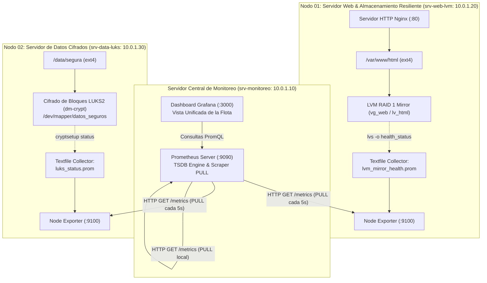

# Arquitectura de Monitoreo Centralizado Multi-Nodo: Prometheus Central, Grafana, LVM RAID 1 y Cifrado LUKS2

En la administración de infraestructuras corporativas modernas, los servidores no se monitorean de forma aislada. Una organización típica opera decenas o cientos de máquinas virtuales e instancias cloud especializadas: servidores web, clústeres de bases de datos, pasarelas de pago y almacenamiento cifrado.

Monitorear cada servidor iniciando sesión por SSH o consultando paneles locales es inviable. El estándar de la industria consiste en desplegar una **arquitectura de observabilidad centralizada**:
1. Un **Servidor Central de Monitoreo** ejecuta **Prometheus** (como motor de recolección PULL y base de datos de series temporales) y **Grafana** (como capa unificada de visualización y tableros de control).
2. Los **Nodos Productivos (Workers)** ejecutan únicamente un agente ultraliviano (**Node Exporter**), sin bases de datos locales ni interfaces gráficas.
3. Mediante el patrón **Textfile Collector**, los nodos productivos extraen telemetría de bajo nivel del kernel de Linux (como la salud de un arreglo **LVM RAID 1** o el estado de un contenedor **LUKS2**) y la convierten en métricas cuantitativas estándar de Prometheus.

---

## 1. Resumen Ejecutivo en 60 Segundos

```bash
# 1. Ejecutar la simulación completa multi-nodo en local (Ubuntu / WSL2):
sudo ./linux/administrator/monitoreo/demo_monitoreo_centralizado.sh

# 2. Desplegar el cluster real en AWS con 3 instancias EC2 y volúmenes EBS:
cd linux/administrator/monitoreo/centralizado_terraform
terraform init && terraform apply -auto-approve

# 3. Limpiar el entorno local:
sudo ./linux/administrator/monitoreo/limpiar_monitoreo_centralizado.sh
```

---

## 2. Arquitectura de la Solución Multi-Nodo



---

## 3. Fundamentos del Paradigma PULL Centralizado

### ¿Por qué PULL Centralizado y no Agentes PUSH?

| Criterio Operativo | Modelo Centralizado PULL (Prometheus) | Modelo Clásico PUSH (Agentes hacia Colector) |
| :--- | :--- | :--- |
| **Detección de Caídas** | **Instantánea:** Si el scrape HTTP da timeout o rechaza conexión, Prometheus marca `up == 0` inmediatamente. | **Tardía o Ambigua:** Si el colector deja de recibir datos, no sabe si el nodo colapsó o si simplemente no hubo tráfico. |
| **Control de Red** | **Estricto:** El servidor central impone el intervalo de scrape (`scrape_interval: 5s`). Evita tormentas de paquetes. | **Impredecible:** Picos de carga en clientes pueden saturar el recolector central. |
| **Complejidad del Nodo** | **Mínima:** El worker solo corre un binario estático de Node Exporter (<15 MB RAM) sin estado. | **Elevada:** El worker debe gestionar buffers locales, reintentos de red y credenciales de autenticación hacia la nube. |
| **Seguridad de Red** | El puerto `:9100` solo se abre hacia la IP interna del servidor de monitoreo mediante firewall o Security Group. | Los nodos requieren salida HTTPS hacia Internet o hacia la DMZ central. |

---

## 4. El Patrón Textfile Collector: Supervisión del Kernel sin Exporters Complejos

Node Exporter recolecta nativamente métricas del sistema operativo (CPU, RAM, red, I/O de disco). Sin embargo, muchos subsistemas especializados del kernel —como el estado de redundancia de un espejo **LVM RAID 1** o el estado de un contenedor **LUKS2**— no cuentan con un exporter dedicado independiente.

El mecanismo estándar para resolver esto es el flag `--collector.textfile.directory`:
1. Un script liviano o cronjob ejecuta comandos nativos (`lvs`, `cryptsetup status`).
2. Escribe un archivo atómico con extensión `.prom` en el directorio configurado.
3. Node Exporter lee automáticamente ese archivo y lo incluye en la siguiente respuesta HTTP a `/metrics`.

### Formato Estándar de una Métrica `.prom`:

```text
# HELP node_lvm_mirror_health Estado de salud del arreglo espejado LVM RAID 1 (1=Sano, 0=Degradado)
# TYPE node_lvm_mirror_health gauge
node_lvm_mirror_health{vg="vg_web",lv="lv_html"} 1
```

---

## 5. Implementación Paso a Paso

### Paso 1: Configurar el Nodo 01 (Worker Web sobre LVM RAID 1)

En el Servidor 1 (`srv-web-lvm` / `10.0.1.20`):

```bash
# 1. Instalar paquetes necesarios vía APT (rápido y nativo):
sudo apt-get update -qq
sudo apt-get install -y -qq lvm2 prometheus-node-exporter nginx

# 2. Crear el almacenamiento espejado LVM RAID 1:
# (Utilizando dos discos físicos /dev/nvme1n1 y /dev/nvme2n1, o loop devices)
sudo pvcreate /dev/sdb /dev/sdc
sudo vgcreate vg_web /dev/sdb /dev/sdc
sudo lvcreate --type raid1 -m 1 -L 10G -n lv_html vg_web

# 3. Formatear y montar en la raíz web:
sudo mkfs.ext4 /dev/vg_web/lv_html
sudo mount /dev/vg_web/lv_html /var/www/html

# 4. Crear el recolector textfile para la salud del espejo LVM:
sudo mkdir -p /var/lib/prometheus/node-exporter
cat << 'EOF' | sudo tee /usr/local/bin/check_lvm_health.sh
#!/bin/bash
HEALTH=$(lvs --noheadings -o health_status vg_web/lv_html 2>/dev/null | tr -d ' ')
VAL=1
if [ "$HEALTH" != "" ]; then
    VAL=0
fi
echo "# HELP node_lvm_mirror_health Salud de LVM RAID 1 (1=Sano, 0=Degradado)" > /var/lib/prometheus/node-exporter/lvm_health.prom.tmp
echo "# TYPE node_lvm_mirror_health gauge" >> /var/lib/prometheus/node-exporter/lvm_health.prom.tmp
echo "node_lvm_mirror_health{vg=\"vg_web\",lv=\"lv_html\"} ${VAL}" >> /var/lib/prometheus/node-exporter/lvm_health.prom.tmp
mv /var/lib/prometheus/node-exporter/lvm_health.prom.tmp /var/lib/prometheus/node-exporter/lvm_health.prom
EOF
sudo chmod +x /usr/local/bin/check_lvm_health.sh
sudo /usr/local/bin/check_lvm_health.sh

# 5. Habilitar y arrancar servicios:
sudo systemctl enable --now prometheus-node-exporter
sudo systemctl enable --now nginx
```

---

### Paso 2: Configurar el Nodo 02 (Worker de Datos Cifrados LUKS2)

En el Servidor 2 (`srv-data-luks` / `10.0.1.30`):

```bash
# 1. Instalar paquetes necesarios:
sudo apt-get update -qq
sudo apt-get install -y -qq cryptsetup prometheus-node-exporter

# 2. Formatear el disco con LUKS2 y abrir el contenedor:
sudo cryptsetup luksFormat --type luks2 /dev/sdb
sudo cryptsetup open /dev/sdb datos_seguros

# 3. Formatear ext4 y montar en el directorio protegido:
sudo mkfs.ext4 /dev/mapper/datos_seguros
sudo mkdir -p /data/segura
sudo mount /dev/mapper/datos_seguros /data/segura

# 4. Crear el recolector textfile para el estado del contenedor LUKS:
sudo mkdir -p /var/lib/prometheus/node-exporter
cat << 'EOF' | sudo tee /usr/local/bin/check_luks_status.sh
#!/bin/bash
VAL=0
if cryptsetup status datos_seguros 2>/dev/null | grep -q "is active"; then
    VAL=1
fi
echo "# HELP node_luks_container_active Estado del contenedor LUKS (1=Abierto, 0=Cerrado)" > /var/lib/prometheus/node-exporter/luks_status.prom.tmp
echo "# TYPE node_luks_container_active gauge" >> /var/lib/prometheus/node-exporter/luks_status.prom.tmp
echo "node_luks_container_active{device=\"datos_seguros\"} ${VAL}" >> /var/lib/prometheus/node-exporter/luks_status.prom.tmp
mv /var/lib/prometheus/node-exporter/luks_status.prom.tmp /var/lib/prometheus/node-exporter/luks_status.prom
EOF
sudo chmod +x /usr/local/bin/check_luks_status.sh
sudo /usr/local/bin/check_luks_status.sh

# 5. Habilitar Node Exporter:
sudo systemctl enable --now prometheus-node-exporter
```

---

### Paso 3: Configurar el Servidor Central (Prometheus + Grafana)

En el Servidor Central (`srv-monitoreo` / `10.0.1.10`):

```bash
# 1. Instalar Prometheus y Grafana vía APT:
sudo apt-get update -qq
sudo apt-get install -y -qq prometheus grafana curl jq

# 2. Configurar el archivo central /etc/prometheus/prometheus.yml:
cat << 'EOF' | sudo tee /etc/prometheus/prometheus.yml
global:
  scrape_interval: 5s
  evaluation_interval: 5s

scrape_jobs:
  - job_name: 'srv-monitoreo-central'
    static_configs:
      - targets: ['localhost:9090']

  - job_name: 'srv-web-lvm'
    static_configs:
      - targets: ['10.0.1.20:9100']
        labels:
          role: 'web-production'
          storage: 'lvm-raid1'

  - job_name: 'srv-data-luks'
    static_configs:
      - targets: ['10.0.1.30:9100']
        labels:
          role: 'secure-database'
          storage: 'luks2-encrypted'
EOF

# 3. Reiniciar y habilitar servicios:
sudo systemctl restart prometheus
sudo systemctl enable --now prometheus
sudo systemctl enable --now grafana-server
```

---

## 6. Consultas PromQL Clave en el Servidor Central

Al ingresar a la interfaz web de Prometheus (`http://<IP_CENTRAL>:9090`) o configurar alertas en Grafana, utilizá estas consultas esenciales:

| Objetivo de Monitoreo | Expresión PromQL | Interpretación Operativa |
| :--- | :--- | :--- |
| **Disponibilidad de la Flota** | `up` | Devuelve `1` si el nodo responde al scrape HTTP y `0` si cayó o no hay red. |
| **Alarma de Falla en RAID 1** | `node_lvm_mirror_health == 0` | Se dispara si algún disco del arreglo espejado LVM se dañó o degradó. |
| **Alarma de Contenedor Cifrado** | `node_luks_container_active == 0` | Se dispara si el volumen LUKS fue desmontado o bloqueado. |
| **Uso de CPU por Instancia** | `100 - (avg by (instance) (rate(node_cpu_seconds_total{mode="idle"}[1m])) * 100)` | Porcentaje de CPU consumida en cada nodo de la flota. |
| **Memoria RAM Libre en MB** | `node_memory_MemAvailable_bytes / 1024 / 1024` | Megabytes de memoria inmediatamente disponible en cada host. |
| **Espacio Libre en Filesystems** | `node_filesystem_avail_bytes{mountpoint=~"/var/www/.*|/data/.*"} / 1024 / 1024` | Monitorea la capacidad en MB de los puntos de montaje de producción. |

---

## 7. Simulación de Falla en Vivo y Recuperación

### 1. Inyección de Falla de Disco en Nodo 1 (Web):
```bash
# Sobrescribir sectores del disco 1 con ceros:
sudo dd if=/dev/zero of=/dev/sdb bs=1M count=10 conv=notrunc

# El servicio web continúa atendiendo peticiones (Zero Downtime):
curl -sI http://10.0.1.20/

# Prometheus en el servidor central detecta la falla:
curl -s 'http://localhost:9090/api/v1/query?query=node_lvm_mirror_health==0'
```

### 2. Recuperación en Caliente:
```bash
# Insertar disco de reemplazo y reparar:
sudo vgextend vg_web /dev/sdd
sudo lvconvert -y --repair vg_web/lv_html
sudo vgreduce -y --removemissing --force vg_web

# La métrica retorna automáticamente a 1 (Verde).
```

---

## 8. Despliegue en AWS con Terraform

La carpeta [`centralizado_terraform/`](centralizado_terraform/) contiene la infraestructura como código completa para levantar los 3 servidores en AWS (VPC, subredes, grupos de seguridad, llaves SSH y volúmenes EBS gp3):

```bash
cd linux/administrator/monitoreo/centralizado_terraform

# 1. Inicializar providers:
terraform init

# 2. Desplegar el cluster de 3 instancias:
terraform apply -auto-approve

# 3. Conectarse a cada servidor usando la clave SSH generada:
ssh -i id_ed25519 -o StrictHostKeyChecking=no ubuntu@<IP_SRV_CENTRAL>
ssh -i id_ed25519 -o StrictHostKeyChecking=no ubuntu@<IP_SRV_WEB_LVM>
ssh -i id_ed25519 -o StrictHostKeyChecking=no ubuntu@<IP_SRV_DATA_LUKS>
```

Al terminar la demostración:
```bash
terraform destroy -auto-approve
```

---

## 9. Enlaces Oficiales de Documentación y Referencia

* **Prometheus Official Documentation:** [prometheus.io/docs](https://prometheus.io/docs/introduction/overview/)
* **Prometheus Configuration Specification (`prometheus.yml`):** [prometheus.io/docs/prometheus/latest/configuration/configuration/](https://prometheus.io/docs/prometheus/latest/configuration/configuration/)
* **Node Exporter Upstream Repository:** [github.com/prometheus/node_exporter](https://github.com/prometheus/node_exporter)
* **Textfile Collector Guide:** [github.com/prometheus/node_exporter#textfile-collector](https://github.com/prometheus/node_exporter#textfile-collector)
* **Grafana Documentation & Dashboards:** [grafana.com/docs/grafana/latest/](https://grafana.com/docs/grafana/latest/)
* **Cryptsetup & LUKS2 Specifications:** [gitlab.com/cryptsetup/cryptsetup](https://gitlab.com/cryptsetup/cryptsetup)
* **LVM2 RAID Reference (Kernel Device-Mapper):** [docs.kernel.org/admin-guide/device-mapper/dm-raid.html](https://docs.kernel.org/admin-guide/device-mapper/dm-raid.html)

---

## 10. Glosario Técnico

* **Multi-Target Scrape:** Capacidad del servidor Prometheus de gestionar docenas de endpoints HTTP independientes agrupados por trabajos (*jobs*) y etiquetas (*labels*).
* **Textfile Collector:** Mecanismo de Node Exporter que ingiere archivos `.prom` generados en disco local por scripts del sistema, extendiendo la telemetría sin crear demonios adicionales.
* **Instance Label:** Etiqueta estándar generada por Prometheus (`instance="host:puerto"`) que permite discriminar métricas idénticas provenientes de distintos servidores físicos o virtuales.
* **Service Discovery (SD):** Mecanismo dinámico mediante el cual Prometheus descubre automáticamente nuevos servidores para monitorear interrogando APIs de nube (AWS EC2 SD, Kubernetes, Consul).
* **PromQL (Prometheus Query Language):** Lenguaje declarativo de consulta que permite filtrar, agregar y calcular tasas de cambio (`rate`, `increase`, `sum`) sobre series temporales.
