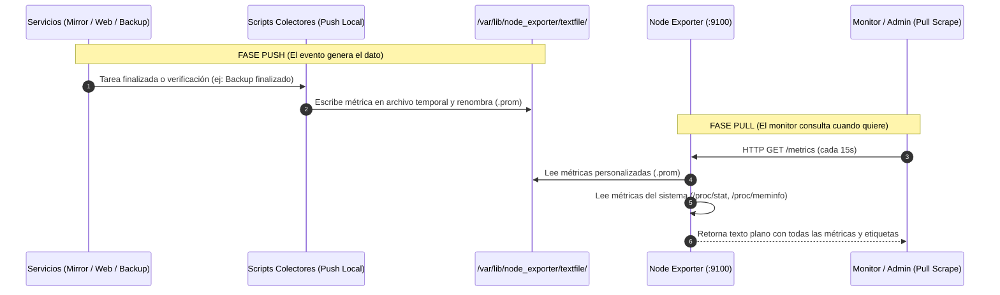

# Laboratorio: Monitoreo y Métricas en Linux (De Cero a Producción)

Este laboratorio está diseñado para enseñar los fundamentos de **métricas y monitoreo continuo en servidores Linux** para estudiantes y administradores que recién comienzan. 

Aprenderás a pasar de herramientas puntuales de terminal (`vmstat`, `iostat`, `sar`) a un **sistema de monitoreo continuo, liviano y estandarizado**, entendiendo qué se monitorea en la vida real, cómo se interpretan los números y cómo conectar alertas de estado en tus proyectos de almacenamiento, servicios web y copias de seguridad.

---

## 🏗️ Arquitectura de la Solución

```
+---------------------------------------------------------------------------------------------------+
|                                  SERVIDOR LINUX (HOST MONITOREADO)                                |
|                                                                                                   |
|  [ SERVICIOS DEL LAB ]                                                                            |
|   ├── Almacenamiento: LVM RAID 1 (Espejo de Datos) ────────────────────────┐                      |
|   ├── Servidor Web:   Nginx / Docker (Tráfico HTTP) ────────────────────┐  │                      |
|   ├── Conectividad:   Sesiones SSH Activas ──────────────────────────┐  │  │                      |
|   └── Tareas Batch:   Backup Diario (Script / Systemd Timer) ─────┐  │  │  │                      |
|                                                                   │  │  │  │                      |
|  [ MODELO PUSH LOCAL ]                                            ▼  ▼  ▼  ▼                      |
|   Scripts Colectores Periódicos / Triggers (Bash/Cron) ───►  Escriben archivos atómicos:          |
|                                                              /var/lib/node_exporter/textfile/     |
|                                                                ├── mirror_health.prom             |
|                                                                ├── web_sessions.prom              |
|                                                                └── backup_status.prom             |
|                                                                      │                            |
|  [ AGENTE LIVIANO ]                                                  │                            |
|   Node Exporter (Prometheus)  ◄──────────────────────────────────────┘                            |
|   (Binario Go único, ~15MB RAM, sin bases de datos pesadas)                                       |
|      │                                                                                            |
|      │  Expone métricas del Kernel (/proc, /sys) + Archivos Textfile                              |
|      ▼                                                                                            |
|   Puerto TCP :9100 /metrics  (Formato Abierto OpenMetrics)                                        |
+──────▲────────────────────────────────────────────────────────────────────────────────────────────+
       │
       │  [ MODELO PULL ]
       │  Petición HTTP GET periódica ("¿Cuáles son tus números actuales?")
       │
+──────┴────────────────────────────────────────────────────────────────────────────────────────────+
|                                    CONSUMIDOR DE MÉTRICAS                                         |
|                                                                                                   |
|   * En este Lab:        curl + grep / Script Watch Terminal (Mini-Dashboard instantáneo)          |
|   * En Producción:      Servidor Prometheus / VictoriaMetrics / Grafana Dashboard                 |
+---------------------------------------------------------------------------------------------------+
```

### Diagrama de Secuencia: Flujo Push vs Pull



---

## ⏱️ Guía Rápida Paso a Paso (Punta a Punta en 10 Minutos)

Si querés ejecutar el laboratorio completo directamente sin navegar la teoría extensa, seguí estos pasos secuenciales:

### Paso 1: Instalar y levantar Node Exporter
```bash
# 1. Crear el directorio obligatorio del Textfile Collector
sudo mkdir -p /var/lib/node_exporter/textfile_collector
sudo chmod 775 /var/lib/node_exporter/textfile_collector

# 2. Instalar el servicio:
# En Debian / Ubuntu:
if command -v apt-get &>/dev/null; then
    sudo apt update && sudo apt install -y prometheus-node-exporter
    echo 'ARGS="--collector.textfile.directory=/var/lib/node_exporter/textfile_collector"' | sudo tee /etc/default/prometheus-node-exporter
    sudo systemctl restart prometheus-node-exporter
    sudo systemctl enable prometheus-node-exporter
else
    # En RHEL / Rocky Linux / Arch / WSL (binario Go oficial <15MB):
    VER="1.8.2"
    curl -sL "https://github.com/prometheus/node_exporter/releases/download/v${VER}/node_exporter-${VER}.linux-amd64.tar.gz" | tar -xz -C /tmp/
    sudo cp /tmp/node_exporter-${VER}.linux-amd64/node_exporter /usr/local/bin/
    sudo /usr/local/bin/node_exporter --collector.textfile.directory=/var/lib/node_exporter/textfile_collector --web.listen-address=":9100" &>/tmp/node_exporter.log &
fi

# 3. Comprobar que expone métricas en el puerto 9100
curl -s http://localhost:9100/metrics | head -n 5
```

### Paso 2: Crear el Colector de Almacenamiento (Espejo LVM RAID 1)
```bash
sudo tee /usr/local/bin/colector_mirror.sh << 'EOF'
#!/usr/bin/env bash
OUTPUT_FILE="/var/lib/node_exporter/textfile_collector/storage_mirror.prom"
HEALTH=1
if lvs --noheadings -o health_status vg_mysql/lv_mysql 2>/dev/null | grep -q -i "partial\|fail"; then
    HEALTH=0
fi
echo "lvm_mirror_health{vg=\"vg_mysql\",lv=\"lv_mysql\"} $HEALTH" > "${OUTPUT_FILE}.$$"
mv "${OUTPUT_FILE}.$$" "$OUTPUT_FILE"
EOF

sudo chmod +x /usr/local/bin/colector_mirror.sh
sudo /usr/local/bin/colector_mirror.sh

# Verificar métrica publicada:
curl -s http://localhost:9100/metrics | grep lvm_mirror_health
```

### Paso 3: Crear el Colector de Tráfico Web y Sesiones SSH
```bash
sudo tee /usr/local/bin/colector_sistema_lab.sh << 'EOF'
#!/usr/bin/env bash
OUTPUT_FILE="/var/lib/node_exporter/textfile_collector/sistema_lab.prom"
SSH_CONEXIONES=$(ss -tn state established '( dport = :22 or sport = :22 )' | grep -v Recv-Q | wc -l)
CONEXIONES_HTTP=$(ss -tn state established '( dport = :80 or sport = :80 )' | grep -v Recv-Q | wc -l)
cat <<METRICS > "${OUTPUT_FILE}.$$"
# HELP server_active_ssh_sessions Conexiones SSH activas en este momento
# TYPE server_active_ssh_sessions gauge
server_active_ssh_sessions $SSH_CONEXIONES
# HELP http_active_connections Conexiones HTTP concurrentes en puerto 80
# TYPE http_active_connections gauge
http_active_connections $CONEXIONES_HTTP
METRICS
mv "${OUTPUT_FILE}.$$" "$OUTPUT_FILE"
EOF

sudo chmod +x /usr/local/bin/colector_sistema_lab.sh
sudo /usr/local/bin/colector_sistema_lab.sh

# Verificar métricas publicadas:
curl -s http://localhost:9100/metrics | grep server_active_ssh_sessions
```

### Paso 4: Crear la Tarea de Respaldo con Emisión PUSH
```bash
sudo tee /usr/local/bin/backup_simulado.sh << 'EOF'
#!/usr/bin/env bash
METRICS_FILE="/var/lib/node_exporter/textfile_collector/backup_status.prom"
TARGET_DIR="/var/backups/lab"
sudo mkdir -p "$TARGET_DIR"
INICIO=$(date +%s)
DESTINO="$TARGET_DIR/backup_data_$(date +%Y%m%d_%H%M%S).tar.gz"

if tar -czf "$DESTINO" /etc 2>/dev/null; then
    EXIT_STATUS=1
    TAMANO_BYTES=$(stat -c%s "$DESTINO" 2>/dev/null || echo 0)
else
    EXIT_STATUS=0
    TAMANO_BYTES=0
fi
FIN=$(date +%s)
DURACION=$(( FIN - INICIO ))

cat <<METRICS > "${METRICS_FILE}.$$"
# HELP backup_last_run_timestamp_seconds Fecha unix del ultimo backup
# TYPE backup_last_run_timestamp_seconds gauge
backup_last_run_timestamp_seconds{job="sistema_etc"} $FIN
# HELP backup_last_status Resultado del ultimo backup (1=OK, 0=Error)
# TYPE backup_last_status gauge
backup_last_status{job="sistema_etc"} $EXIT_STATUS
# HELP backup_last_size_bytes Tamano en bytes del backup
# TYPE backup_last_size_bytes gauge
backup_last_size_bytes{job="sistema_etc"} $TAMANO_BYTES
# HELP backup_duration_seconds Duracion en segundos
# TYPE backup_duration_seconds gauge
backup_duration_seconds{job="sistema_etc"} $DURACION
METRICS
mv "${METRICS_FILE}.$$" "$METRICS_FILE"
EOF

sudo chmod +x /usr/local/bin/backup_simulado.sh
sudo /usr/local/bin/backup_simulado.sh

# Verificar métricas de backup:
curl -s http://localhost:9100/metrics | grep backup_last
```

### Paso 5: Automatización con Systemd Timers (cada 10 segundos)
```bash
# 1. Crear servicio one-shot
sudo tee /etc/systemd/system/lab-metrics.service << 'EOF'
[Unit]
Description=Generador de Metricas Custom para Node Exporter
After=network.target

[Service]
Type=oneshot
ExecStart=/bin/bash -c "/usr/local/bin/colector_mirror.sh && /usr/local/bin/colector_sistema_lab.sh"
EOF

# 2. Crear timer recurrente
sudo tee /etc/systemd/system/lab-metrics.timer << 'EOF'
[Unit]
Description=Ejecutar colector de metricas cada 10 segundos

[Timer]
OnBootSec=10s
OnUnitActiveSec=10s
AccuracySec=1s

[Install]
WantedBy=timers.target
EOF

# 3. Habilitar e iniciar
sudo systemctl daemon-reload
sudo systemctl enable --now lab-metrics.timer
sudo systemctl list-timers | grep lab-metrics
```

### Paso 6: Visualizar las Métricas en Vivo y Simular Fallas
```bash
# Monitoreo continuo en terminal (ejecutar en una ventana):
watch -n 1 -d 'curl -s http://localhost:9100/metrics | grep -E "(lvm_mirror_health|server_active_ssh_sessions|backup_last_status|backup_last_size_bytes)" | grep -v "^#"'
```

### Paso 7: Limpieza del Entorno al Finalizar
Cuando desees desmantelar el laboratorio, detener Node Exporter, deshabilitar los timers de systemd y purgar los scripts colectores y métricas generadas, ejecutá el script de limpieza automatizado:
```bash
sudo ./linux/administrator/monitoreo/limpiar_monitoreo.sh
```

> 💡 **Opción automatizada para clases:** También podés ejecutar todo de forma interactiva con el script del repositorio: `sudo ./linux/administrator/monitoreo/demo_monitoreo.sh`

---

## 🎯 Objetivos de Aprendizaje (Laboratorio de 1 Hora)

1. **Diferencia entre Diagnóstico Puntual vs Monitoreo Continuo:** Comprender por qué `vmstat`, `iostat` y `sar` son excelentes para una emergencia en vivo, pero insuficientes para saber si el disco falló a las 3:00 AM.
2. **Concepto de Métrica:** Aprender qué es un *Gauge*, un *Counter* y un estado *Booleano*.
3. **El Gran Dilema Arquitectónico: PULL vs PUSH:** Entender cómo funciona cada modelo, ventajas, desventajas y por qué el estándar de la industria combina ambos con el **Textfile Collector**.
4. **Despliegue de Node Exporter:** Instalar y correr un exportador de métricas liviano (< 15 MB de memoria RAM) en 2 minutos.
5. **Monitoreo Práctico de Componentes Clave:**
   - **Salud de Almacenamiento:** Estado del espejo RAID 1 / LVM (`1` = Saludable, `0` = Degradado).
   - **Tráfico Entrante:** Contador acumulativo de peticiones HTTP.
   - **Sesiones Activas:** Conexiones SSH abiertas en el servidor.
   - **Ciclo de Vida de Respaldos (Backups):** Timestamp de última ejecución, código de salida (`0` = OK, `1` = Error), duración en segundos y tamaño del archivo en bytes.
6. **Paso Extra Integrable:** Un bloque listo para copiar y pegar en tus laboratorios de LVM, Docker o Btrfs para observar métricas en tiempo real mientras simulas fallos.

---

## 🧠 Marco Teórico Esencial (Para Principiantes)

### 1. ¿Qué es una métrica?

Una métrica es una **medición numérica del estado o comportamiento de un sistema capturada a lo largo del tiempo**.

En los sistemas modernos (estándar Prometheus / OpenMetrics), existen 3 tipos fundamentales:

| Tipo | Comportamiento | Ejemplo Real | ¿Para qué sirve? |
| :--- | :--- | :--- | :--- |
| **Gauge** (Indicador) | Valor que puede subir y bajar arbitrariamente en cualquier momento. | Uso de RAM, temperatura, sesiones SSH activas (`active_ssh_sessions`). | Saber cuántos recursos o conexiones hay ocupados en este instante. |
| **Counter** (Contador) | Valor numérico acumulativo que **solo sube** (o se reinicia a 0 si el servicio reinicia). | Peticiones HTTP totales (`http_requests_total`), errores de red. | Calcular tasas por segundo (¿cuántos requests/segundo estamos recibiendo?). |
| **State / Boolean** | Valor binario (`1` o `0`). | Salud del espejo LVM (`mirror_healthy`), estado del backup (`backup_last_status`). | Disparar alertas inmediatas cuando pasa de 1 a 0 (ej: disco caído, backup fallido). |

---

### 2. Anatomía de una Métrica en Formato Estándar

El formato de métricas más extendido del mundo (Prometheus) es texto plano legible por humanos:

```
# HELP lvm_mirror_health Estado de salud del arreglo espejado (1=OK, 0=Degradado)
# TYPE lvm_mirror_health gauge
lvm_mirror_health{vg="vg_mysql",lv="lv_mysql"} 1

# HELP backup_last_run_timestamp_seconds Fecha unix del ultimo backup
# TYPE backup_last_run_timestamp_seconds gauge
backup_last_run_timestamp_seconds{target="s3_wordpress"} 1729161200

# HELP http_requests_total Total acumulado de peticiones recibidas
# TYPE http_requests_total counter
http_requests_total{service="wordpress",status="200"} 452
```

- **Nombre de la métrica:** Indica claramente qué se mide (`http_requests_total`).
- **Etiquetas (*Labels*) `{clave="valor"}`:** Permiten filtrar y agrupar sin inventar nombres nuevos. Permiten distinguir entre el disco A y el disco B, o entre el servicio web y la base de datos.
- **Valor numérico:** Siempre es un número (entero o flotante). Nunca texto. Si necesitas representar "conectado" o "desconectado", usas `1` y `0`.

---

### 3. Modelo PUSH vs Modelo PULL

| Criterio | Modelo PULL (Prometheus, Node Exporter) | Modelo PUSH (StatsD, Pushgateway, Zabbix Trapper) |
| :--- | :--- | :--- |
| **¿Quién inicia la conexión?** | El **servidor de monitoreo central** se conecta al cliente y "raspa" (*scrape*) las métricas vía HTTP GET. | El **cliente o tarea** envía activamente los datos hacia un colector central. |
| **Detección de Caídas** | **Inmediata**: Si el cliente no responde al HTTP GET, se sabe que el host se apagó o la red cayó. | **Dudosa**: Si no llega nada, no se sabe si el sistema no tuvo actividad o si se murió. |
| **Ideal para...** | Servidores continuos, demonios, contenedores, bases de datos, APIs. | Tareas batch o efímeras (scripts de backup, cron jobs de 10 segundos, funciones serverless). |
| **La Solución Híbrida Ideal** | **Node Exporter + Textfile Collector**: El demonio corre como PULL para el mundo exterior, pero los scripts locales (como un backup) hacen PUSH escribiendo en un archivo local. |

---

## 🚀 Fase 1: Entendiendo la Métrica "Artesanal" (5 minutos)

Antes de instalar cualquier software, veamos cómo se generan las métricas directamente desde el sistema operativo con comandos que ya conoces.

### 1. Extraer datos del sistema con Bash

Crea un script elemental llamado `/tmp/metricas_artesanales.sh`:

```bash
cat <<'EOF' > /tmp/metricas_artesanales.sh
#!/bin/bash
# 1. Sesiones SSH activas
SESIONES_SSH=$(who | wc -l)

# 2. Porcentaje de uso del disco raíz
USO_DISCO=$(df -h / | awk 'NR==2 {gsub("%",""); print $5}')

# 3. Carga promedio de CPU (último minuto)
LOAD_1M=$(awk '{print $1}' /proc/loadavg)

# Imprimir en formato clave=valor
echo "timestamp=$(date +%s)"
echo "active_ssh_sessions=$SESIONES_SSH"
echo "disk_root_used_percent=$USO_DISCO"
echo "cpu_load_1m=$LOAD_1M"
EOF

chmod +x /tmp/metricas_artesanales.sh
/tmp/metricas_artesanales.sh
```

**Salida de ejemplo:**
```text
timestamp=1729161400
active_ssh_sessions=2
disk_root_used_percent=38
cpu_load_1m=0.15
```

> [!NOTE]
> Toda herramienta de monitoreo profesional (desde Zabbix hasta Datadog o Prometheus) hace exactamente esto por debajo: lee interfaces del kernel como `/proc`, `/sys` o ejecuta comandos del sistema operativo, estructurando la salida en números.

---

## 📦 Fase 2: Despliegue de Node Exporter (El Estándar Liviano)

En lugar de inventar servidores web caseros en bash, la industria utiliza **Prometheus Node Exporter**:
- Es un único binario compilado en Go (sin dependencias de Python, Java o NodeJS).
- Consume **menos de 15 MB de RAM**.
- Expone cientos de métricas del kernel de Linux de forma segura por el puerto HTTP `9100`.

### 1. Descarga e Instalación

En Ubuntu / Debian puedes instalarlo directamente vía `apt` o descargando el binario oficial:

```bash
# Opción 1: Mediante apt (rápido y recomendado para la clase)
sudo apt update
sudo apt install -y prometheus-node-exporter
```

*(Si usas otra distro o prefieres el binario oficial directo):*
```bash
# Opción 2: Binario oficial estático
NODE_EXPORTER_VER="1.8.2"
wget -q https://github.com/prometheus/node_exporter/releases/download/v${NODE_EXPORTER_VER}/node_exporter-${NODE_EXPORTER_VER}.linux-amd64.tar.gz -O /tmp/node_exporter.tar.gz
tar -xzf /tmp/node_exporter.tar.gz -C /tmp/
sudo cp /tmp/node_exporter-${NODE_EXPORTER_VER}.linux-amd64/node_exporter /usr/local/bin/
```

### 2. Crear el Directorio del "Textfile Collector"

El **Textfile Collector** es la funcionalidad más poderosa de Node Exporter para principiantes y administradores de sistemas. Le dice a Node Exporter: *"Cualquier archivo `.prom` que esté en esta carpeta, leelo y exponelo en tu puerto HTTP"*.

```bash
# Crear directorio dedicado con permisos
sudo mkdir -p /var/lib/node_exporter/textfile_collector
sudo chmod 775 /var/lib/node_exporter/textfile_collector
```

### 3. Configurar Node Exporter para leer la carpeta Textfile

Si instalaste con `apt`, configuramos los flags en `/etc/default/prometheus-node-exporter`:

```bash
# Inyectar el argumento del textfile collector
echo 'ARGS="--collector.textfile.directory=/var/lib/node_exporter/textfile_collector"' | sudo tee /etc/default/prometheus-node-exporter

# Reiniciar y habilitar el servicio systemd
sudo systemctl restart prometheus-node-exporter
sudo systemctl enable prometheus-node-exporter
sudo systemctl status prometheus-node-exporter --no-pager
```

### 4. Consultar las Métricas Nativas con `curl` (Modelo PULL)

Simulemos que somos el servidor central de monitoreo haciendo una consulta PULL:

```bash
curl -s http://localhost:9100/metrics | head -n 30
```

Verás miles de líneas con métricas del procesador (`node_cpu_seconds_total`), memoria (`node_memory_MemAvailable_bytes`), red (`node_network_receive_bytes_total`), etc.

---

## 🛠️ Fase 3: Creación de Métricas Personalizadas del Mundo Real

Ahora monitorearemos lo que realmente le importa a un administrador de sistemas en producción:
1. **Salud del Espejo LVM RAID 1** (¿se rompió un disco?).
2. **Peticiones HTTP entrantes** (¿cuánto tráfico entra a mi web/WordPress?).
3. **Sesiones SSH activas** (¿cuántos usuarios están conectados por terminal?).
4. **Estado y tamaño del último Backup** (¿se ejecutó hoy? ¿cuántos bytes respaldó? ¿dio error?).

---

### Colector 1: Monitoreo de Espejos de Almacenamiento (LVM RAID 1 / Mirror)

En los laboratorios de almacenamiento empresarial creamos volúmenes espejados (`lv_mysql` o `lv_docker`). ¿Cómo sabe el equipo de monitoreo si una pata del espejo falló?

Creamos el script `/usr/local/bin/colector_mirror.sh`:

```bash
sudo tee /usr/local/bin/colector_mirror.sh << 'EOF'
#!/usr/bin/env bash
# Colector de salud de LVM RAID 1 / Mirror para Node Exporter
OUTPUT_FILE="/var/lib/node_exporter/textfile_collector/storage_mirror.prom"
TMP_FILE="${OUTPUT_FILE}.$$"

# Buscar volúmenes lógicos de tipo raid1 o mirror
# Si no hay ninguno creado aún, evaluamos estado 1 simulado o buscamos vg_mysql/lv_mysql
HEALTH=1

if lvs vg_mysql/lv_mysql &>/dev/null; then
    # Verificar si el atributo de salud de LVM reporta falla
    ATTR=$(lvs --noheadings -o lv_attr vg_mysql/lv_mysql | tr -d ' ')
    HEALTH_STATUS=$(lvs --noheadings -o health_status vg_mysql/lv_mysql | tr -d ' ')
    
    # En LVM, si el estado de salud no está vacío o tiene 'partial', el espejo está degradado
    if [ -n "$HEALTH_STATUS" ] || [[ "$ATTR" =~ ^....p ]]; then
        HEALTH=0
    else
        HEALTH=1
    fi
else
    # Modo de demostración si aún no está montado el lab de docker
    HEALTH=1
fi

# Escribir la métrica en formato Prometheus
cat <<METRICS > "$TMP_FILE"
# HELP lvm_mirror_health Salud del arreglo espejado (1 = OK/Saludable, 0 = Degradado/Falla)
# TYPE lvm_mirror_health gauge
lvm_mirror_health{vg="vg_mysql",lv="lv_mysql"} $HEALTH
METRICS

# Reemplazo atómico (evita que node_exporter lea un archivo a medio escribir)
mv "$TMP_FILE" "$OUTPUT_FILE"
EOF

sudo chmod +x /usr/local/bin/colector_mirror.sh
sudo /usr/local/bin/colector_mirror.sh
```

**Comprobar que Node Exporter ya la está publicando:**
```bash
curl -s http://localhost:9100/metrics | grep lvm_mirror_health
```
**Resultado esperado:**
```text
lvm_mirror_health{vg="vg_mysql",lv="lv_mysql"} 1
```

---

### Colector 2: Monitoreo de Tráfico HTTP y Sesiones Conectadas

¿Cuántos usuarios están conectados por SSH? ¿Cuántas peticiones han llegado al puerto HTTP (80)?

Creamos el script `/usr/local/bin/colector_sistema_lab.sh`:

```bash
sudo tee /usr/local/bin/colector_sistema_lab.sh << 'EOF'
#!/usr/bin/env bash
OUTPUT_FILE="/var/lib/node_exporter/textfile_collector/sistema_lab.prom"
TMP_FILE="${OUTPUT_FILE}.$$"

# 1. Contar sesiones SSH reales activas (usando ss para conexiones establecidas en puerto 22)
SSH_CONEXIONES=$(ss -tn state established '( dport = :22 or sport = :22 )' | grep -v Recv-Q | wc -l)

# 2. Contar peticiones HTTP si existe log de Nginx, Docker o Apache
# Si no hay log, leemos sockets en puerto 80
CONEXIONES_HTTP=$(ss -tn state established '( dport = :80 or sport = :80 )' | grep -v Recv-Q | wc -l)

# 3. Peticiones HTTP totales acumuladas (si existe access.log en /var/log/nginx o contenedor)
TOTAL_HTTP_REQUESTS=0
if [ -f /var/log/nginx/access.log ]; then
    TOTAL_HTTP_REQUESTS=$(wc -l < /var/log/nginx/access.log)
elif [ -f /opt/lab-app/access.log ]; then
    TOTAL_HTTP_REQUESTS=$(wc -l < /opt/lab-app/access.log)
fi

cat <<METRICS > "$TMP_FILE"
# HELP server_active_ssh_sessions Conexiones de terminal SSH activas en este momento
# TYPE server_active_ssh_sessions gauge
server_active_ssh_sessions $SSH_CONEXIONES

# HELP http_active_connections Conexiones HTTP concurrentes establecidas en puerto 80
# TYPE http_active_connections gauge
http_active_connections $CONEXIONES_HTTP

# HELP http_incoming_requests_total Total de peticiones HTTP registradas
# TYPE http_incoming_requests_total counter
http_incoming_requests_total $TOTAL_HTTP_REQUESTS
METRICS

mv "$TMP_FILE" "$OUTPUT_FILE"
EOF

sudo chmod +x /usr/local/bin/colector_sistema_lab.sh
sudo /usr/local/bin/colector_sistema_lab.sh
```

---

### Colector 3: Monitoreo de Tareas de Backup (El Modelo PUSH Real)

Los respaldos no se consultan con un sondeo continuo porque se ejecutan en momentos puntuales (ej: 02:00 AM). 

**La mejor práctica de la industria:** Al finalizar la tarea de backup, el script genera métricas con:
1. **Timestamp UNIX:** Permite saber cuántas horas han pasado desde el último backup exitoso.
2. **Código de salida (`exit_code`):** `1` si fue exitoso, `0` si falló o abortó.
3. **Tamaño del archivo en bytes:** Permite detectar anomalías (ej: si ayer pesaba 500 MB y hoy pesa 0 KB, algo salió mal).
4. **Duración en segundos:** Para saber si el backup se está degradando en tiempo.

Crea `/usr/local/bin/backup_simulado.sh`:

```bash
sudo tee /usr/local/bin/backup_simulado.sh << 'EOF'
#!/usr/bin/env bash
# Script de Respaldo Integrado con Emisión de Métricas PUSH para Node Exporter
METRICS_FILE="/var/lib/node_exporter/textfile_collector/backup_status.prom"
TMP_METRICS="${METRICS_FILE}.$$"

TARGET_DIR="/var/backups/lab"
sudo mkdir -p "$TARGET_DIR"

INICIO=$(date +%s)
NOMBRE_BACKUP="backup_data_$(date +%Y%m%d_%H%M%S).tar.gz"
DESTINO="$TARGET_DIR/$NOMBRE_BACKUP"

echo "[$(date '+%Y-%m-%d %H:%M:%S')] Iniciando tarea de backup..."

# Simular respaldo de directorios del sistema (/etc)
tar -czf "$DESTINO" /etc 2>/dev/null
RESULTADO=$?
FIN=$(date +%s)
DURACION=$(( FIN - INICIO ))

if [ $RESULTADO -eq 0 ]; then
    EXIT_STATUS=1  # 1 = Exitoso (OK)
    TAMANO_BYTES=$(stat -c%s "$DESTINO" 2>/dev/null || echo 0)
    echo "[OK] Backup completado exitosamente: $DESTINO ($TAMANO_BYTES bytes en ${DURACION}s)"
else
    EXIT_STATUS=0  # 0 = Falló
    TAMANO_BYTES=0
    echo "[ERROR] El proceso de backup terminó con error ($RESULTADO)"
fi

# PUSH LOCAL: Escribir métricas para Node Exporter
cat <<METRICS > "$TMP_METRICS"
# HELP backup_last_run_timestamp_seconds Fecha de finalizacion de la ultima ejecucion en epoch unix
# TYPE backup_last_run_timestamp_seconds gauge
backup_last_run_timestamp_seconds{job="sistema_etc"} $FIN

# HELP backup_last_status Resultado del ultimo backup (1 = Exitoso, 0 = Fallido)
# TYPE backup_last_status gauge
backup_last_status{job="sistema_etc"} $EXIT_STATUS

# HELP backup_last_size_bytes Tamano en bytes del ultimo archivo de backup generado
# TYPE backup_last_size_bytes gauge
backup_last_size_bytes{job="sistema_etc"} $TAMANO_BYTES

# HELP backup_duration_seconds Tiempo total en segundos que tardo la operacion
# TYPE backup_duration_seconds gauge
backup_duration_seconds{job="sistema_etc"} $DURACION
METRICS

mv "$TMP_METRICS" "$METRICS_FILE"
EOF

sudo chmod +x /usr/local/bin/backup_simulado.sh
sudo /usr/local/bin/backup_simulado.sh
```

---

## ⚡ Fase 4: Automatización con Systemd Timers (Cada 15 segundos)

Para que los scripts de almacenamiento y sesiones se actualicen continuamente sin intervención humana, usamos un Timer de Systemd liviano:

### 1. Crear el Servicio One-Shot

```bash
sudo tee /etc/systemd/system/lab-metrics.service << 'EOF'
[Unit]
Description=Generador de Metricas Custom para Node Exporter
After=network.target

[Service]
Type=oneshot
ExecStart=/bin/bash -c "/usr/local/bin/colector_mirror.sh && /usr/local/bin/colector_sistema_lab.sh"
EOF
```

### 2. Crear el Timer Repetitivo (Cada 10 segundos)

```bash
sudo tee /etc/systemd/system/lab-metrics.timer << 'EOF'
[Unit]
Description=Ejecutar colector de metricas cada 10 segundos

[Timer]
OnBootSec=10s
OnUnitActiveSec=10s
AccuracySec=1s

[Install]
WantedBy=timers.target
EOF
```

### 3. Activar el Timer

```bash
sudo systemctl daemon-reload
sudo systemctl enable --now lab-metrics.timer
sudo systemctl list-timers | grep lab-metrics
```

---

## 📊 Fase 5: Mini-Dashboard en Terminal y Pruebas en Vivo

Para observar la reacción inmediata de las métricas sin necesidad de instalar Grafana en una clase de 1 hora, utilizaremos un visualizador en vivo con el comando `watch`.

Abre una segunda terminal o ejecuta:

```bash
watch -n 1 -d 'curl -s http://localhost:9100/metrics | grep -E "(lvm_mirror_health|server_active_ssh_sessions|http_incoming_requests_total|backup_last_status|backup_last_size_bytes)" | grep -v "^#"'
```

### 🧪 Experimentos para ver las métricas cambiar en vivo:

#### Experimento A: Variar las Sesiones SSH
1. Abre una nueva ventana de terminal y conéctate por SSH al servidor.
2. Observa cómo `server_active_ssh_sessions` sube inmediatamente.
3. Cierra la sesión (`exit`) y observa cómo baja nuevamente.

#### Experimento B: Inyectar Tráfico Web
Envía ráfagas de peticiones HTTP:
```bash
for i in {1..25}; do curl -s http://localhost > /dev/null; done
```
Observa el incremento en el contador de peticiones.

#### Experimento C: Simular Falla del Mirror
Si estás en el laboratorio de Docker o Storage con LVM RAID 1:
```bash
# Simular fallo en pata 0
DM_PATA0=$(sudo dmsetup ls | grep "vg_mysql-lv_mysql_rimage_0" | awk '{print $1}')
sudo dmsetup suspend $DM_PATA0
sudo dmsetup load $DM_PATA0 --table "0 $(sudo blockdev --getsz /dev/mapper/$DM_PATA0) error"
sudo dmsetup resume $DM_PATA0

# Forzar lectura/escritura para que el kernel detecte el fallo
sudo dd if=/dev/vg_mysql/lv_mysql of=/dev/null bs=4k count=10 2>/dev/null
```
¡En menos de 10 segundos verás que `lvm_mirror_health` pasa de `1` a `0`!

#### Experimento D: Simular Falla de Backup
Provoca intencionalmente un error en el script de backup:
```bash
# Cambiar la ruta destino a un directorio de solo lectura o inexistente
sudo sed -i 's|tar -czf "$DESTINO" /etc|tar -czf "/directorio_inexistente/backup.tar.gz" /etc|g' /usr/local/bin/backup_simulado.sh
sudo /usr/local/bin/backup_simulado.sh
```
Observa en tu terminal:
- `backup_last_status` pasa a `0`.
- `backup_last_size_bytes` pasa a `0`.
¡Cualquier sistema de alarmas (PagerDuty, Slack, Email) se activaría al instante!

---

## 🧩 Fase 6: Paso Extra para Integrar en tus Laboratorios Existentes

¿Cómo agregas esto en tus laboratorios de **Trabajo Integrador 1, 2, 3 o 4**?

Solo tienes que agregar este bloque al final de tu archivo o ejecutarlo en tu servidor antes de iniciar las pruebas de falla de disco:

```bash
# ==============================================================================
# PASO EXTRA: INTEGRACIÓN DE MONITOREO CONTINUO EN EL LAB
# ==============================================================================

# 1. Instalar Node Exporter y crear carpeta de métricas
sudo apt-get update && sudo apt-get install -y prometheus-node-exporter
sudo mkdir -p /var/lib/node_exporter/textfile_collector
echo 'ARGS="--collector.textfile.directory=/var/lib/node_exporter/textfile_collector"' | sudo tee /etc/default/prometheus-node-exporter
sudo systemctl restart prometheus-node-exporter

# 2. Registrar el hook de monitoreo de mirror de tu volumen LVM RAID 1
sudo tee /usr/local/bin/check_lab_mirror.sh << 'EOF'
#!/bin/bash
STATUS=1
if lvs --noheadings -o health_status vg_mysql/lv_mysql 2>/dev/null | grep -q -i "partial\|fail"; then
    STATUS=0
fi
echo "lvm_mirror_health{vg=\"vg_mysql\",lv=\"lv_mysql\"} $STATUS" > /var/lib/node_exporter/textfile_collector/mirror.prom.$$
mv /var/lib/node_exporter/textfile_collector/mirror.prom.$$ /var/lib/node_exporter/textfile_collector/mirror.prom
EOF
sudo chmod +x /usr/local/bin/check_lab_mirror.sh

# 3. Configurar cron rápido cada minuto o ejecutarlo tras tu simulación de falla:
sudo /usr/local/bin/check_lab_mirror.sh

# 4. Registrar métrica al final del backup en AWS S3
# En tu script de backup existente, agrega estas 2 líneas al finalizar el comando 'aws s3 cp':
# BACKUP_SIZE=$(stat -c%s "$BACKUP_CIFRADO")
# echo "backup_s3_upload_status{bucket=\"$BUCKET_S3\"} 1" > /var/lib/node_exporter/textfile_collector/backup_s3.prom
# echo "backup_s3_size_bytes{bucket=\"$BUCKET_S3\"} $BACKUP_SIZE" >> /var/lib/node_exporter/textfile_collector/backup_s3.prom
```

---

## 📖 Guía de Interpretación: ¿Cómo Leo los Datos y para qué Sirven?

| Métrica | Valor Normal | Valor de Alerta | ¿Qué problema real indica? | ¿Qué acción toma el Administrador? |
| :--- | :--- | :--- | :--- | :--- |
| `lvm_mirror_health` | `1` | `0` | Una de las patas del RAID 1 ha muerto o tiene sectores dañados. El sistema sigue en línea pero ya **perdió redundancia**. | Reemplazar el disco dañado (`lvconvert --repair` o `btrfs replace`) antes de que falle el segundo disco. |
| `server_active_ssh_sessions` | `1 - 3` | `> 10` o a horas inusuales | Posible ataque de fuerza bruta, intrusión no autorizada o administradores que olvidan cerrar sus terminales. | Revisar `who`, verificar `/var/log/auth.log` y cortar sesiones con `pkill -u`. |
| `http_incoming_requests_total` | Incremento sostenido | Cero incremento o pico vertical x100 | Si no sube: el servidor web está congelado o el DNS cayó. Si sube en vertical: posible ataque DDoS o scraping masivo. | Revisar `docker logs lab-wordpress` o activar rate limiting en Nginx. |
| `backup_last_status` | `1` | `0` | El backup falló (disco lleno, fallo de autenticación S3 o error de red). | Investigar el log del backup inmediatamente; si ocurre un desastre hoy, **no habrá copia de respaldo**. |
| `backup_last_size_bytes` | Estable o crecimiento gradual | `0` o caída abrupta (-90%) | El script de backup generó un archivo vacío por falta de permisos o corrupción en la base de datos origen. | Probar restauración manual en un entorno de pruebas (*Disaster Recovery Test*). |
| `(now - backup_last_run_timestamp_seconds)` | `< 86400` (24h) | `> 90000` | El temporizador o cron de backup dejó de ejecutarse. | Comprobar `systemctl list-timers` o permisos del cron. |

---

## 🏁 Conclusión de la Clase

En 1 hora aprendiste que:
1. Las herramientas como `vmstat` e `iostat` son para **diagnóstico forense humano**, mientras que **Node Exporter** es para **monitoreo automatizado continuo**.
2. **Pull vs Push no son enemigos:** El mundo real combina un agente HTTP accesible vía PULL con scripts de tareas puntuales que hacen PUSH local mediante **Textfiles**.
3. El estado de un espejo LVM RAID 1, el tráfico entrante y el éxito de un respaldo a la nube pueden expresarse en **simples números binarios (`1` y `0`) y contadores** que cualquier sistema del mundo puede vigilar y alertar.
