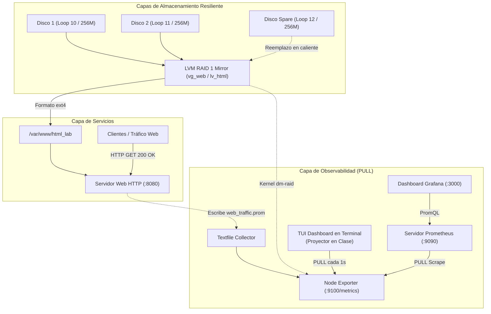
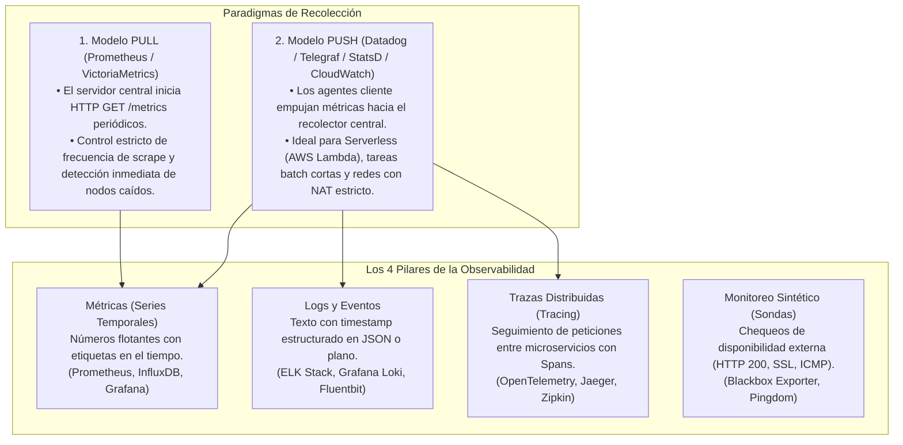
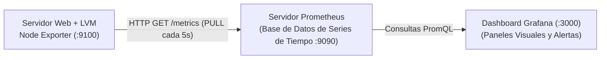
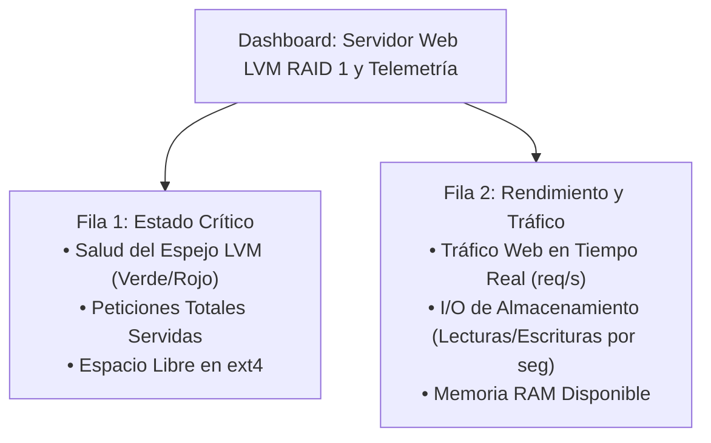
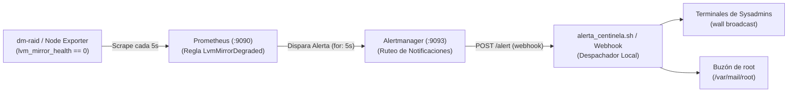

# Taller Integrador: Servidor Web sobre LVM RAID 1, Telemetría PULL, Resiliencia en Vivo, TUI y Grafana

> [!NOTE]
> Este taller fue diseñado especialmente para **clases en vivo y laboratorios guiados**. Integra en una sola práctica coherente:
> 1. Cómo evolucionó el monitoreo desde los comandos de terminal de los 90 hacia el modelo **PULL** moderno.
> 2. **Node Exporter "pelado"** (sin complejidades) para entender qué es una métrica en crudo.
> 3. Un **servicio real** (página web corporativa) montado sobre almacenamiento empresarial con **LVM RAID 1**.
> 4. La **destrucción intencional de un disco físico en caliente**, demostrando que la web **no se cae** (*Zero Downtime*).
> 5. La **sustitución y reconstrucción en caliente** del disco dañado con `lvconvert --repair`.
> 6. Un **dashboard TUI en terminal** para proyectar en el aula sin entorno gráfico.
> 7. La instalación y despliegue completo de **Prometheus y Grafana** con aprovisionamiento automático y consultas PromQL.

---

## 1. Resumen Ejecutivo en 60 Segundos

```bash
# 1. Ejecutar la demo de clase interactiva guiada (avanza paso a paso con ENTER):
sudo ./linux/administrator/monitoreo/demo_taller_integrador.sh

# 2. En una segunda terminal, abrir el dashboard visual TUI para el aula:
./linux/administrator/monitoreo/tui_monitoreo.sh

# 3. Limpiar absolutamente todo al terminar la clase:
sudo ./linux/administrator/monitoreo/limpiar_taller_integrador.sh
```

---

## 2. Arquitectura de la Solución



---

## 3. Acto 1: El Diagnóstico Clásico vs Telemetría Moderna

Antes de la observabilidad moderna basada en series de tiempo, la administración de sistemas dependía de utilitarios forenses ejecutados a demanda cuando un usuario reportaba que *"el sistema está lento"*:

```bash
# 1. ¿Cuál es la carga promedio del procesador en 1, 5 y 15 minutos?
uptime

# 2. ¿Hay cuellos de botella en memoria virtual o cambios de contexto?
vmstat 1 3

# 3. ¿Los discos físicos están saturados en I/O (%util y await)?
iostat -xz 1 3 2>/dev/null || echo "iostat no instalado (sysstat)"

# 4. ¿Cuánto espacio queda en los puntos de montaje?
df -h
```

### 💬 Pie de Clase para el Docente:
> *"Pregunta para los alumnos: Si un servidor colapsa a las 03:14 AM porque un proceso saturó el disco y el kernel lo reinició a las 03:16 AM... ¿qué información nos dan `uptime` o `df -h` cuando nos conectamos a las 09:00 AM? **Ninguna**. Son fotos del instante presente. Para saber qué ocurrió en el pasado necesitamos **telemetría continua almacenada en series temporales**."*

---

### 🗺️ Taxonomía de Observabilidad: Paradigmas (PULL vs PUSH) y Tipos de Telemetría



---

### 📋 La Gran Matriz Comparativa de Sistemas de Monitoreo

| Sistema / Herramienta | Paradigma | Naturaleza de la Telemetría | Generación | Almacenamiento Primario | Ventajas Principales | Desventajas / Limitaciones | Caso de Uso Óptimo |
| :--- | :--- | :--- | :--- | :--- | :--- | :--- | :--- |
| **Prometheus** | **PULL** (Scrape HTTP `/metrics`) | Métricas (Series Temporales Numéricas) | Cloud-Native Moderna | TSDB local optimizada en bloques de 2h | Inmensa riqueza con PromQL, autodetección en Kubernetes, detección inmediata de caídas. | No almacena logs textuales ni trazas; retención local finita (requiere Thanos para histórico de años). | Servidores Linux, Kubernetes, microservicios y hardware con exporters dedicados. |
| **VictoriaMetrics / Thanos** | **PULL / PUSH** (Compatible PromQL) | Métricas (Series Temporales) | Cloud-Native Moderna | Object Storage (S3/GCS) + TSDB | Retención ilimitada a bajo costo, compresión extrema, clustering masivo multi-región. | Mayor complejidad de componentes para orquestar almacenamiento en la nube. | Almacenamiento de métricas a largo plazo (> 1 año) para flotas de miles de nodos. |
| **Datadog / CloudWatch Agent** | **PUSH** (Agente transmite vía HTTPS) | Métricas, Logs y Trazas (All-in-One) | Propietaria / Cloud SaaS | Nube propietaria del proveedor | Fácil de desplegar, correlación automática de métricas con logs y APM. | Costo elevado por host y volumen de datos; dependencia estricta (*Vendor Lock-in*). | Empresas que prefieren no operar infraestructura propia de monitoreo. |
| **Graphite / StatsD** | **PUSH** (UDP / TCP streaming) | Métricas simples (Contadores, Gauges) | Clásica (2008+) | Whisper (Base de datos de archivo circular) | Muy bajo consumo de CPU en clientes, métricas de código fuente en tiempo real. | No soporta etiquetas multidimensionales ricas (*Labels*); formato jerárquico rígido por puntos. | Aplicaciones heredadas que ya emiten contadores numéricos vía UDP. |
| **Nagios / Cacti / Zabbix (legacy)** | **Polling Reactivo / Check-based** | Chequeos binarios (OK/WARNING/CRITICAL) | Clásica Histórica (1999-2005) | RRDtool / Bases de datos SQL (MySQL) | Bajo consumo de memoria, alertas basadas en umbrales estáticos simples. | **Sin series temporales continuas** de alta resolución; no escala en nubes dinámicas ni microservicios. | Monitoreo básico de switches de red físicos vía SNMP o pings ICMP estáticos. |
| **Grafana Loki** | **PUSH** (Flujo de logs indexados por labels) | Logs y Eventos Textuales | Cloud-Native Moderna | Object Storage (S3 / Chunks comprimidos) | Misma sintaxis LogQL inspirada en PromQL, no indexa el texto completo (muy liviano y barato). | Búsquedas de texto libre (*full-text search*) no estructuradas son más lentas que Elasticsearch. | Centralización de logs de contenedores Docker, Kubernetes y servicios systemd. |
| **ELK Stack (Elasticsearch)** | **PUSH** (Vía Logstash / Beats) | Logs y Eventos Estructurados | Clásica / Enterprise | Índices invertidos de Lucene | Búsquedas textuales instantáneas en petabytes de texto libre, análisis forense profundo. | Enorme consumo de memoria RAM y JVM; operación compleja de clusters. | Auditoría forense de seguridad, SIEM, análisis de accesos web y búsquedas textuales complejas. |
| **OpenTelemetry (OTel) / Jaeger** | **PUSH** (Streaming gRPC / OTLP) | Trazabilidad Distribuida (*Tracing / Spans*) | Cloud-Native Moderna | Elasticsearch / Cassandra / ClickHouse | Mide el tiempo exacto que una petición web pasa en la base de datos, caché y servicios externos. | Requiere instrumentación en el código de las aplicaciones; alto volumen de datos en red. | Microservicios distribuidos donde es vital detectar cuál API interna causa lentitud. |
| **Blackbox Exporter** | **PULL** (Sondas sintéticas de extremo a extremo) | Disponibilidad Sintética (HTTP/TCP/DNS/ICMP) | Cloud-Native Moderna | Integrado en Prometheus | Mide la experiencia real del cliente desde afuera (ej: ¿devuelve HTTP 200? ¿cuándo vence el SSL?). | No diagnostica causas internas del servidor (solo sabe si el servicio responde o no). | Monitoreo perimetral y comprobación de SLAs de URLs públicas y endpoints de API. |

---

### ⚖️ ¿PULL o PUSH? Comparativa de Decisión para Sysadmins

```
┌─────────────────────────────────┬────────────────────────────────────────────────────────┐
│ CRITERIO                        │ MODELO PULL (Prometheus)                               │ MODELO PUSH (Datadog / StatsD)         │
├─────────────────────────────────┼────────────────────────────────────────────────────────┤
│ Detección de Caída de Nodos     │ INMEDIATA: Si el GET /metrics falla o da timeout,      │ DIFICULTOSA: El colector no sabe si el │
│                                 │ Prometheus marca el nodo como caído en el acto.        │ nodo murió o si no tuvo eventos nuevos.│
│ Control de Carga de Red         │ TOTAL: El servidor central decide la frecuencia        │ RIESGOSO: Un pico de tráfico en los    │
│                                 │ exacta de muestreo (scrape_interval: 15s).             │ clientes puede saturar el servidor.    │
│ Topología con NAT y Firewalls   │ Requiere que el servidor llegue por HTTP al agente,    │ VENTAJOSO: El cliente solo necesita    │
│                                 │ o usar Pushgateway / reverse tunnels para salir.       │ salida saliente (outbound HTTPS).      │
│ Serverless / Trabajos Batch     │ Difícil (la función Lambda muere antes del scrape).    │ IDEAL: La función emite métricas y     │
│                                 │ Requiere Pushgateway intermedio.                       │ finaliza de inmediato.                 │
└─────────────────────────────────┴────────────────────────────────────────────────────────┘
```

---

## 4. Acto 2: Telemetría PULL con Node Exporter "Pelado"

El paradigma **PULL** invierte la lógica tradicional: el servidor monitoreado **no envía nada proactivamente** (no satura la red empujando logs). En su lugar, un agente ultraliviano expone un socket HTTP plano y espera a que el recolector central le solicite las métricas.

### 1. Descargar y ejecutar Node Exporter directamente:
```bash
# 1. Comprobar si ya se encuentra descargado para evitar descargas redundantes:
cd /tmp
VER="1.8.2"
if [ -f "/tmp/node_exporter" ]; then
    echo "✔ Node Exporter ya está presente en /tmp/node_exporter (omitiendo descarga de red)."
else
    echo "⬇️ Descargando binario portable oficial de Node Exporter v${VER}..."
    curl -sL "https://github.com/prometheus/node_exporter/releases/download/v${VER}/node_exporter-${VER}.linux-amd64.tar.gz" | tar -xz -C /tmp/
    mv /tmp/node_exporter-${VER}.linux-amd64/node_exporter /tmp/node_exporter
    rm -rf /tmp/node_exporter-${VER}.linux-amd64
fi

# 2. Crear directorio para métricas personalizadas (Textfile Collector):
sudo mkdir -p /var/lib/node_exporter/textfile_collector

# 3. Lanzar Node Exporter en segundo plano si no está corriendo:
if ss -tlpn 2>/dev/null | grep -E ':9100\s' &>/dev/null; then
    echo "✔ Node Exporter ya se encuentra activo en el puerto 9100."
else
    /tmp/node_exporter \
      --collector.textfile.directory=/var/lib/node_exporter/textfile_collector \
      --web.listen-address=":9100" > /tmp/node_exporter_taller.log 2>&1 &
    echo "✔ Node Exporter lanzado en segundo plano (:9100)."
fi
```

### 2. Auditar el endpoint crudo con `curl`:
```bash
curl -s http://localhost:9100/metrics | head -n 25
```
Cada línea es una serie temporal en texto plano con el formato:
`nombre_metrica{etiqueta="valor"} numero_flotante`

---

## 5. Acto 3: Servicio Web Real sobre LVM RAID 1

Para demostrar un caso de uso corporativo auténtico, montamos un portal web corporativo sobre almacenamiento redundante en espejo.

### 1. Crear discos virtuales en `/tmp/taller_integrador`:
```bash
sudo mkdir -p /tmp/taller_integrador
sudo truncate -s 256M /tmp/taller_integrador/disk1.img
sudo truncate -s 256M /tmp/taller_integrador/disk2.img
sudo truncate -s 256M /tmp/taller_integrador/disk_spare.img

# Vincular a loop devices:
LOOP1=$(sudo losetup -f --show /tmp/taller_integrador/disk1.img)
LOOP2=$(sudo losetup -f --show /tmp/taller_integrador/disk2.img)
echo "Discos listos en: $LOOP1 y $LOOP2"
```

### 2. Aprovisionar LVM RAID 1 (dm-raid):
```bash
# Inicializar Physical Volumes:
sudo pvcreate -y "$LOOP1" "$LOOP2"

# Crear Volume Group:
sudo vgcreate vg_web "$LOOP1" "$LOOP2"

# Crear Logical Volume en espejo de 2 vías (RAID 1) de 180 MB:
sudo lvcreate --type raid1 -m 1 -L 180M -n lv_html vg_web
```

### 3. Formatear, montar y desplegar el sitio web:
```bash
# Formatear con ext4:
sudo mkfs.ext4 -F /dev/vg_web/lv_html

# Crear directorio de publicación y montar:
sudo mkdir -p /var/www/html_lab
sudo mount /dev/vg_web/lv_html /var/www/html_lab

# Desplegar la página web corporativa:
cat << 'EOF' | sudo tee /var/www/html_lab/index.html
<!DOCTYPE html>
<html lang="es">
<head>
    <meta charset="UTF-8">
    <title>Portal Corporativo - Servidor de Producción</title>
    <style>
        body { font-family: system-ui, sans-serif; background: #0f172a; color: #f8fafc; text-align: center; padding: 50px; }
        .card { background: #1e293b; border-radius: 12px; padding: 30px; display: inline-block; box-shadow: 0 10px 25px rgba(0,0,0,0.5); }
        .status { color: #22c55e; font-weight: bold; font-size: 1.4rem; }
    </style>
</head>
<body>
    <div class="card">
        <h1>🚀 Sistema de Producción Activo</h1>
        <p class="status">✔ ALMACENAMIENTO LVM RAID 1 OPERATIVO</p>
        <p>Montado sobre <code>/dev/vg_web/lv_html</code> con resiliencia de datos.</p>
    </div>
</body>
</html>
EOF

# Iniciar servidor web Python en el puerto 8080:
nohup python3 -m http.server 8080 --directory /var/www/html_lab >/dev/null 2>&1 &
```

### 4. Verificar que el sitio web responde:
```bash
curl -I http://localhost:8080/
```
Salida: `HTTP/1.1 200 OK`.

---

## 6. Acto 4: Generador de Tráfico y Métricas Propias

Simulamos peticiones reales de usuarios y exportamos el contador hacia Node Exporter mediante el **Textfile Collector**:

```bash
# Simular 10 peticiones HTTP:
for i in {1..10}; do
    curl -s -o /dev/null http://localhost:8080/
done

# Registrar el contador en un archivo .prom para Node Exporter:
echo "10" > /tmp/web_requests.count

cat << EOF | sudo tee /var/lib/node_exporter/textfile_collector/web_traffic.prom
# HELP web_requests_total Total de peticiones HTTP procesadas por el servidor web
# TYPE web_requests_total counter
web_requests_total{service="portal_corporativo",port="8080"} $(cat /tmp/web_requests.count)
EOF
```

### Comprobar en Node Exporter:
```bash
curl -s http://localhost:9100/metrics | grep web_requests_total
```
Salida:
```text
# HELP web_requests_total Total de peticiones HTTP procesadas por el servidor web
# TYPE web_requests_total counter
web_requests_total{port="8080",service="portal_corporativo"} 10
```

---

## 7. Acto 5: La Prueba de Fuego (Rotura de Disco con Zero Downtime)

Llegó el momento crítico de la clase: **destruir deliberadamente uno de los discos** mientras el servicio está activo.

### 1. Inyectar corrupción masiva de ceros en el Disco 1:
```bash
sudo dd if=/dev/zero of=/tmp/taller_integrador/disk1.img bs=1M count=50 conv=notrunc
```

### 2. Forzar que el Kernel detecte la degradación:
```bash
# Un barrido de lectura fuerza a LVM a identificar el sector dañado:
sudo dd if=/dev/vg_web/lv_html of=/dev/null bs=1M count=10 2>/dev/null || true
```

### 3. Inspeccionar el estado de LVM:
```bash
sudo lvs -a -o lv_name,attr,health_status,devices vg_web
```
Salida observada:
```text
  LV               Attr       Health  Devices                                                
  lv_html          rwi-a-r-p- partial lv_html_rimage_0(0),lv_html_rimage_1(0)
  [lv_html_rimage_0] iwi-a-r-p- partial unknown device(0)
  [lv_html_rimage_1] iwi-a-r---         /dev/loop11(1)
```
El atributo `p` (*partial*) confirma que el disco 1 está muerto.

### 4. La Comprobación Clave en Vivo:
```bash
curl -I http://localhost:8080/
```
Salida: **`HTTP/1.1 200 OK`**.
¡El portal web nunca se interrumpió! El kernel derivó transparentemente el 100% de las lecturas al disco 2 sin emitir errores de I/O al servidor web.

---

## 8. Acto 6: Hot-Repair en Caliente (Reemplazo sin Reiniciar)

Sustituimos el disco averiado y reconstruimos el arreglo sin apagar la máquina ni el servicio web:

```bash
# 1. Asociar el disco de repuesto preparado:
LOOP_SPARE=$(sudo losetup -f --show /tmp/taller_integrador/disk_spare.img)

# 2. Sumar el disco de reemplazo al Volume Group:
sudo pvcreate -y "$LOOP_SPARE"
sudo vgextend vg_web "$LOOP_SPARE"

# 3. Reparar el Logical Volume en caliente:
sudo lvconvert -y --repair vg_web/lv_html

# 4. Purgar el disco averiado del Volume Group:
sudo vgreduce --removemissing --force vg_web

# 5. Confirmar que la salud del espejo volvió a estar 100% óptima:
sudo lvs -o lv_name,attr,health_status,devices vg_web
```
Salida:
```text
  LV      Attr       Health Devices                                                
  lv_html rwi-aor---        lv_html_rimage_0(0),lv_html_rimage_1(0)
```
¡El espejo LVM RAID 1 fue reconstruido en vivo mientras la web continuaba atendiendo usuarios!

---

## 9. Acto 7: TUI (Terminal User Interface) de Monitoreo

Para dar una clase en vivo sin instalar herramientas gráficas pesadas ni configurar puertos web adicionales, este taller incluye un **Dashboard TUI en terminal** que podés proyectar en el aula o compartir por pantalla.

---

### 📥 1. ¿Cómo Obtener o Crear el Archivo `tui_monitoreo.sh`?

Si clonaste el repositorio, el archivo ya está disponible en:
- `linux/administrator/monitoreo/scripts/tui_monitoreo.sh` (o el acceso directo `./linux/administrator/monitoreo/tui_monitoreo.sh`).

Si estás en un servidor remoto o no tenés el archivo a mano, **copiá y pegá este bloque completo en tu terminal para crearlo en 1 solo segundo**:

```bash
cat << 'EOF' > tui_monitoreo.sh
#!/usr/bin/env bash
# ==============================================================================
# TUI MONITOR: Panel de Control en Terminal para Clase en Vivo
# Lee telemetría de Node Exporter (:9100) y estado de LVM RAID 1 en tiempo real
# ==============================================================================
set -uo pipefail

C_RESET="\033[0m"
C_BOLD="\033[1m"
C_GREEN="\033[0;32m"
C_YELLOW="\033[1;33m"
C_RED="\033[0;31m"
C_CYAN="\033[0;36m"
C_BLUE="\033[1;34m"
C_DIM="\033[2m"

VG_NAME="${VG_NAME:-vg_web}"
LV_NAME="${LV_NAME:-lv_html}"
WEB_PORT="${WEB_PORT:-8080}"
NODE_PORT="${NODE_PORT:-9100}"
INTERVAL="${1:-1}"

trap "echo -e '\n${C_RESET}Panel TUI finalizado.'; exit 0" INT TERM
clear 2>/dev/null || true

while true; do
    # 1. Obtener estado de LVM RAID 1
    LVM_HEALTH="DESCONOCIDO"
    LVM_ATTR="------"
    LVM_COLOR="$C_YELLOW"
    
    if command -v lvs &>/dev/null && lvs "${VG_NAME}/${LV_NAME}" &>/dev/null; then
        LVM_STATUS=$(lvs --noheadings -o health_status "${VG_NAME}/${LV_NAME}" 2>/dev/null | tr -d ' ' || true)
        LVM_ATTR=$(lvs --noheadings -o lv_attr "${VG_NAME}/${LV_NAME}" 2>/dev/null | tr -d ' ' || true)
        
        if [ -z "$LVM_STATUS" ] && [[ ! "$LVM_ATTR" =~ ^....p ]]; then
            LVM_HEALTH="🟢 SANO (Mirror Óptimo)"
            LVM_COLOR="$C_GREEN"
        else
            LVM_HEALTH="🔴 DEGRADADO (Fallo de Disco)"
            LVM_COLOR="$C_RED"
        fi
    else
        LVM_HEALTH="⚪ NO MONTADO"
        LVM_COLOR="$C_DIM"
    fi

    # 2. Consultar servicio Web
    WEB_STATUS="🔴 CAÍDO"
    WEB_CODE="---"
    HTTP_REQ="0"
    if curl -s -m 1 "http://localhost:${WEB_PORT}/" >/dev/null 2>&1; then
        WEB_STATUS="🟢 EN LÍNEA (200 OK)"
        WEB_CODE="200"
    fi
    if [ -f /tmp/web_requests.count ]; then
        HTTP_REQ=$(cat /tmp/web_requests.count 2>/dev/null || echo 0)
    fi

    # 3. Consultar Node Exporter (:9100)
    NODE_STATUS="🔴 DESCONECTADO"
    MEM_AVAIL="---"
    FS_AVAIL="---"
    
    METRICS=$(curl -s -m 1 "http://localhost:${NODE_PORT}/metrics" 2>/dev/null || true)
    if [ -n "$METRICS" ]; then
        NODE_STATUS="🟢 ACTIVO (PULL OK)"
        
        MEM_BYTES=$(echo "$METRICS" | grep -E '^node_memory_MemAvailable_bytes ' | awk '{print $2}' || true)
        if [ -n "$MEM_BYTES" ]; then
            MEM_AVAIL=$(awk -v b="$MEM_BYTES" 'BEGIN {printf "%.0f MB", b/1024/1024}')
        fi

        FS_BYTES=$(echo "$METRICS" | grep -E 'node_filesystem_avail_bytes\{.*mountpoint="/var/www/html_lab".*\}' | awk '{print $2}' || true)
        if [ -n "$FS_BYTES" ]; then
            FS_AVAIL=$(awk -v b="$FS_BYTES" 'BEGIN {printf "%.0f MB", b/1024/1024}')
        fi
    fi

    TIMESTAMP=$(date '+%Y-%m-%d %H:%M:%S')

    tput cup 0 0 2>/dev/null || clear 2>/dev/null || true
    echo -e "${C_BOLD}${C_BLUE}╔══════════════════════════════════════════════════════════════════════════════╗${C_RESET}"
    echo -e "${C_BOLD}${C_BLUE}║${C_RESET} ${C_BOLD}${C_CYAN}📊 TUI DASHBOARD: SERVIDOR WEB SOBRE LVM RAID 1 + NODE EXPORTER${C_RESET}             ${C_BOLD}${C_BLUE}║${C_RESET}"
    echo -e "${C_BOLD}${C_BLUE}║${C_RESET} ${C_DIM}Hora: ${TIMESTAMP}  |  Refresco: cada ${INTERVAL}s  |  Salir: [Ctrl+C]${C_RESET}              ${C_BOLD}${C_BLUE}║${C_RESET}"
    echo -e "${C_BOLD}${C_BLUE}╠══════════════════════════════════════════════════════════════════════════════╣${C_RESET}"
    echo -e "${C_BOLD}${C_BLUE}║${C_RESET} ${C_BOLD}${C_YELLOW}1. ESTADO DE ALMACENAMIENTO (LVM RAID 1 / dm-raid):${C_RESET}                         ${C_BOLD}${C_BLUE}║${C_RESET}"
    echo -e "${C_BOLD}${C_BLUE}║${C_RESET}    • Volumen Lógico:   /dev/${VG_NAME}/${LV_NAME} (Espejo de 2 vías)               ${C_BOLD}${C_BLUE}║${C_RESET}"
    printf "${C_BOLD}${C_BLUE}║${C_RESET}    • Salud del Espejo: %-52b ${C_BOLD}${C_BLUE}║${C_RESET}\n" "${LVM_COLOR}${LVM_HEALTH}${C_RESET} (Attr: ${LVM_ATTR})"
    echo -e "${C_BOLD}${C_BLUE}╠══════════════════════════════════════════════════════════════════════════════╣${C_RESET}"
    echo -e "${C_BOLD}${C_BLUE}║${C_RESET} ${C_BOLD}${C_YELLOW}2. SERVIDOR WEB EN PRODUCCIÓN (Puerto ${WEB_PORT}):${C_RESET}                                   ${C_BOLD}${C_BLUE}║${C_RESET}"
    printf "${C_BOLD}${C_BLUE}║${C_RESET}    • Estado HTTP:      %-54b ${C_BOLD}${C_BLUE}║${C_RESET}\n" "${WEB_STATUS}"
    echo -e "${C_BOLD}${C_BLUE}║${C_RESET}    • Tráfico Servido:  ${C_BOLD}${HTTP_REQ}${C_RESET} peticiones recibidas                              ${C_BOLD}${C_BLUE}║${C_RESET}"
    echo -e "${C_BOLD}${C_BLUE}╠══════════════════════════════════════════════════════════════════════════════╣${C_RESET}"
    echo -e "${C_BOLD}${C_BLUE}║${C_RESET} ${C_BOLD}${C_YELLOW}3. AGENTE NODE EXPORTER (Puerto ${NODE_PORT} - Modelo PULL):${C_RESET}                         ${C_BOLD}${C_BLUE}║${C_RESET}"
    printf "${C_BOLD}${C_BLUE}║${C_RESET}    • Endpoint /metrics:%-54b ${C_BOLD}${C_BLUE}║${C_RESET}\n" "${NODE_STATUS}"
    echo -e "${C_BOLD}${C_BLUE}║${C_RESET}    • RAM Disponible:   ${MEM_AVAIL}                                              ${C_BOLD}${C_BLUE}║${C_RESET}"
    echo -e "${C_BOLD}${C_BLUE}║${C_RESET}    • Espacio Web Libre:${FS_AVAIL}                                               ${C_BOLD}${C_BLUE}║${C_RESET}"
    echo -e "${C_BOLD}${C_BLUE}╚══════════════════════════════════════════════════════════════════════════════╝${C_RESET}"

    sleep "$INTERVAL"
done
EOF

chmod +x tui_monitoreo.sh
```

---

### 🖥️ 2. ¿Dónde Tocar y Cómo Preparar la Pantalla para la Clase?

Para que los alumnos aprecien la magia de la tolerancia a fallos en tiempo real, lo ideal es **dividir la pantalla en dos terminales** (por ejemplo, con `tmux split-window -h` o abriendo dos pestañas/ventanas una al lado de la otra):

```text
┌───────────────────────────────────────┬───────────────────────────────────────┐
│ TERMINAL 1 (IZQUIERDA - PROYECTOR)    │ TERMINAL 2 (DERECHA - DOCENTE / SSH)  │
│                                       │                                       │
│  $ ./tui_monitoreo.sh                 │  $ sudo dd if=/dev/zero ... (Falla)   │
│                                       │  $ curl http://localhost:8080 (200 OK)│
│  [DASHBOARD ACTUALIZÁNDOSE CADA 1s]   │  $ sudo lvconvert --repair (Reparar)  │
└───────────────────────────────────────┴───────────────────────────────────────┘
```

#### Paso 1: En la Terminal 1 (Izquierda / Proyector)
Ejecutá el monitor TUI para dejarlo en pantalla completa:
```bash
# Refresco automático cada 1 segundo:
./tui_monitoreo.sh

# O si querés que refresque cada 2 segundos:
./tui_monitoreo.sh 2
```

#### Paso 2: En la Terminal 2 (Derecha / Comandos del Taller)
Acá es donde ejecutás los comandos de los Actos anteriores sin cerrar el monitor:
1. **Generar tráfico web:**
   ```bash
   for i in {1..20}; do curl -s -o /dev/null http://localhost:8080/; done
   ```
   *(Mirá la Terminal 1: el contador `Tráfico Servido` aumenta al instante).*
2. **Romper el Disco 1 con `dd` (Acto 5):**
   ```bash
   sudo dd if=/dev/zero of=/tmp/taller_integrador/disk1.img bs=1M count=50 conv=notrunc
   sudo lvs vg_web/lv_html
   ```
   *(Mirá la Terminal 1: la caja de almacenamiento pasa de inmediato a `🔴 DEGRADADO`, pero la caja web sigue en `🟢 EN LÍNEA (200 OK)`).*
3. **Reparar el disco en caliente (Acto 6):**
   ```bash
   sudo vgextend vg_web /dev/loop12
   sudo lvconvert -y --repair vg_web/lv_html
   ```
   *(Mirá la Terminal 1: la caja de almacenamiento vuelve automáticamente a `🟢 SANO (Mirror Óptimo)`).*

---

### ⌨️ 3. Controles e Interacción (¿Qué Tocar en el TUI?)

- **Para salir del TUI:** Presioná `Ctrl + C` en cualquier momento. Limpia la pantalla y te devuelve el prompt de la terminal sin matar ningún servicio.
- **Refresco personalizado:** Pasá los segundos como primer argumento:
  ```bash
  ./tui_monitoreo.sh 0.5   # Refresco ultra rápido cada medio segundo
  ./tui_monitoreo.sh 3     # Refresco pausado cada 3 segundos
  ```
- **Puertos alternativos:** Si tu servidor web o Node Exporter escuchan en otros puertos:
  ```bash
  WEB_PORT=8000 NODE_PORT=9200 ./tui_monitoreo.sh
  ```

---

### 🔍 4. Qué Significa Cada Sección del Dashboard

| Sección | Métrica Visualizada | Origen de los Datos | ¿Qué debe ocurrir durante una falla? |
| :--- | :--- | :--- | :--- |
| **1. Almacenamiento LVM** | Salud del espejo (`🟢 SANO` / `🔴 DEGRADADO`) y atributos LVM (`rwi-aor---` vs `rwi-a-r-p-`). | Comando del Kernel `lvs` sobre `/dev/vg_web/lv_html`. | Pasa a rojo `🔴 DEGRADADO`. El quinto carácter de atributos cambia a `p` (*partial*). |
| **2. Servidor Web** | Código HTTP de respuesta (`200 OK` / `CAÍDO`) y contador de peticiones. | Sondeo HTTP con `curl -m 1 http://localhost:8080/` y `/tmp/web_requests.count`. | **Se mantiene 100% en verde.** Demuestra que LVM RAID absorbió el fallo sin interrumpir el servicio. |
| **3. Node Exporter** | Disponibilidad del endpoint `/metrics`, RAM disponible en MB y espacio libre en disco. | PULL HTTP hacia `http://localhost:9100/metrics` parseado en tiempo real. | Sigue respondiendo métricas sin alteración gracias a la tolerancia a fallos del filesystem. |

---

## 10. Acto 8: El Circuito Completo con Prometheus y Grafana

Una vez demostrado el funcionamiento con el TUI en terminal, explicá a los alumnos cómo se monta la infraestructura gráfica profesional con **Prometheus** (almacenamiento de series de tiempo) y **Grafana** (visualización y dashboards).



---

### 🚀 1. Cómo Instalar y Levantar Prometheus en 1 Minuto

Prometheus es el motor central que realiza las peticiones PULL hacia `:9100/metrics` y almacena el histórico en su base de datos de series temporales (TSDB).

```bash
# 1. Comprobar si ya se encuentra descargado (omite la descarga si ya existe):
cd /tmp
VER_PROM="2.54.1"
if [ -f "/tmp/prometheus" ]; then
    echo "✔ Prometheus ya está presente en /tmp/prometheus (omitiendo descarga de red)."
else
    echo "⬇️ Descargando binario portable oficial de Prometheus v${VER_PROM}..."
    curl -sL "https://github.com/prometheus/prometheus/releases/download/v${VER_PROM}/prometheus-${VER_PROM}.linux-amd64.tar.gz" | tar -xz
    mv /tmp/prometheus-${VER_PROM}.linux-amd64/prometheus /tmp/prometheus
    rm -rf /tmp/prometheus-${VER_PROM}.linux-amd64
fi

# 2. Crear archivo de configuración prometheus.yml:
cat << 'EOF' > /tmp/prometheus.yml
global:
  scrape_interval: 5s     # Scrape frecuente para ver cambios de inmediato en clase

scrape_jobs:
  - job_name: 'servidor_web_raid'
    static_configs:
      - targets: ['localhost:9100']
EOF

# 3. Lanzar Prometheus en segundo plano si el puerto 9090 no está en uso:
if ss -tlpn 2>/dev/null | grep -E ':9090\s' &>/dev/null; then
    echo "✔ Prometheus ya se encuentra activo en http://localhost:9090"
else
    /tmp/prometheus --config.file=/tmp/prometheus.yml --storage.tsdb.path=/tmp/prometheus_data > /tmp/prometheus.log 2>&1 &
    echo "✔ Prometheus activo en: http://localhost:9090"
fi
```

---

### 📊 2. Cómo Instalar y Levantar Grafana en 1 Minuto

Para visualizar las métricas en un panel gráfico necesitás Grafana escuchando en el puerto `3000`. Podés elegir cualquiera de estas **3 alternativas**:

#### Opción A: Binario Standalone en `/tmp` (Recomendada para Clases, Labs y WSL2)
*No requiere permisos de root permanentes, no instala repositorios ni deja servicios residentes al reiniciar. Si ya se descargó previamente, inicia al instante sin volver a descargar.*

```bash
cd /tmp
VER_GRAFANA="11.2.0"
GRAFANA_DIR=""

for d in "/tmp/grafana-v${VER_GRAFANA}" "/tmp/grafana-${VER_GRAFANA}"; do
    if [ -f "${d}/bin/grafana" ]; then
        GRAFANA_DIR="$d"
        break
    fi
done

if [ -n "$GRAFANA_DIR" ]; then
    echo "✔ Grafana ya está presente en ${GRAFANA_DIR} (omitiendo descarga de red)."
else
    echo "⬇️ Descargando binario portable oficial de Grafana v${VER_GRAFANA}..."
    curl -sL "https://dl.grafana.com/oss/release/grafana-${VER_GRAFANA}.linux-amd64.tar.gz" | tar -xz
    [ -d "/tmp/grafana-v${VER_GRAFANA}" ] && GRAFANA_DIR="/tmp/grafana-v${VER_GRAFANA}" || GRAFANA_DIR="/tmp/grafana-${VER_GRAFANA}"
fi

# Configurar aprovisionamiento automático de Datasource Prometheus:
mkdir -p ${GRAFANA_DIR}/conf/provisioning/datasources/
cat << 'EOF' > ${GRAFANA_DIR}/conf/provisioning/datasources/prometheus.yaml
apiVersion: 1
datasources:
  - name: Prometheus
    type: prometheus
    access: proxy
    url: http://localhost:9090
    isDefault: true
EOF

# Iniciar Grafana en segundo plano si no está escuchando en el puerto 3000:
if ss -tlpn 2>/dev/null | grep -E ':3000\s' &>/dev/null; then
    echo "✔ Grafana ya se encuentra activo en http://localhost:3000"
else
    ${GRAFANA_DIR}/bin/grafana server --homepath ${GRAFANA_DIR} > /tmp/grafana.log 2>&1 &
    echo "✔ Grafana activo en: http://localhost:3000"
fi
```

#### Opción B: Docker en 1 Solo Comando
```bash
docker run -d --name=grafana -p 3000:3000 grafana/grafana-oss:latest
```

#### Opción C: Instalación con APT (Ubuntu / Debian como Servicio Systemd)
```bash
sudo apt-get install -y apt-transport-https software-properties-common wget gpg
sudo mkdir -p /etc/apt/keyrings/
wget -q -O - https://apt.grafana.com/gpg.key | gpg --dearmor | sudo tee /etc/apt/keyrings/grafana.gpg > /dev/null
echo "deb [signed-by=/etc/apt/keyrings/grafana.gpg] https://apt.grafana.com stable main" | sudo tee /etc/apt/sources.list.d/grafana.list
sudo apt-get update && sudo apt-get install -y grafana

# Aprovisionamiento automático:
sudo mkdir -p /etc/grafana/provisioning/datasources/
sudo bash -c 'cat <<EOF > /etc/grafana/provisioning/datasources/prometheus.yaml
apiVersion: 1
datasources:
  - name: Prometheus
    type: prometheus
    access: proxy
    url: http://localhost:9090
    isDefault: true
EOF'

sudo systemctl enable --now grafana-server
```

---

### 🌐 3. Primer Acceso y Verificación Web

1. Abrí tu navegador en **`http://localhost:3000`**
2. **Usuario inicial:** `admin`
3. **Contraseña inicial:** `admin` *(hacé clic en "Skip" cuando te pida cambiarla)*.
4. Gracias al archivo de aprovisionamiento `prometheus.yaml`, el origen de datos **Prometheus** ya está conectado automáticamente.

---

### 📈 4. Dashboard Oficial Completo (Aprovisionamiento e Importación)

Para evitar tener que diseñar los paneles a mano durante la clase, el repositorio incluye un dashboard completo ya estructurado en:
📁 **[`linux/administrator/monitoreo/dashboards/dashboard_taller_integrador.json`](dashboards/dashboard_taller_integrador.json)**



#### Opción A: Importación Manual desde la Interfaz Web de Grafana (Recomendada en Clase)
1. En Grafana (`http://localhost:3000`), hacé clic en **Dashboards** en el menú izquierdo.
2. Hacé clic en el botón azul **New** ➔ **Import**.
3. Abrí el archivo [`dashboards/dashboard_taller_integrador.json`](dashboards/dashboard_taller_integrador.json), copiá todo su contenido JSON y pegalo en el cuadro **Import via panel json**.
4. Hacé clic en **Load** y luego en **Import**. ¡El panel aparecerá en vivo con todas las visualizaciones listas!

#### Opción B: Aprovisionamiento Automático al Levantar Grafana
Si deseás que Grafana cargue el dashboard de forma 100% desatendida sin tocar la UI:
```bash
# Crear directorio de aprovisionamiento de dashboards:
mkdir -p /tmp/grafana-v${VER_GRAFANA}/conf/provisioning/dashboards/
mkdir -p /tmp/dashboards/

# Copiar el dashboard del repositorio al directorio de aprovisionamiento:
cp linux/administrator/monitoreo/dashboards/dashboard_taller_integrador.json /tmp/dashboards/

# Configurar el proveedor de dashboards de Grafana:
cat << 'EOF' > /tmp/grafana-v${VER_GRAFANA}/conf/provisioning/dashboards/taller.yaml
apiVersion: 1
providers:
  - name: 'taller_integrador'
    orgId: 1
    folder: ''
    type: file
    disableDeletion: false
    updateIntervalSeconds: 5
    allowUiUpdates: true
    options:
      path: /tmp/dashboards
EOF
```

---

### 🔍 5. Las Consultas PromQL Clave del Dashboard

| Métrica | Expresión PromQL | Tipo de Panel | Utilidad en la Clase |
| :--- | :--- | :--- | :--- |
| **Salud del Espejo LVM** | `lvm_mirror_health{vg="vg_web",lv="lv_html"}` | Stat (Verde/Rojo) | Pasa a **ROJO (0)** al romper el disco y a **VERDE (1)** tras el reemplazo. |
| **Peticiones Totales** | `web_requests_total` | Stat (Contador) | Muestra el total de solicitudes servidas desde el inicio. |
| **Tráfico en Vivo** | `rate(web_requests_total[1m])` | Time Series (Líneas) | Se dispara cuando ejecutás ráfagas de tráfico con `curl`. |
| **Espacio en Filesystem** | `node_filesystem_avail_bytes{mountpoint="/var/www/html_lab"} / 1024 / 1024` | Gauge (Medidor) | Monitorea la capacidad libre en MB del filesystem sobre RAID 1. |
| **I/O de Almacenamiento** | `sum(rate(node_disk_reads_completed_total[1m]))` | Time Series | Refleja la actividad física de lecturas y escrituras en disco. |
| **Memoria RAM Libre** | `node_memory_MemAvailable_bytes / 1024 / 1024` | Stat (MB) | Capacidad de memoria operativa disponible en el host. |

---

## 11. Acto 9: Sistema de Alertas a la Terminal (`wall`) y al Email de Root

¿Es posible que el sistema envíe una alerta automática directamente a la **terminal** de los administradores y un correo formal al **buzón de root** cuando un disco se rompe?

**¡Sí, totalmente!** En la administración de servidores Linux de misión crítica, un administrador no puede depender de estar mirando una pantalla web las 24 horas. Los sistemas UNIX incorporan mecanismos nativos inmediatos:

1. **Broadcast a Terminales (`wall` - Write to All):** Difunde un mensaje urgente a **todas las sesiones interactivas (`/dev/pts/*`) y conexiones SSH activas** en el servidor de forma simultánea, activando la campana de terminal (`\a`).
2. **Buzón de Correo Local de Root (`/var/mail/root`):** El estándar de correo mbox del kernel y los demonios de Linux (cron, smartd, mdadm, raid). Se consulta con la herramienta nativa `mail` o simplemente leyendo el archivo.

---

### 🛡️ 1. El Centinela de Alertas en Vivo (`alerta_centinela.sh`)

El repositorio incluye un centinela automatizado listo para usar:
📁 **[`linux/administrator/monitoreo/scripts/alerta_centinela.sh`](scripts/alerta_centinela.sh)** *(o acceso directo: [`alerta_centinela.sh`](alerta_centinela.sh))*.

#### Probar la Emisión de Alertas Inmediata (Modo Test):
```bash
sudo ./linux/administrator/monitoreo/alerta_centinela.sh --test
```

#### Poner el Centinela a Vigilar en Segundo Plano:
```bash
sudo ./linux/administrator/monitoreo/alerta_centinela.sh 2 &
CENTINELA_PID=$!
echo "Centinela activo con PID: $CENTINELA_PID"
```

---

### 💥 2. ¿Qué Ocurre Durante la Falla? (Simulación con `dd`)

En el momento en que dañamos el disco con `dd` (Acto 5):
```bash
sudo dd if=/dev/zero of=/tmp/taller_integrador/disk1.img bs=1M count=50 conv=notrunc
```

El centinela detecta que el volumen lógico `/dev/vg_web/lv_html` entró en estado degradado (atributo `p` en LVM) y ejecuta **dos acciones simultáneas**:

#### Acción 1: Notificación Inmediata en Todas las Terminales con `wall`
En todas las consolas abiertas y sesiones de alumnos aparece instantáneamente este banner:

```text
Broadcast message from root@servidor (pts/1) (Sat Oct 31 01:47:00 2026):

--------------------------------------------------------------------------------
🚨 [CRITICAL ALERT] ¡FALLA EN ARREGLO DE DISCO LVM RAID 1 DETECTADA! 🚨
Hora: 2026-10-31 01:47:00
Volumen afectado: /dev/vg_web/lv_html
Punto de montaje: /var/www/html_lab (Servidor Web)
Estado del Espejo: DEGRADADO (Pérdida de redundancia física)

ℹ️  RESILIENCIA: El servidor web continúa respondiendo (200 OK) por tolerancia a fallos.
👉 ACCIÓN REQUERIDA: Conectar disco de repuesto y ejecutar:
   sudo lvconvert --repair vg_web/lv_html
--------------------------------------------------------------------------------
```

#### Acción 2: Depósito Formal en el Buzón de Correo de Root
El evento se registra con formato estándar RFC 822 en el buzón del administrador. Podés inspeccionarlo ejecutando:

```bash
# Opción A: Ver el buzón de correo directamente
sudo tail -n 35 /var/mail/root

# Opción B: Usar el cliente interactivo de correo de Linux (si está instalado)
mail
```

El correo recibido contiene el informe técnico completo:
```text
From alerta-monitoreo@localhost Sat Oct 31 01:47:00 2026
Date: Sat, 31 Oct 2026 01:47:00 +0100
From: "Centinela de Monitoreo LVM" <alerta-monitoreo@localhost>
To: root@localhost
Subject: 🚨 [CRITICAL] Alerta de Almacenamiento: Espejo LVM RAID 1 Degradado

================================================================================
                    NOTIFICACIÓN DE ALERTA DE SISTEMA
================================================================================
Fecha y Hora:    2026-10-31 01:47:00
Severidad:       CRÍTICA
Subsistema:      dm-raid / LVM2 Mirroring
Dispositivo:     /dev/vg_web/lv_html
Punto de Montaje:/var/www/html_lab (Servicio Web de Producción)
Estado Actual:   DEGRADADO (Una de las patas del espejo falló)

DIAGNÓSTICO:
El kernel ha detectado un error de I/O o corrupción física en una réplica.
La paridad del arreglo absorbió la falla. Los usuarios no perciben caída,
pero la tolerancia a fallos está en riesgo mientras persista la degradación.

PROCEDIMIENTO DE RECUPERACIÓN (HOT-REPAIR):
1. Inserte un disco nuevo o prepare el spare:
   sudo pvcreate /dev/loop12
   sudo vgextend vg_web /dev/loop12

2. Reconstruya el espejo:
   sudo lvconvert -y --repair vg_web/lv_html

3. Elimine el disco averiado:
   sudo vgreduce --removemissing --force vg_web
================================================================================
```

---

### ✅ 3. Auto-Resolución Tras la Recuperación

Cuando ejecutás la reparación en caliente del Acto 6:
```bash
sudo vgextend vg_web /dev/loop12
sudo lvconvert -y --repair vg_web/lv_html
sudo vgreduce --removemissing --force vg_web
```

El centinela detecta que el arreglo volvió a estar **SANO** y emite de inmediato:

```text
Broadcast message from root@servidor (pts/1):

--------------------------------------------------------------------------------
✅ [RESOLVED] RECUPERACIÓN EXITOSA DEL ARREGLO LVM RAID 1
Hora: 2026-10-31 01:48:30
Volumen: /dev/vg_web/lv_html
Estado: SANO / ÓPTIMO (Redundancia completa de 2 vías restablecida)
--------------------------------------------------------------------------------
```

---

### 🌐 4. ¿Cómo se Conecta Esto con Prometheus y Alertmanager?

En una infraestructura empresarial, este mismo flujo se escala utilizando **Prometheus Alertmanager**:



1. **Regla de Alerta en Prometheus (`/tmp/lvm_alert_rules.yml`):**
   ```yaml
   groups:
     - name: lvm_storage_alerts
       rules:
         - alert: LvmMirrorDegraded
           expr: lvm_mirror_health{vg="vg_web",lv="lv_html"} == 0
           for: 5s
           labels:
             severity: critical
           annotations:
             summary: "Espejo LVM RAID 1 degradado en /dev/vg_web/lv_html"
             description: "Una pata del espejo ha fallado. Reemplazar disco en caliente."
   ```
2. **Configuración en Alertmanager (`alertmanager.yml`):**
   El webhook apunta a un receptor local que ejecuta `wall` y deposita el correo en `/var/mail/root`. *(Podés profundizar este circuito completo en el laboratorio [`alertmanager_alertas_locales.md`](alertmanager_alertas_locales.md)).*

---

## 12. Script de Demostración y Limpieza

### Ejecución de la Clase Automatizada:
El script interactivo realiza todo este recorrido paso a paso con pausas y preguntas disparadoras para los alumnos:
```bash
sudo ./linux/administrator/monitoreo/demo_taller_integrador.sh
```

### Limpieza Completa al Finalizar:
Para desmantelar la web, LVM RAID 1, loop devices, Grafana, Prometheus, el centinela de alertas y procesos de telemetría:
```bash
sudo ./linux/administrator/monitoreo/limpiar_taller_integrador_web_lvm_monitoreo.sh
```
*(O de forma abreviada: `sudo ./linux/administrator/monitoreo/limpiar_taller_integrador.sh`).*

---

## 13. Autoevaluación

<details>
<summary><strong>1. ¿Por qué el servidor web no sufrió ninguna interrupción cuando destruimos el disco 1 con dd?</strong></summary>

Porque el volumen lógico fue aprovisionado con LVM RAID 1 (`dm-raid`). El kernel mantiene dos réplicas idénticas de los bloques de datos (`_rimage_0` y `_rimage_1`). Al fallar el disco 1, el driver `dm-raid` descarta silenciosamente esa pata y atiende el 100% de las lecturas desde el disco 2 sobreviviente sin notificar errores de I/O al proceso web.
</details>

<details>
<summary><strong>2. ¿Qué diferencia técnica hay entre el modelo PULL de Node Exporter y un script que envía datos por PUSH?</strong></summary>

En el modelo PULL, el servidor de monitoreo inicia periódicamente peticiones HTTP GET hacia el agente. Si el servidor físico se cuelga o pierde conectividad de red, la consulta falla y el sistema central genera una alerta inmediata. En el modelo PUSH, el cliente envía datos cuando puede; si el cliente muere, el colector puede tardar horas en inferir si no hubo eventos o si la máquina se apagó.
</details>

<details>
<summary><strong>3. ¿Qué función cumplen los sub-volúmenes _rmeta en LVM RAID?</strong></summary>

Almacenan los metadatos de sincronización del arreglo y el *write-intent bitmap*. Este mapa de bits registra qué regiones del disco se modificaron durante una degradación para que, al añadir un nuevo disco de reemplazo, la reconstrucción sea rápida y consistente sin tener que rehacer el disco entero.
</details>

<details>
<summary><strong>4. ¿Cómo se comunican Prometheus y Grafana en producción?</strong></summary>

Prometheus scrapea periódicamente el endpoint `/metrics` de Node Exporter por HTTP (puerto 9100) y almacena las muestras en su base de datos de series temporales (TSDB en puerto 9090). Grafana se conecta como cliente a Prometheus mediante HTTP y ejecuta consultas PromQL para pintar gráficos y paneles en tiempo real para los operadores (puerto 3000).
</details>

<details>
<summary><strong>5. ¿Cómo garantizan herramientas como wall y /var/mail/root la entrega de alertas críticas en servidores sin conexión a Internet?</strong></summary>

<code>wall</code> utiliza la capa de pseudoterminales del kernel de Linux (<code>/dev/pts/*</code>) para escribir directamente en los buffers de pantalla de todos los usuarios conectados al host. Por su parte, <code>/var/mail/root</code> es el buzón local Unix estándar donde el subsistema de correo y los demonios de auditoría depositan notificaciones sin depender de pasarelas SMTP externas, APIs de terceros ni conexión a Internet.
</details>


---

## 🔗 Enlaces Oficiales de Referencia

- [Documentación Oficial de Prometheus](https://prometheus.io/docs/introduction/overview/)
- [Repositorio Oficial de Prometheus Node Exporter](https://github.com/prometheus/node_exporter)
- [Documentación Oficial de Grafana OSS](https://grafana.com/docs/grafana/latest/)
- [Documentación Oficial de Prometheus Alertmanager](https://prometheus.io/docs/alerting/latest/alertmanager/)
- [Especificación Abierta de OpenMetrics](https://openmetrics.io/)
- [Documentación del Kernel de Linux: Device Mapper dm-raid](https://docs.kernel.org/admin-guide/device-mapper/)
- [Especificación y Arquitectura de OpenTelemetry (OTel)](https://opentelemetry.io/)

---

## 📖 Glosario Técnico de Monitoreo y Observabilidad

* **Modelo PULL:** Paradigma de recolección donde el servidor central de monitoreo (como Prometheus) inicia peticiones periódicas HTTP GET hacia los endpoints `/metrics` de los nodos. Garantiza control estricto de frecuencia de scrape y detección instantánea de caídas.
* **Modelo PUSH:** Paradigma donde cada nodo o aplicación transmite proactivamente sus métricas hacia un colector central (como Datadog, Telegraf o StatsD). Esencial en arquitecturas Serverless (AWS Lambda) y redes con NAT cerrado.
* **TSDB (Time Series Database):** Base de datos optimizada exclusivamente para almacenar secuencias de pares `(timestamp, float64)` indexadas por etiquetas multidimensionales clave-valor.
* **PromQL (Prometheus Query Language):** Lenguaje de consulta funcional que permite filtrar, agregar y calcular tasas de cambio instantáneas (`rate()`, `irate()`, `increase()`, `sum()`, `avg()`) sobre series temporales en tiempo real.
* **Textfile Collector:** Módulo de Node Exporter que lee archivos con extensión `.prom` generados atómicamente por scripts locales en `/var/lib/node_exporter/textfile_collector/` y los expone en `/metrics` junto a las métricas del sistema operativo.
* **OpenMetrics:** Estándar neutral de la Cloud Native Computing Foundation (CNCF) que formaliza la sintaxis de texto plano de métricas de Prometheus (`# HELP`, `# TYPE`, etiquetas y marcas de tiempo).
* **Distributed Tracing (Trazas Distribuidas):** Seguimiento del ciclo de vida completo de una petición a través de múltiples microservicios mediante identificadores de traza (*TraceID*) y bloques de tiempo (*Spans*), implementado con OpenTelemetry o Jaeger.
* **Monitoreo Sintético (Sondas / Probes):** Verificación activa de disponibilidad desde el exterior simulando el comportamiento de un usuario final (ej: verificar que una URL devuelva HTTP 200 y que su certificado TLS sea válido con Blackbox Exporter).
