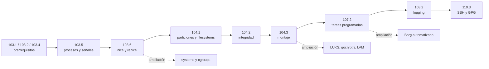

# Ruta de temas: administración Linux y LPIC-1

Esta ruta combina el orden de los objetivos LPIC-1 con las guías locales. Primero se respeta el orden del examen; dentro de cada objetivo, las prácticas avanzan de observar a intervenir. El contenido de Cybercirujas sirve como referencia generada por IA y debe contrastarse con los objetivos oficiales de LPI.

## Prerrequisitos

Antes de procesos (103.5), cubrir del material del curso los objetivos que Cybercirujas señala como previos:

| Objetivo | Conocimiento previo |
| --- | --- |
| 103.1 | Shell y línea de comandos |
| 103.2 | Filtros de texto |
| 103.4 | Streams, pipes y redirecciones |

No hay una guía local específica para estos tres objetivos; no los reemplazaría con contenido avanzado de procesos.

## Secuencia según los objetivos

| Orden | Objetivo LPIC-1 | Recorrido didáctico | Guías locales |
| --- | --- | --- | --- |
| 1 | **103.5 — Crear, monitorizar y terminar procesos** (101-500, peso 6.25) | Empezar observando carga y procesos; seguir PID/PPID y árbol; compilar un programa pequeño; estudiar señales, estado zombie y control de trabajos; terminar con `nohup`/`setsid`. | [uptime.md](uptime.md), [tools-stats.md](tools-stats.md), [guia_discos_procesos.md](guia_discos_procesos.md), [compilar.md](compilar.md), [proceso_zombie.md](proceso_zombie.md), [jobs-fg-bg-nohup-setsid.md](jobs-fg-bg-nohup-setsid.md) |
| 2 | **103.6 — Modificar prioridades de ejecución** (101-500, peso 3.12) | Con procesos ya entendidos, comparar nice, observar `NI`/`%CPU`, cambiar prioridad con `renice` y distinguir prioridad de afinidad. | [nice.md](nice.md) |
| 3 | **104.1 — Crear particiones y filesystems** (101-500, peso 3.12) | Reconocer dispositivos; crear primero un disco virtual con loop y ext4. Después, como ampliación, recorrer PV → VG → LV y extender el volumen/filesystem manualmente. | Sección de almacenamiento en [guia_discos_procesos.md](guia_discos_procesos.md), [lab_storage_simple.md](lab_storage_simple.md), [lab_storage_paso_a_paso.md](lab_storage_paso_a_paso.md) |
| 4 | **104.2 — Mantener la integridad de filesystems** (101-500, peso 3.12) | Incluir comprobación y reparación de filesystems como tema propio. La guía LVM menciona `e2fsck` al reducir ext4, pero no cubre el objetivo de forma completa. | **Hueco local:** no hay una guía dedicada. |
| 5 | **104.3 — Controlar montaje y desmontaje** (101-500, peso 4.69) | Comprender dispositivo, filesystem y punto de montaje; practicar `mount`/`umount` en el loop; después ver montaje persistente. | [lab_storage_simple.md](lab_storage_simple.md), [luks.md](luks.md), [systemd-scoket.md](systemd-scoket.md) |
| 6 | **107.2 — Automatizar tareas programadas** (102-500) | Introducir primero qué es un servicio y luego timers; comparar ejecución programada y manual. La API incluye `cron`, `at` y timers de systemd en su preview. | [systemd-memlogger.md](systemd-memlogger.md), [borg-con-systemd-timers.md](borg-con-systemd-timers.md) |
| 7 | **108.2 — Registro del sistema** (102-500) | Una vez que hay servicios y timers, observar salida y errores en el Journal con `journalctl`; contrastar con logs en archivos. | [systemd-memlogger.md](systemd-memlogger.md), [borg-con-systemd-timers.md](borg-con-systemd-timers.md) |
| 8 | **110.3 — Proteger datos con cifrado** (102-500) | Seguir el alcance mostrado por el objetivo: SSH y GPG. No asumir que “cifrado” significa cifrado de discos. | **Hueco local:** no hay guía específica de SSH/GPG. |

## Extensiones locales, fuera del recorrido base

Estas prácticas amplían los objetivos, pero conviene presentarlas como profundización y no como contenido que la API o el temario oficial necesariamente exigen:

| Extensión | Cuándo incorporarla | Guía |
| --- | --- | --- |
| Cgroups y cuota de CPU | Después de 103.6: contrastar prioridad de proceso con límite de grupo usando systemd. | [systemd-cgroups.md](systemd-cgroups.md) |
| LVM y ampliación en caliente | Después de crear y montar ext4; ejecutar primero cada comando manualmente. | [lab_storage_paso_a_paso.md](lab_storage_paso_a_paso.md), luego [lab_storage.md](lab_storage.md) |
| LUKS y gocryptfs | Como comparación de cifrado de bloques frente a cifrado de archivos; LUKS no sustituye el contenido de SSH/GPG de 110.3. | [luks.md](luks.md), [gocryptfs.md](gocryptfs.md) |
| Backup con Borg | Después de filesystems y montaje; automatizar recién cuando se entiende el backup manual. | [borg.md](borg.md), luego [borg-con-systemd-timers.md](borg-con-systemd-timers.md) |
| Activación por socket | Después de servicios systemd y timers; es una extensión de activación bajo demanda. | [systemd-scoket.md](systemd-scoket.md) |

## Mapa de dependencias

## Cómo aprovechar la API

Usar el flujo `catalogar → previsualizar → traer solo el tema elegido`. Para esta ruta, los candidatos principales son [`103.5`](https://study.cybercirujas.club/api/certs/lpic-1/topics/103.5/preview?lang=es) y [`103.6`](https://study.cybercirujas.club/api/certs/lpic-1/topics/103.6/preview?lang=es). Tomar del primero los comandos y ejercicios alineados con procesos; del segundo, los ejemplos de prioridad. Dejar cgroups, autogroups, Kubernetes y escenarios SRE avanzados como material extra, y revisar sus afirmaciones contra la fuente oficial enlazada por la API.

La API declara el contenido como generado por IA, con fuente LPI y procedencia por tema. Sus previews también muestran que existe contenido de ejercicios, pero `lab_status.state` puede ser `none`: contenido disponible no significa que haya una VM o laboratorio ya preparado. Además, el preview de 107.2 muestra una discrepancia entre el peso del metadato y el peso escrito en el cuerpo; confirmar pesos y alcance con el PDF oficial antes de presentarlos como datos de examen.

## Ritmo recomendado

En cada objetivo: explicar el concepto, ejecutar primero un comando de observación, hacer una práctica pequeña y reversible, comparar el resultado y recién entonces pasar al siguiente objetivo. Mantener aparte los extras y usar VM/archivos de prueba para almacenamiento y cargas; terminar únicamente procesos creados por la práctica.