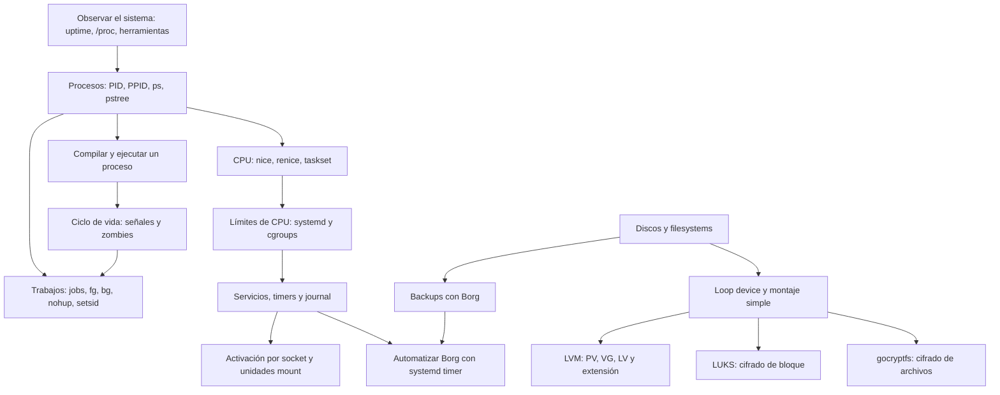

# Ruta de temas: procesos, systemd y almacenamiento

Esta ruta ordena las guías de `linux/administrator` por conocimientos previos. La idea es que cada tema responda una pregunta, se observe con comandos y recién después se controle o automatice.

## Mapa de dependencias

## Secuencia principal

| Orden | Tema y objetivo | Guía para trabajar |
| --- | --- | --- |
| 1 | **Mirar el estado del sistema.** Leer uptime, carga, CPU y datos de `/proc`; separar carga promedio de porcentaje de CPU. | [uptime.md](uptime.md), [tools-stats.md](tools-stats.md) |
| 2 | **Reconocer procesos.** Identificar PID, usuario, consumo de CPU/memoria y relación padre-hijo. | Sección de procesos en [guia_discos_procesos.md](guia_discos_procesos.md) |
| 3 | **Entender cómo nace un proceso.** Compilar y ejecutar un programa pequeño; leer qué hace el ejecutable y sus dependencias. | [compilar.md](compilar.md) |
| 4 | **Seguir el ciclo de vida.** Relacionar `fork`, salida del hijo, `wait`, señales y estado zombie. | [proceso_zombie.md](proceso_zombie.md) |
| 5 | **Controlar trabajos desde la terminal.** Distinguir trabajo de shell, PID, grupo y sesión; practicar `&`, `jobs`, `fg`, `bg`, `nohup` y `setsid`. | [jobs-fg-bg-nohup-setsid.md](jobs-fg-bg-nohup-setsid.md) |
| 6 | **Observar y repartir CPU.** Comparar nice, cambiarlo con renice y separar prioridad de afinidad usando taskset. | [nice.md](nice.md) |
| 7 | **Pasar del proceso al grupo.** Limitar CPU de una unidad transitoria y localizar procesos y controles con systemd, `systemd-cgls`, `/proc/<PID>/cgroup` y `/sys/fs/cgroup`. | [systemd-cgroups.md](systemd-cgroups.md) |
| 8 | **Administrar servicios.** Crear un servicio, revisar estado y logs en el Journal, y entender start/stop/enable. | [systemd-memlogger.md](systemd-memlogger.md) |
| 9 | **Automatizar y activar bajo demanda.** Introducir timers y luego sockets; comparar ejecución periódica con activación por conexión. | [borg-con-systemd-timers.md](borg-con-systemd-timers.md), [systemd-scoket.md](systemd-scoket.md) |

## Secuencia de almacenamiento

Esta parte puede darse después de que el grupo conozca comandos básicos, permisos y montaje. Primero conviene trabajar sobre archivos de prueba; el disco físico es un tema posterior y requiere cuidado adicional.

| Orden | Tema y objetivo | Guía para trabajar |
| --- | --- | --- |
| 10 | **Reconocer discos y filesystems.** Leer `lsblk`, `df`, `du` y distinguir dispositivo, filesystem y punto de montaje. | Sección de almacenamiento en [guia_discos_procesos.md](guia_discos_procesos.md) |
| 11 | **Crear un disco virtual mínimo.** Convertir un archivo en loop device, crear ext4, montar, escribir y desmontar. | [lab_storage_simple.md](lab_storage_simple.md) |
| 12 | **Agregar la capa LVM.** Ejecutar manualmente PV → VG → LV; formatear, montar y ampliar el LV y ext4. | [lab_storage_paso_a_paso.md](lab_storage_paso_a_paso.md) |
| 13 | **Cifrar bloques.** Comparar dispositivo, mapeo LUKS, filesystem y montaje; empezar por el loop device, no por un disco con datos. | [luks.md](luks.md) |
| 14 | **Cifrar archivos.** Contrastar el cifrado de archivos y nombres con el cifrado de un dispositivo completo. | [gocryptfs.md](gocryptfs.md) |
| 15 | **Respaldar y recuperar.** Crear un repositorio Borg, generar un archivo, inspeccionarlo y practicar recuperación antes de automatizar. | [borg.md](borg.md) |
| 16 | **Automatizar el backup.** Usar un timer de systemd para ejecutar el flujo de Borg y revisar su estado y registros. | [borg-con-systemd-timers.md](borg-con-systemd-timers.md) |

## Cómo se conectan los bloques

- `uptime` y las herramientas de estadísticas enseñan a **observar**. `ps`, `top` y `/proc` permiten pasar del estado general a un proceso concreto.
- `proceso_zombie.md` explica qué ocurre cuando termina un hijo; la guía de trabajos muestra cómo la shell controla grupos de procesos detenidos o en segundo plano.
- `nice` cambia prioridad relativa de procesos. `taskset` restringe CPUs permitidas. `CPUQuota` de systemd limita el tiempo de CPU del grupo: son mecanismos distintos y conviene compararlos después de entender procesos.
- `systemd-memlogger.md` usa los conceptos de proceso y servicio. Los timers automatizan unidades; los sockets permiten activarlas cuando llega una conexión.
- En almacenamiento, loop device → filesystem → montaje da el modelo base. LVM agrega una capa de volúmenes; LUKS agrega cifrado de bloques. Borg trabaja sobre archivos y directorios, por eso se entiende mejor con los filesystems ya montados.
- [lab_storage.md](lab_storage.md) automatiza parte de la práctica de LVM. Conviene hacerlo después de [lab_storage_paso_a_paso.md](lab_storage_paso_a_paso.md), cuando ya se reconocen los comandos y sus efectos.

## Ritmo recomendado

Para cada bloque: explicar el concepto en pocas frases, ejecutar un comando de observación, hacer un cambio pequeño y seguro, comparar antes/después y cerrar con una pregunta que conecte el resultado con el siguiente tema. En almacenamiento, usar primero VM y archivos de prueba; en procesos, finalizar únicamente los PID creados por la práctica.