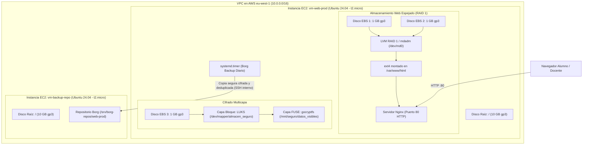

# Trabajo Integrador: Servidor Web Resiliente, Cifrado Multicapa y Backups Remotos (AWS Free Tier)

Este trabajo integrador reúne en un único escenario real todas las tecnologías de administración de almacenamiento, procesos y copias de seguridad de Linux vistas en el curso:
- **Infraestructura como Código (IaC):** Despliegue automatizado en AWS (Free Tier) con Terraform.
- **Tolerancia a fallos de almacenamiento:** RAID 1 espejado en caliente con LVM y con `mdadm` para alojar un servidor Nginx en producción sobre discos EBS.
- **Simulación de fallas y resincronización:** Demostración en vivo de resiliencia ante pérdida de discos.
- **Cifrado en profundidad:** Cifrado a nivel de bloque con **LUKS** combinado con cifrado FUSE a nivel de directorio con **gocryptfs**.
- **Respaldo remoto y deduplicación:** Envío de copias de seguridad con **BorgBackup** hacia un segundo servidor aislado mediante SSH en la misma VPC.
- **Automatización moderna:** Programación de copias y rotación (`prune`) mediante **systemd timers** sin contraseñas en texto plano.
- **Plan de recuperación ante desastres (DRP):** Simulación de borrado catastrófico y restauración completa en minutos.

---

## Arquitectura de la Solución



---

## Fase 1: Despliegue de Infraestructura con Terraform en AWS

El directorio [`terraform/`](terraform/) contiene los manifiestos para levantar ambas instancias en AWS.

### 1.1 Desplegar desde PowerShell en Windows
```powershell
cd linux\administrator\terraform

# Asegurar que se use el perfil autenticado
$env:AWS_PROFILE = "personal"

# Inicializar y desplegar
terraform init
terraform apply -auto-approve
```

### 1.2 Obtener IPs y credenciales
Al finalizar, Terraform generará la clave privada SSH `id_rsa_lab.pem` y mostrará las IPs públicas y privadas:

```powershell
# Ejemplo de salidas generadas:
# vm_web_public_ip    = "54.xxx.xxx.xxx"
# vm_backup_public_ip = "34.xxx.xxx.xxx"
# vm_backup_private_ip = "10.0.1.xxx"
```

Conectate por SSH a la **VM Web** (usando el usuario oficial de AWS `ubuntu`):
```bash
ssh -i id_rsa_lab.pem ubuntu@<IP_PUBLICA_WEB>
```

---

## Fase 2: Identificación de Discos y RAID 1 con LVM

Conectado en la **VM Web** (`vm-web-prod`):

### 2.1 Identificar los discos agregados
```bash
lsblk
```
En Ubuntu sobre AWS EC2, verás el disco raíz (`xvda` o `nvme0n1`) y los **tres discos EBS de 1 GB** adicionales:
- En instancias Xen/t2: suelen llamarse `/dev/xvdh`, `/dev/xvdi`, `/dev/xvdj` (o `/dev/sdh`, `/dev/sdi`, `/dev/sdj`).
- En instancias Nitro/t3: suelen llamarse `/dev/nvme1n1`, `/dev/nvme2n1`, `/dev/nvme3n1`.

> **Definí las variables de disco según lo que muestre tu `lsblk`:**
> ```bash
> DISCO_A="/dev/xvdh"   # (o /dev/nvme1n1) - 1 GB
> DISCO_B="/dev/xvdi"   # (o /dev/nvme2n1) - 1 GB
> DISCO_C="/dev/sdj"    # (o /dev/nvme3n1) - 1 GB
> ```

### 2.2 Crear los Volúmenes Físicos (PV) y el Grupo de Volúmenes (VG)
Inicializamos `DISCO_A` y `DISCO_B` para alojar el sitio web con redundancia:

```bash
sudo pvcreate $DISCO_A $DISCO_B
sudo vgcreate vg_web $DISCO_A $DISCO_B
sudo vgs vg_web
```

### 2.3 Crear el Volumen Lógico en RAID 1 (Mirroring)
LVM permite crear un arreglo RAID 1 nativo con el parámetro `--type raid1 -m 1`:

```bash
# Creamos un LV en espejo de 800MB (para que quepa en los discos de 1GB con margen)
sudo lvcreate --type raid1 -m 1 -L 800M -n lv_web vg_web
```

Verificá el estado del espejo:
```bash
sudo lvs -a -o name,vg_name,attr,size,copy_percent,devices vg_web
```
*(Observá la columna `Cpy%Sync`: debe llegar a `100.00%`, indicando que ambos discos tienen copias idénticas en tiempo real)*.

### 2.4 Formatear ext4 y montar el directorio web
```bash
sudo mkfs.ext4 /dev/vg_web/lv_web
sudo mkdir -p /var/www/html
sudo mount /dev/vg_web/lv_web /var/www/html
df -h /var/www/html
```

### 2.5 Instalar Nginx y publicar el sitio web
```bash
sudo apt update
sudo apt install -y nginx

# Crear una página web visualmente atractiva para la demostración
sudo tee /var/www/html/index.html > /dev/null <<'EOF'
<!DOCTYPE html>
<html>
<head>
    <title>Servidor Web Resiliente - AWS Free Tier</title>
    <style>
        body { font-family: sans-serif; background: #0f172a; color: #f8fafc; text-align: center; padding: 50px; }
        .card { background: #1e293b; border-radius: 12px; padding: 30px; display: inline-block; box-shadow: 0 4px 6px -1px rgba(0,0,0,0.5); }
        .status { color: #22c55e; font-weight: bold; font-size: 1.4rem; }
    </style>
</head>
<body>
    <div class="card">
        <h1>Servidor Web de Producción (AWS EC2)</h1>
        <p>Estado del Almacenamiento: <span class="status">ONLINE (RAID 1 ACTIVO)</span></p>
        <p>Alojado sobre discos EBS espejados con tolerancia a fallas de disco.</p>
    </div>
</body>
</html>
EOF

sudo systemctl restart nginx
```

> **Verificación en el aula**: Abrí `http://<IP_PUBLICA_WEB>` en el navegador. La página web ya está respondiendo desde el arreglo RAID 1 de AWS.

---

## Fase 3: Demostración de Falla de Disco y Comparativa con `mdadm`

### 3.1 Simulación de rotura de disco en LVM RAID 1
Simularemos que el primer disco (`$DISCO_A`) sufre una falla catastrófica (sobrescribiendo sus sectores):

```bash
# Simular corrupción física del disco A
sudo dd if=/dev/urandom of=$DISCO_A bs=1M count=10 oflag=direct
```

Recargá en tu navegador `http://<IP_PUBLICA_WEB>` o hacé `curl -I http://localhost`:
**¡El sitio web sigue respondiendo de inmediato sin ninguna caída!**

Consultá el estado en LVM:
```bash
sudo lvs -a -o +devices vg_web
```
LVM detecta que el sub-volumen de `$DISCO_A` está fallado, pero el servicio se mantiene arriba gracias al espejo en `$DISCO_B`.

---

### 3.2 Alternativa Tradicional: RAID 1 con `mdadm`

Para que los alumnos comprendan cómo se administra un RAID a nivel de bloques tradicional sin LVM:

1. Desmontar `/var/www/html` y limpiar LVM:
```bash
sudo umount /var/www/html
sudo lvremove -y /dev/vg_web/lv_web
sudo vgremove -y vg_web
sudo pvremove -y $DISCO_A $DISCO_B
```

2. Instalar `mdadm` y crear el arreglo RAID 1 `/dev/md0`:
```bash
sudo apt install -y mdadm
sudo mdadm --create --verbose /dev/md0 --level=1 --raid-devices=2 $DISCO_A $DISCO_B
```

3. Observar la sincronización en vivo del kernel:
```bash
cat /proc/mdstat
```

4. Formatear y remontar:
```bash
sudo mkfs.ext4 -F /dev/md0
sudo mount /dev/md0 /var/www/html
sudo systemctl restart nginx
```

5. **Simular disco fallado en caliente con `mdadm`**:
```bash
sudo mdadm /dev/md0 --fail $DISCO_A
cat /proc/mdstat   # Muestra el estado degradado [U_]
```
El sitio web sigue 100% online.

6. **Reemplazar el disco dañado**:
```bash
# Remover el disco roto
sudo mdadm /dev/md0 --remove $DISCO_A

# Insertar el disco de reemplazo (reincorporar DISCO_A)
sudo mdadm /dev/md0 --add $DISCO_A

# Observar la reconstrucción en vivo (Resyncing)
watch -n 1 cat /proc/mdstat
```
*(Presioná `Ctrl+C` para salir de watch)*.

---

## Fase 4: Disco 3 - Cifrado Multicapa (LUKS + gocryptfs)

Usaremos el tercer disco EBS de 1 GB (`$DISCO_C`) para demostrar la estrategia de **cifrado en profundidad**:
1. **LUKS (Capa de Bloque):** Protege ante el robo del disco físico o inspección del hardware apagado (o snapshots en la nube sin clave).
2. **gocryptfs (Capa de Archivos/FUSE):** Protege carpetas de aplicación y credenciales en caliente.

### 4.1 Cifrado de bloque con LUKS
```bash
sudo apt install -y cryptsetup gocryptfs

# 1. Formatear con LUKS (usaremos una contraseña demo: ClaseSegura2026!)
echo -n "ClaseSegura2026!" | sudo cryptsetup luksFormat -q --type luks2 $DISCO_C -

# 2. Abrir el contenedor dm-crypt
echo -n "ClaseSegura2026!" | sudo cryptsetup luksOpen $DISCO_C datos_seguros -

# 3. Formatear el dispositivo virtual mapeado
sudo mkfs.ext4 /dev/mapper/datos_seguros

# 4. Montar el contenedor LUKS
sudo mkdir -p /mnt/almacen_seguro
sudo mount /dev/mapper/datos_seguros /mnt/almacen_seguro
```

### 4.2 Cifrado a nivel de archivos con gocryptfs dentro de LUKS
Dentro del disco seguro, creamos las carpetas para gocryptfs:

```bash
sudo mkdir -p /mnt/almacen_seguro/datos_cifrados
sudo mkdir -p /mnt/almacen_seguro/datos_visibles

# Inicializar gocryptfs con contraseña demo
echo "GocryptClave2026!" | sudo gocryptfs -q -init -extpass "echo GocryptClave2026!" /mnt/almacen_seguro/datos_cifrados

# Montar la carpeta visible con FUSE
sudo gocryptfs -q -extpass "echo GocryptClave2026!" /mnt/almacen_seguro/datos_cifrados /mnt/almacen_seguro/datos_visibles

# Crear credenciales o certificados de prueba
echo "API_KEY_BANCARIA=sk_live_998877665544332211" | sudo tee /mnt/almacen_seguro/datos_visibles/credenciales.env
```

Verificá la diferencia:
- En `/mnt/almacen_seguro/datos_visibles/credenciales.env` se lee el archivo legible.
- En `/mnt/almacen_seguro/datos_cifrados/` solo existen nombres ilegibles y bloques encriptados.

---

## Fase 5: Backup Remoto con Borg hacia la VM de Backup

Ahora conectaremos la **VM Web** con la **VM de Backup** para hacer copias de seguridad remotas y deduplicadas.

### 5.1 Configurar conectividad SSH entre ambas instancias EC2
En la **VM Web**:

```bash
# 1. Generar par de claves SSH en root
sudo ssh-keygen -t ed25519 -N "" -f /root/.ssh/id_ed25519

# 2. Mostrar la clave pública
sudo cat /root/.ssh/id_ed25519.pub
```

Copia esa línea de clave pública. Ahora abrí otra terminal en tu máquina local y conectate a la **VM de Backup**:
```bash
ssh -i id_rsa_lab.pem ubuntu@<IP_PUBLICA_BACKUP>
```

En la **VM de Backup**:
```bash
# Instalar Borg
sudo apt update && sudo apt install -y borgbackup

# Agregar la clave pública de la VM Web a los autorizados
echo "<PEGAR_AQUI_LA_CLAVE_PUBLICA_DE_ROOT>" >> ~/.ssh/authorized_keys

# Crear el directorio raíz para repositorios de respaldo
sudo mkdir -p /srv/borg-repos
sudo chown -R ubuntu:ubuntu /srv/borg-repos
```

### 5.2 Inicializar el Repositorio Borg Remoto (desde la VM Web)
De regreso en la **VM Web**:

```bash
# Definí la IP privada de la VM de backup (visible en la consola de AWS o en las salidas de Terraform):
IP_PRIV_BACKUP="10.0.1.xxx"

# Probar conexión SSH hacia la IP privada de la VM de backup
sudo ssh -o StrictHostKeyChecking=accept-new ubuntu@$IP_PRIV_BACKUP "echo OK"

# Configurar contraseña de cifrado del repositorio Borg
export BORG_PASSPHRASE="SuperSecretoBorg2026!"

# Inicializar el repositorio remoto sobre SSH
sudo -E borg init --encryption=repokey ssh://ubuntu@$IP_PRIV_BACKUP/srv/borg-repos/web-prod
```

### 5.3 Ejecutar el primer backup de producción
Respaldamos el sitio web en RAID, las configuraciones de Nginx y los datos de `gocryptfs`:

```bash
sudo -E borg create --stats --progress \
    ssh://ubuntu@$IP_PRIV_BACKUP/srv/borg-repos/web-prod::"backup-{now:%Y-%m-%d_%H:%M}" \
    /var/www/html \
    /etc/nginx \
    /mnt/almacen_seguro/datos_cifrados
```
*(Observá las estadísticas de deduplicación y compresión en la consola)*.

---

## Fase 6: Automatización Desatendida con systemd Timers

En la **VM Web**:

### 6.1 Crear el archivo de secretos
```bash
sudo mkdir -p /etc/borg
sudo tee /etc/borg/credenciales > /dev/null <<'EOF'
BORG_PASSPHRASE=SuperSecretoBorg2026!
BORG_RSH=ssh -i /root/.ssh/id_ed25519 -o StrictHostKeyChecking=accept-new
EOF

sudo chmod 600 /etc/borg/credenciales
sudo chown root:root /etc/borg/credenciales
```

### 6.2 Crear el script de backup y poda (`prune`)
```bash
sudo tee /usr/local/bin/backup-integrador.sh > /dev/null <<EOF
#!/bin/bash
set -euo pipefail

REPO="ssh://ubuntu@${IP_PRIV_BACKUP}/srv/borg-repos/web-prod"

echo "=== [\$(date)] Iniciando Backup de Produccion hacia \$REPO ==="

# 1. Crear snapshot
borg create --stats \\
    "\$REPO::web-prod-{now:%Y-%m-%d_%H:%M}" \\
    /var/www/html \\
    /etc/nginx \\
    /mnt/almacen_seguro/datos_cifrados

# 2. Poda y política de retención (7 diarios, 4 semanales)
borg prune -v --list --keep-daily=7 --keep-weekly=4 "\$REPO"

echo "=== [\$(date)] Backup finalizado exitosamente ==="
EOF

sudo chmod +x /usr/local/bin/backup-integrador.sh
```

### 6.3 Crear el Service y el Timer de systemd
```bash
# Unidad de Servicio
sudo tee /etc/systemd/system/borg-integrador.service > /dev/null <<'EOF'
[Unit]
Description=Backup Integrador Nginx y Cripto hacia Servidor Remoto
After=network-online.target

[Service]
Type=oneshot
EnvironmentFile=/etc/borg/credenciales
ExecStart=/usr/local/bin/backup-integrador.sh
IOSchedulingClass=idle
CPUSchedulingPolicy=idle
EOF

# Unidad de Temporizador (Timer)
sudo tee /etc/systemd/system/borg-integrador.timer > /dev/null <<'EOF'
[Unit]
Description=Ejecucion automatica diaria del backup de produccion

[Timer]
OnCalendar=*-*-* 03:00:00
Persistent=true

[Install]
WantedBy=timers.target
EOF
```

### 6.4 Activar y probar el servicio
```bash
sudo systemctl daemon-reload
sudo systemctl enable --now borg-integrador.timer

# Disparar una ejecucion manual de prueba para verificar
sudo systemctl start borg-integrador.service

# Ver logs en el Journal
sudo journalctl -u borg-integrador.service -n 30 --no-pager
```

---

## Fase 7: Simulación de Desastre y Restauración Completa

Para cerrar la clase con broche de oro, demostramos a los alumnos cómo recuperarse de un desastre total en producción.

### 7.1 El desastre: Se borra el sitio web accidentalmente
En la **VM Web**:

```bash
# Simular borrado destructivo
sudo rm -rf /var/www/html/*

# Detener o recargar Nginx
sudo systemctl reload nginx
```

Si abrís `http://<IP_PUBLICA_WEB>` en tu navegador, verás un error **403 Forbidden** o **404 Not Found**. El sitio web está caído.

### 7.2 La restauración desde la VM de Backup
En la **VM Web**:

1. Consultar los snapshots disponibles en el servidor remoto:
```bash
export BORG_PASSPHRASE="SuperSecretoBorg2026!"
sudo -E borg list ssh://ubuntu@$IP_PRIV_BACKUP/srv/borg-repos/web-prod
```

2. Extraer y restaurar los archivos del último snapshot:
```bash
# Nos ubicamos en / para que restaure en las rutas absolutas originales
cd /
sudo -E borg extract \
    ssh://ubuntu@$IP_PRIV_BACKUP/srv/borg-repos/web-prod::$(sudo -E borg list --short ssh://ubuntu@$IP_PRIV_BACKUP/srv/borg-repos/web-prod | tail -n 1) \
    var/www/html
```

3. Verificar y reiniciar Nginx:
```bash
ls -lh /var/www/html
sudo systemctl restart nginx
```

> **Verificación final**: Recargá `http://<IP_PUBLICA_WEB>` en el navegador. ¡El sitio web está nuevamente online y los datos fueron recuperados íntegramente desde el servidor de backup remoto!

---

## Fase 8: Destruir la Infraestructura en AWS (Costo Cero)

Al finalizar la práctica o clase, destruí los recursos creados para que no continúen facturando en tu suscripción de AWS:

Desde tu terminal de PowerShell en Windows:
```powershell
cd linux\administrator\terraform
terraform destroy -auto-approve
```
