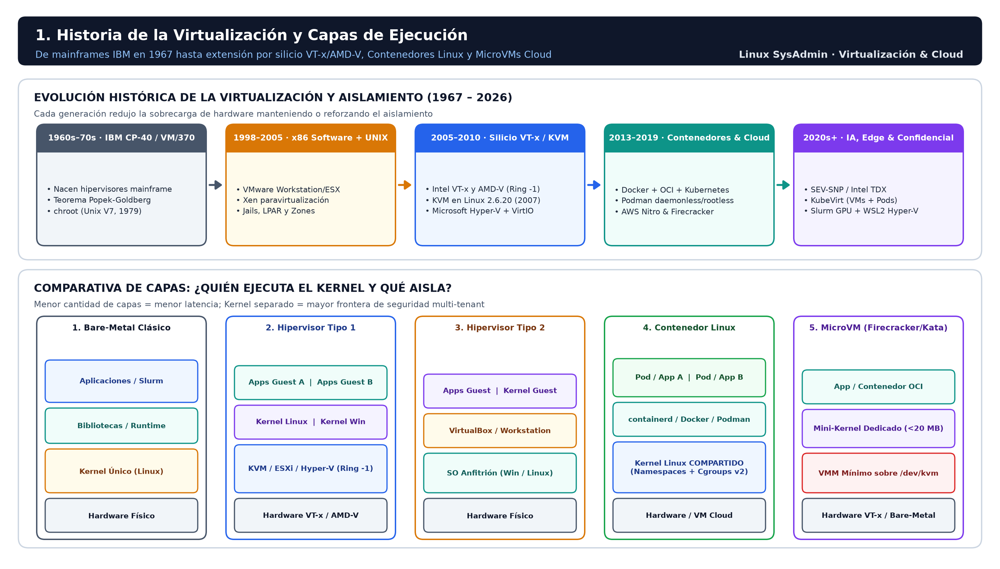
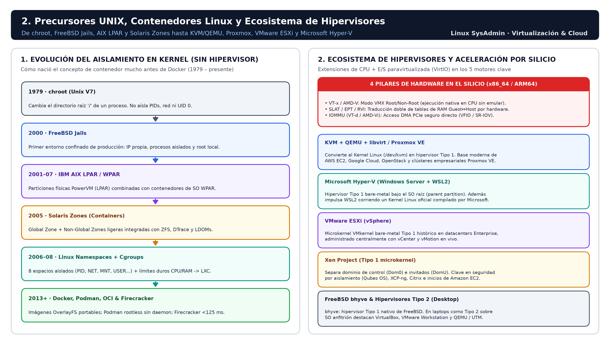
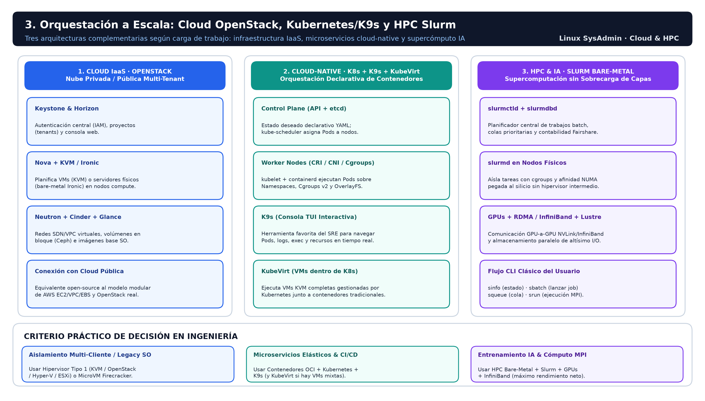
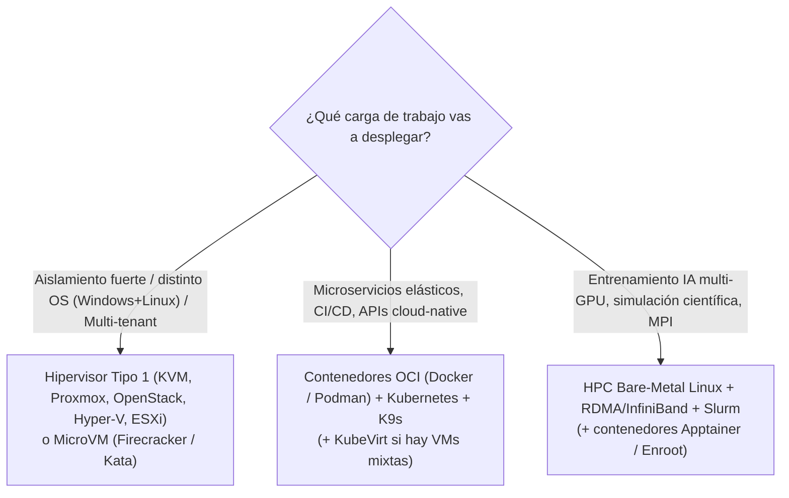

# Virtualización, Contenedores, Cloud y HPC: De IBM VM/370 y los Precursores UNIX hasta KVM, Hyper-V, OpenStack, Kubernetes (`K9s`) y `Slurm`

> *"Virtualizar no es magia ni un único producto: es una decisión de frontera. Podés dividir el hardware físico con asistencia del silicio para correr múltiples kernels independientes, dividir un mismo kernel en compartimentos estancos para miles de procesos, o quitar todas las capas intermedias cuando necesitás exprimir miles de GPUs en un clúster de Inteligencia Artificial."*

Esta guía conecta directamente lo que aprendiste en la [**Guía Maestra del Kernel Linux (1.6)**](../kernel/kernel_arquitectura_historia_guia_maestra.md) con el mapa completo de la infraestructura moderna: cómo nació la virtualización, qué hace realmente la CPU frente al software del kernel, cómo aislaron cargas UNIX/AIX/Solaris/FreeBSD décadas antes de Docker, cómo funcionan **KVM**, **VMware ESXi**, **Microsoft Hyper-V (y WSL2)**, **OpenStack**, **Kubernetes + `K9s` + `KubeVirt`** y, finalmente, por qué la supercomputación y el entrenamiento de IA confían en **`Slurm` HPC** sobre *bare-metal*.

> [!TIP]
> **Guía de lectura ágil para clase:** Cada sigla o tecnología técnica enlaza **en su primera aparición** con una explicación ampliada y enlaces a su documentación oficial dentro del [**Glosario Técnico**](../GLOSARIO.md#virtualización-contenedores-cloud-openstack--kubernetes-y-hpc-slurm).

---

## 🧭 Mapa de Contenidos

1. [Historia de la Virtualización: De los Mainframes IBM (1960s) a Hoy](#-1-historia-de-la-virtualización-de-los-mainframes-ibm-1960s-a-hoy)
2. [¿Hardware, Software o Kernel? Cómo Funciona por Dentro](#-2-hardware-software-o-kernel-cómo-funciona-por-dentro)
3. [Hipervisores Tipo 1 vs. Tipo 2 y Ecosistema Histórico (KVM, ESXi, Xen, Hyper-V/WSL2, bhyve)](#-3-hipervisores-tipo-1-vs-tipo-2-y-ecosistema-histórico)
4. [Precursores UNIX del Aislamiento a Nivel de Kernel (`chroot`, FreeBSD Jails, AIX LPAR, Solaris Zones)](#-4-precursores-unix-del-aislamiento-a-nivel-de-kernel)
5. [Contenedores Modernos en Linux y MicroVMs (`Namespaces`, `Cgroups`, `OCI`, `Podman`, `Firecracker`)](#-5-contenedores-modernos-en-linux-y-microvms)
6. [¿Cómo lo Hace la Nube? Hyperscalers y `OpenStack`](#-6-cómo-lo-hace-la-nube-hyperscalers-y-openstack)
7. [Orquestación Moderna: `Kubernetes`, `K9s` y `KubeVirt`](#-7-orquestación-moderna-kubernetes-k9s-y-kubevirt)
8. [Supercomputación (`HPC`) y `Slurm`: Cuando Cada Microsegundo Cuenta](#-8-supercomputación-hpc-y-slurm-cuando-cada-microsegundo-cuenta)
9. [Árbol de Decisión y Auditoría Práctica de tu Equipo en Terminal](#-9-árbol-de-decisión-y-auditoría-práctica-de-tu-equipo-en-terminal)
10. [Glosario Técnico y Laboratorios Relacionados](#-10-glosario-técnico-y-laboratorios-relacionados)

---

## 📜 1. Historia de la Virtualización: De los Mainframes IBM (1960s) a Hoy

La virtualización **no nació en la era Cloud ni con VMware**: surgió hace casi 60 años por una necesidad económica muy concreta: aprovechar computadoras gigantes (*mainframes*) millonarias que quedaban ociosas ejecutando una sola tarea por vez.



1. **Años 1960s–1970s — IBM CP-40, CP-67 y VM/370:** IBM inventó los primeros hipervisores reales (*Control Program*) para dar a cada investigador universitario su propia "máquina virtual" aislada de tiempo compartido. En 1974, Gerald Popek y Robert Goldberg formalizaron los requisitos matemáticos de CPU para poder virtualizar un procesador limpiamente sin trucos complejos (*requisitos de Popek-Goldberg*).
2. **Años 1980s–1990s — La era PC x86 y el "problema de los anillos":** Cuando llegaron los procesadores Intel x86 de los PCs, **no cumplían el teorema de Popek-Goldberg** (algunas instrucciones privilegiadas fallaban en silencio fuera de Ring 0 en lugar de avisar al hipervisor). En **1998**, **VMware** resolvió el problema mediante **traducción binaria dinámica por software**, interceptando y reescribiendo instrucciones al vuelo para correr múltiples sistemas en servidores x86 estándar. Poco después (**2003**), **Xen** popularizó la **paravirtualización** (modificar ligeramente el kernel invitado para colaborar con el hipervisor).
3. **2005–2010 — La Revolución del Silicio (`VT-x` / `AMD-V`) y `KVM`:** Intel y AMD agregaron soporte directo de virtualización dentro del procesador físico (**2005–2006**), acabando con los malabares de software. En **2007**, **KVM** entró al kernel oficial Linux `2.6.20`, convirtiendo al propio Linux en hipervisor de clase empresarial. En **2008**, Microsoft lanzó **Hyper-V**.
4. **2013–2019 — Contenedores e Hiperescaladores (`Docker`, `Kubernetes`, `AWS Nitro`):** En paralelo, tecnologías de aislamiento ligero dentro del kernel dieron vida a Docker (`2013`) y Kubernetes (`2014`), mientras nubes como AWS descargaron virtualización de red y discos a tarjetas de hardware dedicadas (**Nitro**) e introdujeron microVMs minimalistas (**Firecracker**).
5. **2020s+ — Cómputo Confidencial, Unificación y Clusters de IA (`Slurm`):** Hoy conviven [**Confidential Computing**](../GLOSARIO.md#confidential-computing-amd-sev-snp-e-intel-tdx) (RAM de VMs cifrada por hardware con AMD SEV-SNP / Intel TDX), máquinas virtuales dentro de Kubernetes (**KubeVirt**), kernels Linux corriendo dentro de Hyper-V en Windows (**WSL2**) y superclusters bare-metal de GPUs gobernados por **Slurm**.

---

## ⚙️ 2. ¿Hardware, Software o Kernel? Cómo Funciona por Dentro

Una duda clásica en clase es: **"¿la virtualización la hace el hardware o el kernel?"**. La respuesta precisa es que **trabajan en equipo**: sin el silicio de la CPU sería lentísimo, pero sin el código del kernel/hipervisor no habría quien coordine memoria, discos ni redes.

### 2.1 Los 4 Mecanismos de Hardware + Kernel
- [**Extensiones de CPU (`Intel VT-x` / `AMD-V`)**](../GLOSARIO.md#virtualización-asistida-por-hardware-intel-vt-x-amd-v-slatept-e-iommu): Crean un modo de ejecución extra debajo de Ring 0 —informalmente llamado **"Ring -1"** (*VMX Root Mode*)— para el hipervisor. Así el kernel invitado (*Guest*) corre en su propio Ring 0 virtual (*VMX Non-Root Mode*) **a velocidad nativa de CPU**; solo cuando toca hardware real o puertos restringidos ocurre una trampa rápida llamada *VM-Exit*.
- [**SLAT (`EPT` / `RVI`)**](../GLOSARIO.md#virtualización-asistida-por-hardware-intel-vt-x-amd-v-slatept-e-iommu): El proceso invitado cree usar memoria virtual → memoria física de su VM → memoria física real del servidor. Con *Second Level Address Translation* en la **MMU** física, esa doble traducción se resuelve en silicio sin castigar el rendimiento.
- [**IOMMU (`VT-d` / `AMD-Vi`)**](../GLOSARIO.md#virtualización-asistida-por-hardware-intel-vt-x-amd-v-slatept-e-iommu): Traduce direcciones DMA de tarjetas físicas PCIe, habilitando entregar una GPU o placa NVMe entera directamente a una VM ([**VFIO**](../GLOSARIO.md#sr-iov-y-vfio-pcie-passthrough)) o partir una NIC física en múltiples interfaces virtuales por hardware ([**SR-IOV**](../GLOSARIO.md#sr-iov-y-vfio-pcie-passthrough)).
- **Rol del Kernel del Anfitrión:** En el caso de Linux (**KVM**), el módulo del kernel `kvm.ko` / `kvm_intel.ko` / `kvm_amd.ko` expone `/dev/kvm`, programa las vCPUs dentro del planificador estándar de Linux y coordina interrupciones e I/O con procesos en espacio de usuario como `QEMU`.

### 2.2 Cuatro Técnicas para Presentar Hardware al Invitado

| Técnica | Cómo Funciona | Velocidad / Latencia | Caso de Uso Típico |
| :--- | :--- | :---: | :--- |
| **1. Emulación Pura** | Todo (CPU incluida) se interpreta por software (ej. correr ARM64 en una laptop x86 con `qemu-system-aarch64`). | 🐢 Lenta | Pruebas multi-arquitectura, IoT embebido sin hardware físico. |
| **2. Virtualización Completa** | CPU acelerada por `VT-x`/`AMD-V`, pero discos y red emulan tarjetas reales viejas (`IDE`, `Intel e1000`). | 🟡 Media (muchos *VM-Exits*) | Sistemas antiguos sin drivers modernos (ej. Windows XP, DOS, ISOs viejas). |
| **3. [Paravirtualización (`VirtIO`)](../GLOSARIO.md#virtualización-completa-paravirtualización-virtio-y-emulación)** | El kernel invitado sabe que es una VM y usa drivers cooperativos (`virtio_blk`, `virtio_net`, `virtio_scsi`) que intercambian colas rápidas en RAM. | 🚀 Muy Alta | **Estándar en producción Cloud**, KVM, QEMU, OpenStack y Proxmox VE. |
| **4. Passthrough (`VFIO` / `SR-IOV`)** | La tarjeta PCIe real (o una Virtual Function suya) se asigna en exclusiva al Guest saltándose emulación del hipervisor. | ⚡ ~99% Bare-Metal | GPUs para IA/render en nube y tarjetas de red 25/100 Gbps ultrarrápidas. |

---

## 🖥️ 3. Hipervisores Tipo 1 vs. Tipo 2 y Ecosistema Histórico

A lo largo de las últimas dos décadas se consolidaron dos categorías clásicas definidas por **qué tan cerca del metal corre el hipervisor**:

- [**Hipervisor Tipo 1 (*Bare-Metal / Nativo*)**](../GLOSARIO.md#hipervisor-tipo-1-bare-metal-vs-tipo-2-hosted): Arranca directamente sobre el servidor físico (o integra el propio kernel como hipervisor). No carga entorno gráfico pesado ni aplicaciones de oficina debajo. Es el estándar absoluto de datacenters y nubes.
- [**Hipervisor Tipo 2 (*Hosted*)**](../GLOSARIO.md#hipervisor-tipo-1-bare-metal-vs-tipo-2-hosted): Es una aplicación instalada encima de un sistema operativo completo de escritorio (Windows, macOS o Linux). Muy cómodo para practicar en tu laptop, con mayor latencia que un Tipo 1.



| Tecnología / Motor | Tipo | Origen y Arquitectura Técnica Real | Uso Actual e Impacto |
| :--- | :---: | :--- | :--- |
| [**KVM + QEMU (+ libvirt / Proxmox VE)**](../GLOSARIO.md#kvm-qemu-libvirt-y-proxmox-ve) | **Tipo 1** *(Kernel Linux)* | El kernel Linux actúa como hipervisor bare-metal (`/dev/kvm`); `QEMU` maneja periféricos y `libvirt`/`virsh` (o **Proxmox VE**) gestionan redes, snapshots ZFS/Ceph y alta disponibilidad. | Motor dominante en **AWS Nitro, GCP, OpenStack, OpenShift Virtualization y Proxmox**. |
| [**VMware ESXi (`vSphere`)**](../GLOSARIO.md#xen-vmware-esxi-microsoft-hyper-v-y-wsl2) | **Tipo 1** | Hipervisor propietario con microkernel propio (`VMkernel`). Marcó el estándar corporativo on-premise durante 20 años con `vCenter` y `vMotion` en vivo. | Datacenters empresariales tradicionales; muchos hoy migran hacia KVM/Proxmox/OpenStack/KubeVirt tras cambios de licenciamiento. |
| [**Xen Project**](../GLOSARIO.md#xen-vmware-esxi-microsoft-hyper-v-y-wsl2) | **Tipo 1** *(Microkernel)* | Un microkernel mínimo separa un dominio de control privilegiado (`Dom0`) de los invitados (`DomU`). Fue el pilar original de **AWS EC2 (2006)** antes de migrar a Nitro/KVM. | Base de **Citrix Hypervisor / XCP-ng** y estaciones ultraseguras como **Qubes OS**. |
| [**Microsoft Hyper-V (y WSL2)**](../GLOSARIO.md#xen-vmware-esxi-microsoft-hyper-v-y-wsl2) | **Tipo 1** | **Mito común:** mucha gente cree que Hyper-V es Tipo 2 por habilitarlo desde Windows. En realidad, al activarlo, Hyper-V toma control del silicio debajo del arranque y degrada al propio Windows anfitrión a una *"parent partition"* virtualizada. | Impulsa centros de datos Windows Server, **Microsoft Azure** y tu entorno local de [**WSL2**](../GLOSARIO.md#xen-vmware-esxi-microsoft-hyper-v-y-wsl2) ejecutando un Kernel Linux oficial compilado por Microsoft. |
| [**FreeBSD `bhyve`**](../GLOSARIO.md#freebsd-jails-y-bhyve) | **Tipo 1** | Hipervisor moderno e integrado en el sistema base de **FreeBSD** (soporta `VT-x`, `VirtIO`, `UEFI` y passthrough PCI con código compacto). | Appliances, soluciones ZFS (*TrueNAS*) y alojamiento BSD limpio. |
| **VirtualBox / VMware Workstation / UTM** | **Tipo 2** | Software de escritorio corriendo sobre Windows, macOS o Linux desktop (`vboxdrv`, interfaces gráficas). | Ideal para laboratorios locales de escritorio en laptops personales. |

---

## 🏛️ 4. Precursores UNIX del Aislamiento a Nivel de Kernel

Mucho antes de que **Docker** popularizara los contenedores en 2013, los ingenieros de UNIX ya habían descubierto que **virtualizar hardware completo es costoso** si todas las máquinas van a correr el mismo sistema operativo. Así nació el aislamiento ligero en el propio kernel:

1. **`chroot` (UNIX Version 7, 1979):** El abuelo de todo. Cambia el directorio raíz (`/`) que ve un proceso mediante la syscall `chroot()`. Útil para recuperación de sistemas o enjaular un FTP básico, pero **no era seguridad real**: no aislaba PIDs, ni red, ni memoria, y un usuario `root` podía escapar fácilmente.
2. [**FreeBSD Jails (FreeBSD 4.0, 2000)**](../GLOSARIO.md#freebsd-jails-y-bhyve): Creadas por Poul-Henning Kamp para proveedores de hosting compartido. Fue la **primera tecnología masiva de contenedores seguros en producción**: cada *Jail* tenía su propio árbol de sistema, dirección IP asignada, procesos visibles aislados e incluso un `root` local que no podía tocar el host ni escapar al árbol global.
3. [**IBM AIX `LPAR`, `DLPAR` y `WPAR`**](../GLOSARIO.md#aix-lpar-y-wpar-ibm-powervm): En el mundo enterprise IBM Power, una **`LPAR`** (*Logical Partition*) divide físicamente el hardware/firmware (Hipervisor **PowerVM**) en máquinas independientes capaces de reasignar CPU y RAM en caliente (**`DLPAR`**); más tarde **AIX 6.1 (2007)** incorporó **`WPAR`** (*Workload Partitions*), contenedores ligeros compartiendo el mismo kernel AIX con migración en vivo.
4. [**Sun / Oracle Solaris `Zones` (Containers) & `LDOMs` (2005)**](../GLOSARIO.md#solaris-zones-containers-y-ldoms): **Solaris 10** llevó el concepto a grado bancario combinando una **`Global Zone`** administrativa con docenas de **`Non-Global Zones`** aisladas integradas directamente con **ZFS**, control granular de recursos y observabilidad con DTrace (mientras **LDOMs** proveía hipervisor completo en procesadores SPARC).

---

## 📦 5. Contenedores Modernos en Linux y MicroVMs

Linux estudió esas ideas de FreeBSD Jails y Solaris Zones, pero en lugar de crear una única syscall rígida llamada `"crear_contenedor"`, construyó **piezas modulares combinables en el kernel** (`2006–2013`) que terminaron originando LXC, Docker, Podman y Kubernetes:

| Pieza del Kernel / Ecosistema | Qué Problema Resuelve Exactamente | Comando / Ruta Clave en Linux |
| :--- | :--- | :--- |
| [**Namespaces (`mount`, `pid`, `net`, `ipc`, `uts`, `user`, `cgroup`, `time`)**](../GLOSARIO.md#contenedores-linux-chroot-namespaces-cgroups-v2-oci-docker-y-podman) | Define **"qué puede ver"** un proceso: su propia tabla de PIDs (`PID 1`), sus interfaces de red (`veth`), sus montajes e incluso mapeo seguro de UID (`user namespace`). | `unshare`, `nsenter`, `lsns`, `/proc/<PID>/ns/` |
| [**`Cgroups v2` (*Control Groups*)**](../GLOSARIO.md#contenedores-linux-chroot-namespaces-cgroups-v2-oci-docker-y-podman) | Define **"cuánto hardware puede consumir"** un grupo de procesos: topes estrictos de CPU, RAM, I/O de bloque y número de procesos (*fork bombs*). | `/sys/fs/cgroup/`, `systemd-run` (ver [Lab 2.3](../systemd/systemd-cgroups.md)) |
| **`OverlayFS` + `seccomp-bpf` + Capabilities** | `OverlayFS` apila capas inmutables de imagen (`LowerDir`) + capa de escritura (`UpperDir`); `seccomp` filtra `syscalls` peligrosas y Capabilities fragmenta privilegios de `root`. | `/proc/<PID>/status` (`CapEff`, `Seccomp`) |
| **Estándar `OCI`, Docker vs. Podman** | **`OCI`** estandarizó imágenes y runtimes (`runc`, `crun`). **Docker** usa demonio central `dockerd` + `containerd`; **Podman** es *daemonless* y corre contenedores **rootless** sin privilegios de administrador en el host. | `docker ps`, `podman run`, `containerd` |

### El Eslabón Perdido: MicroVMs y Sandboxes ([`Firecracker`](../GLOSARIO.md#microvms-y-sandboxes-firecracker-kata-containers-y-gvisor), `Kata`, `gVisor`)
Como un contenedor clásico **comparte el mismo kernel Linux con todos sus vecinos**, si un atacante explota un bug en una syscall del núcleo dentro de un contenedor comprometido, puede escalar hacia el servidor físico. En entornos **multi-tenant públicos** (donde corrés código de clientes desconocidos, Serverless o agentes de IA) nació una capa híbrida:
- **AWS Firecracker:** Lanza microVMs sobre `/dev/kvm` con un mini-kernel de `< 20 MB` sin BIOS ni USB emulado en **~125 ms** (impulsa AWS Lambda y Fargate).
- **Kata Containers:** Envuelve cada contenedor estándar de Kubernetes dentro de su propia microVM KVM dedicada manteniendo compatibilidad OCI.
- **gVisor (Google):** Intercepta las syscalls del contenedor desde un núcleo seguro escrito en Go antes de tocar el kernel real del host.

---

## ☁️ 6. ¿Cómo lo Hace la Nube? Hyperscalers y `OpenStack`

Cuando creás una instancia EC2 en **AWS**, una VM en **Azure** o un Compute Engine en **Google Cloud**, la nube pública no usa "una instalación mágica de Linux": orquesta **miles de servidores físicos bare-metal** con software de control distribuido:
- **AWS Nitro System:** Descarga la virtualización de red (`VPC`), cifrado e I/O de discos (`EBS`) a tarjetas hardware ASIC dedicadas para que el hipervisor KVM apenas consuma CPU y entregue el ~100% del servidor al cliente.
- [**OpenStack (La Nube Privada e Híbrida Abierta)**](../GLOSARIO.md#cloud-iaas-y-openstack-nova-neutron-cinder-glance-keystone): Es el gran proyecto open-source que replica esa misma arquitectura IaaS modular para bancos, telcos 5G, universidades y datacenters propios mediante piezas desacopladas:
  - **`Keystone`:** Identidad y permisos (equivalente al IAM).
  - **`Nova`:** Planificador de cómputo (crea VMs KVM/libvirt o aprovisiona servidores físicos puros con **`Ironic`**).
  - **`Neutron`:** Redes virtuales SDN, routers, VPCs y grupos de seguridad.
  - **`Glance` + `Cinder` + `Swift`:** Catálogo de imágenes SO, discos en bloque persistentes (usualmente respaldados por clústeres **Ceph**) y almacenamiento de objetos tipo S3.
  - **`Horizon`:** Panel web de autoservicio.

*(En infraestructura de escala mediana, **Proxmox VE** y **Apache CloudStack** ofrecen alternativas mucho más livianas de operar que un OpenStack completo).*

---

## ☸️ 7. Orquestación Moderna: `Kubernetes`, `K9s` y `KubeVirt`



A medida que las empresas pasaron de decenas de VMs monolíticas a miles de microservicios en contenedores, necesitaban una plataforma automática que decidiera en qué nodo corre cada contenedor, lo reiniciara si caía y escalara copias según CPU o red:

- [**Kubernetes (`K8s`)**](../GLOSARIO.md#orquestación-kubernetes-k8s-k9s-y-kubevirt): Un clúster divide responsabilidades entre el **Control Plane** (`kube-apiserver`, `etcd`, `kube-scheduler`, `controller-manager`) —donde declarás en YAML el estado deseado— y los **Worker Nodes**, donde cada `kubelet` coordina el runtime (`containerd`/`CRI-O`), la red (**CNI**, muchas veces acelerada hoy con **eBPF/Cilium**) y el almacenamiento persistente (**CSI**).
- [**`K9s` (La Consola TUI Favorita en Producción)**](../GLOSARIO.md#orquestación-kubernetes-k8s-k9s-y-kubevirt): Quien trabaja todo el día con Kubernetes rara vez tipea 50 veces seguidas comandos largos de `kubectl get pods -n ...`. **`k9s`** ofrece una interfaz de terminal interactiva en vivo (*estilo `htop`/`top` para clústeres K8s*) donde cambiás entre Pods, Deployments, Nodes, Secretos o CRDs con atajos rápidos, abrís logs en tiempo real (`l`), entrás en shell dentro de un contenedor (`s`), editás manifiestos o inspeccionás recursos de **CPU/RAM (`cgroups`)** en segundos.
- [**`KubeVirt`**](../GLOSARIO.md#orquestación-kubernetes-k8s-k9s-y-kubevirt): Cuando una empresa adopta Kubernetes pero todavía necesita correr VMs completas heredadas (ej. Windows Server, firewalls virtuales o kernels especiales), **`KubeVirt`** permite levantar máquinas virtuales **KVM/QEMU envueltas como Pods** manejadas por la misma API YAML, red e incluso desde el mismo tablero **`k9s`**. *(Es la base de **OpenShift Virtualization** y **Harvester**).*

---

## 🚀 8. Supercomputación (`HPC`) y `Slurm`: Cuando Cada Microsegundo Cuenta

Si la nube moderna gira en torno a VMs y contenedores Kubernetes, ¿por qué los supercomputadores científicos y los grandes clústeres de entrenamiento de **Inteligencia Artificial** usan un paradigma distinto llamado [**HPC (*High-Performance Computing*)**](../GLOSARIO.md#hpc-high-performance-computing-y-slurm) y un planificador llamado **`Slurm`**?

Porque sus problemas son opuestos a los de un servidor web:
- En un backend web querés **aislar** miles de clientes independientes y **sobrevender** CPU ociosa.
- En un trabajo **MPI / IA distribuido** usando 256 GPUs a la vez, si un proceso se retrasa 2 milisegundos por culpa de un cambio de contexto de hipervisor, **las otras 255 GPUs quedan esperando paradas**.

### Anatomía Práctica de `Slurm` (*Simple Linux Utility for Resource Management*)
1. **Arquitectura sin capa de hipervisor (Bare-Metal + Linux + Hardware Dedicado):** Los nodos de cómputo ejecutan Linux directamente sobre el hierro con redes de bajísima latencia (**InfiniBand / RDMA**), enlaces NVLink entre GPUs y filesystems paralelos (**Lustre**, **GPFS**). Para reproducibilidad de software sin sobrecarga de VM, hoy se combinan con contenedores HPC rootless como **Apptainer (Singularity)** o **Enroot**.
2. **Componentes principales de Slurm:**
   - **`slurmctld`:** Cerebro central de planificación y colas (*Head Node*).
   - **`slurmd`:** Demonio ligero en cada nodo de cómputo que lanza tareas asignadas y las encierra estrictamente en núcleos/GPUs/RAM exactos usando **`cgroups`** y afinidad **NUMA** del kernel Linux.
   - **`slurmdbd`:** Base de datos de contabilidad y prioridades equitativas (*Fairshare*) por grupo investigador o proyecto.
3. **Los 4 Comandos Universales del Usuario HPC:**
   ```bash
   sinfo                  # Ver particiones (colas) y nodos/GPUs libres o ocupados
   sbatch mi_entrenamiento.sh   # Enviar un trabajo batch a la cola (especificando #SBATCH --gpus=4)
   squeue -u $USER        # Monitorear trabajos en cola (PENDING) o corriendo (RUNNING)
   srun --pty bash        # Pedir una sesión interactiva directa en un nodo con recursos reservados
   ```

### Matriz Comparativa Final: VMs vs. Contenedores/K8s vs. HPC/`Slurm`

| Criterio | Virtualización Clásica (VMs KVM / ESXi / OpenStack) | Contenedores & Orquestación (`K8s` / `K9s`) | Supercómputo (`HPC` + `Slurm`) |
| :--- | :--- | :--- | :--- |
| **Unidad mínima** | Máquina Virtual completa (kernel + OS propio). | Pod / Contenedor (procesos aislados compartiendo kernel). | Job paralelo multi-nodo (MPI, OpenMP, PyTorch distribuido). |
| **Tiempo de arranque** | Segundos a minutos *(o ~125 ms en Firecracker)*. | Milisegundos a segundos. | Cola de espera hasta haber silicio libre; luego ejecución nativa directa. |
| **Modelo de ejecución** | Servicios de larga vida, distintos OS (Windows + Linux), *multi-tenant* estricto. | Microservicios sin estado, HTTP/APIs, autoscaling 24/7. | Trabajos *batch* finitos con principio y fin consumiendo todo el nodo/GPU. |
| **Red y Almacenamiento** | Virtual switches / SDN (`Neutron`), volúmenes (`EBS`, `Cinder`). | CNI overlay / `eBPF Cilium`, volúmenes CSI. | **RDMA / InfiniBand**, NVLink y filesystems paralelos (`Lustre`, `BeeGFS`). |
| **Convergencia hoy** | `OpenStack` + `KubeVirt` unifican gestión declarativa de VMs y contenedores. | Clústeres GPU en K8s conviven con entrenamiento puro. | `Slurm` integra **Apptainer / Pyxis** para correr imágenes Docker sin pérdida de rendimiento. |

---

## 🔍 9. Árbol de Decisión y Auditoría Práctica de tu Equipo en Terminal

### Árbol de Decisión Rápida: ¿Qué Tecnología Elegir?



### Comandos Rápidos para Auditar Hoy tu Laptop o Servidor
Podés ejecutar estos comandos inocuos en solo lectura para comprobar qué soporte de virtualización tiene tu máquina y si ahora mismo estás dentro de un hipervisor o contenedor:

```bash
# 1. Comprobar soporte por hardware en CPU (vmx = Intel VT-x | svm = AMD-V)
lscpu | grep -iE 'Virtualization|Hypervisor|Model name|Architecture'
grep -E -c '(vmx|svm)' /proc/cpuinfo

# 2. Detectar si el sistema actual corre sobre bare-metal, VM (kvm/microsoft/vmware) o contenedor
systemd-detect-virt || echo "Bare-metal físico"

# 3. Verificar si el módulo KVM del kernel está activo y expuesto en /dev/kvm
lsmod | grep -E 'kvm|hv_vmbus|virtio'
ls -l /dev/kvm 2>/dev/null || echo "/dev/kvm no presente (sin permiso, contenedor o CPU sin nested virt)"
```

---

## 🔗 10. Glosario Técnico y Laboratorios Relacionados

Para seguir profundizando paso a paso con el código fuente y las demostraciones en vivo del repositorio:

- 📖 **Glosario Completo y Documentación Oficial:** [**Virtualización, Contenedores, Cloud (OpenStack / K8s) y HPC (Slurm)**](../GLOSARIO.md#virtualización-contenedores-cloud-openstack--kubernetes-y-hpc-slurm).
- 🐧 **Base de Sistema Operativo:** [**Lab 1.6: Guía Maestra del Kernel Linux (Incluye Familias UNIX, AIX, BSD, Solaris, Windows y Android)**](../kernel/kernel_arquitectura_historia_guia_maestra.md).
- ⚙️ **Cgroups v2 en Vivo:** [**Lab 2.3: Gobernanza de Recursos con Cgroups v2**](../systemd/systemd-cgroups.md).
- 🧪 **QEMU/KVM + Mini-OS + `initramfs`:** [**Lab 3.24: Compilación de Kernel y Demostración en 2 Actos en QEMU/KVM**](../kernel/compilacion_kernel_initramfs.md).
- 🐳 **Contenedores + Almacenamiento Empresarial:** [**Integrador 4.2: Docker Engine LVM Hot-Mirror, MySQL RAID 1 y AWS S3**](../trabajo_integrador_docker/trabajo_integrador_docker.md).
